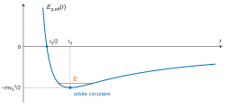
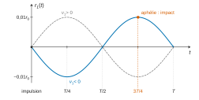
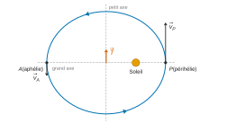
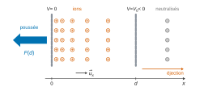
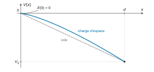
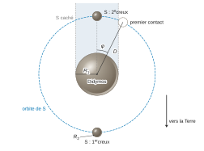

# X-ENS MPI — Physique MPI 2026 · Corrigé brut

*Corrigé rédigé par IA, non officiel. Signalez toute erreur.*

**Déviation d'un astéroïde par percussion.** Durée 4 h, calculatrice interdite. Données : $r_0=150\times10^6$ km et $v_0=30$ km·s$^{-1}$, orbite terrestre circulaire.

On note $M_\odot$ la masse du Soleil. Pour l'orbite terrestre, $GM_\odot=v_0^2r_0$.

## I — Orbite de Didymos autour du Soleil

### Question 1

La force de gravitation exercée par le Soleil (origine $O$) est **centrale** : son moment en $O$ est nul. Le théorème du moment cinétique, dans le référentiel héliocentrique supposé galiléen, donne alors

$$\frac{\mathrm d\vec L_O}{\mathrm dt}=\vec 0 .$$

Le vecteur $\vec L_O=\vec r\wedge m\vec v$ est donc constant. Le vecteur position $\vec r$ reste orthogonal à ce vecteur fixe : le mouvement a lieu dans le plan passant par le Soleil et orthogonal à $\vec L_O$.

**Principe : conservation du moment cinétique (force centrale).**

### Question 2

La trajectoire de Didymos est une ellipse dont le Soleil occupe un **foyer** (et non le centre). Les distances au Soleil au périhélie et à l'aphélie sont $r_{\min}$ et $r_{\max}$, et le grand axe vaut leur somme.

La figure 1 donne la distance Terre–Didymos $d$. Elle est maximale quand Didymos est à son aphélie et que la Terre est de l'autre côté du Soleil, alignée avec lui :

$$d_{\max}=r_{\max}+r_0 .$$

La figure donne $d_{\max}\simeq3{,}25\,r_0$, donc $r_{\max}\simeq2{,}25\,r_0$. Le demi-grand axe est la demi-somme des distances extrêmes au Soleil :

$$\boxed{a=\frac{r_{\min}+r_{\max}}{2}\simeq\frac{1{,}01+2{,}25}{2}\,r_0\simeq1{,}6\,r_0}$$

### Question 3

Troisième loi de Kepler : $T^2/a^3$ a la même valeur pour tous les corps en orbite autour du Soleil, en particulier pour la Terre ($a_\oplus=r_0$, $T_\oplus=1$ an) et Didymos. Sans faire intervenir $G$ ni $M_\odot$ :

$$\begin{aligned}
\left(\frac{T}{1\ \text{an}}\right)^2&=\left(\frac{a}{r_0}\right)^3\\
T&=(1{,}63)^{3/2}\ \text{an}\\
&\approx\sqrt{4{,}3}\ \text{an}
\end{aligned}$$

$$\boxed{T\approx2{,}1\ \text{ans}}$$

### Question 4

Les rapprochements Terre–Didymos (minima de $d$) ne se répètent pas avec la période $T$. Ils se répètent avec la période synodique $P_{\text{syn}}$, durée au bout de laquelle la Terre a fait un tour de plus que Didymos :

$$\begin{aligned}
\frac{1}{P_{\text{syn}}}&=\frac{1}{T_\oplus}-\frac{1}{T}\\
P_{\text{syn}}&=\frac{T}{T-1}\approx\frac{2{,}1}{1{,}1}\ \text{an}\approx1{,}9\ \text{an}
\end{aligned}$$

Sur la figure, les rapprochements très profonds (Didymos à son périhélie au moment où la Terre passe à proximité) ont lieu vers 2004 et vers 2023, à environ 19 ans d'intervalle. On compte 10 maxima principaux entre eux, d'où $P_{\text{syn}}\approx19/10=1{,}9$ an. On en tire $T=P_{\text{syn}}/(P_{\text{syn}}-1)\approx2{,}1$ ans.

De façon équivalente, la configuration se reproduit quand la durée écoulée contient à la fois un nombre entier d'années et de périodes de Didymos : $19\ \text{ans}\approx9\,T$ donne $T\approx2{,}1$ ans. Les 19 ou 20 ans de l'enveloppe ne sont donc pas la période de Didymos, mais la durée de retour de la configuration Terre–Didymos.

**L'estimation de la question 3 est validée.**

## II — Orbite de DART autour du Soleil

### Question 5

Sur une orbite circulaire de rayon $r_0$, le principe fondamental de la dynamique projeté sur $\vec e_r$ donne

$$\frac{mv^2}{r_0}=\frac{GM_\odot m}{r_0^2}$$

soit

$$v=\sqrt{\frac{GM_\odot}{r_0}} .$$

La masse $m$ de l'engin s'élimine : la vitesse ne dépend que de $M_\odot$, de $G$ et du rayon. Elle est donc la même que celle de la Terre :

$$\boxed{v=v_0=30\ \text{km·s}^{-1}}$$

### Question 6

L'impulsion est parallèle à la direction du Soleil : la force qui la produit a un moment nul en $O$. Le théorème du moment cinétique donne $\Delta\vec L=\vec 0$.

On le vérifie directement : juste après l'impulsion, la position est inchangée ($r=r_0$) et la vitesse orthoradiale aussi ($v_\theta=v_0$), donc $L=mr\,v_\theta$ ne change pas.

$$\boxed{\Delta\vec L=\vec 0}$$

$$\boxed{L=mr_0v_0}$$

### Question 7

L'impulsion est brève : la vitesse change instantanément, la position ne change pas. L'énergie potentielle gravitationnelle est donc inchangée.

Les vecteurs $\vec v_0=v_0\vec e_\theta$ et $\vec v_1=v_1\vec e_r$ sont orthogonaux, le produit scalaire croisé est nul : $(\vec v_0+\vec v_1)^2=v_0^2+v_1^2$. L'énergie cinétique passe de $\frac12mv_0^2$ à $\frac12m(v_0^2+v_1^2)$ :

$$\boxed{\Delta E=\tfrac12mv_1^2>0}$$

Pour une orbite képlérienne, l'énergie mécanique fixe le demi-grand axe : $E=-\dfrac{GM_\odot m}{2a}$. Avant l'impulsion, $E_0=-\frac12mv_0^2$ et $a_0=r_0$. Donc

$$\frac{\Delta a}{a}\simeq-\frac{\Delta E}{E_0}=\frac{v_1^2}{v_0^2} .$$

La variation est du second ordre en $|v_1|/v_0$. Au premier ordre,

$$\boxed{\Delta a=0}$$

le demi-grand axe reste $r_0$. L'expression exacte est $a=r_0/(1-v_1^2/v_0^2)$.

### Première méthode : utilisation de l'énergie potentielle effective

### Question 8

En coordonnées polaires, l'énergie mécanique s'écrit

$$E=\tfrac12m(\dot r^2+r^2\dot\theta^2)-\frac{GM_\odot m}{r} .$$

Le moment cinétique $L=mr^2\dot\theta$ est constant, donc $\frac12mr^2\dot\theta^2=\dfrac{L^2}{2mr^2}$. Il vient $E=\frac12m\dot r^2+E_{p,\text{eff}}(r)$ avec

$$E_{p,\text{eff}}(r)=\frac{L^2}{2mr^2}-\frac{GM_\odot m}{r} .$$

Avec $L=mr_0v_0$ et $GM_\odot=v_0^2r_0$ :

$$\boxed{E_{p,\text{eff}}(r)=\frac{mv_0^2r_0^2}{2r^2}-\frac{mv_0^2r_0}{r}}$$

### Question 9

Une orbite circulaire correspond à $r$ constant, donc à une position d'équilibre du mouvement radial. C'est la **dérivée** de $E_{p,\text{eff}}$ qui s'annule :

$$\begin{aligned}
E_{p,\text{eff}}'(r)&=-\frac{mv_0^2r_0^2}{r^3}+\frac{mv_0^2r_0}{r^2}\\
&=\frac{mv_0^2r_0}{r^2}\left(1-\frac{r_0}{r}\right)
\end{aligned}$$

Cette dérivée s'annule si et seulement si $r=r_0$ : on retrouve le rayon de l'orbite terrestre.

C'est un minimum : $E_{p,\text{eff}}'<0$ pour $r<r_0$ et $E_{p,\text{eff}}'>0$ pour $r>r_0$. L'équilibre est stable.

Allure (figure 1) : $E_{p,\text{eff}}\to+\infty$ en $r\to0$ et $E_{p,\text{eff}}\to0^-$ à l'infini.

### Question 10

On dérive par rapport au temps l'énergie $E=\frac12m\dot r^2+E_{p,\text{eff}}(r)$, constante. Pour $\dot r\neq0$ :

$$m\ddot r=-E_{p,\text{eff}}'(r) .$$

On pose $r=r_0+r_1$. Le développement limité au premier ordre en $r_1$ donne $E_{p,\text{eff}}'(r_0+r_1)\simeq E_{p,\text{eff}}''(r_0)\,r_1$, puisque $E_{p,\text{eff}}'(r_0)=0$. Or

$$\begin{aligned}
E_{p,\text{eff}}''(r_0)&=\frac{3mv_0^2r_0^2}{r_0^4}-\frac{2mv_0^2r_0}{r_0^3}\\
&=\frac{mv_0^2}{r_0^2}
\end{aligned}$$

D'où l'équation d'un oscillateur harmonique :

$$\ddot r_1+\frac{v_0^2}{r_0^2}\,r_1=0$$

$$\boxed{\omega=\frac{v_0}{r_0}}$$

C'est la pulsation orbitale : la période radiale égale la période de révolution (orbite fermée).

### Question 11

L'aphélie de DART doit valoir $1{,}01\,r_0$, soit une amplitude $|r_1|_{\max}=0{,}01\,r_0$. Comme $|r_1|/r_0\le10^{-2}\ll1$, **l'approximation des petites oscillations est justifiée.**

### Question 12

La solution générale s'écrit $r_1(t)=A\cos(\omega t+\phi)$. L'impulsion est donnée à $t=0$ sur l'orbite circulaire : $r_1(0)=0$ et $\dot r_1(0)=v_1$. D'où

$$r_1(t)=\frac{v_1}{\omega}\sin(\omega t) .$$

L'amplitude vaut $|v_1|/\omega=r_0|v_1|/v_0$. On impose qu'elle égale $0{,}01\,r_0$ :

$$\boxed{|v_1|=0{,}01\,v_0=300\ \text{m·s}^{-1}}$$

### Question 13

$$\begin{aligned}
T_{\text{DART}}&=\frac{2\pi}{\omega}=\frac{2\pi r_0}{v_0}\\
&=\frac{2\pi\times1{,}5\times10^{11}}{3\times10^4}\ \text{s}\\
&\approx3{,}1\times10^7\ \text{s}
\end{aligned}$$

$$\boxed{T_{\text{DART}}\approx1\ \text{an}}$$

Sans calcul : le demi-grand axe est inchangé au premier ordre (Q7). D'après la troisième loi de Kepler, la période est celle de la Terre, un an.

### Question 14

Entre l'impulsion et l'impact s'écoulent 3/4 d'année, soit $\frac34T_{\text{DART}}$. L'impact a lieu à l'aphélie de DART, maximum de $r_1(t)=A\sin(\omega t)$ avec $A=v_1/\omega$, du signe de $v_1$.

- Si $v_1>0$ (vers l'extérieur), $A>0$ : le maximum est atteint à $\omega t=\pi/2$, soit $t=T/4$.
- Si $v_1<0$ (vers le Soleil), $A<0$ : $r_1$ devient d'abord négatif (périhélie à $T/4$), et le maximum est atteint à $\omega t=3\pi/2$, soit $t=3T/4$.

L'aphélie est atteint $3T/4$ après l'impulsion, donc $A<0$ et $v_1<0$ : **l'impulsion était dirigée vers le Soleil.**

### Seconde méthode : constantes du mouvement

### Question 15

On traite une trajectoire quelconque. Le principe fondamental de la dynamique et la dérivée du vecteur de base donnent

$$m\frac{\mathrm d\vec v}{\mathrm dt}=-\frac{GM_\odot m}{r^2}\vec e_r$$

$$\frac{\mathrm d\vec e_\theta}{\mathrm dt}=-\dot\theta\,\vec e_r$$

Pour $B$ constant, en utilisant $\dot\theta=L/(mr^2)$ (conservation du moment cinétique) :

$$\begin{aligned}
\frac{\mathrm d\vec T}{\mathrm dt}&=\left(-\frac{GM_\odot}{r^2}+B\dot\theta\right)\vec e_r\\
&=\frac{1}{r^2}\left(-GM_\odot+\frac{BL}{m}\right)\vec e_r
\end{aligned}$$

Ce vecteur est nul à tout instant si et seulement si

$$\boxed{B=\frac{GM_\odot m}{L}}$$

$B$ ne dépend que de la trajectoire (par $L$), et pour cette valeur $\vec T$ est constant.

### Question 16

Sur l'orbite circulaire de rayon $r_0$, $L=mr_0v_0$ et $GM_\odot=v_0^2r_0$, donc $B=v_0$. Comme $\vec v=v_0\vec e_\theta$ :

$$\boxed{B=v_0}$$

$$\boxed{\vec T=\vec 0}$$

### Question 17

Le Soleil occupe le **foyer** proche du périhélie $P$ ; l'aphélie $A$ est le sommet opposé ; l'orbite est parcourue dans le sens trigonométrique.

Direction. $\vec T$ est constant : on l'évalue aux deux apsides, où la vitesse est orthoradiale, $\vec v=v\,\vec e_\theta$. En $A$, $\vec e_\theta(A)=-\vec e_\theta(P)$. D'où

$$\begin{aligned}
\vec T&=(v_P-B)\,\vec e_\theta(P)&&\text{(au périhélie)}\\
\vec T&=(B-v_A)\,\vec e_\theta(P)&&\text{(à l'aphélie)}
\end{aligned}$$

$\vec T$ est colinéaire à $\vec e_\theta(P)$, orthogonal au grand axe :

$$\boxed{\vec T\ \text{est dirigé selon le petit axe}}$$

Sens. L'égalité des deux expressions donne $B=\frac12(v_P+v_A)$, puis $\vec T=\frac12(v_P-v_A)\,\vec e_\theta(P)$. La conservation du moment cinétique aux apsides s'écrit $mr_Pv_P=mr_Av_A$. Comme $r_P<r_A$, on a $v_P>v_A$ : **$\vec T$ a le sens de la vitesse au périhélie.**

### Question 18

Le moment cinétique $L=mr_0v_0$ est inchangé (Q6), donc $B=GM_\odot m/L=v_0$. À l'instant de l'impulsion, $\vec v=v_1\vec e_r+v_0\vec e_\theta$, donc $\vec T=v_1\vec e_r$ :

$$\boxed{B=v_0}$$

$$\boxed{|\vec T|=|v_1|}$$

### Question 19

D'après Q17, aux apsides $\vec v$ est colinéaire à $\vec T$ : de même sens au périhélie, de sens opposé à l'aphélie. Donc $v_P=B+|\vec T|$ et $v_A=B-|\vec T|$ :

$$\boxed{v_P=v_0+|v_1|}$$

$$\boxed{v_A=v_0-|v_1|}$$

### Question 20

Le **moment cinétique** (loi des aires). Aux apsides, $\vec v\perp\vec r$, donc $L=mrv$. Sa valeur est celle de l'orbite initiale, $L=mr_0v_0$, inchangée par l'impulsion (Q6). À l'aphélie, $mr_Av_A=mr_0v_0$, et $v_A$ est donné par Q19 :

$$\boxed{r_A=\frac{r_0v_0}{v_0-|v_1|}}$$

De même, $r_P=r_0v_0/(v_0+|v_1|)$.

### Question 21

Développement limité au premier ordre en $|v_1|/v_0\ll1$ :

$$\begin{aligned}
r_A&=r_0\left(1-\frac{|v_1|}{v_0}\right)^{-1}\\
&\simeq r_0\left(1+\frac{|v_1|}{v_0}\right)
\end{aligned}$$

Imposer $r_A=1{,}01\,r_0$ donne $|v_1|=0{,}01\,v_0$ : **on retrouve le résultat de la question 12.**

## III — Moteur ionique

### Question 22

Théorème de la quantité de mouvement à force constante : $M\,\Delta v=F\,\Delta t$, avec $\Delta v=|v_1|=300$ m·s$^{-1}$.

$$\begin{aligned}
\Delta t&=\frac{M|v_1|}{F}=\frac{600\times300}{0{,}2}\ \text{s}\\
&=9\times10^5\ \text{s}
\end{aligned}$$

$$\boxed{\Delta t\approx10\ \text{jours}}$$

Il faut comparer cette durée à l'échelle de temps du mouvement orbital : la période $T\approx1$ an, ou plus finement $1/\omega=r_0/v_0=5\times10^6$ s, soit environ 58 jours.

On a $\Delta t/T\approx3\,\%$ et $\Delta t/(1/\omega)\approx0{,}17$ : pendant la poussée, la direction du Soleil ne tourne que d'environ $10°$. **L'impulsion peut être qualifiée de brève en première approximation.**

### Question 23

Conservation de la charge :

$$\frac{\partial\rho}{\partial t}+\operatorname{div}\vec j=0 .$$

En régime stationnaire, $\operatorname{div}\vec j=0$.

Les plaques sont grandes et les ions répartis uniformément sur leur surface : invariance par translation selon $y$ et $z$, d'où $\vec j=j(x)\vec u_x$. Alors $\dfrac{\mathrm dj}{\mathrm dx}=0$, et $j$ est indépendante de $x$.

Le courant est porté par les ions, de densité volumique de **charge** $\rho(x)$ :

$$\boxed{j=\rho(x)\,v(x)=\text{constante}}$$

### Question 24

Théorème de l'énergie cinétique pour un ion entre $x=0$ (vitesse négligeable, $V=0$) et $x$. La force électrique dérive de l'énergie potentielle $eV$ :

$$\tfrac12mv(x)^2-0=-\left(eV(x)-0\right)$$

$$\boxed{\tfrac12mv(x)^2=-eV(x)}$$

Le signe est cohérent : $V(x)\le0$ entre les plaques, et l'ion positif est accéléré vers les potentiels décroissants.

### Question 25

Pendant $\mathrm dt$, le nombre d'ions traversant $S$ est $\dfrac{jS}{e}\mathrm dt$, chacun portant la quantité de mouvement $mv(x)\vec u_x$ :

$$\boxed{F(x)=\frac{Sjm}{e}\,v(x)}$$

Comme $v(0)=0$ :

$$\boxed{F(0)=0}$$

Bilan pour les ions situés entre les plaques, en régime stationnaire : ils reçoivent par unité de temps la quantité de mouvement $F(d)-F(0)=F(d)$ selon $+\vec u_x$. Le moteur exerce donc sur eux la force $F(d)\vec u_x$. Par la loi des actions réciproques, les ions exercent sur le moteur la force $-F(d)\vec u_x$.

**La poussée vaut $F(d)$ et est dirigée selon $-\vec u_x$**, à l'opposé de l'éjection des ions.

### Question 26

On dérive $\frac12mv^2=-eV$ par rapport à $x$, avec $E=-\mathrm dV/\mathrm dx$ :

$$mvv'=-eV'=eE$$

$$\boxed{v'(x)=\frac{eE(x)}{mv(x)}}$$

### Question 27

Maxwell-Gauss à une dimension, puis Q23 : $E'=\rho/\varepsilon_0=j/(\varepsilon_0v)$. Donc

$$\begin{aligned}
\frac{\mathrm d}{\mathrm dx}\left(\tfrac12\varepsilon_0E^2\right)&=\varepsilon_0EE'=\frac{jE}{v}\\
\frac{\mathrm d}{\mathrm dx}\left(\frac{F}{S}\right)&=\frac{jm}{e}\,v'=\frac{jm}{e}\cdot\frac{eE}{mv}=\frac{jE}{v}
\end{aligned}$$

D'où $\dfrac{\mathrm dQ}{\mathrm dx}=0$ : **$Q$ est indépendant de $x$.** On l'évalue en $x=0$, où $F(0)=0$ :

$$\boxed{Q=\tfrac12\varepsilon_0E(0)^2\ge0}$$

### Question 28

Comme $E'=\rho/\varepsilon_0>0$, $E$ croît avec $x$, et $E(0)\ge0$ (les ions partent du repos vers $+x$).

La contrainte $|E|\le E_{\max}$ porte donc sur $E(d)$. En $x=d$, puisque $Q\ge0$ :

$$\frac{F(d)}{S}=\tfrac12\varepsilon_0E(d)^2-Q\le\tfrac12\varepsilon_0E_{\max}^2$$

L'égalité exige $Q=0$ et $E(d)=E_{\max}$ : la poussée maximale est atteinte pour $Q=0$ et vaut

$$\boxed{F_{\max}=\tfrac12\varepsilon_0E_{\max}^2S}$$

### Question 29

Avec $Q=0$, la relation de Q27 devient $\frac12\varepsilon_0E^2=F/S=\dfrac{jm}{e}v$. On y porte $E=-V'$ et $v=\sqrt{-2eV/m}$ (Q24), avec $\dfrac me\sqrt{\dfrac{2e}{m}}=\sqrt{\dfrac{2m}{e}}$ :

$$\boxed{\tfrac12\varepsilon_0\left(\frac{\mathrm dV}{\mathrm dx}\right)^2=j\sqrt{\frac{2m}{e}}\,\sqrt{-V(x)}}$$

### Question 30

On essaie $V=V_0(x/d)^\beta$ avec $V_0<0$ :

$$\begin{aligned}
V'&=\frac{\beta V_0}{d}\left(\frac xd\right)^{\beta-1}\\
\sqrt{-V}&=\sqrt{-V_0}\left(\frac xd\right)^{\beta/2}
\end{aligned}$$

L'équation s'écrit

$$\frac{\varepsilon_0\beta^2V_0^2}{2d^2}\left(\frac xd\right)^{2\beta-2}=j\sqrt{\frac{2m}{e}}\sqrt{-V_0}\left(\frac xd\right)^{\beta/2}$$

Elle est vérifiée pour tout $x$ si $2\beta-2=\beta/2$, soit

$$\boxed{\beta=\frac43}$$

et si les coefficients sont égaux, ce qui fixe la densité de courant (loi de Child-Langmuir) :

$$j=\frac{4\varepsilon_0}{9d^2}\sqrt{\frac{2e}{m}}\,(-V_0)^{3/2}$$

Cette forme vérifie $V(0)=0$, $V(d)=V_0$ et $V'(0)=0$, c'est-à-dire $E(0)=0$, cohérent avec $Q=\frac12\varepsilon_0E(0)^2=0$.

### Question 31

Sans charge d'espace, $V''=0$ : $V=V_0\,x/d$ (droite, champ uniforme). Avec charge d'espace, $V=V_0(x/d)^{4/3}$. Dans les deux cas, $V$ est **négatif** entre les plaques.

| $x/d$ | 0 | 0,25 | 0,5 | 0,75 | 1 |
|---|---|---|---|---|---|
| $V/V_0$ (charge d'espace) | 0 | 0,16 | 0,40 | 0,68 | 1 |
| $V/V_0$ (vide) | 0 | 0,25 | 0,50 | 0,75 | 1 |

Comme $V_0<0$ et $(x/d)^{4/3}<x/d$ sur $]0,d[$, la courbe avec charge d'espace reste **au-dessus** de la droite.

Elle part avec une **tangente horizontale** ($E(0)=0$) et arrive en $x=d$ plus raide que la droite : pente $\frac43V_0/d$, soit $E(d)=\frac43|V_0|/d$.

## IV — Étude de l'astéroïde double Didymos-Dimorphos et effet de l'impact de DART

### Question 32

La luminosité est proportionnelle à la surface éclairée vue depuis la Terre, donc aux sections $\pi R^2$. Hors creux, elle est proportionnelle à $R_1^2+R_2^2$. Lors du second creux, S est caché derrière Didymos : elle est proportionnelle à $R_1^2$. La baisse relative vaut donc

$$\frac{R_2^2}{R_1^2+R_2^2}=0{,}04$$

$$\frac{R_2^2}{R_1^2}=\frac{0{,}04}{0{,}96}=\frac{1}{24}$$

$$\boxed{\frac{R_2}{R_1}\approx0{,}2}$$

### Question 33

On repère S par l'angle $\varphi=2\pi t/P$ compté depuis la conjonction (S derrière Didymos). Vue de la Terre, très lointaine, la distance projetée entre les centres vaut $D|\sin\varphi|$.

- S est entièrement caché tant que $D|\sin\varphi|<R_1-R_2$.
- S est partiellement caché tant que $D|\sin\varphi|<R_1+R_2$.

Sur la figure 2, le second creux dure environ $0{,}15\,P$ entre premier et dernier contact, et environ $0{,}09\,P$ en fond plat. D'où

$$\frac{R_1+R_2}{D}\approx\sin(0{,}15\,\pi)\approx0{,}45$$

$$\frac{R_1-R_2}{D}\approx\sin(0{,}09\,\pi)\approx0{,}28$$

$$\boxed{\frac{R_1}{D}\approx0{,}35\ \text{à}\ 0{,}4}$$

On obtient aussi $R_2/D\approx0{,}08$, soit $R_2/R_1\approx0{,}2$, cohérent avec Q32.

Dessin à l'échelle (figure 6, avec $R_1\approx0{,}37\,D$ et $R_2\approx0{,}08\,D$) : le système est compact, Didymos occupe plus du tiers du rayon orbital.

### Question 34

Les deux creux correspondent à S devant puis derrière Didymos. Sur une orbite circulaire, ils sont séparés d'une demi-révolution : $\Delta t=P/2$ (la figure le confirme, creux centrés vers $0{,}25$ et $0{,}75$). On en tire $P=2\Delta t$.

La masse de S est négligeable devant $M_1=\frac43\pi R_1^3\rho_1$, puisque $(R_2/R_1)^3\approx10^{-2}$. Pour S en orbite circulaire autour de Didymos, le principe fondamental de la dynamique donne

$$\begin{aligned}
\left(\frac{2\pi}{P}\right)^2D&=\frac{GM_1}{D^2}\\
&=\frac{4\pi G\rho_1}{3}\,\frac{R_1^3}{D^2}
\end{aligned}$$

$$\boxed{\rho_1=\frac{3\pi}{GP^2}\left(\frac{D}{R_1}\right)^3=\frac{3\pi}{4G\,\Delta t^2}\left(\frac{D}{R_1}\right)^3}$$

$R_1/D$ venant de Q33, **$\rho_1$ est déterminée par la seule mesure de $\Delta t$.** Avec une période d'environ 12 h et $R_1/D\approx0{,}33$, on trouve $\rho_1\sim2\times10^3$ kg·m$^{-3}$.

### Question 35

On différencie la troisième loi de Kepler, $T^2\propto a^3$ : $\dfrac{\Delta T}{T}=\dfrac32\dfrac{\Delta a}{a}$. D'où

$$\boxed{\frac{\Delta a}{a}=\frac23\times4{,}8\,\%=+3{,}2\,\%}$$

Juste après l'impact, S est toujours à la distance $D$. L'énergie mécanique s'écrit

$$\tfrac12v^2-\frac{GM_1}{D}=-\frac{GM_1}{2a}$$

$$v^2=GM_1\left(\frac2D-\frac1a\right)$$

Avant l'impact, l'orbite est circulaire : $a=D$ et $v^2=GM_1/D$. En différentiant à $D$ fixé :

$$\begin{aligned}
2v\,\Delta v&=\frac{GM_1}{a^2}\,\Delta a\\
\frac{\Delta v}{v}&=\frac{GM_1}{2v^2a^2}\,\Delta a=\frac12\,\frac{\Delta a}{a}
\end{aligned}$$

$$\boxed{\frac{\Delta v}{v}=+1{,}6\,\%}$$

La vitesse de S a augmenté en norme, sans changer de direction. DART, de vitesse parallèle à celle de S, **a percuté S dans le sens de son mouvement** (en le rattrapant par l'arrière). Si la période avait diminué (cas de la mission réelle), on aurait conclu à un impact de face, en sens opposé au mouvement de S.
