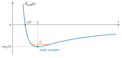
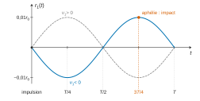
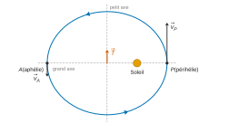
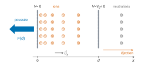
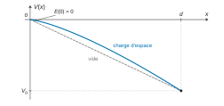
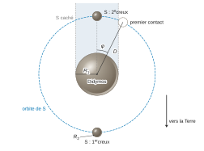

# X-ENS MPI — Physique MPI 2026 · Corrigé guidé

*Corrigé rédigé par IA, non officiel. Signalez toute erreur.*

## Présentation du sujet

**Thème.** Le sujet suit la mission DART (2021–2022) : dévier un astéroïde en le percutant avec une sonde. Il mêle mécanique céleste, électrostatique avec charge d'espace et exploitation de données réelles (deux figures tirées d'articles). Il compte **35 questions** courtes ; l'énoncé demande explicitement des « réponses courtes ».

Durée 4 h, calculatrice interdite : les applications numériques se font à la main, avec des valeurs choisies pour être simples ($r_0=1{,}5\times10^{11}$ m, $v_0=3\times10^4$ m·s$^{-1}$).

**Découpage.**

- **Partie I (Q1–4)** : lecture de la figure 1 (distance Terre–Didymos sur 50 ans) pour obtenir le demi-grand axe et la période de Didymos ; troisième loi de Kepler et période synodique.
- **Partie II (Q5–21)** : orbite de transfert de DART après une impulsion radiale. Première méthode par l'énergie potentielle effective et les petites oscillations radiales (Q8–14) ; seconde méthode par un vecteur constant $\vec T=\vec v-B\vec e_\theta$, cousin du vecteur de Runge-Lenz (Q15–21). C'est le cœur du sujet.
- **Partie III (Q22–31)** : moteur ionique modélisé par un condensateur plan traversé par un faisceau d'ions ; conservation de la charge, flux de quantité de mouvement, grandeur conservée $Q$, et loi de Child-Langmuir $V\propto x^{4/3}$.
- **Partie IV (Q32–35)** : courbe de lumière de l'astéroïde double (figure 2) pour obtenir rapports de tailles et masse volumique, puis interprétation de la variation de période de Dimorphos après l'impact.

Les quatre parties peuvent être traitées indépendamment.

**Notions mobilisées.** Forces centrales, moment cinétique, énergie potentielle effective, lois de Kepler, énergie d'une orbite elliptique $E=-GMm/2a$, dérivées des vecteurs de base polaires ; conservation de la charge, théorème de l'énergie cinétique, Maxwell-Gauss, bilan de quantité de mouvement sur un système ouvert ; développements limités et lectures de graphes.

**Difficulté et gestion du temps.** Le sujet est de longueur raisonnable pour 4 h. Les questions 1, 3, 5, 6, 11, 13, 16, 25, 26, 31 et 32 sont des points faciles à ne pas laisser passer.

Le rapport 2026 range parmi les questions discriminantes les questions 2, 12, 14, 15, 17, 27, 33, 34 et 35. Il qualifie en outre chacune des questions Q7 et Q10 de « particulièrement discriminante », Q29 de « très discriminante », et Q8 de « relativement discriminante ». Q2, Q4, Q33 et Q34 demandent une analyse de document sur les deux figures.

Le rapport souligne aussi que Q18–21, simples une fois Q17 acquise, ont été très peu abordées : il faut aller jusqu'au bout de la seconde méthode. En cas de blocage dans la partie II, passer aux parties III et IV.

> [!JURY]
> Deux exigences générales du rapport 2026 (p. 2) : « Tout résultat doit être accompagné d'une justification physique claire et rigoureuse ; à défaut il n'est pas pris en compte dans l'évaluation. » et « Toute application numérique doit être assortie de l'unité correspondante. » La lecture attentive des consignes (exprimer le résultat avec les variables demandées) revient dans plusieurs commentaires.

## Partie I — Orbite de Didymos autour du Soleil

On tire de la figure 1 les distances extrêmes de Didymos au Soleil, puis sa période, et l'on vérifie cette période sur la périodicité de la figure.

### Question 1

> [!INDICATION]
> Quelle propriété géométrique a la force exercée par le Soleil ? Quel théorème en tire une grandeur conservée ?

> [!INDICATION]
> Si un vecteur fixe est toujours orthogonal à $\vec r$, que peut-on dire de $\vec r$ ?

#### Solution

La force de gravitation exercée par le Soleil (origine $O$) est **centrale** : son moment en $O$ est nul. Le théorème du moment cinétique, dans le référentiel héliocentrique supposé galiléen, donne alors

$$\frac{\mathrm d\vec L_O}{\mathrm dt}=\vec 0 .$$

Le vecteur $\vec L_O=\vec r\wedge m\vec v$ est donc constant. Le vecteur position $\vec r$ reste orthogonal à ce vecteur fixe : le mouvement a lieu dans le plan passant par le Soleil et orthogonal à $\vec L_O$.

**Principe : conservation du moment cinétique (force centrale).**

> [!PIEGE]
> Citer la « loi des aires » comme principe : c'en est une conséquence. Il faut nommer le théorème du moment cinétique et dire pourquoi le moment de la force est nul.

### Question 2

> [!INDICATION]
> Faites un schéma de l'orbite de Didymos et de celle de la Terre. Où se trouve le Soleil sur l'ellipse ?

> [!INDICATION]
> La figure donne la distance Terre–Didymos, pas Soleil–Didymos. Dans quelle configuration géométrique la distance Terre–Didymos est-elle la plus grande possible ?

> [!INDICATION]
> Pour une ellipse, le demi-grand axe s'exprime simplement avec les distances au foyer au périhélie et à l'aphélie.

#### Solution

La trajectoire de Didymos est une ellipse dont le Soleil occupe un **foyer** (et non le centre). Les distances au Soleil au périhélie et à l'aphélie sont $r_{\min}$ et $r_{\max}$, et le grand axe vaut leur somme.

La distance Terre–Didymos $d$ est maximale quand Didymos est à son aphélie et que la Terre est de l'autre côté du Soleil, alignée avec lui :

$$d_{\max}=r_{\max}+r_0 .$$

La figure donne $d_{\max}\simeq3{,}25\,r_0$, donc $r_{\max}\simeq2{,}25\,r_0$. Le demi-grand axe est la demi-somme des distances extrêmes au Soleil :

$$\boxed{a=\frac{r_{\min}+r_{\max}}{2}\simeq\frac{1{,}01+2{,}25}{2}\,r_0\simeq1{,}6\,r_0}$$

> [!PIEGE]
> Prendre $r_{\max}=3{,}25\,r_0$ directement sur la figure. On obtiendrait $a\approx2{,}1\,r_0$ et une période trop longue.

> [!PIEGE]
> Placer le Soleil au centre de l'ellipse. Le rapport 2026 (p. 2–3) relève que de nombreuses copies ont fait cette erreur, « le Soleil étant placé au centre alors qu'il doit se situer en l'un des foyers ».

> [!JURY]
> Le rapport 2026 (p. 2) note qu'aucun schéma n'était demandé mais que sa réalisation « facilitait grandement le raisonnement ». Q2 figure parmi les questions discriminantes.

### Question 3

> [!INDICATION]
> La Terre et Didymos tournent autour du même astre : la troisième loi de Kepler permet de travailler en années et en unités astronomiques.

#### Solution

Troisième loi de Kepler : $T^2/a^3$ a la même valeur pour tous les corps en orbite autour du Soleil, en particulier pour la Terre ($a_\oplus=r_0$, $T_\oplus=1$ an) et Didymos. Sans faire intervenir $G$ ni $M_\odot$ :

$$\begin{aligned}
\left(\frac{T}{1\ \text{an}}\right)^2&=\left(\frac{a}{r_0}\right)^3\\
T&=(1{,}63)^{3/2}\ \text{an}\\
&\approx\sqrt{4{,}3}\ \text{an}
\end{aligned}$$

$$\boxed{T\approx2{,}1\ \text{ans}}$$

> [!METHODE]
> Sans calculatrice : $1{,}63^2\approx2{,}66$, $1{,}63^3\approx4{,}3$, et $\sqrt{4{,}3}\approx2{,}1$ car $2{,}1^2=4{,}41$. Écrire les étapes montre que le résultat n'est pas deviné.

> [!JURY]
> Le rapport 2026 (p. 3) attend exactement cette démarche : comparer à la Terre, ce qui permet de s'affranchir de la masse du Soleil et de la constante de gravitation.

### Question 4

> [!INDICATION]
> Les rapprochements Terre–Didymos ne se répètent pas avec la période $T$ mais avec une autre période liée au mouvement relatif des deux corps.

> [!INDICATION]
> Pensez à la période synodique. Pour une mesure précise, utilisez un long intervalle de temps : repérez deux rapprochements exceptionnellement profonds et comptez les oscillations entre eux.

#### Solution

Les rapprochements (minima de $d$) se répètent avec la période synodique $P_{\text{syn}}$, durée au bout de laquelle la Terre a fait un tour de plus que Didymos :

$$\begin{aligned}
\frac{1}{P_{\text{syn}}}&=\frac{1}{T_\oplus}-\frac{1}{T}\\
P_{\text{syn}}&=\frac{T}{T-1}\approx\frac{2{,}1}{1{,}1}\ \text{an}\approx1{,}9\ \text{an}
\end{aligned}$$

Sur la figure, les rapprochements très profonds (Didymos à son périhélie quand la Terre passe à proximité) ont lieu vers 2004 et vers 2023, à environ 19 ans d'intervalle. On compte 10 maxima principaux entre eux, d'où $P_{\text{syn}}\approx1{,}9$ an. On en tire $T=P_{\text{syn}}/(P_{\text{syn}}-1)\approx2{,}1$ ans.

De façon équivalente, la configuration se reproduit quand la durée écoulée contient à la fois un nombre entier d'années et de périodes de Didymos : $19\ \text{ans}\approx9\,T$ donne $T\approx2{,}1$ ans.

**L'estimation de la question 3 est validée.**

> [!PIEGE]
> Lire sur la figure une « période » d'une vingtaine d'années et la prendre pour $T$. Le rapport 2026 (p. 3) : « Une très large majorité des candidat(e)s a déduit de manière erronée une période orbitale de 20 ans à partir de la figure fournie. » Ces 19 à 20 ans sont la durée de retour de la configuration Terre–Didymos, qui contient environ 9 périodes de Didymos.

> [!PIEGE]
> Mesurer l'écart entre deux minima voisins (environ 2 ans) et l'injecter dans $T=P_{\text{syn}}/(P_{\text{syn}}-1)$ : cette formule est très sensible à $P_{\text{syn}}$ (2,0 ans donne $T=2{,}0$ ans, 1,9 an donne $T=2{,}1$ ans). Une mesure sur une longue durée est bien plus précise.

## Partie II — Orbite de DART autour du Soleil

On place DART sur l'orbite terrestre, on lui donne une petite vitesse radiale $v_1$ et on cherche $v_1$ pour que l'aphélie de DART atteigne le périhélie de Didymos ($1{,}01\,r_0$). Deux méthodes : petites oscillations dans le potentiel effectif, puis constantes du mouvement.

### Question 5

> [!INDICATION]
> Même orbite circulaire, même astre attracteur : que donne le principe fondamental de la dynamique ? De quoi dépend le résultat ?

#### Solution

Sur une orbite circulaire de rayon $r_0$, le principe fondamental de la dynamique projeté sur $\vec e_r$ donne

$$\frac{mv^2}{r_0}=\frac{GM_\odot m}{r_0^2}$$

soit

$$v=\sqrt{\frac{GM_\odot}{r_0}} .$$

La masse $m$ de l'engin s'élimine : la vitesse ne dépend que de $M_\odot$, de $G$ et du rayon. Elle est donc la même que celle de la Terre :

$$\boxed{v=v_0=30\ \text{km·s}^{-1}}$$

On retiendra $GM_\odot=v_0^2r_0$.

> [!JURY]
> Le rapport 2026 (p. 3) attend qu'on rappelle explicitement que « la vitesse orbitale est indépendante de la masse du satellite ». C'est la justification de « même vitesse que la Terre ».

### Question 6

> [!INDICATION]
> Quelle est la direction de la force qui produit l'impulsion ? Que vaut son moment en $O$ ?

#### Solution

L'impulsion est parallèle à la direction du Soleil : la force qui la produit a un moment nul en $O$. Le théorème du moment cinétique donne $\Delta\vec L=\vec 0$.

On le vérifie directement : juste après l'impulsion, la position est inchangée ($r=r_0$) et la vitesse orthoradiale aussi ($v_\theta=v_0$), donc $L=mr\,v_\theta$ ne change pas.

$$\boxed{\Delta\vec L=\vec 0}$$

$$\boxed{L=mr_0v_0}$$

### Question 7

> [!INDICATION]
> L'impulsion est brève : qu'est-ce qui change instantanément, et qu'est-ce qui ne change pas ? L'énergie potentielle dépend seulement de la position.

> [!INDICATION]
> Comment varie l'énergie cinétique quand on ajoute une composante de vitesse orthogonale à l'ancienne ? Reliez ensuite l'énergie au demi-grand axe et regardez l'ordre en $v_1/v_0$.

#### Solution

L'impulsion est brève : la vitesse change instantanément, la position ne change pas. L'énergie potentielle gravitationnelle est donc inchangée.

Les vecteurs $\vec v_0=v_0\vec e_\theta$ et $\vec v_1=v_1\vec e_r$ sont orthogonaux, le produit scalaire croisé est nul : $(\vec v_0+\vec v_1)^2=v_0^2+v_1^2$. L'énergie cinétique passe de $\frac12mv_0^2$ à $\frac12m(v_0^2+v_1^2)$ :

$$\boxed{\Delta E=\tfrac12mv_1^2>0}$$

Pour une orbite képlérienne, l'énergie mécanique fixe le demi-grand axe : $E=-\dfrac{GM_\odot m}{2a}$. Avant l'impulsion, $E_0=-\frac12mv_0^2$ et $a_0=r_0$. Donc

$$\frac{\Delta a}{a}\simeq-\frac{\Delta E}{E_0}=\frac{v_1^2}{v_0^2} .$$

La variation est du second ordre en $|v_1|/v_0$. Au premier ordre,

$$\boxed{\Delta a=0}$$

le demi-grand axe reste $r_0$. L'expression exacte est $a=r_0/(1-v_1^2/v_0^2)$.

> [!PIEGE]
> Développer $(\vec v_0+\vec v_1)^2$ comme si les vecteurs étaient colinéaires, en $v_0^2+2v_0v_1+v_1^2$. Le rapport 2026 (p. 3) relève cette erreur dans un grand nombre de copies : les deux vitesses sont orthogonales, le terme croisé est nul.

> [!PIEGE]
> Encadrer $\Delta a=r_0(v_1/v_0)^2$ : c'est un terme du second ordre, que l'énoncé demande précisément de négliger. La réponse attendue est « pas de variation au premier ordre », qui sert ensuite en Q13.

> [!JURY]
> Question « particulièrement discriminante » selon le rapport 2026 (p. 3). Deux idées étaient attendues : l'impulsion brève ne change pas la position, donc pas l'énergie potentielle ; et « le demi-grand axe d'une orbite est entièrement déterminée par l'énergie mécanique du système ».

**Première méthode : utilisation de l'énergie potentielle effective**

### Question 8

> [!INDICATION]
> Écrivez l'énergie mécanique en polaires et éliminez $\dot\theta$ grâce à la constante $L$.

> [!INDICATION]
> L'énoncé impose les variables finales : remplacez $L$ et $GM_\odot$ par leurs valeurs sur l'orbite initiale.

#### Solution

En coordonnées polaires, l'énergie mécanique s'écrit

$$E=\tfrac12m(\dot r^2+r^2\dot\theta^2)-\frac{GM_\odot m}{r} .$$

Le moment cinétique $L=mr^2\dot\theta$ est constant, donc $\frac12mr^2\dot\theta^2=\dfrac{L^2}{2mr^2}$. Il vient $E=\frac12m\dot r^2+E_{p,\text{eff}}(r)$ avec

$$E_{p,\text{eff}}(r)=\frac{L^2}{2mr^2}-\frac{GM_\odot m}{r} .$$

Avec $L=mr_0v_0$ et $GM_\odot=v_0^2r_0$ :

$$\boxed{E_{p,\text{eff}}(r)=\frac{mv_0^2r_0^2}{2r^2}-\frac{mv_0^2r_0}{r}}$$

> [!JURY]
> Selon le rapport 2026 (p. 3), une part importante des candidats a établi l'expression générale sans la réécrire avec les variables imposées par l'énoncé : « Cette question souligne l'importance d'une lecture attentive des consignes ». La dernière ligne, en fonction de $m$, $r_0$, $v_0$ et $r$, fait partie de la réponse.

### Question 9

> [!INDICATION]
> Une orbite circulaire, c'est $r$ constant : que doit vérifier $E_{p,\text{eff}}$ en ce rayon pour le mouvement radial ?

#### Solution

Une orbite circulaire correspond à $r$ constant, donc à une position d'équilibre du mouvement radial. C'est la **dérivée** de $E_{p,\text{eff}}$ qui s'annule :

$$\begin{aligned}
E_{p,\text{eff}}'(r)&=-\frac{mv_0^2r_0^2}{r^3}+\frac{mv_0^2r_0}{r^2}\\
&=\frac{mv_0^2r_0}{r^2}\left(1-\frac{r_0}{r}\right)
\end{aligned}$$

Cette dérivée s'annule si et seulement si $r=r_0$ : on retrouve le rayon de l'orbite terrestre.

C'est un minimum, donc un équilibre stable.

Allure (figure 1) : $E_{p,\text{eff}}\to+\infty$ en $r\to0$ et $E_{p,\text{eff}}\to0^-$ à l'infini.

> [!PIEGE]
> Écrire $E_{p,\text{eff}}(r_0)=0$. Le rapport 2026 (p. 3–4) : « Une erreur fréquente a été de considérer que l'énergie potentielle effective devait elle-même s'annuler » en $r_0$. L'équilibre se lit sur la dérivée, pas sur la valeur ; d'ailleurs $E_{p,\text{eff}}(r_0)=-\frac12mv_0^2<0$.

### Question 10

> [!INDICATION]
> Petites oscillations autour d'un minimum d'énergie potentielle : dérivez l'énergie mécanique par rapport au temps, puis développez la force au premier ordre en $r_1$.

> [!INDICATION]
> La « masse » du mouvement radial se lit sur le terme cinétique $\frac12m\dot r^2$.

#### Solution

On dérive par rapport au temps l'énergie $E=\frac12m\dot r^2+E_{p,\text{eff}}(r)$, constante. Pour $\dot r\neq0$ :

$$m\ddot r=-E_{p,\text{eff}}'(r) .$$

On pose $r=r_0+r_1$. Le développement limité au premier ordre en $r_1$ donne $E_{p,\text{eff}}'(r_0+r_1)\simeq E_{p,\text{eff}}''(r_0)\,r_1$, puisque $E_{p,\text{eff}}'(r_0)=0$. Or

$$\begin{aligned}
E_{p,\text{eff}}''(r_0)&=\frac{3mv_0^2}{r_0^2}-\frac{2mv_0^2}{r_0^2}\\
&=\frac{mv_0^2}{r_0^2}
\end{aligned}$$

D'où l'équation d'un oscillateur harmonique :

$$\ddot r_1+\frac{v_0^2}{r_0^2}\,r_1=0$$

$$\boxed{\omega=\frac{v_0}{r_0}}$$

C'est la pulsation orbitale : la période radiale égale la période de révolution, ce qui traduit le fait que les orbites képlériennes sont fermées.

> [!JURY]
> Question « particulièrement discriminante, correctement traitée par un nombre très limité de candidat(e)s » (rapport 2026, p. 4). Le jury attend un développement limité rigoureux au voisinage du minimum et, là encore, le résultat écrit avec les seules grandeurs $r_0$ et $v_0$.

### Question 11

> [!INDICATION]
> Quelle doit être l'amplitude de $r_1$ ? Comparez-la à $r_0$.

#### Solution

L'aphélie de DART doit valoir $1{,}01\,r_0$, soit une amplitude $|r_1|_{\max}=0{,}01\,r_0$. Comme $|r_1|/r_0\le10^{-2}\ll1$, **l'approximation des petites oscillations est justifiée.**

### Question 12

> [!INDICATION]
> Écrivez la solution générale de l'équation de Q10 avec deux constantes, puis fixez-les avec les conditions juste après l'impulsion : quelle position, quelle vitesse radiale ?

#### Solution

La solution générale s'écrit $r_1(t)=A\cos(\omega t+\phi)$. L'impulsion est donnée à $t=0$ sur l'orbite circulaire : $r_1(0)=0$ et $\dot r_1(0)=v_1$. D'où

$$r_1(t)=\frac{v_1}{\omega}\sin(\omega t) .$$

L'amplitude vaut $|v_1|/\omega=r_0|v_1|/v_0$. On impose qu'elle égale $0{,}01\,r_0$ :

$$\boxed{|v_1|=0{,}01\,v_0=300\ \text{m·s}^{-1}}$$

> [!JURY]
> Le rapport 2026 (p. 4) la classe « très discriminante, principalement en raison du très faible nombre de copies l'ayant abordée ». La valeur de $|v_1|$ sert ensuite en Q22 : la manquer coûte aussi l'application numérique de la partie III.

### Question 13

> [!INDICATION]
> La période se déduit directement de $\omega$. Pour l'argument sans calcul, reprenez le résultat de Q7.

#### Solution

$$\begin{aligned}
T_{\text{DART}}&=\frac{2\pi}{\omega}=\frac{2\pi r_0}{v_0}\\
&=\frac{2\pi\times1{,}5\times10^{11}}{3\times10^4}\ \text{s}\\
&\approx3{,}1\times10^7\ \text{s}
\end{aligned}$$

$$\boxed{T_{\text{DART}}\approx1\ \text{an}}$$

Sans calcul : le demi-grand axe est inchangé au premier ordre (Q7). D'après la troisième loi de Kepler, la période est celle de la Terre, un an.

### Question 14

> [!INDICATION]
> Quelle fraction de la période sépare l'impulsion de l'impact ? En quel point de l'orbite de DART l'impact doit-il avoir lieu ?

> [!INDICATION]
> Tracez $r_1(t)=A\sin(\omega t)$ pour $A>0$ puis pour $A<0$ et repérez la date du maximum. Reliez le signe de $A$ à celui de $v_1$.

#### Solution

Entre l'impulsion et l'impact s'écoulent 3/4 d'année, soit $\frac34T_{\text{DART}}$. L'impact a lieu à l'aphélie de DART, maximum de $r_1(t)=A\sin(\omega t)$ avec $A=v_1/\omega$, du signe de $v_1$.

- Si $v_1>0$ (vers l'extérieur), $A>0$ : le maximum est atteint à $\omega t=\pi/2$, soit $t=T/4$.
- Si $v_1<0$ (vers le Soleil), $A<0$ : $r_1$ devient d'abord négatif (périhélie à $T/4$), et le maximum est atteint à $\omega t=3\pi/2$, soit $t=3T/4$.

L'aphélie est atteint $3T/4$ après l'impulsion, donc $A<0$ et $v_1<0$ : **l'impulsion était dirigée vers le Soleil.**

> [!PIEGE]
> Raisonner « pour s'éloigner du Soleil, on pousse vers l'extérieur » : c'est vrai pour atteindre l'aphélie au plus vite ($T/4$), mais les dates imposent ici $3T/4$.

> [!JURY]
> Le rapport 2026 (p. 4) : « De nombreuses réponses ont été données sans justification suffisante. » Il attend le paramétrage de $r_1(t)$, la discussion selon le signe de l'amplitude et le lien entre ce signe et la vitesse initiale ; la question évaluait « moins la maîtrise calculatoire que la capacité à interpréter physiquement la solution d'un mouvement harmonique ».

**Seconde méthode : constantes du mouvement**

### Question 15

> [!INDICATION]
> Dérivez $\vec T$ : il faut $\mathrm d\vec v/\mathrm dt$ (principe fondamental) et $\mathrm d\vec e_\theta/\mathrm dt$.

> [!INDICATION]
> Les deux termes obtenus sont portés par $\vec e_r$ ; exprimez $\dot\theta$ avec $L$ pour qu'ils aient la même dépendance en $r$.

#### Solution

On traite une trajectoire quelconque. Le principe fondamental de la dynamique et la dérivée du vecteur de base donnent

$$m\frac{\mathrm d\vec v}{\mathrm dt}=-\frac{GM_\odot m}{r^2}\vec e_r$$

$$\frac{\mathrm d\vec e_\theta}{\mathrm dt}=-\dot\theta\,\vec e_r$$

Pour $B$ constant, en utilisant $\dot\theta=L/(mr^2)$ (conservation du moment cinétique) :

$$\begin{aligned}
\frac{\mathrm d\vec T}{\mathrm dt}&=\left(-\frac{GM_\odot}{r^2}+B\dot\theta\right)\vec e_r\\
&=\frac{1}{r^2}\left(-GM_\odot+\frac{BL}{m}\right)\vec e_r
\end{aligned}$$

Ce vecteur est nul à tout instant si et seulement si

$$\boxed{B=\frac{GM_\odot m}{L}}$$

$B$ ne dépend que de la trajectoire (par $L$), et pour cette valeur $\vec T$ est constant.

> [!PIEGE]
> Se tromper de signe dans $\mathrm d\vec e_\theta/\mathrm dt$ (erreur relevée dans de nombreuses copies par le rapport 2026, p. 4–5), ou ne traiter que l'orbite circulaire : le rapport signale qu'un nombre significatif de candidats « se sont limité(e)s à l'étude du cas particulier d'une orbite circulaire, sans traiter le cas général attendu ».

> [!METHODE]
> $\vec T$ est lié au vecteur de Runge-Lenz : $\vec T\wedge\vec e_z$ est proportionnel au vecteur excentricité, dirigé vers le périhélie. On n'a pas besoin de le savoir, mais cela explique la question suivante.

### Question 16

> [!INDICATION]
> Remplacez $L$ et $GM_\odot$ par leurs valeurs sur l'orbite circulaire.

#### Solution

Sur l'orbite circulaire de rayon $r_0$, $L=mr_0v_0$ et $GM_\odot=v_0^2r_0$, donc $B=v_0$. Comme $\vec v=v_0\vec e_\theta$ :

$$\boxed{B=v_0}$$

$$\boxed{\vec T=\vec 0}$$

### Question 17

> [!INDICATION]
> $\vec T$ étant constant, il suffit de le calculer en deux points bien choisis de l'orbite. Où la vitesse a-t-elle une direction simple ?

> [!INDICATION]
> Aux apsides, la vitesse est orthoradiale ; comparez $\vec e_\theta$ au périhélie et à l'aphélie. Pour le sens, il faut comparer $v_P$ et $v_A$ : quelle loi de conservation le permet ?

#### Solution

Le Soleil occupe le **foyer** proche du périhélie $P$ ; l'aphélie $A$ est le sommet opposé ; l'orbite est parcourue dans le sens trigonométrique.

Direction. $\vec T$ est constant : on l'évalue aux deux apsides, où la vitesse est orthoradiale. En $A$, $\vec e_\theta(A)=-\vec e_\theta(P)$. D'où

$$\begin{aligned}
\vec T&=(v_P-B)\,\vec e_\theta(P)&&\text{(au périhélie)}\\
\vec T&=(B-v_A)\,\vec e_\theta(P)&&\text{(à l'aphélie)}
\end{aligned}$$

$\vec T$ est colinéaire à $\vec e_\theta(P)$, orthogonal au grand axe :

$$\boxed{\vec T\ \text{est dirigé selon le petit axe}}$$

Sens. L'égalité des deux expressions donne $B=\frac12(v_P+v_A)$, puis $\vec T=\frac12(v_P-v_A)\,\vec e_\theta(P)$. La conservation du moment cinétique aux apsides s'écrit $mr_Pv_P=mr_Av_A$. Comme $r_P<r_A$, on a $v_P>v_A$ : **$\vec T$ a le sens de la vitesse au périhélie.**

> [!PIEGE]
> Confondre $\vec T$ avec le vecteur excentricité, porté par le grand axe. Le calcul aux apsides tranche sans ambiguïté.

> [!JURY]
> Le rapport 2026 (p. 5) relève à nouveau le Soleil placé au centre de l'ellipse, et une direction et un sens de $\vec T$ le plus souvent donnés sans justification. Il attend l'évaluation de $\vec T$ au périhélie et à l'aphélie, puis la comparaison des vitesses par la conservation du moment cinétique : « Très peu de copies ont présenté un raisonnement à la fois complet, rigoureux et clairement rédigé. »

### Question 18

> [!INDICATION]
> Qu'est-ce qui détermine $B$ ? Évaluez ensuite $\vec T$ à l'instant le plus simple : juste après l'impulsion.

#### Solution

Le moment cinétique $L=mr_0v_0$ est inchangé (Q6), donc $B=GM_\odot m/L=v_0$. Juste après l'impulsion, $\vec v=v_1\vec e_r+v_0\vec e_\theta$, donc $\vec T=v_1\vec e_r$ :

$$\boxed{B=v_0}$$

$$\boxed{|\vec T|=|v_1|}$$

> [!JURY]
> Q18 et Q19 : « Questions pourtant assez simples, mais qui ont été très peu abordées dans les copies » (rapport 2026, p. 5). Des points accessibles en quelques lignes une fois Q15–17 posées.

### Question 19

> [!INDICATION]
> Utilisez la colinéarité entre $\vec v$ et $\vec T$ aux apsides, établie en Q17.

#### Solution

Au périhélie, $\vec v$ et $\vec T$ ont même sens : $v_P=B+|\vec T|$. À l'aphélie, sens opposés : $v_A=B-|\vec T|$.

$$\boxed{v_P=v_0+|v_1|}$$

$$\boxed{v_A=v_0-|v_1|}$$

### Question 20

> [!INDICATION]
> Une constante du mouvement fait intervenir le produit d'une distance et d'une vitesse. Que vaut ce produit aux apsides, et quelle est sa valeur depuis l'impulsion ?

#### Solution

Le **moment cinétique** (loi des aires). Aux apsides, $\vec v\perp\vec r$, donc $L=mrv$. Sa valeur est celle de l'orbite initiale, $L=mr_0v_0$, inchangée par l'impulsion (Q6). À l'aphélie, $mr_Av_A=mr_0v_0$, et $v_A$ est donné par Q19 :

$$\boxed{r_A=\frac{r_0v_0}{v_0-|v_1|}}$$

De même, $r_P=r_0v_0/(v_0+|v_1|)$.

On peut vérifier la conservation de l'énergie : $\frac12v_A^2-GM_\odot/r_A=-\frac12(v_0^2-v_1^2)$, comme juste après l'impulsion.

> [!PIEGE]
> Écrire $L=mrv$ en un point quelconque : ce n'est vrai que si la vitesse est orthoradiale.

> [!JURY]
> Le rapport 2026 (p. 5) juge la première partie de la question bien traitée, mais la seconde « très peu traitée par les candidat(e)s, alors même qu'elle ne présentait pas de difficulté conceptuelle majeure une fois les résultats précédents mobilisés ». Il faut se souvenir que $L$ n'a pas changé depuis Q6.

### Question 21

> [!INDICATION]
> Développez au premier ordre en $|v_1|/v_0$ et comparez à la condition de Q11–12.

#### Solution

Développement limité au premier ordre en $|v_1|/v_0\ll1$ :

$$\begin{aligned}
r_A&=r_0\left(1-\frac{|v_1|}{v_0}\right)^{-1}\\
&\simeq r_0\left(1+\frac{|v_1|}{v_0}\right)
\end{aligned}$$

Imposer $r_A=1{,}01\,r_0$ donne $|v_1|=0{,}01\,v_0$ : **on retrouve le résultat de la question 12.**

## Partie III — Moteur ionique

On estime d'abord la durée de poussée, puis on étudie un accélérateur électrostatique : des ions traversent un condensateur plan et leur propre charge modifie le champ. On montre que la poussée est limitée par le champ de claquage et l'on retrouve la loi de Child-Langmuir.

### Question 22

> [!INDICATION]
> Force constante pendant $\Delta t$ : reliez la variation de quantité de mouvement à $F$.

> [!INDICATION]
> Pour juger si la poussée est brève, comparez $\Delta t$ au temps caractéristique de l'évolution de l'orbite.

#### Solution

Théorème de la quantité de mouvement à force constante : $M\,\Delta v=F\,\Delta t$, avec $\Delta v=|v_1|=300$ m·s$^{-1}$.

$$\begin{aligned}
\Delta t&=\frac{M|v_1|}{F}=\frac{600\times300}{0{,}2}\ \text{s}\\
&=9\times10^5\ \text{s}
\end{aligned}$$

$$\boxed{\Delta t\approx10\ \text{jours}}$$

Il faut comparer cette durée à l'échelle de temps du mouvement orbital : la période $T\approx1$ an, ou plus finement $1/\omega=r_0/v_0=5\times10^6$ s, soit environ 58 jours.

On a $\Delta t/T\approx3\,\%$ et $\Delta t/(1/\omega)\approx0{,}17$ : pendant la poussée, la direction du Soleil ne tourne que d'environ $10°$. **L'impulsion peut être qualifiée de brève en première approximation.**

> [!METHODE]
> « Bref » n'a de sens que par rapport à un temps caractéristique du système. Le rapport 2026 (p. 5) retient la période orbitale : l'impulsion est brève « dès lors que sa durée restait très inférieure à sa période orbitale ». Pour un oscillateur de pulsation $\omega$, l'étalon le plus exigeant est $1/\omega$.

### Question 23

> [!INDICATION]
> Écrivez l'équation locale de conservation de la charge en régime stationnaire. Quelles invariances la géométrie impose-t-elle à $\vec j$ ?

#### Solution

Conservation de la charge :

$$\frac{\partial\rho}{\partial t}+\operatorname{div}\vec j=0 .$$

En régime stationnaire, $\operatorname{div}\vec j=0$.

Les plaques sont grandes et les ions répartis uniformément sur leur surface : invariance par translation selon $y$ et $z$, d'où $\vec j=j(x)\vec u_x$. Alors $\dfrac{\mathrm dj}{\mathrm dx}=0$, et $j$ est indépendante de $x$.

Le courant est porté par les ions, de densité volumique de **charge** $\rho(x)$ :

$$\boxed{j=\rho(x)\,v(x)=\text{constante}}$$

> [!PIEGE]
> Prendre $\rho(x)$ pour une masse volumique : l'énoncé la définit comme densité de charges, et le rapport 2026 (p. 5) relève cette confusion. Il note aussi que « seule environ la moitié des candidat(e)s ayant traité cette question, a justifié de manière satisfaisante » l'indépendance en $x$ par la conservation de la charge.

### Question 24

> [!INDICATION]
> Théorème de l'énergie cinétique pour un ion, de $x=0$ (vitesse négligeable) à $x$. Quelle est l'énergie potentielle d'une charge $e$ au potentiel $V$ ?

#### Solution

Théorème de l'énergie cinétique pour un ion entre $x=0$ (vitesse négligeable, $V=0$) et $x$. La force électrique dérive de l'énergie potentielle $eV$ :

$$\tfrac12mv(x)^2-0=-\left(eV(x)-0\right)$$

$$\boxed{\tfrac12mv(x)^2=-eV(x)}$$

Le signe est cohérent : $V(x)\le0$ entre les plaques, et l'ion positif est accéléré vers les potentiels décroissants.

> [!PIEGE]
> Écrire $\frac12mv^2=eV$. Le rapport 2026 (p. 6) relève dans un grand nombre de copies « une erreur de signe dans la relation reliant la vitesse à la charge élémentaire », au potentiel et à la masse. Contrôle immédiat : $V_0<0$, donc $-eV>0$. Le rapport note aussi que le principe fondamental de la dynamique, choisi par beaucoup, a souvent été mal intégré : le théorème de l'énergie cinétique est plus direct.

### Question 25

> [!INDICATION]
> Combien d'ions traversent $S$ par unité de temps ? Quelle quantité de mouvement porte chacun ?

> [!INDICATION]
> Pour la poussée, faites un bilan de quantité de mouvement sur les ions compris entre les plaques, puis utilisez la loi des actions réciproques.

#### Solution

Pendant $\mathrm dt$, le nombre d'ions traversant $S$ est $\dfrac{jS}{e}\mathrm dt$, chacun portant $mv(x)\vec u_x$ :

$$\boxed{F(x)=\frac{Sjm}{e}\,v(x)}$$

Comme $v(0)=0$ :

$$\boxed{F(0)=0}$$

En régime stationnaire, les ions situés entre les plaques reçoivent par unité de temps la quantité de mouvement $F(d)-F(0)=F(d)$ selon $+\vec u_x$ : le moteur exerce sur eux la force $F(d)\vec u_x$. Par la loi des actions réciproques, les ions exercent sur le moteur $-F(d)\vec u_x$.

**La poussée vaut $F(d)$ et est dirigée selon $-\vec u_x$**, à l'opposé de l'éjection des ions.

> [!PIEGE]
> Se tromper de sens : les ions positifs vont vers le potentiel le plus bas ($V_0<0$ en $x=d$), donc sont éjectés vers $+x$ ; la sonde est poussée vers $-x$.

### Question 26

> [!INDICATION]
> Dérivez la relation de Q24 par rapport à $x$ et faites apparaître $E$.

#### Solution

On dérive $\frac12mv^2=-eV$ par rapport à $x$, avec $E=-\mathrm dV/\mathrm dx$ :

$$mvv'=-eV'=eE$$

$$\boxed{v'(x)=\frac{eE(x)}{mv(x)}}$$

> [!METHODE]
> Autre voie admise par le rapport 2026 (p. 6) : le principe fondamental de la dynamique $m\,\mathrm dv/\mathrm dt=eE$, avec $\mathrm dv/\mathrm dt=v\,v'$ (dérivation en chaîne). Elle donne le même résultat et sert de contrôle de signe pour Q24.

### Question 27

> [!INDICATION]
> Montrez que $\mathrm dQ/\mathrm dx=0$. Il faut une équation reliant $E'$ à $\rho$, puis $\rho$ à $j$ et $v$.

> [!INDICATION]
> Pour le signe, évaluez $Q$ en un point où l'un des deux termes est connu.

#### Solution

Maxwell-Gauss à une dimension, puis Q23 : $E'=\rho/\varepsilon_0=j/(\varepsilon_0v)$. Donc

$$\begin{aligned}
\frac{\mathrm d}{\mathrm dx}\left(\tfrac12\varepsilon_0E^2\right)&=\varepsilon_0EE'=\frac{jE}{v}\\
\frac{\mathrm d}{\mathrm dx}\left(\frac{F}{S}\right)&=\frac{jm}{e}\,v'=\frac{jE}{v}
\end{aligned}$$

D'où $\dfrac{\mathrm dQ}{\mathrm dx}=0$ : **$Q$ est indépendant de $x$.** On l'évalue en $x=0$, où $F(0)=0$ :

$$\boxed{Q=\tfrac12\varepsilon_0E(0)^2\ge0}$$

> [!METHODE]
> $\frac12\varepsilon_0E^2$ est une pression électrostatique et $F/S$ un flux de quantité de mouvement : $Q$ exprime un bilan de quantité de mouvement entre le champ et les ions. Ce genre d'invariant s'établit toujours en dérivant et en utilisant les équations locales.

> [!JURY]
> Question « relativement discriminante » (rapport 2026, p. 6). Démarche attendue : dériver $Q$, utiliser Maxwell-Gauss pour montrer que la dérivée est nulle, puis obtenir le signe en $x=0$.

### Question 28

> [!INDICATION]
> Exprimez $F(d)/S$ à l'aide de $Q$ et de $E(d)$, puis majorez chaque terme.

> [!INDICATION]
> Où le champ est-il le plus intense entre les plaques ? Regardez le signe de $E'$.

#### Solution

Comme $E'=\rho/\varepsilon_0>0$, $E$ croît avec $x$, et $E(0)\ge0$ (les ions partent du repos vers $+x$).

La contrainte de claquage porte donc sur $E(d)$. En $x=d$, puisque $Q\ge0$ :

$$\frac{F(d)}{S}=\tfrac12\varepsilon_0E(d)^2-Q\le\tfrac12\varepsilon_0E_{\max}^2$$

L'égalité exige $Q=0$ et $E(d)=E_{\max}$ :

$$\boxed{F_{\max}=\tfrac12\varepsilon_0E_{\max}^2S}$$

> [!JURY]
> Le rapport 2026 (p. 6) rappelle que la réponse rigoureuse s'appuie sur le signe de $Q$ (Q27) et sur $F(0)=0$ (Q25). Admettre $Q\ge0$ sans l'avoir établi n'a pas été pénalisé quand le raisonnement était cohérent.

### Question 29

> [!INDICATION]
> Avec $Q=0$, remplacez $E$ par $-V'$ et $v$ par son expression en $V$ tirée de Q24.

#### Solution

Avec $Q=0$, la relation de Q27 devient $\frac12\varepsilon_0E^2=F/S=\dfrac{jm}{e}v$. On y porte $E=-V'$ et $v=\sqrt{-2eV/m}$ (Q24) :

$$\boxed{\tfrac12\varepsilon_0\left(\frac{\mathrm dV}{\mathrm dx}\right)^2=j\sqrt{\frac{2m}{e}}\,\sqrt{-V(x)}}$$

> [!PIEGE]
> La simplification $\dfrac me\sqrt{\dfrac{2e}{m}}=\sqrt{\dfrac{2m}{e}}$ est une source classique d'erreur.

> [!JURY]
> Question « très discriminante » parce que très peu abordée. Selon le rapport 2026 (p. 6), « La difficulté de cette question résidait moins dans les calculs à effectuer que dans la nécessité de disposer des résultats des questions précédentes. » Des résultats justes en Q24 et Q25 sont la clé de toute la fin de la partie III.

### Question 30

> [!INDICATION]
> Injectez la forme proposée : l'égalité doit être vraie pour tout $x$, ce qui impose une condition sur les puissances de $x$.

> [!INDICATION]
> N'oubliez pas les coefficients : qu'impose leur égalité ? Vérifiez aussi les conditions aux limites.

#### Solution

On essaie $V=V_0(x/d)^\beta$ avec $V_0<0$ :

$$\begin{aligned}
V'&=\frac{\beta V_0}{d}\left(\frac xd\right)^{\beta-1}\\
\sqrt{-V}&=\sqrt{-V_0}\left(\frac xd\right)^{\beta/2}
\end{aligned}$$

L'équation devient

$$\frac{\varepsilon_0\beta^2V_0^2}{2d^2}\left(\frac xd\right)^{2\beta-2}=j\sqrt{\frac{2m}{e}}\sqrt{-V_0}\left(\frac xd\right)^{\beta/2}$$

Elle est vraie pour tout $x$ si $2\beta-2=\beta/2$ :

$$\boxed{\beta=\frac43}$$

et si les coefficients sont égaux, ce qui fixe la densité de courant (loi de Child-Langmuir) :

$$j=\frac{4\varepsilon_0}{9d^2}\sqrt{\frac{2e}{m}}\,(-V_0)^{3/2}$$

Cette forme vérifie $V(0)=0$, $V(d)=V_0$ et $V'(0)=0$, donc $E(0)=0$, cohérent avec $Q=0$.

> [!METHODE]
> Pour vérifier une solution en loi de puissance, on identifie les exposants puis les coefficients ; le second point donne souvent une relation physique intéressante (ici le courant maximal transportable).

### Question 31

> [!INDICATION]
> Sans charge, que vaut $V''$ ? Comparez ensuite $(x/d)^{4/3}$ et $x/d$ sur $[0,1]$, sans oublier que $V_0<0$.

#### Solution

Sans charge d'espace, $V''=0$ : $V=V_0\,x/d$ (droite, champ uniforme). Avec charge d'espace, $V=V_0(x/d)^{4/3}$. Dans les deux cas, $V$ est **négatif** entre les plaques.

| $x/d$ | 0 | 0,25 | 0,5 | 0,75 | 1 |
|---|---|---|---|---|---|
| $V/V_0$ (charge d'espace) | 0 | 0,16 | 0,40 | 0,68 | 1 |
| $V/V_0$ (vide) | 0 | 0,25 | 0,50 | 0,75 | 1 |

Comme $V_0<0$ et $(x/d)^{4/3}<x/d$ sur $]0,d[$, la courbe avec charge d'espace reste **au-dessus** de la droite.

Elle part avec une **tangente horizontale** ($E(0)=0$) et arrive en $x=d$ plus raide que la droite (champ $E(d)=\frac43|V_0|/d$).

> [!PIEGE]
> Tracer un potentiel positif. Le rapport 2026 (p. 6) relève que, dans de nombreuses copies, « le signe du potentiel entre 0 et d est considéré à tort comme positif alors que l'énoncé précisait explicitement qu'il était négatif ». Conséquence : comme $V_0<0$, la courbe en $x^{4/3}$ est au-dessus de la droite, l'ordre est inversé par rapport au tracé de $(x/d)^{4/3}$.

## Partie IV — Étude de l'astéroïde double Didymos-Dimorphos et effet de l'impact de DART

Les creux de la courbe de lumière donnent des rapports de tailles ; leur espacement donne la période orbitale, donc la masse de Didymos. On interprète enfin la variation de période après l'impact.

### Question 32

> [!INDICATION]
> Lors du second creux, que voit-on encore ? La luminosité est proportionnelle à la surface éclairée vue depuis la Terre.

#### Solution

La luminosité est proportionnelle aux sections $\pi R^2$ vues depuis la Terre. Hors creux, elle est proportionnelle à $R_1^2+R_2^2$. Lors du second creux, S est caché : elle est proportionnelle à $R_1^2$. Donc

$$\frac{R_2^2}{R_1^2+R_2^2}=0{,}04$$

$$\frac{R_2^2}{R_1^2}=\frac{0{,}04}{0{,}96}=\frac{1}{24}$$

$$\boxed{\frac{R_2}{R_1}\approx0{,}2}$$

> [!METHODE]
> Sans calculatrice : $1/24$ est proche de $1/25$, dont la racine vaut $0{,}2$. Le rapport 2026 (p. 7) relève « quelques erreurs sur l'application numérique » dans une question pourtant bien réussie.

### Question 33

> [!INDICATION]
> La durée d'un creux est le temps pendant lequel S est (au moins en partie) caché. Exprimez la distance projetée entre les centres en fonction de l'angle orbital.

> [!INDICATION]
> Le second creux a une partie en pente (occultation partielle) et un fond plat (occultation totale) : chacun correspond à une condition géométrique différente.

#### Solution

On repère S par l'angle $\varphi=2\pi t/P$ compté depuis la conjonction (S derrière Didymos). Vue de la Terre, la distance projetée entre les centres vaut $D|\sin\varphi|$.

- S est entièrement caché tant que $D|\sin\varphi|<R_1-R_2$.
- S est partiellement caché tant que $D|\sin\varphi|<R_1+R_2$.

Sur la figure 2, le second creux dure environ $0{,}15\,P$ entre premier et dernier contact, et environ $0{,}09\,P$ en fond plat. D'où

$$\frac{R_1+R_2}{D}\approx\sin(0{,}15\,\pi)\approx0{,}45$$

$$\frac{R_1-R_2}{D}\approx\sin(0{,}09\,\pi)\approx0{,}28$$

$$\boxed{\frac{R_1}{D}\approx0{,}35\ \text{à}\ 0{,}4}$$

On obtient aussi $R_2/D\approx0{,}08$, soit $R_2/R_1\approx0{,}2$, cohérent avec Q32.

Dessin à l'échelle (figure 6, avec $R_1\approx0{,}37\,D$ et $R_2\approx0{,}08\,D$) : Didymos occupe plus du tiers du rayon orbital.

> [!METHODE]
> Utiliser les deux largeurs (contacts extérieurs et fond plat) donne à la fois $R_1/D$ et $R_2/D$, et un contrôle de cohérence avec Q32. Une approximation linéaire $\Delta t/P\approx R_1/(\pi D)$ est acceptable mais doit être signalée, car $R_1/D$ n'est pas petit.

> [!PIEGE]
> Ne pas dire quelle largeur on mesure. Selon qu'on lit le fond plat ou la largeur totale, $R_1/D$ varie de 0,3 à 0,45, et $\rho_1$ (Q34) varie comme $(R_1/D)^{-3}$.

> [!JURY]
> « Question discriminante en raison du faible nombre de candidat(e)s l'ayant traitée » (rapport 2026, p. 7) ; ceux qui l'ont abordée ont en majorité obtenu la bonne réponse ou amorcé un raisonnement correct. Elle rapporte donc à qui ose s'y lancer.

### Question 34

> [!INDICATION]
> Quelle fraction de l'orbite de S sépare les deux creux ?

> [!INDICATION]
> Écrivez la troisième loi de Kepler pour S autour de Didymos, avec la masse de Didymos exprimée par $\rho_1$ et $R_1$.

#### Solution

Les deux creux correspondent à S devant puis derrière Didymos. Sur une orbite circulaire, ils sont séparés d'une demi-révolution : $\Delta t=P/2$ (creux centrés vers $0{,}25$ et $0{,}75$ sur la figure).

La masse de S est négligeable devant $M_1=\frac43\pi R_1^3\rho_1$, puisque $(R_2/R_1)^3\approx10^{-2}$. Pour S en orbite circulaire autour de Didymos :

$$\begin{aligned}
\left(\frac{2\pi}{P}\right)^2D&=\frac{GM_1}{D^2}\\
&=\frac{4\pi G\rho_1}{3}\,\frac{R_1^3}{D^2}
\end{aligned}$$

$$\boxed{\rho_1=\frac{3\pi}{GP^2}\left(\frac{D}{R_1}\right)^3=\frac{3\pi}{4G\,\Delta t^2}\left(\frac{D}{R_1}\right)^3}$$

$R_1/D$ venant de Q33, **$\rho_1$ est déterminée par la seule mesure de $\Delta t$.** Avec une période d'environ 12 h et $R_1/D\approx0{,}33$, on trouve $\rho_1\sim2\times10^3$ kg·m$^{-3}$, valeur typique d'un astéroïde rocheux poreux.

> [!METHODE]
> Les longueurs absolues ($R_1$, $D$) sont inconnues, mais seul leur rapport intervient : c'est ce qui rend la mesure possible depuis la Terre.

### Question 35

> [!INDICATION]
> Pour le demi-grand axe, troisième loi de Kepler sous forme différentielle.

> [!INDICATION]
> Juste après l'impact, S est encore à la même distance de Didymos : écrivez l'énergie mécanique en ce point en fonction de $a$, et différentiez à distance fixée.

#### Solution

On différencie la troisième loi de Kepler, $T^2\propto a^3$ : $\dfrac{\Delta T}{T}=\dfrac32\dfrac{\Delta a}{a}$. D'où

$$\boxed{\frac{\Delta a}{a}=\frac23\times4{,}8\,\%=+3{,}2\,\%}$$

Juste après l'impact, S est toujours à la distance $D$. L'énergie mécanique s'écrit

$$\tfrac12v^2-\frac{GM_1}{D}=-\frac{GM_1}{2a}$$

$$v^2=GM_1\left(\frac2D-\frac1a\right)$$

Avant l'impact, l'orbite est circulaire : $a=D$ et $v^2=GM_1/D$. En différentiant à $D$ fixé :

$$\begin{aligned}
2v\,\Delta v&=\frac{GM_1}{a^2}\,\Delta a\\
\frac{\Delta v}{v}&=\frac12\,\frac{\Delta a}{a}
\end{aligned}$$

$$\boxed{\frac{\Delta v}{v}=+1{,}6\,\%}$$

La vitesse de S a augmenté sans changer de direction : DART, de vitesse parallèle à celle de S, **a percuté S dans le sens de son mouvement**. Si la période avait diminué (cas de la mission réelle), on aurait conclu à un impact de face.

> [!PIEGE]
> Utiliser $v^2=GM_1/a$, valable seulement sur une orbite circulaire : on trouverait une vitesse qui diminue, donc le mauvais sens d'impact. Après l'impact, l'orbite n'est plus circulaire ; la relation de l'orbite circulaire ne sert que pour l'état d'avant l'impact, et il faut écrire l'énergie au point de l'impact.

> [!JURY]
> Le rapport 2026 (p. 7) décrit la démarche attendue : « il fallait différencier la troisième loi de Kepler afin d'obtenir la variation relative du demi-grand axe », puis relier l'énergie mécanique au demi-grand axe et la vitesse orbitale circulaire au rayon. Peu abordée, elle a été bien traitée par ceux qui l'ont tentée.

## Bilan

**Questions discriminantes.** D'après le rapport 2026, la différence s'est faite sur Q2 (schéma avec le Soleil au foyer), Q7 et Q10 (impulsion brève et petites oscillations), Q12 et Q14 (exploitation et interprétation de $r_1(t)$), Q15 et Q17 (vecteur $\vec T$ en cas général, justification du sens), Q27 et Q29 (invariant $Q$ et équation de Child-Langmuir), Q33 à Q35 (exploitation de la figure 2 et de l'impact). Beaucoup de ces questions ont été discriminantes surtout parce que peu de candidats les ont abordées.

**Méthodes à retenir.**

- Force centrale : conservation du moment cinétique, planéité, réduction à un mouvement radial dans un potentiel effectif ; orbite circulaire au minimum de $E_{p,\text{eff}}$ (dérivée nulle, pas valeur nulle), petites oscillations par la dérivée seconde.
- Énergie d'une orbite képlérienne $E=-GMm/2a$ et sa conséquence : une variation de vitesse à position fixée modifie $a$, donc la période (Q7, Q35).
- Recherche d'un vecteur constant en dérivant et en utilisant $\mathrm d\vec e_\theta/\mathrm dt=-\dot\theta\vec e_r$ ; exploitation aux apsides, où la vitesse est orthoradiale.
- Systèmes ouverts : flux de quantité de mouvement $\dot N\,mv$, bilan stationnaire, loi des actions réciproques pour la poussée.
- Grandeur conservée $Q$ : dériver et utiliser les équations locales (Maxwell-Gauss, conservation de la charge).
- Lecture quantitative de graphes : choisir une mesure sur une longue durée et ne pas confondre période de la configuration et période orbitale (Q4), préciser quelle largeur on lit (Q33).
- Lire la consigne jusqu'au bout : variables imposées (Q8, Q10), unité de chaque application numérique.

**Prérequis à revoir.** Lois de Kepler et période synodique, coordonnées polaires et dérivées des vecteurs de base, développements limités au premier ordre, théorème de l'énergie cinétique pour une particule chargée (signe de $eV$), Maxwell-Gauss à une dimension.

**Questions transposables.** Potentiel effectif et petites oscillations (toute épreuve de mécanique céleste), manœuvres orbitales (transfert de Hohmann, effet d'une poussée radiale ou tangentielle), loi de Child-Langmuir (diodes à vide, propulsion ionique), photométrie des binaires à éclipses (exoplanètes par transit).
