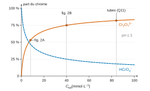
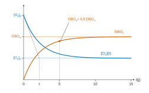
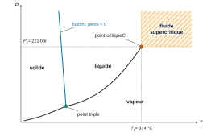

# X-ENS PC — Chimie A 2026 · Corrigé brut

*Corrigé rédigé par IA, non officiel. Signalez toute erreur.*

Épreuve de 4 h, calculatrice interdite. Sujet : « Eau et chimie : caractériser, traiter et prévenir la pollution organique ». Deux problèmes indépendants, 59 questions.

# Problème 1 : La baignabilité de la Seine

## I. Mesures de la pollution organique d'une eau par une méthode chimique

### Question 1

La règle de Klechkowski remplit les sous-couches par $n+\ell$ croissant, puis par $n$ croissant à $n+\ell$ égal. Pour $Z=24$ :

$$\boxed{\mathrm{Cr} : 1s^2\,2s^2\,2p^6\,3s^2\,3p^6\,4s^2\,3d^4}$$

On signale que la configuration réelle est $[\mathrm{Ar}]\,4s^1\,3d^5$ (exception liée à la sous-couche $d$ à demi remplie). La question demande toutefois l'application stricte de la règle.

### Question 2

Dans la formule de Lewis de la figure 1, chaque chrome porte trois oxygènes terminaux : deux liés par une double liaison, et un lié par une simple liaison et chargé $-$. Les deux chromes sont reliés par un oxygène pontant, lié à chacun par une simple liaison.

Cette formule n'est qu'une **forme mésomère**. Sur chaque motif CrO$_3$, on écrit trois formes équivalentes en plaçant la simple liaison et la charge $-$ successivement sur chacun des trois oxygènes terminaux. Les six liaisons Cr–O terminales sont donc équivalentes, d'ordre moyen $(2+2+1)/3=5/3$.

Les deux liaisons Cr–O vers l'oxygène pontant restent simples (ordre 1). L'oxygène pontant, déjà engagé dans deux liaisons, ne peut participer à la délocalisation sans porter une charge positive, ce qui ne donnerait que des formes très minoritaires.

Une liaison est d'autant plus courte que son ordre est élevé, d'où :

$$\boxed{\text{2 longueurs : } d(\mathrm{Cr{-}O_{terminal}}) < d(\mathrm{Cr{-}O_{pontant}})}$$

(À titre indicatif, les valeurs expérimentales sont d'environ 1,63 Å et 1,79 Å.)

### Question 3

La charge formelle d'un atome vaut (électrons de valence) − (électrons non liants) − (nombre de liaisons). L'oxygène a 6 électrons de valence. Dans la formule de la figure 1 :

- O doublement lié (4 atomes) : $6-4-2=0$ ;
- O pontant : $6-4-2=0$ ;
- O terminal simplement lié (2 atomes, un par chrome) : $6-6-1=-1$.

Chaque chrome est alors de charge formelle nulle ($6-0-6$). Le fait que les deux chromes aient le même nombre d'oxydation impose que les deux charges négatives se répartissent à raison d'**une par motif CrO$_3$**. Le total vaut bien $-2$. Compte tenu de la mésomérie (question 2), chaque oxygène terminal porte en moyenne une charge de $-1/3$ ; l'oxygène pontant reste neutre.

### Question 4

Avec $\mathrm{n.o.}(\mathrm{O})=-\mathrm{II}$ et $\mathrm{n.o.}(\mathrm{H})=+\mathrm{I}$ :

- $\mathrm{CrO_4^{2-}}$ : $x+4(-2)=-2$, donc $x=+6$ ;
- $\mathrm{HCrO_4^{-}}$ : $1+x+4(-2)=-1$, donc $x=+6$ ;
- $\mathrm{Cr_2O_7^{2-}}$ : $2x+7(-2)=-2$, donc $x=+6$.

$$\boxed{\text{Le chrome est au degré }+\mathrm{VI}\text{ dans les trois espèces}}$$

Les échanges entre elles sont donc des réactions acido-basiques ou de condensation, et non des oxydoréductions.

### Question 5

$\mathrm{CrO_4^{2-}}$ est majoritaire s'il est au moins dix fois plus concentré que $\mathrm{HCrO_4^-}$ et que $\mathrm{Cr_2O_7^{2-}}$.

Ordre de grandeur : le croisement des courbes de $\mathrm{CrO_4^{2-}}$ et de $\mathrm{HCrO_4^-}$ donne un p$K_a$ apparent voisin de 6. Le rapport des concentrations vaut

$$\frac{[\mathrm{CrO_4^{2-}}]}{[\mathrm{HCrO_4^-}]}=10^{\,\mathrm{pH}-\mathrm{p}K_a},$$

et il atteint 10 pour pH ≈ p$K_a$ + 1 ≈ 7.

Lecture quantitative des deux figures à pH 7 (concentrations en mmol/L) :

| Figure | $[\mathrm{CrO_4^{2-}}]$ | $[\mathrm{HCrO_4^-}]$ | $[\mathrm{Cr_2O_7^{2-}}]$ | Rapport chromate / hydrogénochromate |
|---|---|---|---|---|
| 2A (8 mmol/L) | ≈ 7,3 | ≈ 0,6 | ≈ 0 | ≈ 12 |
| 2B (40 mmol/L) | ≈ 35 | ≈ 3 | ≈ 1 | ≈ 12 |

Le dimère est alors au moins trente fois moins concentré que le chromate. À pH 6,5, le rapport chromate / hydrogénochromate ne vaut encore qu'environ 3 : le critère n'est pas rempli.

$$\boxed{\mathrm{CrO_4^{2-}}\text{ majoritaire pour pH} \gtrsim 7}$$

### Question 6

Condensation :

$$\boxed{2\,\mathrm{HCrO_4^-}\;=\;\mathrm{Cr_2O_7^{2-}}+\mathrm{H_2O}}$$

Quotient de réaction : l'eau, solvant, a une activité égale à 1 et n'y figure pas ; les solutés sont supposés idéaux.

$$Q=\frac{[\mathrm{Cr_2O_7^{2-}}]\,c^\circ}{[\mathrm{HCrO_4^-}]^2}$$

À l'équilibre, $Q=K^\circ$. La constante est « apparente » parce qu'elle est estimée avec des concentrations lues sur la figure, dans le milieu de la mesure, et non avec des activités.

Sur la figure 2B à pH 3 : $[\mathrm{HCrO_4^-}]\approx10$ mmol/L et $[\mathrm{Cr_2O_7^{2-}}]\approx15$ mmol/L (bilan en chrome : $10+2\times15=40$ ✓). D'où

$$\boxed{K^\circ\approx\frac{1{,}5\times10^{-2}}{(1{,}0\times10^{-2})^2}\approx1{,}5\times10^{2}}$$

Contrôle sur la figure 2A ($\approx3{,}8$ et $\approx2{,}2$ mmol/L) : $K^\circ\approx1{,}5\times10^2$.

Signe de $\Delta_rS^\circ$ : la réaction remplace deux particules de soluté par une seule, car la molécule d'eau formée se confond avec le solvant. De plus, l'ion dichromate, doublement chargé, ordonne fortement l'eau qui l'entoure. Le désordre diminue :

$$\boxed{\Delta_rS^\circ<0}$$

### Question 7

À pH ≤ 3, $\mathrm{CrO_4^{2-}}$ est négligeable. La conservation du chrome et la loi d'action de masse donnent :

$$\begin{aligned}
C_{\text{tot}}&=[\mathrm{HCrO_4^-}]+2\,[\mathrm{Cr_2O_7^{2-}}]\\
[\mathrm{Cr_2O_7^{2-}}]&=\frac{K^\circ\,[\mathrm{HCrO_4^-}]^2}{c^\circ}
\end{aligned}$$

Principe de modération : partons d'un état d'équilibre et multiplions toutes les concentrations par $\lambda>1$ (solution plus concentrée). Le quotient de réaction devient

$$Q=\frac{\lambda\,[\mathrm{Cr_2O_7^{2-}}]\,c^\circ}{\lambda^2\,[\mathrm{HCrO_4^-}]^2}=\frac{K^\circ}{\lambda}<K^\circ.$$

Le système évolue donc dans le sens direct, celui de la condensation, qui diminue le nombre de particules de soluté : il modère la hausse de concentration. Quand $C_{\text{tot}}$ augmente, $[\mathrm{Cr_2O_7^{2-}}]$ augmente, et sa part relative aussi.

Vérification : de 2A à 2B ($C_{\text{tot}}\times5$), $[\mathrm{HCrO_4^-}]$ passe de ≈ 4 à ≈ 10 mmol/L (facteur 2,5) et $[\mathrm{Cr_2O_7^{2-}}]$ de ≈ 2 à ≈ 15 mmol/L (facteur ≈ 7). La fraction du chrome sous forme de dimère passe de ≈ 50 % à ≈ 75 %.

$$\boxed{[\mathrm{Cr_2O_7^{2-}}]\text{ croît plus vite que }C_{\text{tot}}\text{ : la dimérisation est favorisée par la concentration}}$$

### Question 8

$$\boxed{\mathrm{Cr_2O_7^{2-}}+14\,\mathrm{H^+}+6\,e^-=2\,\mathrm{Cr^{3+}}+7\,\mathrm{H_2O}}$$

### Question 9

Une mole de $\mathrm{K_2Cr_2O_7}$ capte 6 mol d'électrons (question 8) : elle représente 6 équivalents. Le dioxygène capte 4 électrons par molécule :

$$\mathrm{O_2}+4\,\mathrm{H^+}+4\,e^-=2\,\mathrm{H_2O}$$

L'équivalent-gramme du dioxygène vaut donc $32/4=8$ g. Une mole de dichromate correspond à $6\times8=48$ g de dioxygène, soit $1{,}5$ mol de $\mathrm{O_2}$ :

$$\boxed{1\text{ mol de }\mathrm{K_2Cr_2O_7}\equiv48\,000\text{ mg de }\mathrm{O_2}}$$

### Question 10

C'est un **titrage en retour**. On introduit une quantité connue et excédentaire de dichromate. Après deux heures à reflux en milieu sulfurique concentré, catalysé par Ag$^+$ (HgSO$_4$ complexe les chlorures, qui seraient sinon oxydés), la matière organique est oxydée en CO$_2$ et consomme une partie du dichromate. On titre l'excès restant par Fe$^{2+}$. La différence avec le témoin négatif (dichromate initial) donne le dichromate consommé, donc le nombre d'électrons cédés par la matière organique. On le convertit en masse de O$_2$ équivalente (question 9).

### Question 11

La solution introduite contient $C_t=42$ mmol/L de $\mathrm{K_2Cr_2O_7}$, soit 84 mmol/L de chrome, plus que dans la figure 2B. Elle est acide, puis très fortement acidifiée dans le tube par $\mathrm{H_2SO_4}$ : $\mathrm{CrO_4^{2-}}$ est absent.

D'après la question 7, la part du dimère augmente avec la concentration. Avec $K^\circ\approx150$, on résout $C_{\text{tot}}=h+2K^\circ h^2/c^\circ$ pour $h=[\mathrm{HCrO_4^-}]$. On trouve environ 82 % du chrome sous forme $\mathrm{Cr_2O_7^{2-}}$ et 18 % sous forme $\mathrm{HCrO_4^-}$, soit un rapport des concentrations voisin de 2,3. Le pH n'y change rien, car la condensation ne fait pas intervenir H$^+$.

Une fois les 5 mL de solution dilués dans les 30 mL du tube, le chrome total tombe à 14 mmol/L et la part du dimère à environ 60 % : l'écart à « tout dimère » s'accroît encore.

Au sens strict (critère « 10 fois »), le dimère n'est donc pas la seule forme. L'approximation est pourtant **pertinente pour la DCO** : $\mathrm{HCrO_4^-}$ et $\mathrm{Cr_2O_7^{2-}}$ contiennent du chrome +VI (question 4), réduit en Cr$^{3+}$ avec 3 électrons par atome de chrome dans les deux cas. Le pouvoir oxydant de la solution ne dépend que de la quantité totale de chrome, et compter « $C_t$ en $\mathrm{Cr_2O_7^{2-}}$ » donne le bon nombre d'électrons.

### Question 12

L'hydrogénophtalate $\mathrm{C_8H_5O_4^-}$ est oxydé en CO$_2$. Le nombre d'oxydation moyen $x$ du carbone vérifie :

$$\begin{aligned}
8x+5\times(+1)+4\times(-2)&=-1\\
x&=+\tfrac14
\end{aligned}$$

Chaque carbone, porté au degré +IV dans CO$_2$, cède $4-\tfrac14=\tfrac{15}{4}$ électrons. La molécule en cède $8\times\tfrac{15}{4}=30$. Cela équivaut à $30/4=7{,}5$ mol de O$_2$ par mole :

$$2\,\mathrm{C_8H_5O_4^-}+15\,\mathrm{O_2}\rightarrow16\,\mathrm{CO_2}+4\,\mathrm{H_2O}+2\,\mathrm{HO^-}.$$

$$\begin{aligned}
\mathrm{DCO_{th}}&=7{,}5\,C_h\,M(\mathrm{O_2})\\
&=7{,}5\times2{,}1\times10^{-3}\times32\\
&=0{,}504\ \mathrm{g\,L^{-1}}
\end{aligned}$$

$$\boxed{\mathrm{DCO_{th}}\approx5{,}0\times10^{2}\ \mathrm{mg\,L^{-1}}\text{ de }\mathrm{O_2}}$$

### Question 13

$$\boxed{\mathrm{Cr_2O_7^{2-}}+6\,\mathrm{Fe^{2+}}+14\,\mathrm{H^+}\rightarrow2\,\mathrm{Cr^{3+}}+6\,\mathrm{Fe^{3+}}+7\,\mathrm{H_2O}}$$

### Question 14

À l'équilibre, les potentiels des deux couples sont égaux. Pour 6 électrons échangés :

$$\begin{aligned}
\log K^\circ&=\frac{6\,(E^\circ_{\mathrm{Cr_2O_7^{2-}/Cr^{3+}}}-E^\circ_{\mathrm{Fe^{3+}/Fe^{2+}}})}{0{,}06}\\
&=\frac{6\times(1{,}33-0{,}77)}{0{,}06}\\
&=56
\end{aligned}$$

$$\boxed{K^\circ=10^{56}\gg10^4\text{ : réaction totale}}$$

Repérage de l'équivalence : l'indicateur est le complexe fer–orthophénanthroline (ferroïne). Avant l'équivalence, le dichromate est en excès et tout le fer est à l'état +III : le complexe est bleu pâle (sur fond vert dû à Cr$^{3+}$). Dès la première goutte de Fe$^{2+}$ en excès, le complexe ferreux se forme et la solution vire au **rouge sang**. Le virage marque l'équivalence.

### Question 15

Le témoin négatif est l'**essai à blanc** : de l'eau distillée qui subit exactement le même traitement que les échantillons, mais ne contient pas de matière organique. Son volume équivalent $V_0$ mesure le dichromate réellement disponible dans un tube après chauffage. Il sert de référence pour calculer le dichromate consommé ($V_0-V_m$), et il corrige les consommations parasites (impuretés oxydables des réactifs ou de l'eau, éventuelle évolution du dichromate au reflux).

### Question 16

Étape 1, dichromate consommé. Le témoin indique par $V_0$ le dichromate disponible sans matière organique, l'essai indique par $V_m$ le dichromate restant. La différence $V_0-V_m$ (en mL) correspond donc au Fe$^{2+}$ que le dichromate consommé aurait oxydé.

Étape 2, stœchiométrie. D'après l'équation de titrage (Q13), 6 Fe$^{2+}$ réagissent avec 1 Cr$_2$O$_7^{2-}$ :

$$n_{\text{cons}}=\frac{C_{\text{Mohr}}(V_0-V_m)\times10^{-3}}{6}\ \text{mol}$$

Étape 3, masse de O$_2$ équivalente (Q9) :

$$\begin{aligned}
m_{\mathrm{O_2}}&=48\,000\,n_{\text{cons}}\ \text{mg}\\
&=8\,C_{\text{Mohr}}(V_0-V_m)\ \text{mg}
\end{aligned}$$

Étape 4, on rapporte au volume de la prise d'essai, $V_{\text{sol}}\times10^{-3}$ L :

$$\boxed{\mathrm{DCO}=8\,000\,C_{\text{Mohr}}\,\frac{V_0-V_m}{V_{\text{sol}}}\ \ (\mathrm{mg\,L^{-1}})}$$

### Question 17

$$\begin{aligned}
\mathrm{DCO}(S_{\text{pos}})&=8\,000\times0{,}05\times\frac{24{,}5-12{,}2}{10}\\
&=492\ \mathrm{mg\,L^{-1}}
\end{aligned}$$

Comparaison quantitative avec la DCO théorique de la question 12 :

$$\frac{\mathrm{DCO_{mes}}}{\mathrm{DCO_{th}}}=\frac{492}{504}\approx0{,}976$$

Avec la valeur arrondie de 500 mg/L, le rapport vaut 0,984.

$$\boxed{\text{DCO mesurée} \approx 98\,\%\text{ de la DCO théorique} \geq 95\,\%\text{ : l'expérience est validée}}$$

### Question 18

- $S_0$ (non diluée) : $V_{\text{eq}}=0{,}2$ mL, donc presque tout le dichromate a été consommé. Il n'était plus en excès et la matière organique n'a peut-être pas été entièrement oxydée. On ne lit qu'une borne inférieure de la DCO ($8\,000\times0{,}05\times24{,}3/10=972$ mg/L, sous-estimée).
- $S_3$ (dilution 50) : $V_0-V_m=0{,}2$ mL, de l'ordre de l'incertitude de lecture de la burette (environ 0,05 à 0,1 mL). L'incertitude relative est énorme, amplifiée par le facteur 50 (on trouverait 400 mg/L).

Pour un échantillon inconnu, la DCO n'est pas connue a priori. Une gamme de dilutions garantit qu'au moins une mesure tombe dans le domaine exploitable : dichromate encore en excès, mais consommation nettement mesurable. Les dilutions extrêmes encadrent le résultat.

### Question 19

On multiplie la DCO de chaque dilution par son facteur de dilution :

- $S_1$ (×2) : $400\times(24{,}5-11{,}8)/10=508$ mg/L, soit $1\,016$ mg/L ;
- $S_2$ (×10) : $400\times(24{,}5-22{,}0)/10=100$ mg/L, soit $1\,000$ mg/L.

$$\boxed{\mathrm{DCO}\approx1{,}0\times10^{3}\ \mathrm{mg\,L^{-1}}\text{ de }\mathrm{O_2}}$$

## II. Suivi biologique de la réduction de la pollution organique d'une eau par autoépuration

### Question 20

Consommation dans le témoin : $9-8=1$ mg/L (respiration propre des bactéries). Consommation dans l'essai : $9-2=7$ mg/L. La consommation due aux eaux usées vaut $7-1=6$ mg/L dans le flacon de 300 mL, qui en contient 10 mL (dilution 30) :

$$\boxed{\mathrm{DBO_5}=(7-1)\times\frac{300}{10}=1{,}8\times10^{2}\ \mathrm{mg\,L^{-1}}}$$

(En ne retranchant la consommation du témoin que pour les 290 mL d'eau distillée, on obtient 181 mg/L, identique à deux chiffres.)

### Question 21

En posant $y=[\mathrm{O_2}]-[\mathrm{O_2}]_\infty$, l'équation devient $\mathrm{d}y/\mathrm{d}t=-k_T\ln(10)\,y$. Elle s'intègre en :

$$\begin{aligned}
y(t)&=y_0\,e^{-k_T\ln(10)\,t}\\
&=y_0\,10^{-k_Tt}
\end{aligned}$$

D'où, avec $y_0=[\mathrm{O_2}]_0-[\mathrm{O_2}]_\infty$ :

$$\boxed{[\mathrm{O_2}](t)=[\mathrm{O_2}]_\infty+\big([\mathrm{O_2}]_0-[\mathrm{O_2}]_\infty\big)\,10^{-k_Tt}}$$

$$\boxed{\mathrm{DBO}_t=[\mathrm{O_2}]_0-[\mathrm{O_2}](t)=\big([\mathrm{O_2}]_0-[\mathrm{O_2}]_\infty\big)\big(1-10^{-k_Tt}\big)}$$

Limites asymptotiques :

- à $t=0$ : $[\mathrm{O_2}]=[\mathrm{O_2}]_0$ et $\mathrm{DBO}_0=0$ ;
- quand $t\to\infty$ : $[\mathrm{O_2}]\to[\mathrm{O_2}]_\infty$ et $\mathrm{DBO}_t\to\mathrm{DBO}_\infty$.

Le palier vaut $\mathrm{DBO}_\infty=[\mathrm{O_2}]_0-[\mathrm{O_2}]_\infty$.

Représentations (figure 2) : $[\mathrm{O_2}]$ décroît exponentiellement vers l'asymptote horizontale $[\mathrm{O_2}]_\infty$. $\mathrm{DBO}_t$ croît de 0 vers le palier $\mathrm{DBO}_\infty$. Les deux courbes sont symétriques, puisque $[\mathrm{O_2}]+\mathrm{DBO}_t=[\mathrm{O_2}]_0$.

La tangente à l'origine coupe l'asymptote en $\tau=1/(k_T\ln10)\approx2{,}2$ jours, temps caractéristique. À $t=5$ jours, $10^{-k_Tt}=0{,}1$ : 90 % du palier est atteint.

### Question 22

$$\begin{aligned}
\mathrm{DBO}_5&=\mathrm{DBO}_\infty\,(1-10^{-0{,}2\times5})\\
&=0{,}9\,\mathrm{DBO}_\infty
\end{aligned}$$

$$\boxed{\mathrm{DBO}_\infty=\frac{180}{0{,}9}=2{,}0\times10^{2}\ \mathrm{mg\,L^{-1}}}$$

## III. Étude d'une méthode innovante de traitement des eaux polluées : l'oxydation hydrothermale dans l'eau en conditions supercritiques

### Question 23

- Trois courbes concourantes au **point triple** $T$ (0,01 °C ; 6 mbar) : la sublimation (solide/vapeur), la vaporisation (liquide/vapeur), qui s'arrête au **point critique** $C$ (374 °C ; 221 bar), et la fusion (solide/liquide), de pente **négative** pour l'eau.
- Le domaine supercritique, à hachurer, est la région $T>T_c$ et $P>P_c$.

### Question 24

Dans CO$_2$, le carbone est au degré d'oxydation +IV, le maximum possible pour un élément à 4 électrons de valence : CO$_2$ ne peut plus être oxydé. C'est en outre une molécule très stable (deux liaisons C=O fortes, enthalpie de formation très négative). La minéralisation de la matière organique s'arrête donc à CO$_2$ (et H$_2$O).

### Question 25

Chaque étape a une vitesse de la forme $v_i=k_i\,[\mathrm{org}]^a[\mathrm{O_2}]^b$.

Au-delà du point critique, l'eau, la matière organique et le dioxygène forment une **seule phase homogène** (énoncé : ils sont « complètement miscibles »). Il n'y a plus de transfert gaz–liquide limitant : la concentration en dioxygène dissous est fixée par la quantité introduite. Le dioxygène étant en outre en large excès, sa concentration reste pratiquement constante au cours de l'oxydation.

On l'intègre dans une constante apparente $k'_i=k_i[\mathrm{O_2}]_0^b$ : c'est la **dégénérescence de l'ordre**. Les $k'_i$ dépendent alors de la quantité de O$_2$ introduite.

### Question 26

La **spectroscopie infrarouge** convient : d'après les données, CO absorbe à 2 140 cm$^{-1}$ et CO$_2$ à 2 350 cm$^{-1}$. Ces bandes sont bien séparées et l'absorbance est proportionnelle à la concentration (loi de Beer-Lambert, après étalonnage). On peut suivre l'effluent par prélèvements, ou en ligne avec une cellule adaptée. La chromatographie en phase gazeuse sur des prélèvements détendus est une alternative.

### Question 27

Les trois actes sont d'ordre 1 apparent, de vitesses $k'_1C_{\mathrm{COT}}$, $k'_2C_{\mathrm{COT}}$ et $k'_3C_{\mathrm{CO}}$. Le bilan apparition moins disparition de chaque espèce donne :

$$\boxed{\begin{aligned}
\frac{\mathrm{d}C_{\mathrm{COT}}}{\mathrm{d}t}&=-(k'_1+k'_2)\,C_{\mathrm{COT}}\\
\frac{\mathrm{d}C_{\mathrm{CO}}}{\mathrm{d}t}&=k'_2\,C_{\mathrm{COT}}-k'_3\,C_{\mathrm{CO}}\\
\frac{\mathrm{d}C_{\mathrm{CO_2}}}{\mathrm{d}t}&=k'_1\,C_{\mathrm{COT}}+k'_3\,C_{\mathrm{CO}}
\end{aligned}}$$

### Question 28

La première équation s'intègre en $C_{\mathrm{COT}}=C_{\mathrm{COT},0}\,e^{-(k'_1+k'_2)t}$. On reporte dans la deuxième :

$$\frac{\mathrm{d}C_{\mathrm{CO}}}{\mathrm{d}t}+k'_3C_{\mathrm{CO}}=k'_2C_{\mathrm{COT},0}\,e^{-(k'_1+k'_2)t}.$$

Une solution particulière s'écrit $\mu\,e^{-(k'_1+k'_2)t}$. En la reportant, on obtient $\mu\,(k'_3-k'_1-k'_2)=k'_2C_{\mathrm{COT},0}$.

La solution générale vaut $C_{\mathrm{CO}}=\lambda e^{-k'_3t}+\mu e^{-(k'_1+k'_2)t}$. La condition $C_{\mathrm{CO}}(0)=0$ impose $\lambda=-\mu$, d'où :

$$\boxed{C_{\mathrm{CO}}=\frac{k'_2C_{\mathrm{COT},0}}{k'_1+k'_2-k'_3}\left(e^{-k'_3t}-e^{-(k'_1+k'_2)t}\right)}\qquad(k'_1+k'_2\neq k'_3)$$

### Question 29

D'après Q28, $\ln(C_{\mathrm{COT}}/C_{\mathrm{COT},0})=-(k'_1+k'_2)t$. La pente de la figure 4 donne seulement la somme :

$$\boxed{k'_1+k'_2\approx0{,}15\ \mathrm{s^{-1}}\ \text{à }450\ \text{°C}}$$

Les constantes $k'_1$ et $k'_2$ ne sont pas accessibles séparément par le seul suivi du COT. L'ordonnée à l'origine ($-0{,}11$ au lieu de 0) montre que le modèle n'est pas suivi aux temps courts (mise en température et en pression, temps mort, incertitude sur $C_{\mathrm{COT},0}$). Pour fiabiliser l'estimation : ajouter des points (en particulier entre 0 et 6 s), élargir l'intervalle de temps, répéter les mesures et évaluer l'incertitude sur la pente. Il ne faut pas se contenter de 4 points.

### Question 30

On étudie l'étape 3 isolément : on réalise l'oxydation hydrothermale à 450 °C, dans les mêmes conditions (même excès de O$_2$, même pression), d'une solution contenant **du monoxyde de carbone seul**, sans matière organique. Alors $C_{\mathrm{CO}}=C_{\mathrm{CO},0}\,e^{-k'_3t}$. On suit CO par IR, à 2 140 cm⁻¹. La pente de $\ln(C_{\mathrm{CO}}/C_{\mathrm{CO},0})$ en fonction du temps vaut $-k'_3$.

### Question 31

- La figure 4 donne $S=k'_1+k'_2$.
- L'expérience de Q30 donne $k'_3$.
- Dans l'expérience complète, le suivi de CO (ou de CO$_2$) donne $k'_2$. On peut ajuster la loi de Q28, où $k'_2$ est la seule inconnue, ou utiliser les pentes initiales : $(\mathrm{d}C_{\mathrm{CO}}/\mathrm{d}t)_0=k'_2C_{\mathrm{COT},0}$ et $(\mathrm{d}C_{\mathrm{CO_2}}/\mathrm{d}t)_0=k'_1C_{\mathrm{COT},0}$.
- On en déduit $k'_1=S-k'_2$.

### Question 32

Loi d'Arrhenius, avec $k$ en s⁻¹ et $T$ en kelvins : $\ln k=\ln A-\dfrac{E_a}{R}\dfrac1T$.

L'abscisse de la figure 5 est $x=1000/T$, en K$^{-1}$. La pente vaut donc $-E_a/(1000\,R)$ et s'exprime en milliers de kelvins.

- Droite supérieure (points pleins), $y=-11{,}10\,x+13{,}05$ : $E_a=11{,}10\times10^3\times8{,}314\ \mathrm{J\,mol^{-1}}$, soit 92 kJ/mol.
- Droite inférieure (points creux), $y=-10{,}31\,x+11{,}23$ : $E_a\approx86$ kJ/mol.

Attribution : à 450 °C, soit 723 K, $x=1{,}383$. Les deux droites donnent alors 0,100 et 0,048 s$^{-1}$, de somme 0,148 s$^{-1}$, en accord avec la figure 4.

Sur la figure 6, CO se forme initialement plus vite que CO$_2$. Les pentes initiales valent $k'_2C_0$ et $k'_1C_0$, donc $k'_2>k'_1$ : la droite supérieure est celle de l'étape 2.

$$\boxed{\begin{aligned}
E_{a2}&\approx92\ \mathrm{kJ\,mol^{-1}}\\
E_{a1}&\approx86\ \mathrm{kJ\,mol^{-1}}
\end{aligned}}$$

Commentaire : les deux valeurs sont proches et modérées, typiques d'actes chimiques radicalaires (bien au-dessus d'un contrôle par la diffusion, de quelques kJ/mol). Le rapport $k'_2/k'_1$ varie donc peu avec $T$. L'ajustement de la série creuse est moins bon ($r^2=0{,}964$), et son estimation est moins fiable.

### Question 33

Si les trois étapes avaient la même énergie d'activation, élever $T$ multiplierait les trois constantes par le même facteur : les courbes se déduiraient les unes des autres par une simple contraction de l'axe des temps, et la hauteur du maximum de CO resterait la même. Or, sur la figure 6, à 400 °C et 425 °C, CO s'accumule sans maximum net sur 20 s (≈ 0,35–0,4 à 20 s). Dès 450 °C, CO passe par un maximum de plus en plus précoce et de plus en plus bas relativement au COT consommé, et il a presque disparu à 20 s à 500 °C, où CO$_2$ tend vers 1. Le rapport $k'_3/(k'_1+k'_2)$ augmente donc avec $T$, ce qui impose :

$$\boxed{E_{a3}>E_{a1}\ \text{et}\ E_{a3}>E_{a2}}$$

L'oxydation de CO est l'étape limitante de la minéralisation à basse température.

### Question 34

Avec les lois d'Arrhenius de Q32, on calcule $k'_1+k'_2$, puis la fraction de COT restant à 20 s, $e^{-20\,(k'_1+k'_2)}$ :

| $T$ (°C) | 400 | 425 | 450 | 475 | 500 |
|---|---|---|---|---|---|
| $k'_1+k'_2$ (s$^{-1}$) | 0,049 | 0,087 | 0,148 | 0,25 | 0,39 |
| COT restant à 20 s | 0,38 | 0,18 | 0,05 | 0,007 | 0,000 4 |

C'est bien ce que montre la figure 6. Une disparition à 99 % en 20 s exige

$$k'_1+k'_2\geq\frac{\ln 100}{20}\approx0{,}23\ \mathrm{s^{-1}},$$

valeur atteinte vers 470–475 °C. Pour une minéralisation complète (CO lui aussi oxydé, CO$_2$ ≈ 1 à 20 s), la figure 6 indique plutôt 500 °C.

$$\boxed{T\approx475\text{–}500\ \text{°C}}$$

Conclusion : l'oxydation hydrothermale détruit la matière organique en quelques secondes, contre plusieurs jours pour l'autoépuration biologique (DBO), soit un gain d'un facteur de l'ordre de $10^4$. Elle traite aussi la fraction non biodégradable ($\mathrm{DCO}/\mathrm{DBO_5}\approx5{,}5$ ici). Le prix à payer est élevé : plus de 221 bar et environ 500 °C, d'où un coût énergétique important et des matériaux résistant à la corrosion. Le procédé est réservé aux effluents industriels concentrés ou réfractaires.

# Problème 2 : Synthèse de l'énacyloxine IIa

### Question 35

Le fragment B se termine par une méthylcétone $\mathrm{C_{15}(=O){-}C_{16}H_3}$, et le fragment C commence par l'aldéhyde $\mathrm{C_{17}HO}$. La liaison $\mathrm{C_{16}{-}C_{17}}$ se forme par **aldolisation croisée dirigée** :

1. LDA (1 équivalent), THF anhydre, −78 °C, sous argon : formation quantitative de l'énolate cinétique de la méthylcétone. La déprotonation a lieu sur le CH$_3$, le côté le moins encombré, l'autre position α étant le CH du dioxolane.
2. Addition lente de l'aldéhyde (fragment C) à −78 °C.
3. Hydrolyse douce par NH$_4$Cl aqueux saturé.

Précautions :
- milieu anhydre et atmosphère inerte (base et énolate sont détruits par l'eau) ;
- déprotonation complète de la cétone avant l'introduction de l'aldéhyde, pour éviter l'autocondensation ;
- basse température pour éviter la crotonisation de l'aldol, la rétro-aldolisation et surtout l'épimérisation de l'α-chloroaldéhyde (H en C18 acide) ou l'élimination de HCl ;
- compatibilité avec les protections : d'après la table, l'éther TBS résiste au LDA ; il n'est coupé qu'en milieu acide (pH ≤ 2), basique (pH > 12) ou par TBAF. L'acétonide, un acétal, est stable en milieu basique. On proscrit donc tout traitement acide, qui ouvrirait l'acétonide et couperait le TBS, et toute base aqueuse forte, qui couperait le TBS et saponifierait l'ester. D'où l'hydrolyse par NH$_4$Cl, faiblement acide ;
- éviter tout excès de LDA, qui pourrait déprotoner d'autres positions (méthyle allylique du polyène) ; le LDA, encombré, n'attaque pas l'ester éthylique à −78 °C ;
- le nouveau centre C17 n'est pas contrôlé par cette méthode, et un mélange de diastéréoisomères est possible.

### Question 36

On note $\mathrm{R^B{-}CO{-}CH_3}$ le fragment B et $\mathrm{R^C{-}CHO}$ le fragment C.

1. Déprotonation : le doublet de l'azote de $i\mathrm{Pr_2N^-}$ arrache un H du méthyle. Le doublet C–H forme la double liaison C=C et le doublet π du C=O passe sur l'oxygène. On obtient l'énolate $\mathrm{R^B{-}C(O^-){=}CH_2}\leftrightarrow\mathrm{R^B{-}C(=O){-}CH_2^-}$ (+ $i\mathrm{Pr_2NH}$).
2. Addition nucléophile : le doublet π C=C de l'énolate attaque le carbone de l'aldéhyde, et le doublet π C=O de l'aldéhyde passe sur son oxygène. Il se forme la liaison $\mathrm{C_{16}{-}C_{17}}$ et l'alcoolate $\mathrm{R^B{-}CO{-}CH_2{-}CH(O^-){-}R^C}$ (Li$^+$).
3. Hydrolyse : l'alcoolate est protoné par NH$_4^+$, ce qui donne la β-hydroxycétone $\mathrm{R^B{-}CO{-}CH_2{-}CH(OH){-}R^C}$.

### Question 37

Le fragment C s'écrit $\mathrm{OHC{-}CHCl{-}CH(OTBS){-}CH{=}CH{-}CH_2{-}CH_3}$ (C17 à C23). Il comporte deux carbones asymétriques (C18 et C19) et une double liaison C20=C21 stéréogène (chaque carbone porte H et un groupe différent). Il n'a aucun élément de symétrie.

$$\boxed{2^3=8\text{ stéréoisomères de configuration}}$$

### Question 38

Règles CIP : on classe les atomes directement liés au centre par numéro atomique décroissant. En cas d'égalité, on compare les ensembles des atomes du rang suivant, une double liaison étant dupliquée.

- **C18** : $\mathrm{Cl}>\mathrm{C_{17}}\,(\mathrm{O,O,H})>\mathrm{C_{19}}\,(\mathrm{O,C,H})>\mathrm{H}$. Sur la figure 7, C18 est un sommet haut du zigzag : Cl est vers le haut en liaison hachurée, donc H pointe vers l'observateur. Le sens Cl → C17 (en bas à gauche) → C19 (en bas à droite) est antihoraire, et on l'inverse puisque H est à l'avant : **R**.
- **C19** : $\mathrm{OTBS}>\mathrm{C_{18}}\,(\mathrm{Cl,C,H})>\mathrm{C_{20}}\,(\mathrm{C,C,H})>\mathrm{H}$. OTBS est vers le bas en liaison grasse, donc H est à l'arrière. Le sens O → C18 (en haut à gauche) → C20 (en haut à droite) est horaire : **R**.

$$\boxed{\text{C18 : }R,\qquad\text{C19 : }R\qquad(\text{double liaison C20=C21 }E)}$$

### Question 39

**1** est l'épibromhydrine énantiopure. Il y a deux étapes.

1. Déprotonation de l'alcool par l'ion hydrure : $\mathrm{PMB{-}OH}+\mathrm{H^-}\rightarrow\mathrm{PMB{-}O^-}+\mathrm{H_2}\uparrow$. Elle est totale (p$K_a$ 35 contre ~16) et irréversible (dégagement gazeux).
2. S$_\text{N}$2 : un doublet de l'alcoolate attaque le carbone du $\mathrm{CH_2Br}$ en anti de la liaison C–Br, et Br$^-$ part. On obtient **2**, $\mathrm{PMBO{-}CH_2}$-oxirane, en conservant le centre stéréogène, qui n'est pas touché.

### Question 40

L'alcoolate peut aussi attaquer le $\mathrm{CH_2}$ du cycle époxyde, le carbone le moins encombré. On obtient l'alcoolate $\mathrm{PMBO{-}CH_2{-}CH(O^-){-}CH_2Br}$, qui se referme par S$_\text{N}$2 intramoléculaire sur le $\mathrm{CH_2Br}$. Le nouvel époxyde a la même constitution que **2**, mais le centre stéréogène a vu ses substituants échanger leurs rôles : l'ancien $\mathrm{CH_2}$ du cycle porte maintenant l'OPMB, et l'ancien $\mathrm{CH_2Br}$ est dans le cycle.

$$\boxed{\text{produit secondaire : l'énantiomère de }\mathbf{2}}$$

(On peut aussi citer le 1,3-bis(PMBO)propan-2-ol, issu d'une seconde ouverture par PMBO$^-$.)

### Question 41

**2** est très majoritaire parce que la substitution directe sur le $\mathrm{CH_2Br}$ est nettement plus rapide que l'ouverture de l'époxyde :
- le carbone est primaire, exocyclique et peu encombré ;
- Br$^-$ est un excellent nucléofuge (base faible, polarisable), alors que l'ouverture de l'époxyde non activé (milieu basique, sans acide de Lewis) libère un alcoolate, mauvais nucléofuge, malgré la tension du cycle.

La voie directe conserve la configuration du centre stéréogène, et l'excès énantiomérique de **1** se retrouve dans **2**. L'autre voie, minoritaire, conduit à *ent*-**2** et abaisse l'excès énantiomérique.

### Question 42

1. $n$-HxLi déprotone le triméthylsilylacétylène : p$K_a$ ≈ 25 contre 40 pour l'hexane, réaction totale. Le sous-produit est l'hexane, liquide et inerte ($n$-HxLi est moins dangereux que $n$-BuLi, qui libère du butane gazeux). Le groupe TMS bloque l'autre extrémité de l'alcyne : il empêche une seconde déprotonation et un double couplage.
2. L'alcynure de lithium, nucléophile, ouvre l'époxyde de **2** par S$_\text{N}$2 sur le carbone le moins substitué ($\mathrm{CH_2}$). Le centre stéréogène n'est pas touché, et sa configuration est conservée.
3. Le milieu doit être anhydre et aprotique (THF, sous atmosphère inerte, à basse température). On peut activer l'époxyde par un acide de Lewis (BF$_3$·OEt$_2$).
4. Le lavage par $\mathrm{H_2O}$/H$^+$ protone l'alcoolate pour libérer l'alcool **3**. Il doit rester doux, car le PMB n'est stable que pour pH > 1.

### Question 43

Hydrogénation partielle syn de l'alcyne en alcène Z :

$$\boxed{\mathrm{H_2}\ (1\ \text{bar, 1 équiv.}),\ \text{catalyseur de Lindlar (Pd/CaCO}_3\text{ désactivé par Pb, quinoléine), AcOEt ou MeOH, 25 °C}}$$

D'après la table, l'éther PMB ne craint pas $\mathrm{H_2}$/Pd.

### Question 44

Le m-CPBA époxyde la double liaison C=C. **6** est $\mathrm{CH_3{-}CH{-}CH{-}CH(OH){-}CH_2{-}OPMB}$, où les deux CH centraux appartiennent à un cycle époxyde (oxirane), dont les deux substituants $\mathrm{CH_3}$ et $\mathrm{CH(OH)CH_2OPMB}$ sont en cis.

### Question 45

**7** → **8** : protection du diol vicinal en acétonide.

$$\boxed{\text{2,2-diméthoxypropane (ou acétone), APTS en quantité catalytique, CH}_2\text{Cl}_2\text{ ou acétone anhydre, 25 °C}}$$

On élimine le méthanol ou l'eau formés (tamis moléculaire), car la réaction est équilibrée. La catalyse acide reste douce : le PMB est stable à pH > 1.

Mécanisme (catalyse acide, étapes toutes renversables), écrit avec le 2,2-diméthoxypropane :
1. Activation : un doublet non liant d'un oxygène méthoxy capte H$^+$. Le méthanol part avec le doublet de la liaison C–O, et un doublet non liant de l'autre méthoxy forme la double liaison C=O$^+$. On obtient l'ion oxocarbénium $\mathrm{(CH_3)_2C{=}O^+{-}CH_3}$, stabilisé par mésomérie.
2. Addition nucléophile : un doublet non liant d'un OH du diol attaque le carbone de l'oxocarbénium, et le doublet π revient sur l'oxygène. La perte de H$^+$ donne un acétal mixte.
3. Protonation du second méthoxy et départ de MeOH : nouvel oxocarbénium, porté cette fois par l'oxygène du diol.
4. Attaque intramoléculaire du second OH (cycle à 5 chaînons, favorisé), puis perte de H$^+$ : on obtient l'acétonide **8**, et l'acide catalyseur est régénéré.

Avec l'acétone, la séquence est la même : protonation du C=O, addition d'un OH, prototropie, départ d'eau qui donne l'oxocarbénium, cyclisation, déprotonation. On élimine alors l'eau formée.

### Question 46

Premier temps, DDQ dans $\mathrm{CH_2Cl_2}$/H$_2$O tamponné à pH 7,4 : déprotection sélective de l'éther PMB. Elle libère l'alcool primaire $\mathrm{{-}CH_2OH}$, de formule $\mathrm{C_{13}H_{21}ClO_3}$.

Second temps, DMP/NaHCO$_3$ : oxydation ménagée de l'alcool primaire en aldéhyde.

Contrôle par la formule : **10** = $\mathrm{C_{13}H_{19}ClO_3}$, soit l'alcool moins 2 H. Contrôle par l'IR : une bande intense à 1 690 cm$^{-1}$ correspond au C=O d'aldéhyde (plage 1 650–1 730 cm$^{-1}$). L'absence de bande au-dessus de 3 000 cm$^{-1}$ signifie qu'il n'y a ni O–H (oxydation complète de l'alcool) ni H aromatique (groupe PMB bien éliminé).

$$\boxed{\mathbf{10} : \mathrm{CH_2{=}CH{-}CH_2{-}CH{=}C(Cl){-}CH(CH_3){-}}\text{[dioxolane 2,2-diméthyle]}\mathrm{{-}CHO}}$$

C'est **9** où $\mathrm{CH_2OPMB}$ est remplacé par CHO, sur le carbone du cycle acétonide, avec les mêmes stéréocentres. L'aldéhyde n'est pas conjugué.

### Question 47

Addition d'un organomagnésien méthylé sur l'aldéhyde.

Préparation de l'organomagnésien, juste avant l'emploi : on ajoute goutte à goutte l'iodométhane (ou le bromométhane, en solution) sur des copeaux de magnésium, dans l'éther diéthylique ou le THF **anhydres**. La verrerie est séchée à l'étuve et le montage (ampoule de coulée, réfrigérant, garde à CaCl$_2$) est placé sous argon. Un cristal de diiode amorce la réaction, exothermique, que l'on entretient à reflux doux. L'eau, le dioxygène et le dioxyde de carbone détruisent l'organomagnésien : on les exclut tout au long.

Addition sur **10** puis hydrolyse :

$$\boxed{\begin{aligned}
&1)\ \mathrm{CH_3MgI}\ \text{ou}\ \mathrm{CH_3MgBr},\ \text{Et}_2\text{O ou THF anhydre, sous argon},\ -78\to0\ \text{°C}\\
&2)\ \mathrm{NH_4Cl}\ \text{aq.}
\end{aligned}}$$

L'acétonide et le chlorure vinylique ne réagissent pas avec l'organomagnésien, et **10** ne porte plus aucun H acide.

L'hydrolyse doit rester douce, car l'acétonide est un acétal sensible aux acides. Le nouveau centre est obtenu en mélange d'épimères (liaison ondulée de **11**), sans conséquence puisqu'il sera ensuite oxydé en cétone.

### Question 48

**5** : $\mathrm{C^1H_3{-}C^2H{=}C^3H{-}C^4H(OH){-}C^5H_2{-}O{-}C^6H_2{-}Ar}$.
- Signal $c$ (5,65 ppm) : doublet ($J=11{,}0$ Hz) de quadruplets ($J=7{,}0$ Hz). Le couplage $^3J=7$ Hz avec les 3 H du méthyle voisin désigne **H2**.
- Signal $d$ (5,37 ppm) : doublet ($J=11{,}0$ Hz) de quadruplets ($J=1{,}8$ Hz). Le petit couplage allylique $^4J$ avec le méthyle à travers la double liaison désigne **H3**.

La constante commune $J=11{,}0$ Hz est le couplage $^3J$ entre H2 et H3. Elle tombe dans l'intervalle cis (6–11 Hz) et hors de l'intervalle trans (12–17 Hz) :

$$\boxed{\text{H2 et H3 sont cis : alcène }Z}$$

### Question 49

| Signal | δ (ppm) | Intégration | Multiplicité | Attribution |
|---|---|---|---|---|
| a | 7,30–7,25 | 2 H | m | H8 et H12 (aromatiques, côté CH$_2$) |
| b | 6,91–6,86 | 2 H | m | H9 et H11 (aromatiques en ortho de OCH$_3$, blindés par l'effet donneur) |
| c | 5,65 | 1 H | m (dq) | H2 |
| d | 5,37 | 1 H | m (dq) | H3 |
| e | 4,69 | 1 H | m | H4 (CH–OH, allylique) |
| f | 4,52 | 2 H | s | H6 (O–CH$_2$–Ar, sans voisin) |
| g | 3,81 | 3 H | s | H13 (Ar–O–CH$_3$) |
| h, i | 3,44 ; 3,35 | 1 H + 1 H | m | H5 (diastéréotopes, donnés) |
| j | 2,61 | 1 H | s large | O–H (échangeable) |
| k | 1,68 | 3 H | m (dd) | H1 (CH$_3$ vinylique, $^3J=7{,}0$ et $^4J=1{,}8$ Hz) |

Total : 18 H, conforme à C$_{13}$H$_{18}$O$_3$.

### Question 50

La partie Est porte une double liaison terminale monosubstituée $\mathrm{CH_2{=}CH{-}}$ et une double liaison trisubstituée portant un chlore. Le m-CPBA est un électrophile, qui réagit d'autant plus vite que la double liaison est riche en électrons (HO haute). L'effet inductif attracteur du chlore appauvrit la double liaison chlorée, qui est en outre plus encombrée.

$$\boxed{\text{C'est la double liaison terminale qui est époxydée}}$$

L'époxyde terminal est ensuite ouvert par l'alcynure de TMS, comme pour **2** → **3**, ce qui donne **12**.

### Question 51

Réduction 1,2 de la cétone conjuguée à l'allène en alcool secondaire :

$$\boxed{\mathrm{NaBH_4}\ (\text{+ CeCl}_3\text{ pour garantir l'addition 1,2}),\ \mathrm{MeOH},\ 0\ \text{°C, puis hydrolyse douce}}$$

Les conditions sont neutres et compatibles avec l'acétonide, le TBS, le chlorure vinylique et l'allène. Le cérium (conditions de Luche) dépasse le programme. NaBH$_4$ seul à basse température convient en première approche. La configuration du carbinol formé importe peu, car ce carbone devient trigonal lors de la déshydratation **17** → **18**. Un réducteur chiral (type CBS) permettrait néanmoins de la contrôler.

### Question 52

Le groupe P doit résister au couplage de la figure 12 (Pd(OAc)$_2$, phosphine, CuCl, NEt$_3$, THF, 40 °C) et aux étapes de la question 57 (hydrure d'aluminium, réactifs basiques). Il doit aussi pouvoir être ôté sélectivement en présence de l'éther TBS de l'autre alcool. D'après la table :
- Ac et CHO sont coupés par les organométalliques, les hydrures et les bases fortes ;
- TMS est trop labile (acide pH ≤ 6, base, TBAF) ;
- Bn s'ôte par H$_2$/Pd/C, ce qui hydrogénerait aussi les insaturations.

$$\boxed{P=\mathrm{PMB}\ :\ \mathrm{PMBCl,\ NaH,\ THF,\ 20\ °C,\ 12\ h}}$$

Le PMB est stable aux bases, aux organométalliques et aux conditions de couplage. Le DDQ (CH$_2$Cl$_2$/H$_2$O tamponné à pH 7) le coupe sélectivement, sans toucher au TBS, qui ne réagit pas au DDQ. Réciproquement, le TBS s'ôte au TBAF sans toucher au PMB.

### Question 53

Le cycle réalise l'**hydroalcynylation** de l'allène : $\mathrm{R^1{-}C{\equiv}C{-}H}+\mathrm{H_2C{=}C{=}CH{-}R^2}\rightarrow\mathrm{R^1{-}C{\equiv}C{-}C(CH_3){=}CH{-}R^2}$ (1,3-ényne). Ici :

$$\boxed{\mathbf{15}+\mathrm{HC{\equiv}C{-}CH_2OH}\xrightarrow{\ \mathrm{Pd(OAc)_2,\ (4\text{-}MeOPh)_3P,\ CuCl,\ NEt_3}\ }\mathbf{16}}$$

### Question 54

Dans le cycle, le proton se fixe sur le CH$_2$ terminal de l'allène. Il en résulte le cation vinylique $\mathrm{CH_3{-}C^+{=}CH{-}R^2}$, lié ensuite au palladium. Autres carbocations possibles :
- protonation sur l'autre carbone terminal (celui qui porte R$^2$) : cation vinylique $\mathrm{CH_2{=}C^+{-}CH_2{-}R^2}$ ;
- protonation sur le carbone central : cation $\mathrm{^+CH_2{-}CH{=}CH{-}R^2}\leftrightarrow\mathrm{CH_2{=}CH{-}C^+H{-}R^2}$. C'est un cation allylique, stabilisé par mésomérie une fois le CH$_2$ tourné de 90° ; juste après la protonation, la lacune est orthogonale au système π restant.

Les cations vinyliques (lacune sur un carbone sp, non délocalisée) sont très instables. La régiosélectivité observée est imposée par la coordination au métal, et non par la stabilité intrinsèque du cation.

### Question 55

- **Étape 4** : le centre palladié anionique capte le cation vinylique et forme la liaison σ Pd–C(vinyle). Le palladium gagne un ligand anionique et son degré d'oxydation formel augmente de deux unités : c'est une **addition oxydante** formelle. Avec l'étape 3, elle revient à une hydropalladation de l'allène (insertion dans une liaison Pd–H).
- **Étape 5** : **élimination réductrice**. La liaison C(sp)–C(sp$^2$) entre l'alcynyle et le vinyle se forme, l'ényne est libérée et le palladium revient au degré +II (complexe de départ).

### Question 56

L'étape 4 fixe la géométrie de la double liaison trisubstituée $\mathrm{(CH_3)(Pd)C{=}CH{-}R^2}$ : le palladium peut se lier au cation vinylique (linéaire) du côté opposé à R$^2$ ou du même côté.
- Majoritaire : Pd (puis l'alcynyle après l'élimination réductrice) en trans de R$^2$, ce qui donne l'ényne $E$ de **16**.
- Minoritaire : Pd et R² du même côté, d'où l'ényne $\mathrm{R^1C{\equiv}C{-}C(CH_3){=}CH{-}R^2}$ avec l'alcynyle et R² en cis (isomère $Z$).

Le diastéréoisomère minoritaire est défavorisé par la gêne stérique entre la chaîne R$^2$, volumineuse, et le fragment Pd(L)(alcynyl–CuCl), qui porte la phosphine encombrante $(4\text{-MeOPh})_3$P. L'état de transition correspondant est plus haut en énergie (contrôle cinétique).

### Question 57

**16** → **17** : l'alcyne devient une double liaison $E$, la chaîne gagne un motif $\mathrm{CH{=}CH{-}CO_2Et}$ et l'alcool secondaire est libéré. Avec $P=\mathrm{PMB}$ :

1. Réduction trans de l'alcool propargylique en alcool allylique $E$ : Red-Al (ou LiAlH$_4$), THF, 0 °C, puis hydrolyse douce (NH$_4$Cl). L'hydroxyle oriente l'hydroaluminium (réaction hors programme). Le Lindlar donnerait l'isomère $Z$.
2. Oxydation ménagée de l'alcool allylique primaire en diénal : MnO₂, CH₂Cl₂, 25 °C (ou DMP, NaHCO₃).
3. Réaction de Wittig avec l'ylure stabilisé $\mathrm{Ph_3P{=}CH{-}CO_2Et}$, toluène, 25–80 °C : on obtient le triénoate d'éthyle de configuration $E$ (ylure stabilisé, donc $E$-sélectif).
4. Déprotection du PMB : DDQ, CH$_2$Cl$_2$/H$_2$O tamponné à pH 7, 0 °C. On obtient **17** sans toucher au TBS ni à l'acétonide.

### Question 58

**17** → **18** est une **β-élimination (déshydratation)** de l'alcool secondaire allylique. Elle crée une double liaison conjuguée qui relie les deux systèmes π : le pentaénoate est entièrement conjugué jusqu'au chlorure vinylique.

Précautions : préserver l'acétal (acétonide) et l'ester, ainsi que le TBS et le polyène.
- Pas d'acide fort ni de chaleur (déshydratation E1 classique) : l'acétonide serait hydrolysé, le TBS coupé (pH ≤ 2), et le polyène pourrait s'isomériser ou se polymériser via un carbocation allylique.
- Pas de base aqueuse forte (soude, potasse) : elle saponifierait l'ester éthylique et couperait le TBS (pH > 12).
- On active donc l'alcool en bon groupe partant, puis on élimine en E2, en milieu anhydre, avec une base organique non nucléophile qui n'attaque pas l'ester : MsCl, Et$_3$N, CH$_2$Cl$_2$, 0 °C, puis DBU ;
- Contrôler la stéréochimie : la double liaison $E$ attendue est favorisée thermodynamiquement par la conjugaison.
- Travailler sous atmosphère inerte et à l'abri de la lumière : le polyène est sensible à l'oxydation et à la photo-isomérisation.

### Question 59

**18** → fragment B : le motif $\mathrm{CH(OTBS){-}CH_3}$ devient la méthylcétone.

1. Déprotection du TBS : TBAF, THF, 25 °C. On obtient l'alcool secondaire, sans toucher à l'acétonide, à l'ester ni au polyène (on évite le milieu acide, qui ouvrirait l'acétonide).
2. Oxydation ménagée de l'alcool secondaire en cétone : DMP, NaHCO$_3$, CH$_2$Cl$_2$, 25 °C (ou oxydation de Swern). Les conditions sont neutres et ne touchent pas aux doubles liaisons.

$$\boxed{\mathbf{18}\xrightarrow{\ \mathrm{TBAF,\ THF}\ }\text{alcool}\xrightarrow{\ \mathrm{DMP,\ NaHCO_3,\ CH_2Cl_2}\ }\text{fragment B}}$$
