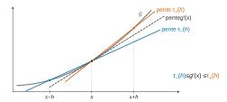
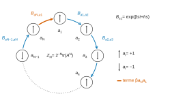
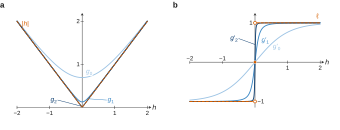
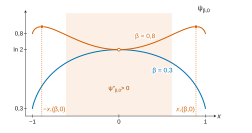
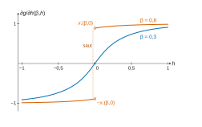
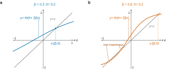

# X-ENS PC — Mathématiques 2026 · Corrigé brut

*Corrigé rédigé par IA, non officiel. Signalez toute erreur.*

Épreuve n° 1 de la filière PC, durée 4 h, calculatrice interdite. Notations du sujet : $\operatorname{ch},\operatorname{sh},\operatorname{th}$, le produit scalaire usuel $x\cdot y$ de $\mathbb R^d$, et $\phi(\lambda)=\ln E[e^{\lambda\cdot X}]$.

**Erratum de l'énoncé (question 21).** Avec la fonction $I$ de l'énoncé, la limite de la question 21 vaut $I(x)+\ln 2$, et non $I(x)$ : il manque un terme constant en $\ln 2$, ce que confirme le rapport du jury. De même, la convergence admise après la question 22 s'écrit en toute rigueur
$$G_N(\beta,h)\xrightarrow[N\to+\infty]{}g(\beta,h)-\ln 2 .$$
On démontre la forme exacte en Q21 et on en tient compte en Q30. Les questions 23 à 29, 31 et 32 ne portent que sur $\psi''_{\beta,h}$, sur les points de maximum de $\psi_{\beta,h}$ ou sur des différences de valeurs de $g$ : elles ne dépendent pas de cette constante.

**Coquille (question 5).** Il faut lire « en tout point $x\in\mathbb R^d$ ».

---

## Première partie

### Question 1

Soit $h>0$. Pour $0<s\leqslant t$, posons $\alpha=s/t\in\,]0,1]$. On a $x+s=\alpha(x+t)+(1-\alpha)x$, donc, par la définition de la convexité,
$$g(x+s)\leqslant\alpha\,g(x+t)+(1-\alpha)\,g(x).$$
En retranchant $g(x)$ et en divisant par $s>0$ :
$$\frac{g(x+s)-g(x)}{s}\leqslant\frac{g(x+t)-g(x)}{t}.$$
Le taux $\tau_+(s)=\frac{g(x+s)-g(x)}{s}$ est donc croissant sur $]0,+\infty[$.

De même, $x-s=\alpha(x-t)+(1-\alpha)x$ donne
$$g(x-s)-g(x)\leqslant\frac st\big(g(x-t)-g(x)\big).$$
Après division par $s$ et changement de signe, le taux $\tau_-(s)=\frac{g(x)-g(x-s)}{s}$ est **décroissant** en $s$.

Comme $g$ est dérivable en $x$ (et seulement supposée telle en ce point), $\tau_+(s)$ et $\tau_-(s)$ tendent vers $g'(x)$ quand $s\to0^+$.

Pour $0<s\leqslant h$, la monotonie donne
$$\tau_-(h)\leqslant\tau_-(s)\qquad\text{et}\qquad\tau_+(s)\leqslant\tau_+(h).$$
Dans chacune de ces inégalités, le membre de gauche et le membre de droite ont une limite quand $s\to0^+$ (l'un est constant). Le passage à la limite dans les inégalités larges donne $\tau_-(h)\leqslant g'(x)$ et $g'(x)\leqslant\tau_+(h)$ :
$$\boxed{\frac{g(x)-g(x-h)}{h}\leqslant g'(x)\leqslant\frac{g(x+h)-g(x)}{h}}$$

### Question 2

Soient $x,y\in\mathbb R$ et $\alpha\in[0,1]$. Pour tout $n$,
$$f_n(\alpha x+(1-\alpha)y)\leqslant\alpha f_n(x)+(1-\alpha)f_n(y).$$
Les trois suites $(f_n(\alpha x+(1-\alpha)y))_n$, $(f_n(x))_n$ et $(f_n(y))_n$ convergent, par convergence simple. Le passage à la limite dans l'inégalité large donne
$$f(\alpha x+(1-\alpha)y)\leqslant\alpha f(x)+(1-\alpha)f(y).$$
**$f$ est convexe.**

### Question 3

Pour $n\in\mathbb N$, posons $f_n(x)=\sqrt{x^2+\frac1{n+1}}$. Le radicande est minoré par $\frac1{n+1}>0$.

La racine carrée est de classe $\mathcal C^\infty$ sur $]0,+\infty[$, donc $f_n$ est de classe $\mathcal C^2$ sur $\mathbb R$, avec
$$f_n'(x)=\frac{x}{\sqrt{x^2+\frac1{n+1}}}$$
et
$$f_n''(x)=\frac{\frac1{n+1}}{\big(x^2+\frac1{n+1}\big)^{3/2}}>0 .$$

*Convexité.* La hessienne de $f_n$ (matrice $1\times1$ égale à $f_n''(x)$) est symétrique positive en tout point. Par Q6 avec $d=1$, **$f_n$ est convexe** ; elle est dérivable.

*Convergence.* Pour $x$ fixé, $x^2+\frac1{n+1}\to x^2$ et la racine carrée est continue sur $[0,+\infty[$, donc $f_n(x)\to\sqrt{x^2}=|x|$.

**La limite simple $f=|\cdot|$ n'est pas dérivable en $0$** : son taux d'accroissement en $0$ vaut $1$ à droite et $-1$ à gauche.

### Question 4

Soit $\varepsilon>0$. Comme $f$ est dérivable en $x$, on fixe $h>0$ tel que
$$\frac{f(x)-f(x-h)}{h}\geqslant f'(x)-\varepsilon$$
et
$$\frac{f(x+h)-f(x)}{h}\leqslant f'(x)+\varepsilon.$$
Le pas $h$ étant fixé, la convergence simple en $x-h$, $x$ et $x+h$ fournit $n_0$ tel que, pour $n\geqslant n_0$,
$$\frac{f_n(x)-f_n(x-h)}{h}\geqslant\frac{f(x)-f(x-h)}{h}-\varepsilon$$
et
$$\frac{f_n(x+h)-f_n(x)}{h}\leqslant\frac{f(x+h)-f(x)}{h}+\varepsilon.$$
La question 1, appliquée à $f_n$ (convexe et dérivable en $x$), encadre $f_n'(x)$ entre ces deux taux. On enchaîne les minorations d'une part, les majorations d'autre part : pour $n\geqslant n_0$,
$$\begin{aligned}
f_n'(x)&\geqslant\frac{f_n(x)-f_n(x-h)}{h}\geqslant f'(x)-2\varepsilon,\\
f_n'(x)&\leqslant\frac{f_n(x+h)-f_n(x)}{h}\leqslant f'(x)+2\varepsilon.
\end{aligned}$$
Ainsi $|f_n'(x)-f'(x)|\leqslant2\varepsilon$ pour $n\geqslant n_0$. Ceci établit à la fois l'existence de la limite et sa valeur :
$$\boxed{\lim_{n\to\infty}f_n'(x)=f'(x)}$$

### Question 5

(On lit $x\in\mathbb R^d$.) Rappelons qu'une matrice $S\in\mathcal M_d(\mathbb R)$ est symétrique positive si ${}^tS=S$ et ${}^tu\,S\,u\geqslant0$ pour tout $u\in\mathbb R^d$.

*Symétrie.* $g$ étant de classe $\mathcal C^2$, sa hessienne $\nabla^2g(x)$ est symétrique (théorème de Schwarz).

*Positivité.* Soit $u\in\mathbb R^d$ et $\gamma(t)=g(x+tu)$, de classe $\mathcal C^2$ sur $\mathbb R$. Par la règle de la chaîne,
$$\gamma'(t)=\sum_{i=1}^du_i\,\partial_ig(x+tu)$$
et
$$\begin{aligned}
\gamma''(t)&=\sum_{i,j}u_iu_j\,\partial_{ij}g(x+tu)\\
&={}^tu\,\nabla^2g(x+tu)\,u.
\end{aligned}$$
$\gamma$ est convexe, car $x+(\alpha s+(1-\alpha)t)u=\alpha(x+su)+(1-\alpha)(x+tu)$.

Pour $s<t$, la question 1 appliquée à $\gamma$ en $s$ et en $t$, avec le pas $t-s$, donne
$$\gamma'(s)\leqslant\frac{\gamma(t)-\gamma(s)}{t-s}\leqslant\gamma'(t).$$
$\gamma'$ est donc croissante, d'où $\gamma''\geqslant0$. En $t=0$, ${}^tu\,\nabla^2g(x)\,u\geqslant0$ pour tout $u$.

**La hessienne de $g$ en $x$ est symétrique positive.**

### Question 6

Soient $x,y\in\mathbb R^d$ et $\gamma(t)=g(x+t(y-x))$ pour $t\in[0,1]$. Il suffit d'établir $\gamma(\alpha)\leqslant\alpha\gamma(1)+(1-\alpha)\gamma(0)$ pour tout $\alpha\in[0,1]$. Comme en Q5,
$$\gamma''(t)={}^t(y-x)\,\nabla^2g\big(x+t(y-x)\big)\,(y-x)\geqslant0,$$
donc $\gamma'$ est croissante sur $[0,1]$.

Soit donc $\alpha\in[0,1]$. Si $\alpha\in\{0,1\}$, l'inégalité cherchée est une égalité. Sinon, le théorème des accroissements finis sur $[0,\alpha]$ et sur $[\alpha,1]$ fournit $c_1\in\,]0,\alpha[$ et $c_2\in\,]\alpha,1[$ tels que
$$\begin{aligned}
\frac{\gamma(\alpha)-\gamma(0)}{\alpha}&=\gamma'(c_1)\\
&\leqslant\gamma'(c_2)\\
&=\frac{\gamma(1)-\gamma(\alpha)}{1-\alpha}.
\end{aligned}$$
En multipliant par $\alpha(1-\alpha)>0$ :
$$\begin{aligned}
(1-\alpha)\big(\gamma(\alpha)-\gamma(0)\big)&\leqslant\alpha\big(\gamma(1)-\gamma(\alpha)\big),\\
\gamma(\alpha)&\leqslant\alpha\,\gamma(1)+(1-\alpha)\,\gamma(0).
\end{aligned}$$
Ainsi $g(\alpha y+(1-\alpha)x)\leqslant\alpha g(y)+(1-\alpha)g(x)$ : **$g$ est convexe.**

### Question 7

Soit $V\subset\mathbb R^d$ l'ensemble **fini** des valeurs de $X$ et $p_v=P[X=v]$. Par la formule de transfert,
$$Z(\lambda)=E[e^{\lambda\cdot X}]=\sum_{v\in V}p_v\,e^{\lambda\cdot v}.$$
C'est une somme finie de fonctions $\mathcal C^\infty$ de $\lambda$.

De plus $Z>0$ : les poids $p_v$ sont positifs de somme $1$ et les exponentielles sont strictement positives. Donc $\phi=\ln\circ Z$ est de classe $\mathcal C^\infty$, en particulier $\mathcal C^2$.

Une somme finie se dérive terme à terme :
$$\begin{aligned}
\partial_iZ(\lambda)&=\sum_vp_v\,v_i\,e^{\lambda\cdot v}=E[X_ie^{\lambda\cdot X}],\\
\partial_{ij}Z(\lambda)&=\sum_vp_v\,v_iv_j\,e^{\lambda\cdot v}=E[X_iX_je^{\lambda\cdot X}].
\end{aligned}$$
On en déduit
$$\begin{aligned}
\partial_i\phi&=\frac{\partial_iZ}{Z},\\
\partial_{ij}\phi&=\frac{\partial_{ij}Z}{Z}-\frac{\partial_iZ\,\partial_jZ}{Z^2},
\end{aligned}$$
c'est-à-dire
$$\boxed{\begin{aligned}
\frac{\partial\phi}{\partial\lambda_i}(\lambda)&=\frac{E[X_ie^{\lambda\cdot X}]}{E[e^{\lambda\cdot X}]},\\
\frac{\partial^2\phi}{\partial\lambda_i\partial\lambda_j}(\lambda)&=\frac{E[X_iX_je^{\lambda\cdot X}]}{E[e^{\lambda\cdot X}]}-\frac{E[X_ie^{\lambda\cdot X}]}{E[e^{\lambda\cdot X}]}\,\frac{E[X_je^{\lambda\cdot X}]}{E[e^{\lambda\cdot X}]}
\end{aligned}}$$

### Question 8

Fixons $\lambda$ et posons $q_v=p_v\,e^{\lambda\cdot v}/Z(\lambda)$ : $q_v\geqslant0$ et $\sum_vq_v=1$. Notons $\langle f\rangle=\sum_vq_vf(v)$ pour $f:V\to\mathbb R$. D'après Q7,
$$\partial_{ij}\phi(\lambda)=\langle v_iv_j\rangle-\langle v_i\rangle\langle v_j\rangle .$$
Cette expression est symétrique en $(i,j)$ : la hessienne $\nabla^2\phi(\lambda)$ est symétrique. Pour $u\in\mathbb R^d$, par bilinéarité,
$$\begin{aligned}
{}^tu\,\nabla^2\phi(\lambda)\,u&=\big\langle(u\cdot v)^2\big\rangle-\langle u\cdot v\rangle^2\\
&=\big\langle(u\cdot v-\langle u\cdot v\rangle)^2\big\rangle\\
&\geqslant0 .
\end{aligned}$$
La hessienne de $\phi$ est donc symétrique positive en tout point, et $\phi$ est de classe $\mathcal C^2$ (Q7). Par Q6, **$\phi$ est convexe.**

---

## Deuxième partie

### Question 9

$H_N(0,h,a)=h\sum_ia_i$. Les variables $e^{h\sigma_1},\dots,e^{h\sigma_N}$ sont mutuellement indépendantes (fonctions de variables indépendantes), donc
$$\begin{aligned}
Z_N(0,h)&=E\Big[\prod_{i=1}^Ne^{h\sigma_i}\Big]\\
&=\prod_{i=1}^NE[e^{h\sigma_i}]\\
&=\Big(\frac{e^h+e^{-h}}2\Big)^N\\
&=\operatorname{ch}(h)^N .
\end{aligned}$$
D'où $\boxed{Z_{N+1}(0,h)=\operatorname{ch}(h)Z_N(0,h)}$ et $\boxed{F_N(0,h)=\ln\operatorname{ch}(h)}$.

### Question 10

Posons
$$\begin{aligned}
Y^{(N)}&=\big(Y^{(N)}_1,Y^{(N)}_2\big),\\
Y^{(N)}_1&=\sum_{i=1}^{N-1}\sigma_i\sigma_{i+1}+\sigma_N\sigma_1,\\
Y^{(N)}_2&=\sum_{i=1}^N\sigma_i .
\end{aligned}$$
C'est une variable aléatoire à valeurs dans un sous-ensemble **fini** de $\mathbb R^2$ (au plus $2^N$ valeurs). Pour $\lambda=(\beta,h)$, on a $H_N(\beta,h,X^{(N)})=\lambda\cdot Y^{(N)}$, donc
$$\ln Z_N(\beta,h)=\ln E\big[e^{\lambda\cdot Y^{(N)}}\big]=\phi_{Y^{(N)}}(\lambda).$$
Par Q8 appliquée à $X=Y^{(N)}$ et $d=2$, cette fonction est convexe sur $\mathbb R^2$. Multiplier par $\frac1N>0$ conserve la convexité : **$F_N$ est convexe sur $\mathbb R^2$.**

### Question 11

On calcule
$$\begin{aligned}
\operatorname{tr}A&=e^{\beta-h}+e^{\beta+h}=2e^\beta\operatorname{ch}h,\\
\det A&=e^{2\beta}-e^{-2\beta}=2\operatorname{sh}(2\beta).
\end{aligned}$$
Le polynôme caractéristique $\chi_A(t)=t^2-2e^\beta\operatorname{ch}(h)\,t+2\operatorname{sh}(2\beta)$ a pour discriminant
$$\begin{aligned}
\Delta&=4\big(e^{2\beta}\operatorname{ch}^2h-e^{2\beta}+e^{-2\beta}\big)\\
&=4\big(e^{2\beta}\operatorname{sh}^2h+e^{-2\beta}\big),
\end{aligned}$$
grâce à $\operatorname{ch}^2h-1=\operatorname{sh}^2h$. Comme $e^{-2\beta}>0$, on a $\Delta>0$ : $\chi_A$ a deux racines réelles distinctes, qui sont les deux valeurs propres de $A$. La plus grande est
$$\boxed{\begin{aligned}
\lambda(\beta,h)&=e^\beta\operatorname{ch}(h)+\sqrt{e^{2\beta}\operatorname{ch}^2(h)-2\operatorname{sh}(2\beta)}\\
&=e^\beta\operatorname{ch}(h)+\sqrt{e^{2\beta}\operatorname{sh}^2(h)+e^{-2\beta}}
\end{aligned}}$$

### Question 12

Par définition, $B_{a_i,a_{i+1}}=\exp(\beta a_ia_{i+1}+ha_i)$ et $B_{a_N,a_1}=\exp(\beta a_Na_1+ha_N)$. Un produit d'exponentielles est l'exponentielle de la somme :
$$\begin{aligned}
\Big(\prod_{i=1}^{N-1}B_{a_i,a_{i+1}}\Big)B_{a_N,a_1}&=\exp\Big(\sum_{i=1}^{N-1}(\beta a_ia_{i+1}+ha_i)+\beta a_Na_1+ha_N\Big)\\
&=\exp\Big(\beta\sum_{i=1}^{N-1}a_ia_{i+1}+\beta a_Na_1+h\sum_{i=1}^Na_i\Big),
\end{aligned}$$
qui est $\exp(H_N(\beta,h,a))$.

### Question 13

$X^{(N)}$ est uniforme sur $\{-1,1\}^N$ : par indépendance, chaque configuration $a$ a la probabilité $2^{-N}$. Par la formule de transfert et Q12,
$$Z_N(\beta,h)=2^{-N}\sum_{a\in\{-1,1\}^N}\Big(\prod_{i=1}^{N-1}B_{a_i,a_{i+1}}\Big)B_{a_N,a_1}.$$
(Les facteurs $B_{\sigma_i,\sigma_{i+1}}$ ne sont pas indépendants : on ne factorise pas l'espérance, on la développe en somme sur les configurations.)

Indexons lignes et colonnes par $(-1,+1)$, dans cet ordre. La matrice $B=(B_{s,t})$ vaut
$$B=\begin{pmatrix}e^{\beta-h}&e^{-\beta-h}\\e^{-\beta+h}&e^{\beta+h}\end{pmatrix}={}^tA .$$
Par la formule du produit matriciel,
$$(B^N)_{a_1,a_1}=\sum_{a_2,\dots,a_N}B_{a_1,a_2}B_{a_2,a_3}\cdots B_{a_{N-1},a_N}B_{a_N,a_1}.$$
En sommant sur $a_1$, la somme sur les configurations vaut $\operatorname{tr}(B^N)$. Enfin $\operatorname{tr}(B^N)=\operatorname{tr}\big({}^t(A^N)\big)=\operatorname{tr}(A^N)$. Donc
$$\boxed{Z_N(\beta,h)=2^{-N}\operatorname{tr}(A^N)}$$

### Question 14

Soit $\mu$ l'autre valeur propre de $A$ et $\lambda=\lambda(\beta,h)$. $A$ est diagonalisable (deux valeurs propres distinctes en dimension 2), donc $\operatorname{tr}(A^N)=\lambda^N+\mu^N$.

*Comparaison des modules.* $\lambda>0$, comme somme de $e^\beta\operatorname{ch}h>0$ et d'une racine carrée.

Pour $\beta\geqslant0$, $\lambda\mu=\det A=2\operatorname{sh}(2\beta)\geqslant0$, donc $\mu\geqslant0$.

Comme $\mu<\lambda$ (valeurs propres distinctes, $\lambda$ la plus grande), on obtient $0\leqslant\mu/\lambda<1$.

Alors
$$F_N(\beta,h)=\ln\lambda-\ln2+\frac1N\ln\Big(1+\big(\tfrac\mu\lambda\big)^N\Big),$$
avec
$$0\leqslant\frac1N\ln\Big(1+\big(\tfrac\mu\lambda\big)^N\Big)\leqslant\frac{\ln2}N .$$
Par encadrement,
$$\boxed{\lim_{N\to+\infty}F_N(\beta,h)=\ln\lambda(\beta,h)-\ln2}$$

### Question 15

D'après Q11, $\lambda(\beta,h)=e^\beta\operatorname{ch}h+\sqrt{R(\beta,h)}$ avec
$$R(\beta,h)=e^{2\beta}\operatorname{sh}^2h+e^{-2\beta}.$$
$R$ est de classe $\mathcal C^\infty$ sur $\mathbb R^2$ (sommes, produits et composées de fonctions $\mathcal C^\infty$), et $R\geqslant e^{-2\beta}>0$.

La racine carrée est $\mathcal C^\infty$ sur $]0,+\infty[$, donc $\sqrt R$ l'est aussi.

**$\lambda$ est de classe $\mathcal C^\infty$ sur $\mathbb R^2$**, a fortiori sur $[0,+\infty[\times\mathbb R$.

### Question 16

Fixons $\beta\geqslant0$. $Z_N(\beta,h)=2^{-N}\sum_ae^{H_N(\beta,h,a)}$ est une somme finie de fonctions dérivables en $h$, avec $\partial_hH_N(\beta,h,a)=\sum_ia_i$. D'où
$$\begin{aligned}
\frac{\partial F_N}{\partial h}(\beta,h)&=\frac1N\,\frac{\partial_hZ_N(\beta,h)}{Z_N(\beta,h)}\\
&=\frac1{Z_N(\beta,h)}E\Big[\Big(\frac1N\sum_{i=1}^N\sigma_i\Big)e^{H_N(\beta,h,X^{(N)})}\Big]\\
&=m_N(\beta,h).
\end{aligned}$$
(C'est aussi la première formule de Q7 pour la variable $Y^{(N)}$ de Q10, coordonnée $i=2$, divisée par $N$.)

Posons $f_N=F_N(\beta,\cdot)$ et vérifions les hypothèses de Q4 :

- chaque $f_N$ est convexe (restriction à une droite de la fonction convexe $F_N$, Q10) et dérivable sur $\mathbb R$ ;
- $(f_N)$ converge simplement vers $f=\ln\lambda(\beta,\cdot)-\ln2$ (Q14) ;
- $f$ est dérivable sur $\mathbb R$ (Q15, et $\lambda>0$).

La question 4 donne $f_N'(h)\to f'(h)$, c'est-à-dire
$$\boxed{\lim_{N\to+\infty}m_N(\beta,h)=\frac{\partial}{\partial h}\ln\lambda(\beta,h)}$$

### Question 17

D'après Q11,
$$e^{-\beta}\lambda(\beta,h)=\operatorname{ch}h+\sqrt{\operatorname{sh}^2h+e^{-4\beta}},$$
donc
$$g_\beta(h)=\ln\Big(\operatorname{ch}h+\sqrt{\operatorname{sh}^2h+e^{-4\beta}}\Big).$$
À $h$ fixé, quand $\beta\to+\infty$ dans $\mathbb N$, $e^{-4\beta}\to0$.

Par continuité de la racine carrée sur $[0,+\infty[$ et du logarithme sur $[1,+\infty[$,
$$g_\beta(h)\longrightarrow\ln\big(\operatorname{ch}h+|\operatorname{sh}h|\big).$$
Selon le signe de $h$ : si $h\geqslant0$, $\operatorname{ch}h+|\operatorname{sh}h|=\operatorname{ch}h+\operatorname{sh}h=e^h$ ; si $h<0$, $\operatorname{ch}h+|\operatorname{sh}h|=\operatorname{ch}h-\operatorname{sh}h=e^{-h}$. Dans les deux cas, la limite vaut $\ln e^{|h|}=|h|$.

**$(g_\beta)_{\beta\in\mathbb N}$ converge simplement vers $h\mapsto|h|$.**

### Question 18

Posons $c=e^{-4\beta}$ et $r=\sqrt{\operatorname{sh}^2h+c}>0$, de dérivée $r'=\frac{\operatorname{sh}h\operatorname{ch}h}{r}$. Alors
$$\begin{aligned}
g_\beta'(h)&=\frac{\operatorname{sh}h+\frac{\operatorname{sh}h\operatorname{ch}h}{r}}{\operatorname{ch}h+r}\\
&=\frac{\operatorname{sh}h\,(r+\operatorname{ch}h)}{r\,(\operatorname{ch}h+r)}\\
&=\frac{\operatorname{sh}h}{\sqrt{\operatorname{sh}^2h+e^{-4\beta}}}.
\end{aligned}$$
Pour $h>0$, $g_\beta'(h)\to\frac{\operatorname{sh}h}{|\operatorname{sh}h|}=1$. Pour $h<0$, la limite vaut $-1$. Enfin $g_\beta'(0)=0$ pour tout $\beta$. La limite simple est
$$\boxed{\ell(h)=\begin{cases}-1&h<0\\0&h=0\\1&h>0\end{cases}}$$
Pour $h\neq0$, on retrouve ce que donne Q4 appliquée aux $g_\beta$ : elles sont convexes comme limites simples des $F_N(\beta,\cdot)+\ln2-\beta$ (Q2, Q10, Q14), et $|\cdot|$ est dérivable en $h\neq0$ (Q17).

**La convergence n'est pas uniforme.** Chaque $g_\beta'$ est continue sur $\mathbb R$, et une limite uniforme de fonctions continues est continue, ce que $\ell$ n'est pas en $0$.

Explicitement, $g_\beta'(e^{-2\beta})\to\frac1{\sqrt2}$ alors que $\ell(e^{-2\beta})=1$, donc $\sup_h|g_\beta'(h)-\ell(h)|$ ne tend pas vers $0$.

---

## Troisième partie

### Question 19

Posons $p=\frac{1+x}2$ et $q=\frac{1-x}2$, de sorte que $I(x)=p\ln p+q\ln q$.

Quand $x\to1^-$, $p\to1$ donc $p\ln p\to0$, et $q\to0^+$ donc $q\ln q\to0$ (croissances comparées).

$I$ étant paire, il en va de même en $-1^+$.

**$I$ se prolonge par continuité en posant $I(\pm1)=0$**, et devient continue sur $[-1,1]$.

### Question 20

Soit $K$ le nombre d'indices $i\leqslant N$ tels que $\sigma_i=1$.

On a $K=\sum_i\frac{1+\sigma_i}2$, somme de $N$ variables de Bernoulli de paramètre $\frac12$ mutuellement indépendantes, donc $K\sim\mathcal B(N,\frac12)$.

Comme $\sum_i\sigma_i=K-(N-K)$,
$$S_N=\frac{2K-N}N=-1+\frac{2K}N .$$
$S_N$ prend donc ses valeurs dans $\mathscr M_N$, et $S_N=x$ équivaut à $K=\frac{N(1+x)}2$. D'où
$$\boxed{P[S_N=x]=\begin{cases}\dbinom{N}{\frac{N(1+x)}2}2^{-N}&\text{si }x\in\mathscr M_N,\\[2mm]0&\text{sinon.}\end{cases}}$$

### Question 21

Posons $m_N=\frac{N(1+u_N)}2$ : comme $u_N\in\mathscr M_N$, c'est un entier de $\{0,\dots,N\}$.

Posons aussi $p_N=\frac{m_N}N=\frac{1+u_N}2$ et $q_N=1-p_N$.

Alors $p_N\to p=\frac{1+x}2\in\,]0,1[$ et $q_N\to q=1-p$.

*Les arguments des factorielles tendent vers l'infini.* $m_N=Np_N$ et $N-m_N=Nq_N$ avec $p,q>0$, donc $m_N\to+\infty$ et $N-m_N\to+\infty$.

*Stirling sans sommer d'équivalents.* De $n!\sim\sqrt{2\pi n}\,(n/e)^n$ on tire, en passant au logarithme (si $a_n\sim b_n$, alors $\ln a_n-\ln b_n=\ln\frac{a_n}{b_n}\to0$) :
$$\ln n!=n\ln n-n+\tfrac12\ln(2\pi n)+o(1).$$
On l'applique à $N$, $m_N$ et $N-m_N$, qui tendent tous vers l'infini, et on **soustrait des égalités** (et non des équivalents). Les termes $-n$ se compensent et les termes $\frac12\ln(2\pi\,\cdot)$ sont des $O(\ln N)$ :
$$\ln\binom N{m_N}=N\ln N-m_N\ln m_N-(N-m_N)\ln(N-m_N)+O(\ln N).$$
Avec $\ln m_N=\ln N+\ln p_N$ et $\ln(N-m_N)=\ln N+\ln q_N$, les termes en $\ln N$ se compensent :
$$\begin{aligned}
\frac1N\ln\binom N{m_N}&=-p_N\ln p_N-q_N\ln q_N+O\Big(\frac{\ln N}N\Big)\\
&\longrightarrow-p\ln p-q\ln q=-I(x),
\end{aligned}$$
par continuité de $u\mapsto u\ln u$ sur $]0,1[$. Par Q20,
$$-\frac1N\ln P[S_N=u_N]=-\frac1N\ln\binom N{m_N}+\ln2,$$
donc
$$\boxed{\lim_{N\to+\infty}-\frac1N\ln P[S_N=u_N]=I(x)+\ln2}$$
**L'énoncé, qui annonce $I(x)$, comporte une erreur de constante.**

Contrôle en $x=0$ (avec $u_N\in\{0,\frac1N\}$) : $P[S_N=u_N]$ est de l'ordre de $\sqrt{2/(\pi N)}$ et ne décroît pas exponentiellement.

La limite vaut donc $0=I(0)+\ln2$, alors que $I(0)=-\ln2$. Le résultat annoncé serait exact avec
$$J(x)=I(x)+\ln2=\frac{1+x}2\ln(1+x)+\frac{1-x}2\ln(1-x).$$

### Question 22

Soit $x\in\mathscr M_N$. $S_N$ prend ses valeurs dans l'ensemble fini $\mathscr M_N$, donc, par la formule de transfert,
$$Y_N(\beta,h)=\sum_{y\in\mathscr M_N}P[S_N=y]\,e^{N(\beta y^2+hy)} .$$
C'est une somme finie de termes positifs, donc elle majore chacun d'eux :
$$Y_N(\beta,h)\geqslant P[S_N=x]\,e^{N(\beta x^2+hx)}.$$
Comme $P[S_N=x]>0$ (Q20), on prend le logarithme (croissant) et on divise par $N$ :
$$\boxed{G_N(\beta,h)\geqslant\beta x^2+hx+\frac1N\ln P[S_N=x]}$$
Compte tenu de Q21, la convergence admise est exacte sous la forme $G_N(\beta,h)\to g(\beta,h)-\ln2$, avec $g$ défini comme dans l'énoncé ; seule cette forme sert en Q30.

### Question 23

Sur $]-1,1[$, on dérive les deux termes de $I$ :
$$\begin{aligned}
I'(x)&=\tfrac12\ln\tfrac{1+x}2+\tfrac12-\tfrac12\ln\tfrac{1-x}2-\tfrac12\\
&=\tfrac12\ln\frac{1+x}{1-x},
\end{aligned}$$
puis
$$\begin{aligned}
I''(x)&=\frac12\Big(\frac1{1+x}+\frac1{1-x}\Big)\\
&=\frac1{1-x^2}.
\end{aligned}$$
Donc, indépendamment de $h$,
$$\psi_{\beta,h}''(x)=2\beta-\frac1{1-x^2}.$$

- Si $\beta\in[0,\frac12]$ : $\frac1{1-x^2}\geqslant1\geqslant2\beta$, donc **$\psi''_{\beta,h}(x)\leqslant0$ pour tout $x\in\,]-1,1[$** (avec égalité seulement pour $\beta=\frac12$ et $x=0$).
- Si $\beta>\frac12$ : $\psi''_{\beta,h}(x)\leqslant0$ équivaut à $1-x^2\leqslant\frac1{2\beta}$, c'est-à-dire, avec $x\in\,]-1,1[$, $$\boxed{|x|\geqslant\sqrt{1-\frac1{2\beta}}}$$

### Question 24

Soient $\beta\geqslant0$ et $h>0$. $\psi=\psi_{\beta,h}$ est continue sur le segment $[-1,1]$ (Q19), donc atteint son maximum.

*Localisation.* $\beta x^2$ et $I$ sont paires, donc pour $x\in\,]0,1]$,
$$\psi(x)-\psi(-x)=2hx>0 :$$
aucun point de $[-1,0[$ n'est point de maximum. Sur $]-1,1[$,
$$\psi'(x)=2\beta x+h-\frac12\ln\frac{1+x}{1-x}.$$
- D'une part $\psi'(0)=h>0$, donc $\psi$ croît strictement au voisinage de $0$ : $0$ n'est pas un maximum.
- D'autre part $\psi'(x)\to-\infty$ quand $x\to1^-$. Il existe donc $a<1$ tel que $\psi'<0$ sur $[a,1[$.
- Alors $\psi$, continue en $1$, est strictement décroissante sur $[a,1]$ : $1$ n'est pas un maximum.

Tout point de maximum est donc dans l'ouvert $]0,1[$, où $\psi$ est dérivable : il annule $\psi'$.

*Unicité.* Sur $]0,1[$,
$$\psi'''(x)=-I'''(x)=-\frac{2x}{(1-x^2)^2}<0 .$$
$\psi''$ est donc strictement décroissante sur $[0,1[$, et $\psi'$ y est **strictement concave** (argument de Q6, avec des inégalités strictes).

Supposons que $\psi'$ s'annule en $0<z_1<z_2<1$. Écrivons $z_1=t\cdot0+(1-t)z_2$ avec $t\in\,]0,1[$. La stricte concavité donne
$$\begin{aligned}
0=\psi'(z_1)&>t\,\psi'(0)+(1-t)\,\psi'(z_2)\\
&=th>0,
\end{aligned}$$
ce qui est absurde. $\psi'$ a donc au plus un zéro dans $]0,1[$, et au moins un (le point de maximum).

**$\psi_{\beta,h}$ atteint son maximum en un unique point $x_*(\beta,h)\in\,]0,1[$**, caractérisé par $\psi'_{\beta,h}(x_*)=0$.

De plus $\psi'>0$ sur $[0,x_*[$ et $\psi'<0$ sur $]x_*,1[$.

*Cas $h<0$.* On a $\psi_{\beta,h}(x)=\psi_{\beta,-h}(-x)$. Donc $\psi_{\beta,h}$ atteint son maximum en un unique point, à savoir $-x_*(\beta,-h)\in\,]-1,0[$.

### Question 25

Ici $h=0$ : $\psi_{\beta,0}(x)=\beta x^2-I(x)$ est paire et $\psi'_{\beta,0}(0)=0$.

*Cas $\beta\in[0,\frac12]$.* Par Q23, $\psi''_{\beta,0}<0$ sur $]-1,1[$, sauf éventuellement en $0$.

$\psi'_{\beta,0}$ est donc strictement décroissante. Nulle en $0$, elle est $>0$ sur $]-1,0[$ et $<0$ sur $]0,1[$.

Par continuité de $\psi_{\beta,0}$ en $\pm1$, $\psi_{\beta,0}$ est strictement croissante sur $[-1,0]$ et strictement décroissante sur $[0,1]$.

**Le maximum est atteint en $0$ et seulement en $0$.**

*Cas $\beta>\frac12$.* Sur $[0,1[$, $\psi'_{\beta,0}$ est strictement concave (même calcul qu'en Q24). On dispose de :

- $\psi'_{\beta,0}(0)=0$ et $\psi''_{\beta,0}(0)=2\beta-1>0$, donc il existe $\varepsilon\in\,]0,1[$ avec $\psi'_{\beta,0}(\varepsilon)>0$ ;
- $\psi'_{\beta,0}(x)\to-\infty$ quand $x\to1^-$.

Par le théorème des valeurs intermédiaires, $\psi'_{\beta,0}$ s'annule en un point $c\in\,]\varepsilon,1[$.

Ce zéro est unique dans $]0,1[$.

En effet, une fonction strictement concave s'annule au plus deux fois : si $a<b<c'$ étaient trois zéros, $b$ serait combinaison convexe stricte de $a$ et $c'$, et la stricte concavité donnerait $0>0$. Or $0$ est déjà un zéro.

Entre ses zéros, $\psi'_{\beta,0}$ garde un signe constant (valeurs intermédiaires). Elle est $>0$ en $\varepsilon<c$ et tend vers $-\infty$ en $1^-$.

Donc $\psi'_{\beta,0}>0$ sur $]0,c[$ et $\psi'_{\beta,0}<0$ sur $]c,1[$.

Ainsi $\psi_{\beta,0}$ est strictement croissante sur $[0,c]$ et strictement décroissante sur $[c,1]$ : sur $[0,1]$, le maximum est atteint en $c$ seul.

Par parité, sur $[-1,1]$, **le maximum est atteint exactement en $x_*(\beta,0):=c\in\,]0,1[$ et en $-x_*(\beta,0)$.**

### Question 26

Comme $v_n\to h>0$, il existe $n_1$ tel que $v_n>0$ pour $n\geqslant n_1$.

Posons alors $x_n=x_*(\beta,v_n)\in\,]0,1[$ et $\ell=\lim x_n$, qui appartient au fermé $[0,1]$.

*Caractère maximal.* Pour $n\geqslant n_1$ et tout $y\in[-1,1]$,
$$\beta x_n^2+v_nx_n-I(x_n)\geqslant\beta y^2+v_ny-I(y).$$

*Passage à la limite.* $I$ est continue sur $[-1,1]$ (Q19), y compris aux bords, où $\ell$ peut se trouver a priori. Avec $x_n\to\ell$ et $v_n\to h$, on obtient, pour tout $y\in[-1,1]$,
$$\psi_{\beta,h}(\ell)\geqslant\psi_{\beta,h}(y).$$

*Unicité.* $\ell$ est un point de maximum de $\psi_{\beta,h}$ ; par l'unicité de Q24,
$$\boxed{\lim_{n\to\infty}x_*(\beta,v_n)=x_*(\beta,h)}$$

### Question 27

Pour $h\geqslant0$, $x_*(\beta,h)$ est un point de maximum de $\psi_{\beta,h}$ sur $[-1,1]$.

C'est Q24 si $h>0$, et Q25 si $h=0$, que $\beta$ soit au-dessous ou au-dessus de $\frac12$.

Le supremum $g(\beta,h)$ est donc atteint :
$$g(\beta,h)=\psi_{\beta,h}\big(x_*(\beta,h)\big).$$
Posons $x_*=x_*(\beta,h)$ et comparons $\psi_{\beta,h'}$ et $\psi_{\beta,h}$ : $\psi_{\beta,h'}(x)=\psi_{\beta,h}(x)+(h'-h)x$. Comme $g(\beta,h')$ majore $\psi_{\beta,h'}$,
$$\begin{aligned}
g(\beta,h')&\geqslant\psi_{\beta,h'}(x_*)\\
&=\psi_{\beta,h}(x_*)+(h'-h)x_*\\
&=g(\beta,h)+(h'-h)x_*.
\end{aligned}$$
En échangeant les rôles de $h$ et $h'$ :
$$g(\beta,h)\geqslant g(\beta,h')+(h-h')\,x_*(\beta,h').$$
D'où
$$\boxed{(h'-h)\,x_*(\beta,h)\leqslant g(\beta,h')-g(\beta,h)\leqslant(h'-h)\,x_*(\beta,h')}$$

### Question 28

Soit $h>0$ et $h'\geqslant0$ avec $h'\neq h$. On divise l'encadrement de Q27 par $h'-h$, en renversant les inégalités si $h'<h$ : le taux
$$\tau(h')=\frac{g(\beta,h')-g(\beta,h)}{h'-h}$$
est compris entre $x_*(\beta,h)$ et $x_*(\beta,h')$.

Par la continuité admise de $h'\mapsto x_*(\beta,h')$ sur $[0,+\infty[$, $x_*(\beta,h')\to x_*(\beta,h)$ quand $h'\to h$.

Par encadrement, $\tau(h')\to x_*(\beta,h)$ :
$$\boxed{h'\mapsto g(\beta,h')\text{ est dérivable en }h\text{ et }\frac{\partial g}{\partial h}(\beta,h)=x_*(\beta,h)}$$

### Question 29

*Parité.* $\psi_{\beta,-h}(x)=\psi_{\beta,h}(-x)$ et $[-1,1]$ est symétrique, donc $g(\beta,-h)=g(\beta,h)$.

*Hors de $0$.* $g(\beta,\cdot)$ est dérivable sur $]0,+\infty[$ (Q28), donc sur $]-\infty,0[$ par parité (composée avec $h\mapsto-h$).

*En $0$.* Q27 avec $h=0$ et $h'>0$ donne
$$x_*(\beta,0)\leqslant\frac{g(\beta,h')-g(\beta,0)}{h'}\leqslant x_*(\beta,h').$$
Par la continuité admise en $0$, la dérivée à droite en $0$ existe et vaut $x_*(\beta,0)$. Par parité, la dérivée à gauche vaut $-x_*(\beta,0)$.

Donc $g(\beta,\cdot)$ est dérivable en $0$ si et seulement si $x_*(\beta,0)=0$, c'est-à-dire, par Q25, si et seulement si $\beta\leqslant\frac12$ :
$$\boxed{h\mapsto g(\beta,h)\text{ est dérivable sur }\mathbb R\iff\beta\in\big[0,\tfrac12\big]}$$

### Question 30

On a $\frac\beta N\sum_{i,j}\sigma_i\sigma_j=\frac\beta N\big(\sum_i\sigma_i\big)^2=\beta NS_N^2$ et $h\sum_i\sigma_i=hNS_N$. La quantité étudiée vaut donc
$$Q_N=\frac{E\big[S_N\,e^{\beta NS_N^2+hNS_N}\big]}{Y_N(\beta,h)} .$$
$Y_N$ est une somme finie de fonctions dérivables en $h$ (Q22), et
$$\begin{aligned}
Q_N&=\frac1N\,\frac{\partial_hY_N(\beta,h)}{Y_N(\beta,h)}\\
&=\frac{\partial G_N}{\partial h}(\beta,h).
\end{aligned}$$
Vérifions les hypothèses de Q4 pour $f_N=G_N(\beta,\cdot)+\ln2$ :

- avec $W^{(N)}=(NS_N^2,NS_N)$, à valeurs dans un ensemble fini de $\mathbb R^2$, $\ln Y_N(\beta,h)=\phi_{W^{(N)}}(\beta,h)$ est convexe (Q8) ; donc $f_N$ est convexe et dérivable sur $\mathbb R$ ;
- par la convergence admise, sous sa forme rectifiée (Q21–Q22), $f_N\to g(\beta,\cdot)$ simplement sur $\mathbb R$ ;
- $g(\beta,\cdot)$ est dérivable en $h>0$, de dérivée $x_*(\beta,h)$ (Q28).

La question 4 donne $f_N'(h)=Q_N\to x_*(\beta,h)$ :
$$\boxed{\lim_{N\to+\infty}\frac1{Y_N(\beta,h)}E\Big[\Big(\frac1N\sum_{i=1}^N\sigma_i\Big)\exp\Big(\frac\beta N\sum_{i,j}\sigma_i\sigma_j+h\sum_i\sigma_i\Big)\Big]=x_*(\beta,h)}$$
La constante $\ln2$ est sans effet : l'énoncé tel qu'admis conduirait à la même dérivée.

### Question 31

Par Q24, $x_*=x_*(\beta,h)\in\,]0,1[$ annule $\psi'_{\beta,h}$ :
$$\frac12\ln\frac{1+x_*}{1-x_*}=h+2\beta x_* .$$
Or, pour $t\in\mathbb R$ et $x\in\,]-1,1[$,
$$\begin{aligned}
\operatorname{th}t=x&\iff\frac{e^{2t}-1}{e^{2t}+1}=x\\
&\iff e^{2t}=\frac{1+x}{1-x}\\
&\iff t=\frac12\ln\frac{1+x}{1-x}.
\end{aligned}$$
Avec $t=h+2\beta x_*$ :
$$\boxed{x_*(\beta,h)=\operatorname{th}\big(h+2\beta x_*(\beta,h)\big)}$$

### Question 32

Notons $x_h=x_*(\frac12,h)$ pour $h>0$. Par Q24 et Q31, $x_h\in\,]0,1[$ et $\frac12\ln\frac{1+x_h}{1-x_h}=h+x_h$, soit $\Phi(x_h)=h$ avec
$$\Phi(x)=\frac12\ln\frac{1+x}{1-x}-x .$$

*$x_h$ tend vers $0$.* Sur $]0,1[$,
$$\Phi'(x)=\frac1{1-x^2}-1=\frac{x^2}{1-x^2}>0 .$$
$\Phi$ est donc une bijection continue strictement croissante de $[0,1[$ sur $[0,+\infty[$ (car $\Phi(0)=0$ et $\Phi\to+\infty$ en $1$), de réciproque continue.

Donc $x_h=\Phi^{-1}(h)\to\Phi^{-1}(0)=0$ quand $h\to0^+$.

(On peut aussi invoquer la continuité admise et $x_*(\frac12,0)=0$, par Q25.)

*Équivalent.* Par différence des développements en série entière de $\ln(1+x)$ et $\ln(1-x)$, pour $|x|<1$,
$$\frac12\ln\frac{1+x}{1-x}=\sum_{k\geqslant0}\frac{x^{2k+1}}{2k+1}.$$
Donc $\Phi(x)=\frac{x^3}3+O(x^5)$, d'où $\Phi(x)\sim\frac{x^3}3$ en $0$.

Comme $x_h\to0$, on peut composer : $h=\Phi(x_h)\sim\frac{x_h^3}3$, soit $\frac{x_h^3}{3h}\to1$.

Par continuité de $t\mapsto t^{1/3}$ en $1$ :
$$\boxed{\lim_{\substack{h\to0\\h>0}}\frac{x_*(\frac12,h)}{(3h)^{1/3}}=1}$$
