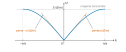
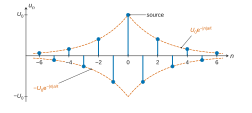
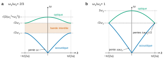
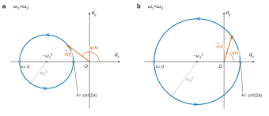
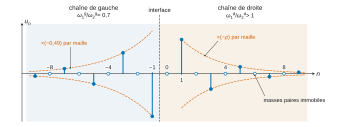
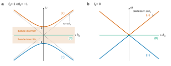

# X-ENS PC — Physique B 2026 · Corrigé brut

*Corrigé rédigé par IA, non officiel. Signalez toute erreur.*

*De la topologie dans les ondes : de la matière condensée à El Niño.* Durée 4 h, calculatrice interdite. 45 questions (numérotation du sujet, sous-questions comprises).

## Partie I — Chaînes masse-ressort

### 1. Chaîne monoatomique

#### Question 1

La masse $n$ est reliée aux masses $n+1$ et $n-1$ par deux ressorts de raideur $\beta$ et de longueur à vide $a$.

Le ressort de droite a pour longueur $a+u_{n+1}-u_n$ : son allongement est $u_{n+1}-u_n$, indépendant de la longueur à vide. De même, l'allongement du ressort de gauche est $u_n-u_{n-1}$.

Le ressort de droite, s'il est étiré, tire la masse vers $+x$ ; celui de gauche la tire vers $-x$. Le poids et la réaction du support se compensent. Le principe fondamental de la dynamique projeté sur $\vec e_x$ donne

$$\begin{aligned}
m\,\ddot u_n&=\beta\,(u_{n+1}-u_n)-\beta\,(u_n-u_{n-1})\\
&=\beta\,(u_{n+1}+u_{n-1}-2u_n)
\end{aligned}$$

$$\boxed{m\,\ddot u_n=\beta\,(u_{n+1}+u_{n-1}-2u_n)}$$

#### Question 2

Avec $\underline{u_n}=\underline{U_0}\,e^{i(kna-\omega t)}$, on a $\ddot{\underline{u_n}}=-\omega^2\underline{u_n}$ et $\underline{u_{n\pm1}}=e^{\pm ika}\,\underline{u_n}$. En simplifiant par $\underline{u_n}\neq0$ :

$$\begin{aligned}
-m\omega^2&=\beta\left(e^{ika}+e^{-ika}-2\right)\\
&=2\beta(\cos ka-1)\\
&=-4\beta\sin^2\frac{ka}{2}
\end{aligned}$$

On a utilisé $\cos2\theta=1-2\sin^2\theta$ avec $\theta=ka/2$. On obtient $\omega^2=\dfrac{4\beta}{m}\sin^2\dfrac{ka}{2}$.

La pulsation est positive et $\sqrt{\sin^2x}=\lvert\sin x\rvert$ :

$$\boxed{\omega(k)=2\sqrt{\frac{\beta}{m}}\,\left|\sin\frac{ka}{2}\right|}$$

#### Question 3

$\omega$ dépend de $k$ par $\sin^2(ka/2)$, de période $2\pi/a$.

D'ailleurs, $k$ et $k+2\pi/a$ donnent exactement les mêmes déplacements $u_n$, puisque $e^{2i\pi n}=1$. La période centrée sur l'origine est

$$\boxed{k\in\left[-\frac{\pi}{a},\ \frac{\pi}{a}\right]}$$

#### Question 4

Sur $[-\pi/a,\pi/a]$, $\omega(k)$ est paire et nulle en $k=0$. Elle croît sur $[0,\pi/a]$ et atteint son maximum $\omega_{\max}=2\sqrt{\beta/m}$ en $k=\pm\pi/a$, avec une tangente horizontale.

En $k=0$, la courbe présente un point anguleux : demi-tangentes de pentes $\pm a\sqrt{\beta/m}$.

| $k$ | $-\pi/a$ | $0^-$ | $0$ | $0^+$ | $\pi/a$ |
|---|---|---|---|---|---|
| $\omega$ | $2\sqrt{\beta/m}$ | | $0$ | | $2\sqrt{\beta/m}$ |
| pente | $0$ | $-a\sqrt{\beta/m}$ | point anguleux | $+a\sqrt{\beta/m}$ | $0$ |

Deux arcs concaves symétriques : une arche de sinus « redressée ».

#### Question 5

Pour $\lvert k\rvert a\ll1$, $\sin(ka/2)\simeq ka/2$, d'où $\omega\simeq a\sqrt{\beta/m}\,\lvert k\rvert$. La relation est linéaire : vitesses de phase et de groupe sont égales,

$$\boxed{c_s=a\sqrt{\frac{\beta}{m}}}$$

C'est la célérité du son dans la chaîne. Aux grandes longueurs d'onde ($\lambda\gg a$), la chaîne se comporte comme un milieu élastique continu, **non dispersif** (équation de d'Alembert).

La pente est $+c_s$ pour $k>0$ (onde vers $+x$) et $-c_s$ pour $k<0$ (onde vers $-x$).

#### Question 6

Sur $[0,\pi/a]$, $v_g=\dfrac{\mathrm d\omega}{\mathrm dk}=a\sqrt{\dfrac{\beta}{m}}\cos\dfrac{ka}{2}$, donc

$$\boxed{v_g\left(\pm\frac{\pi}{a}\right)=0}$$

L'énergie n'est pas transportée. En $k=\pm\pi/a$ ($\lambda=2a$), deux masses voisines oscillent en opposition de phase. Les ondes $\pm\pi/a$, qui décrivent le même mode, se superposent en une **onde stationnaire**.

C'est une condition de type Bragg : les réflexions sur chaque maille interfèrent constructivement.

#### Question 7.1

On impose $\omega=\alpha\sqrt{\beta/m}$, avec $\alpha>2$. La relation de la question 2 exige

$$\sin^2\frac{ka}{2}=\frac{m\omega^2}{4\beta}=\frac{\alpha^2}{4}>1$$

C'est impossible pour $k$ réel, puisque $\lvert\sin(ka/2)\rvert\leq1$. La pulsation dépasse la pulsation de coupure $2\sqrt{\beta/m}$ : il faut chercher $\underline k=k'+ik''$ complexe.

#### Question 7.2

On pose $x=k'a/2$ et $y=k''a/2$. La formule rappelée donne $\sin(\underline ka/2)=\sin x\,\mathrm{ch}\,y+i\cos x\,\mathrm{sh}\,y$.

Son carré doit être le réel positif $\alpha^2/4$, donc $\sin(\underline ka/2)=\pm\alpha/2$ est réel. Il faut $\cos x\,\mathrm{sh}\,y=0$.

Le cas $y=0$ ramène au cas réel, impossible. Donc $\cos x=0$, soit $k'a/2\equiv\pi/2\ [\pi]$. Dans la première zone de Brillouin :

$$\boxed{k'=\pm\frac{\pi}{a}}$$

Ces deux bords de zone sont équivalents, puisque $e^{i\pi n}=e^{-i\pi n}=(-1)^n$ ; on garde $k'=\pi/a$.

#### Question 7.3

Avec $\sin x=\pm1$, on a $\sin(\underline ka/2)=\pm\mathrm{ch}(k''a/2)$. D'où $\mathrm{ch}(k''a/2)=\alpha/2>1$, ce qui est possible :

$$\boxed{k''=\pm\frac{2}{a}\,\mathrm{argch}\frac{\alpha}{2}}$$

Le déplacement vaut $\underline{u_n}=\underline{U_0}\,(-1)^n e^{-k''na}e^{-i\omega t}$, de module $\lvert U_0\rvert e^{-k''na}$.

L'énergie provient de la source en $n=0$. Une amplitude croissant exponentiellement loin de la source n'est pas physique (énergie infinie). On garde donc $k''>0$ pour $n>0$ et $k''<0$ pour $n<0$ : dans les deux cas, l'amplitude décroît en s'éloignant de la source.

#### Question 7.4

On pose $\ell=\dfrac{1}{\lvert k''\rvert}=\dfrac{a}{2\,\mathrm{argch}(\alpha/2)}$ et on prend $\underline{U_0}=U_0$ réel :

$$\boxed{u_n(t)=U_0\,(-1)^n\,e^{-|n|a/\ell}\cos\omega t}$$

La solution n'est définie que pour $n\in\mathbb Z$ : le tracé est une suite de **points** (un par masse), et non une courbe continue.

À un instant donné, les déplacements alternent de signe d'une masse à la suivante. Ils restent sous l'enveloppe $\pm U_0e^{-|n|a/\ell}$, symétrique par rapport à $n=0$, tracée seulement pour guider l'œil.

| $n$ | $-2$ | $-1$ | $0$ | $1$ | $2$ |
|---|---|---|---|---|---|
| $u_n/(U_0\cos\omega t)$ | $+e^{-2a/\ell}$ | $-e^{-a/\ell}$ | $1$ | $-e^{-a/\ell}$ | $+e^{-2a/\ell}$ |

#### Question 7.5

Toutes les masses oscillent en phase ou en opposition de phase avec la source. La phase n'avance pas progressivement avec la position ($k'$ est bloqué au bord de zone) : aucun front d'onde ne se déplace. L'amplitude s'éteint exponentiellement sur la longueur $\ell$.

En régime établi, la puissance moyenne transmise d'une masse à la suivante est nulle : les forces et les vitesses sont en quadrature. L'onde est **évanescente**, pas propagative.

Il ne faut pas la confondre avec une onde **amortie**. Une onde amortie se propage (sa phase avance) et son amplitude décroît parce que de l'énergie est dissipée en chemin. Ici, il n'y a aucune dissipation : la décroissance vient de ce que la pulsation est interdite, et aucune énergie n'est transportée en moyenne.

$$\boxed{\begin{aligned}
0\leq\omega\leq2\sqrt{\beta/m}&\ :\ \text{ondes propagatives}\\
\omega>2\sqrt{\beta/m}&\ :\ \text{ondes évanescentes}
\end{aligned}}$$

La chaîne est un filtre mécanique passe-bas.

### 2. Chaîne dimérisée : le modèle SSH mécanique

#### Question 8

D'après la figure, la masse $2n$ est liée à $2n+1$ par $\beta_1$ et à $2n-1$ par $\beta_2$.

La masse $2n+1$ est liée à $2n$ par $\beta_1$ et à $2n+2$ par $\beta_2$.

$$\boxed{\begin{aligned}m\,\ddot u_{2n}&=\beta_1\,(u_{2n+1}-u_{2n})+\beta_2\,(u_{2n-1}-u_{2n})\\ m\,\ddot u_{2n+1}&=\beta_2\,(u_{2n+2}-u_{2n+1})+\beta_1\,(u_{2n}-u_{2n+1})\end{aligned}}$$

#### Question 9

On pose $\underline{u_{2n}}=U_0e^{i(2kna-\omega t)}$ et $\underline{u_{2n+1}}=U_1e^{i(2kna-\omega t)}$. Alors

$$\begin{aligned}
\underline{u_{2n-1}}&=U_1e^{-2ika}e^{i(2kna-\omega t)}\\
\underline{u_{2n+2}}&=U_0e^{2ika}e^{i(2kna-\omega t)}
\end{aligned}$$

En divisant par $-m\,e^{i(2kna-\omega t)}$ :

$$\begin{aligned}\omega^2U_0&=(\omega_1^2+\omega_2^2)U_0-\left(\omega_1^2+\omega_2^2e^{-2ika}\right)U_1\\ \omega^2U_1&=-\left(\omega_1^2+\omega_2^2e^{2ika}\right)U_0+(\omega_1^2+\omega_2^2)U_1\end{aligned}$$

soit $\omega^2\begin{pmatrix}U_0\\U_1\end{pmatrix}=\mathbf D(k)\begin{pmatrix}U_0\\U_1\end{pmatrix}$ avec

$$\boxed{\mathbf D(k)=\begin{pmatrix}\omega_1^2+\omega_2^2 & -\left(\omega_1^2+\omega_2^2e^{-2ika}\right)\\ -\left(\omega_1^2+\omega_2^2e^{2ika}\right) & \omega_1^2+\omega_2^2\end{pmatrix}}$$

$\mathbf D$ est hermitienne : ses valeurs propres $\omega^2$ sont réelles.

#### Question 10

Une solution non nulle existe si et seulement si $\det(\mathbf D-\omega^2\mathbb I)=0$ :

$$\begin{aligned}
(\omega_1^2+\omega_2^2-\omega^2)^2&=\left|\omega_1^2+\omega_2^2e^{-2ika}\right|^2\\
&=(\omega_1^2+\omega_2^2\cos2ka)^2+\omega_2^4\sin^22ka\\
&=\omega_1^4+\omega_2^4+2\omega_1^2\omega_2^2\cos2ka
\end{aligned}$$

d'où

$$\boxed{\omega^2=\omega_1^2+\omega_2^2\pm\sqrt{\omega_1^4+\omega_2^4+2\omega_1^2\omega_2^2\cos(2ka)}}$$

#### Question 11

La relation de dispersion ne fait intervenir que $\omega_1^2+\omega_2^2$, $\omega_1^4+\omega_2^4$ et $\omega_1^2\omega_2^2$. Elle est donc symétrique dans l'échange $\omega_1\leftrightarrow\omega_2$.

Il faut cependant préciser ce que l'on compare.

- Si l'on passe d'un cas à l'autre en **échangeant** les deux raideurs (par exemple $\omega_1=\omega_0+\delta\omega$, $\omega_2=\omega_0-\delta\omega$ avec $\delta\omega\to-\delta\omega$, comme dans le diagramme de la question 16), les deux chaînes ont exactement le même spectre : mêmes bandes, même bande interdite.
- Si l'on garde $\omega_2$ fixé, les deux spectres ne coïncident pas. Pour $\omega_1/\omega_2=2/3$, la bande interdite est environ $]0{,}94\,\omega_2;1{,}41\,\omega_2[$.
  Pour $3/2$, elle devient environ $]1{,}41\,\omega_2;2{,}12\,\omega_2[$.
  Le second spectre se déduit du premier par une homothétie de rapport $3/2$ : même forme, échelle différente.

Surtout, les deux chaînes sont **physiquement différentes**. Pour $\omega_1<\omega_2$, le ressort fort ($\beta_2$) relie deux mailles ; pour $\omega_1>\omega_2$, il est interne à la maille $(2n,2n+1)$.

Pour une chaîne infinie, ce n'est qu'un choix de maille : décaler la maille d'un site échange $\beta_1$ et $\beta_2$, et le spectre de volume ne voit pas la différence. Elle se lit sur les vecteurs propres (la phase du terme non diagonal de $\mathbf D$) et apparaît dès que la chaîne a un bord ou une interface, puisque le ressort terminal fixe alors la maille. La section 3 la mesure par l'invariant $\nu$.

#### Question 12

La dépendance en $k$ est en $\cos(2ka)$, de période $\pi/a$. La première zone de Brillouin est

$$\boxed{k\in\left[-\frac{\pi}{2a},\ \frac{\pi}{2a}\right]}$$

Elle est deux fois plus petite que celle de la chaîne monoatomique, ce qui reflète le doublement de la période spatiale ($2a$ au lieu de $a$).

En contrepartie, il y a deux branches (deux masses par maille). La branche de la chaîne monoatomique est « repliée » sur la zone réduite, et, pour $\omega_1\neq\omega_2$, une bande interdite s'ouvre au point de repliement.

#### Question 13.1

La relation comporte deux branches, notées $+$ et $-$ selon le signe devant la racine. En $k=0$, le radicande vaut $(\omega_1^2+\omega_2^2)^2$ :

$$\boxed{\begin{aligned}
\text{branche }-\ (\text{acoustique})&\ :\ \omega=0\\
\text{branche }+\ (\text{optique})&\ :\ \omega=\sqrt{2(\omega_1^2+\omega_2^2)}
\end{aligned}}$$

$\omega=0$ correspond à la translation d'ensemble ($U_0=U_1$). Le mode optique correspond à l'opposition de phase des deux masses de la maille ($U_0=-U_1$).

#### Question 13.2

En $k=\pm\pi/(2a)$, $\cos2ka=-1$ et le radicande vaut $(\omega_1^2-\omega_2^2)^2$. Sa racine est $\lvert\omega_1^2-\omega_2^2\rvert$, d'où $\omega^2=\omega_1^2+\omega_2^2\pm\lvert\omega_1^2-\omega_2^2\rvert$ :

$$\boxed{\begin{aligned}
\text{branche }-&\ :\ \omega=\sqrt2\,\min(\omega_1,\omega_2)\\
\text{branche }+&\ :\ \omega=\sqrt2\,\max(\omega_1,\omega_2)
\end{aligned}}$$

Il existe une bande interdite $\left]\sqrt2\min(\omega_1,\omega_2),\sqrt2\max(\omega_1,\omega_2)\right[$ dès que $\omega_1\neq\omega_2$. Pour $\omega_1=\omega_2$, les deux branches se rejoignent en bord de zone.

#### Question 13.3

On a $\cos2ka=1-2k^2a^2+o(k^2)$. Le radicande vaut donc $(\omega_1^2+\omega_2^2)^2-4\omega_1^2\omega_2^2a^2k^2+o(k^2)$, et

$$\sqrt{\cdots}=(\omega_1^2+\omega_2^2)-\frac{2\omega_1^2\omega_2^2a^2k^2}{\omega_1^2+\omega_2^2}+o(k^2)$$

Pour chacune des deux branches :

$$\boxed{\begin{aligned}
\omega_-^2&=\frac{2\omega_1^2\omega_2^2a^2}{\omega_1^2+\omega_2^2}\,k^2+o(k^2)\\
\omega_+^2&=2(\omega_1^2+\omega_2^2)-\frac{2\omega_1^2\omega_2^2a^2}{\omega_1^2+\omega_2^2}\,k^2+o(k^2)
\end{aligned}}$$

À basse fréquence (branche acoustique), $\omega\simeq c\lvert k\rvert$ avec

$$\boxed{c=a\,\omega_1\omega_2\sqrt{\frac{2}{\omega_1^2+\omega_2^2}}}$$

Contrôle : pour $\omega_1=\omega_2=\sqrt{\beta/m}$, $c=a\sqrt{\beta/m}$ (question 5).

La branche optique, elle, part de son maximum en $k=0$ et décroît en $k^2$ : elle ne porte pas d'onde de basse fréquence.

#### Question 13.4

- En $k=0$, branche acoustique : demi-tangentes de pentes $\pm c$ (point anguleux, comme en question 5).
- En $k=0$, branche optique : $\omega_+^2$ est paire et régulière en $k$, la pente est **nulle**.
- En $k=\pm\pi/(2a)$, si $\omega_1\neq\omega_2$ : on note $R=\omega_1^4+\omega_2^4+2\omega_1^2\omega_2^2\cos2ka$ le radicande. Alors $\dfrac{\mathrm d(\omega^2)}{\mathrm dk}=\mp\dfrac{2a\omega_1^2\omega_2^2\sin2ka}{\sqrt{R}}$, avec $R=(\omega_1^2-\omega_2^2)^2\neq0$ et $\sin2ka=0$. La pente est **nulle** pour les deux branches (vitesse de groupe nulle, onde stationnaire).
- Cas particulier $\omega_1=\omega_2=\omega_0$ : $R$ s'annule en bord de zone, le calcul précédent ne s'applique pas. Alors $\sqrt R=2\omega_0^2\lvert\cos ka\rvert$.

Dans ce cas particulier, les deux branches s'écrivent

$$\begin{aligned}
\omega_-&=2\omega_0\lvert\sin(ka/2)\rvert\\
\omega_+&=2\omega_0\cos(ka/2)
\end{aligned}$$

En $k=\pi/(2a)$, elles se rejoignent en $\sqrt2\,\omega_0$ avec des pentes $\pm a\omega_0/\sqrt2$ non nulles.

#### Question 14

On prend $\omega_2$ comme unité.

**Cas $\omega_1/\omega_2=2/3$.**

- Branche acoustique : elle part de $0$ en $k=0$, avec des demi-tangentes de pente $\pm c$, où $c=2\sqrt2\,a\omega_2/\sqrt{13}\approx0{,}78\,a\omega_2$. Elle monte jusqu'à $\sqrt2\,\omega_1\approx0{,}94\,\omega_2$ en $k=\pm\pi/(2a)$, où elle arrive à tangente horizontale.
- Branche optique : maximum $\sqrt{2(\omega_1^2+\omega_2^2)}=\sqrt{26}\,\omega_2/3\approx1{,}70\,\omega_2$ en $k=0$, à tangente horizontale. Elle décroît jusqu'à $\sqrt2\,\omega_2\approx1{,}41\,\omega_2$ en bord de zone, à tangente horizontale.
- Bande interdite : $]0{,}94\,\omega_2;1{,}41\,\omega_2[$.

**Cas $\omega_1/\omega_2=1$.**

- Les branches s'écrivent $\omega_-=2\omega_2\lvert\sin(ka/2)\rvert$ et $\omega_+=2\omega_2\cos(ka/2)$.
- Branche acoustique : de $0$ (pentes $\pm a\omega_2$) à $\sqrt2\,\omega_2$.
- Branche optique : de $2\omega_2$ (tangente horizontale) à $\sqrt2\,\omega_2$.
- Les deux branches se touchent en bord de zone avec des pentes $\pm a\omega_2/\sqrt2$. Il n'y a pas de bande interdite : c'est la courbe de la question 4, repliée sur $[-\pi/(2a),\pi/(2a)]$.

| | $k=0$ | $k=\pm\pi/(2a)$ |
|---|---|---|
| $2/3$, acoustique | $0$, pentes $\pm0{,}78\,a\omega_2$ | $0{,}94\,\omega_2$, pente nulle |
| $2/3$, optique | $1{,}70\,\omega_2$, pente nulle | $1{,}41\,\omega_2$, pente nulle |
| $1$, acoustique | $0$, pentes $\pm a\omega_2$ | $1{,}41\,\omega_2$, pente $\pm a\omega_2/\sqrt2$ |
| $1$, optique | $2\,\omega_2$, pente nulle | $1{,}41\,\omega_2$, pente $\mp a\omega_2/\sqrt2$ |

#### Question 15.1

On suppose $\omega\in]\sqrt2\omega_1,\sqrt2\omega_2[$ (ou l'intervalle inverse). La relation de dispersion impose

$$\cos(2\underline ka)=\frac{(\omega_1^2+\omega_2^2-\omega^2)^2-\omega_1^4-\omega_2^4}{2\omega_1^2\omega_2^2}$$

qui est réel. On pose $x=2k'a$ et $y=2k''a$ : $\cos(2\underline ka)=\cos x\,\mathrm{ch}\,y-i\sin x\,\mathrm{sh}\,y$.

Comme $k''\neq0$, il faut $\sin(2k'a)=0$, soit $2k'a\equiv0\ [\pi]$. Dans la première zone de Brillouin, où $\pm\pi/(2a)$ sont équivalents :

$$\boxed{\begin{aligned}
&k'=0\\
\text{ou}\quad&k'=\frac{\pi}{2a}
\end{aligned}}$$

#### Question 15.2

Notons $S=\omega_1^2+\omega_2^2$.

- $k'=0$ : $\cos(2\underline ka)=\mathrm{ch}(2k''a)>1$, donc le radicande est strictement supérieur à $S^2$.
  La branche $-$ donne $\omega^2<0$ (exclu). La branche $+$ donne $\omega^2>2S$ : pulsation au-dessus de la bande optique, pas dans la bande interdite.
- $k'=\pi/(2a)$ : $\cos(2\underline ka)=-\mathrm{ch}(2k''a)<-1$. Le radicande vérifie alors $0\leq\omega_1^4+\omega_2^4-2\omega_1^2\omega_2^2\,\mathrm{ch}(2k''a)<(\omega_1^2-\omega_2^2)^2$. Les deux valeurs $\omega^2=S\pm\sqrt{\cdots}$ décrivent l'intervalle $]2\min(\omega_1^2,\omega_2^2),2\max(\omega_1^2,\omega_2^2)[$ : c'est exactement la bande interdite.

$$\boxed{\text{seule }k'=\frac{\pi}{2a}\text{ convient dans la bande interdite}}$$

Le module $k''$ est fixé par

$$\mathrm{ch}(2k''a)=\frac{\omega_1^4+\omega_2^4-(S-\omega^2)^2}{2\omega_1^2\omega_2^2}$$

Comme en 7.3, on choisit $k''>0$ pour $n>0$.

#### Question 15.3

Avec $\underline k=\pi/(2a)+ik''$ et $k''>0$, on a $e^{2i\underline ka}=-e^{-2k''a}$. D'une maille à la suivante, pour $n>0$ :

$$\boxed{\begin{aligned}
u_{2n}&=U_0\,(-1)^n e^{-2k''na}\cos\omega t\\
u_{2n+1}&=U_1\,(-1)^n e^{-2k''na}\cos\omega t
\end{aligned}}$$

Le rapport $U_1/U_0=\dfrac{S-\omega^2}{\omega_1^2-\omega_2^2e^{2k''a}}$ (première équation de la question 9) est **réel** : les deux masses d'une même maille oscillent en phase ou en opposition.

Le profil est le même qu'en 7.4, à l'échelle de la maille. Le signe s'inverse d'une maille à la suivante (période spatiale $4a$), sous une enveloppe exponentielle décroissante : l'amplitude est divisée par $e^{2k''a}$ à chaque maille de longueur $2a$ (longueur d'atténuation $1/k''$). Comme en 7.4, le tracé est fait de points, un par masse.

| maille $n$ | $0$ | $1$ | $2$ | $3$ |
|---|---|---|---|---|
| $u_{2n}/\cos\omega t$ | $U_0$ | $-U_0e^{-\gamma}$ | $U_0e^{-2\gamma}$ | $-U_0e^{-3\gamma}$ |
| $u_{2n+1}/\cos\omega t$ | $U_1$ | $-U_1e^{-\gamma}$ | $U_1e^{-2\gamma}$ | $-U_1e^{-3\gamma}$ |

avec $\gamma=2k''a$.

#### Question 16

Pour $\omega_1=\omega_0+\delta\omega$ et $\omega_2=\omega_0-\delta\omega$, les courbes du diagramme sont, de bas en haut :

- $\sqrt2\min(\omega_1,\omega_2)$ et $\sqrt2\max(\omega_1,\omega_2)$, les deux droites qui se croisent en $\sqrt2\,\omega_0$ (question 13.2) ;
- $\sqrt{2(\omega_1^2+\omega_2^2)}=2\sqrt{\omega_0^2+\delta\omega^2}\approx2\omega_0$ (question 13.1).

Justification. Sur chaque branche, $\omega$ varie continûment et de façon monotone entre sa valeur en $k=0$ et sa valeur en bord de zone (questions 13 et 14). Une pulsation comprise entre ces deux valeurs est donc atteinte pour un $k$ réel : l'onde se propage. Hors de ces intervalles, aucun $k$ réel ne convient, et la question 15 montre que $\underline k$ est complexe, de partie imaginaire non nulle : l'onde est évanescente.

- **Bandes de propagation (zones grisées)** : la bande acoustique $0\leq\omega\leq\sqrt2\min(\omega_1,\omega_2)$ et la bande optique $\sqrt2\max(\omega_1,\omega_2)\leq\omega\leq\sqrt{2(\omega_1^2+\omega_2^2)}$.
- **Bandes interdites (zones blanches)** : entre les deux droites, avec $k'=\pi/(2a)$ (question 15) ; au-dessus de $\sqrt{2(\omega_1^2+\omega_2^2)}$, avec $k'=0$.

En $\omega_1/\omega_2=1$, la bande interdite centrale se **ferme** : sa largeur $\sqrt2\lvert\omega_1-\omega_2\rvert$ s'annule, et l'on retrouve la chaîne monoatomique.

De part et d'autre, les bords de bande s'échangent. Le bord haut de la bande acoustique vaut $\sqrt2\omega_1$ pour $\omega_1<\omega_2$, et $\sqrt2\omega_2$ pour $\omega_1>\omega_2$. On ne peut pas passer continûment d'un régime à l'autre sans fermer le gap.

### 3. Interprétation topologique

#### Question 17

On a $d_0\mathbb I+d_x\sigma_x+d_y\sigma_y=\begin{pmatrix}d_0 & d_x-id_y\\ d_x+id_y & d_0\end{pmatrix}$. Par identification avec $\mathbf D(k)$ :

$$\begin{aligned}
d_x-id_y&=-\left(\omega_1^2+\omega_2^2e^{-2ika}\right)\\
&=-(\omega_1^2+\omega_2^2\cos2ka)+i\,\omega_2^2\sin2ka
\end{aligned}$$

$$\boxed{\begin{aligned}
d_0&=\omega_1^2+\omega_2^2\\
d_x(k)&=-\left(\omega_1^2+\omega_2^2\cos2ka\right)\\
d_y(k)&=-\,\omega_2^2\sin2ka
\end{aligned}}$$

Le coefficient inférieur $d_x+id_y=-(\omega_1^2+\omega_2^2e^{2ika})$ est bien vérifié. On retrouve $\omega^2=d_0\pm\lVert\vec d\rVert$.

#### Question 18

On pose $\theta=2ka\in[-\pi,\pi]$ :

$$\vec d=\begin{pmatrix}-\omega_1^2\\0\end{pmatrix}+\omega_2^2\begin{pmatrix}\cos(\theta+\pi)\\ \sin(\theta+\pi)\end{pmatrix}$$

**La trajectoire est le cercle de centre $(-\omega_1^2,0)$ et de rayon $\omega_2^2$, parcouru une fois dans le sens trigonométrique.**

Il part de $(\omega_2^2-\omega_1^2,0)$ en $k=-\pi/(2a)$, passe par $(-\omega_1^2-\omega_2^2,0)$ en $k=0$ et revient au point de départ.

- $\omega_1>\omega_2$ : le cercle est entièrement dans le demi-plan $d_x<0$, l'origine est **à l'extérieur**.
- $\omega_1<\omega_2$ : le point de départ $(\omega_2^2-\omega_1^2,0)$ est sur l'axe $d_x>0$, l'origine est **à l'intérieur**.

Sur chaque trajectoire, le point représenté donne $\vec d(k)$, issu de $O$, et l'angle $\phi(k)$ mesuré depuis $(Ox)$.

#### Question 19

$\nu$ est le nombre de tours de $\vec d$ autour de l'origine.

- $\omega_1>\omega_2$ : l'origine est extérieure. $\phi$ oscille dans un intervalle d'amplitude inférieure à $\pi$, autour de $\pi$, et revient à sa valeur initiale : $\boxed{\nu=0}$.
- $\omega_1<\omega_2$ : l'origine est intérieure. $\phi$ augmente de $2\pi$ (sens trigonométrique, $k$ croissant) : $\boxed{\nu=1}$.

$\nu$ est entier. Il ne peut changer que si le cercle passe par l'origine, c'est-à-dire si $\lVert\vec d\rVert$ s'annule pour un $k$, soit $\omega_1=\omega_2$ : c'est la fermeture du gap (question 16).

#### Question 20

À droite, $\omega_1^d/\omega_2^d>1$ : $\boxed{\nu_d=0}$ dans tout le graphique. À gauche :

- $\omega_1^g/\omega_2^g<1$ (partie gauche du graphique) : $\nu_g=1$ et $\lvert\nu_g-\nu_d\rvert=1$ ;
- $\omega_1^g/\omega_2^g>1$ (partie droite) : $\nu_g=0$ et $\lvert\nu_g-\nu_d\rvert=0$ ;
- $\omega_1^g/\omega_2^g=1$ : gap fermé à gauche, $\nu_g$ non défini.

Le graphique montre exactement **une** fréquence propre dans la zone blanche pour $\omega_1^g/\omega_2^g<1$ (la ligne horizontale de points au milieu du gap), et **aucune** pour $\omega_1^g/\omega_2^g>1$ :

$$\boxed{N_{\text{gap}}=|\nu_g-\nu_d|}$$

C'est la correspondance volume-bord : des invariants calculés sur les chaînes infinies prédisent le nombre de modes d'interface.

#### Question 21

La fréquence du mode est dans la bande interdite des deux chaînes. De chaque côté, la solution est du type de la question 15 ($k'=\pi/(2a)$), avec une amplitude décroissante en s'éloignant de l'interface : $k''>0$ à droite, $k''<0$ à gauche. Le profil est donc :

- maximal au voisinage de l'interface $n=0$ ;
- décroissant exponentiellement vers $n\to+\infty$ et vers $n\to-\infty$, avec des longueurs d'atténuation différentes de part et d'autre (les deux chaînes ont des $\omega_1/\omega_2$ différents) ;
- de signe alterné d'une maille à la suivante (facteur $e^{i\pi}=-1$ par maille).

Précision. Sur le graphique, la fréquence du mode ne dépend pas de $\omega_1^g/\omega_2^g$ et se trouve au milieu du gap, en $\omega^2=d_0=\omega_1^2+\omega_2^2$. Pour cette valeur, les équations de la question 8 deviennent

$$\begin{aligned}
\text{masses paires}&\ :\ \omega_1^2u_{2n+1}+\omega_2^2u_{2n-1}=0\\
\text{masses impaires}&\ :\ \omega_2^2u_{2n+2}+\omega_1^2u_{2n}=0
\end{aligned}$$

La première donne $u_{2n+1}=-(\omega_2/\omega_1)^2u_{2n-1}$ : elle ne lie que les masses impaires.

- À droite ($\omega_1^d>\omega_2^d$), la solution décroissante n'occupe que les masses impaires, avec le facteur $-(\omega_2^d/\omega_1^d)^2$ par maille.
- À gauche ($\omega_1^g/\omega_2^g=0{,}7$), la solution qui décroît vers $n\to-\infty$ occupe aussi les masses impaires, avec le facteur $-(\omega_1^g/\omega_2^g)^2=-0{,}49$ par maille.
- Les masses paires restent (quasiment) immobiles.

Pour $\omega_1^g>\omega_2^g$, les deux solutions décroissantes occuperaient des sous-réseaux différents et ne pourraient pas se raccorder : il n'y a pas de mode, ce qui confirme la question 20.

Allure du mode (masses $n=-5$ à $5$), avec $\rho=(\omega_2^d/\omega_1^d)^2<1$ et $r>0$ qui dépend du ressort de jonction :

| masse | −5 | −4 | −3 | −2 | −1 | 0 | 1 | 2 | 3 | 4 | 5 |
|---|---|---|---|---|---|---|---|---|---|---|---|
| allure | −0,24 | 0 | +0,49 | 0 | −1 | 0 | +r | 0 | −rρ | 0 | +rρ² |

On parle de **mode de bord** (ou d'interface) parce que l'énergie est concentrée sur quelques mailles autour de la jonction. Sa fréquence est dans la bande interdite des deux milieux : il ne peut pas rayonner dans le volume. Son existence, fixée par la différence d'invariants entiers, résiste aux perturbations qui ne ferment pas le gap.

## Partie II — Ondes équatoriales : états de bord topologiques

### 1. Mise en équation du problème

#### Question 22

- $\dfrac{\partial h}{\partial t}+\mathrm{div}(h\vec u)=0$ : **équation de continuité** (conservation de la masse). Elle a la forme de $\partial_t\rho+\mathrm{div}(\rho\vec v)=0$, avec la hauteur $h$ à la place de la masse volumique : c'est le bilan de volume d'une colonne de fluide **incompressible**, intégré sur l'épaisseur, et $h\vec u$ est le débit volumique par unité de largeur.
- $\dfrac{\partial\vec u}{\partial t}+(\vec u\cdot\overrightarrow{\mathrm{grad}})\vec u=-g\,\overrightarrow{\mathrm{grad}}\,h+\vec F_c$ : **équation d'Euler** (fluide parfait, ou Navier-Stokes sans terme visqueux) dans le référentiel terrestre, avec la force de Coriolis massique $\vec F_c$.

Différence avec l'équation d'Euler usuelle : le terme $-\frac1\rho\overrightarrow{\mathrm{grad}}\,p$ est remplacé par $-g\,\overrightarrow{\mathrm{grad}}\,h$. Cela suppose l'**équilibre hydrostatique** sur la verticale, $p=p_0+\rho g(h-z)$, d'où $-\frac1\rho\overrightarrow{\mathrm{grad}}\,p=-g\,\overrightarrow{\mathrm{grad}}\,h$. Cela suppose aussi une vitesse horizontale indépendante de $z$.

L'ensemble forme les **équations de Saint-Venant** (eau peu profonde) en rotation.

#### Question 23

$\vec\Omega$ est porté par l'axe des pôles et fait l'angle $\pi/2-\hat\ell$ avec la verticale locale $\vec e_z$ :

$$\boxed{f=2\Omega\sin\hat\ell}$$

À l'équateur, $\hat\ell=0$ et $f=0$ : la composante utile de la force de Coriolis s'annule. $f$ change de signe d'un hémisphère à l'autre : $f>0$ au nord, $f<0$ au sud.

#### Question 24

$\vec e_z\wedge\vec u=u\,\vec e_y-v\,\vec e_x$, d'où

$$\boxed{\begin{aligned}
F_{c,x}&=f\,v\\
F_{c,y}&=-f\,u\\
F_{c,z}&=0
\end{aligned}}$$

#### Question 25

Avec $h=H+\eta$, $\eta\ll H$ et $u,v$ d'ordre 1 : $h\vec u=H\vec u+O(2)$ et $(\vec u\cdot\overrightarrow{\mathrm{grad}})\vec u=O(2)$. Au premier ordre ($H$ uniforme) :

$$\boxed{\begin{aligned}\frac{\partial\eta}{\partial t}+H\left(\frac{\partial u}{\partial x}+\frac{\partial v}{\partial y}\right)&=0\\ \frac{\partial u}{\partial t}&=-g\frac{\partial\eta}{\partial x}+f\,v\\ \frac{\partial v}{\partial t}&=-g\frac{\partial\eta}{\partial y}-f\,u\end{aligned}}$$

### 2. Hypothèse de Lord Kelvin

#### Question 26

On remplace $\partial_t\to-i\omega$, $\partial_x\to ik_x$, $\partial_y\to ik_y$ et $f=f_0$, puis on multiplie chaque équation par $i$ :

$$\begin{aligned}
\omega\eta_0&=Hk_xu_0+Hk_yv_0\\
\omega u_0&=gk_x\eta_0+if_0v_0\\
\omega v_0&=gk_y\eta_0-if_0u_0
\end{aligned}$$

$$\boxed{\mathbf M=\begin{pmatrix}0 & Hk_x & Hk_y\\ gk_x & 0 & if_0\\ gk_y & -if_0 & 0\end{pmatrix}}$$

#### Question 27

Les modes non nuls vérifient $\det(\mathbf M-\omega\mathbb I)=0$. On développe :

$$\begin{aligned}
\det(\mathbf M-\omega\mathbb I)&=\begin{vmatrix}-\omega & Hk_x & Hk_y\\ gk_x & -\omega & if_0\\ gk_y & -if_0 & -\omega\end{vmatrix}\\
&=-\omega\left[\omega^2-f_0^2-gH(k_x^2+k_y^2)\right]
\end{aligned}$$

Les deux termes croisés $\pm iHgf_0k_xk_y$ se compensent. Avec $k^2=k_x^2+k_y^2$ :

$$\boxed{\begin{aligned}
&\omega=0\\
\text{ou}\quad&\omega=\pm\sqrt{f_0^2+gH\,k^2}
\end{aligned}}$$

Les deux signes sont à garder : le système est du premier ordre en $\partial/\partial t$, donc l'équation porte sur $\omega$ et non sur $\omega^2$ comme dans la partie I. On obtient trois branches.

#### Question 28

Pour $gHk^2\gg f_0^2$, soit $\lvert\omega\rvert\gg\lvert f_0\rvert$, on a $\omega\simeq\pm\sqrt{gH}\,k$. La relation est linéaire, non dispersive, de célérité

$$\boxed{c=\sqrt{gH}}$$

Ce sont les ondes de gravité en eau peu profonde : la rotation devient négligeable.

#### Question 29

Pour $k_y=0$ : $\omega=0$ et $\omega=\pm\sqrt{f_0^2+c^2k_x^2}$.

- $f_0=\pm1$ : deux branches hyperboliques, $\omega\geq1$ et $\omega\leq-1$.
  Leur extremum $\lvert\omega\rvert=1$ est atteint en $k_x=0$ (tangente horizontale) et leurs asymptotes sont $\omega=\pm ck_x$. S'y ajoute la bande plate $\omega=0$.
- **Les tracés pour $f_0=1$ et $f_0=-1$ sont identiques**, la relation ne dépendant que de $f_0^2$. Comme pour la question 11, le spectre ne distingue pas les deux hémisphères.
- $f_0=0$ : les hyperboles dégénèrent en les droites $\omega=\pm ck_x$, plus la droite $\omega=0$. Les trois branches se croisent à l'origine.

#### Question 30

Les bandes de Poincaré vérifient $\lvert\omega\rvert\geq\lvert f_0\rvert$ et la troisième bande est $\omega=0$ :

$$\boxed{0<|\omega|<|f_0|\ :\ \text{bandes interdites}}$$

soit $]0,\lvert f_0\rvert[$ et $]-\lvert f_0\rvert,0[$, et aucune pour $f_0=0$. La rotation ouvre les gaps, comme la dimérisation dans la partie I.

### 3. Le cas équatorial

#### Question 31

Avec $f(y)=\beta y$, on a $f>0$ au nord ($y>0$) et $f<0$ au sud. Loin de l'équateur, chaque hémisphère se comporte localement comme un milieu « de Kelvin » homogène, de paramètre $f_0$ de signe fixé. Ses invariants sont

$$\begin{aligned}
\text{nord}&\ :\ \{\mathscr C^{(-)},\mathscr C^{(0)},\mathscr C^{(+)}\}=\{2,0,-2\}\\
\text{sud}&\ :\ \{\mathscr C^{(-)},\mathscr C^{(0)},\mathscr C^{(+)}\}=\{-2,0,2\}
\end{aligned}$$

Les deux hémisphères ont **les mêmes bandes** (relation de dispersion en $f_0^2$, question 29) mais des **invariants opposés**. L'équateur, où $f=0$ et où le gap se ferme, est donc une interface entre deux milieux de topologies différentes, exactement comme la jonction des deux chaînes SSH (question 20), où le gap se fermait en $\omega_1=\omega_2$.

Le saut d'invariant à l'équateur vaut, pour chacune des bandes de Poincaré :

$$\boxed{\Delta\mathscr C^{(\pm)}=\left|\mathscr C^{(\pm)}_{\text{nord}}-\mathscr C^{(\pm)}_{\text{sud}}\right|=4}$$

et $\Delta\mathscr C^{(0)}=0$.

**Conséquence** : par correspondance volume-bord, il existe des modes piégés au voisinage de l'équateur, dont les fréquences traversent les bandes interdites. Leur nombre est fixé par le saut d'invariant, et ils sont robustes vis-à-vis des perturbations qui ne referment pas les gaps. Le décompte précis est fait à la question 33.

#### Question 32

Avec $\Psi=\Psi(y)e^{i(k_xx-\omega t)}$ : $\partial_x\to ik_x$ et $\partial_t\to-i\omega$, mais $\partial_y$ reste un opérateur. On multiplie par $i$ les équations de la question 25, avec $f=\beta y$ :

$$\begin{aligned}
\omega\eta&=Hk_xu-iH\frac{\mathrm dv}{\mathrm dy}\\
\omega u&=gk_x\eta+i\beta y\,v\\
\omega v&=-ig\frac{\mathrm d\eta}{\mathrm dy}-i\beta y\,u
\end{aligned}$$

$$\boxed{\underline{\mathbf M}(y)=\begin{pmatrix}0 & Hk_x & -iH\dfrac{\mathrm d}{\mathrm dy}\\ gk_x & 0 & i\beta y\\ -ig\dfrac{\mathrm d}{\mathrm dy} & -i\beta y & 0\end{pmatrix}}$$

C'est la matrice de la question 26 où $k_y\to-i\,\mathrm d/\mathrm dy$ et $f_0\to\beta y$ : un opérateur différentiel, et non plus une matrice numérique.

#### Question 33

Sur la figure de Matsuno, les modes de Poincaré ($\lvert\omega\rvert\gtrsim\sqrt3\sqrt{\beta c}$) jouent le rôle des bandes $(\pm)$, et les modes de Rossby ($\omega\approx0$) celui de la bande $(0)$. Entre eux, deux branches traversent chaque bande interdite.

- **Gap supérieur** ($\omega>0$) : l'onde de Kelvin $\omega=ck_x$, et la branche supérieure de l'onde de Yanai. Celle-ci part de la bande de Rossby ($\omega\to0^+$ quand $k_x\to-\infty$) et rejoint les modes de Poincaré ($\omega\simeq ck_x$ quand $k_x\to+\infty$).
- **Gap inférieur** ($\omega<0$) : de même, l'onde de Kelvin et la branche inférieure de Yanai.

La branche de Yanai provient de la solution $n=0$ de l'équation de Matsuno. Multipliée par $c^2\omega$, celle-ci se factorise :

$$(\omega+ck_x)\left(\omega^2-ck_x\omega-\beta c\right)=0$$

La racine $\omega=-ck_x$ est parasite (introduite par le découplage des équations). Les deux autres donnent les deux branches de Yanai :

$$\omega=\frac12\left(ck_x\pm\sqrt{c^2k_x^2+4\beta c}\right)$$

On compte donc **2 modes par bande interdite**, soit **4 modes de bord au total** pour les deux gaps. Tous ont une pente $\mathrm d\omega/\mathrm dk_x>0$ : vitesse de groupe vers l'Est.

Compatibilité avec l'invariant. Comme pour la chaîne SSH, où $\lvert\nu_g-\nu_d\rvert=1$ donnait 1 mode, le nombre de modes de bord est fixé par le saut d'invariant entre les deux hémisphères. Avec les valeurs de l'énoncé, ce saut vaut $\Delta\mathscr C^{(\pm)}=4$ (question 31), à comparer aux 4 modes de bord comptés au total.

Remarque : un décompte « un mode par unité de saut, dans chaque gap » donnerait 4 modes dans chaque gap, alors que la figure en montre 2. Un calcul direct de l'invariant d'un seul hémisphère donne $\mathscr C^{(\pm)}=\mp\,\mathrm{signe}(f_0)$, soit un saut de 2 par gap, en accord avec la figure. Les valeurs $\pm2$ de l'énoncé comptent déjà l'écart entre les deux hémisphères.

Les modes topologiques recherchés sont **l'onde de Kelvin et l'onde de Yanai** (onde de Rossby-gravité mixte), piégées à l'équateur.

#### Question 34

On pose $A=\dfrac{\beta}{c}(2n+1)>0$ :

$$\boxed{v_\varphi=\frac{\omega}{k_x}=-\frac{\beta}{k_x^2+A}<0}$$

pour tout $k_x$. La phase des ondes de Rossby se propage toujours vers les $x$ décroissants, c'est-à-dire **vers l'Ouest** ($\vec e_x$ pointe vers l'Est).

#### Question 35

On dérive le quotient :

$$\begin{aligned}
v_g=\frac{\mathrm d\omega}{\mathrm dk_x}&=-\beta\,\frac{(k_x^2+A)-2k_x^2}{(k_x^2+A)^2}\\
&=\beta\,\frac{k_x^2-A}{(k_x^2+A)^2}
\end{aligned}$$

$v_g$ change de signe en $\lvert k_x\rvert=\sqrt A$, soit une longueur d'onde critique

$$\boxed{\lambda_c=\frac{2\pi}{\sqrt A}=2\pi\sqrt{\frac{c}{\beta(2n+1)}}}$$

- $\lambda>\lambda_c$ ($\lvert k_x\rvert<\sqrt A$) : $v_g<0$, les paquets d'ondes de Rossby **longs** se propagent vers l'**Ouest** ;
- $\lambda<\lambda_c$ : $v_g>0$, les paquets **courts** se propagent vers l'**Est**, en sens inverse de leur phase.

#### Question 36

L'onde de Kelvin équatoriale est non dispersive ($v_\varphi=v_g=c$). Elle est piégée près de l'équateur (pas de fuite vers les hautes latitudes) et se propage **uniquement vers l'Est** : c'est un mode topologique unidirectionnel.

En temps normal, les alizés poussent les eaux chaudes de surface vers l'Ouest du Pacifique, où elles s'accumulent, tandis que l'upwelling fait remonter des eaux froides le long des côtes du Pérou.

Lors d'un épisode El Niño, les alizés faiblissent. L'excédent d'eau chaude accumulé à l'Ouest est libéré sous forme d'une perturbation de hauteur ($\eta>0$, thermocline enfoncée), qui ne peut partir que vers l'Est, portée par l'onde de Kelvin.

Elle traverse le Pacifique sans se disperser ni s'étaler en latitude et vient buter sur la côte américaine : l'eau chaude **s'accumule au large du Pérou**. La thermocline s'y approfondit, l'upwelling d'eaux froides est bloqué et la surface se réchauffe anormalement, ce qui est la signature d'El Niño.
