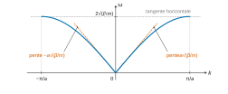
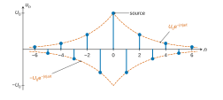
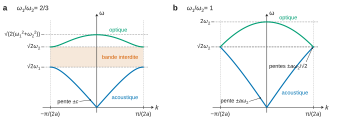
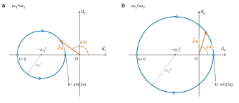
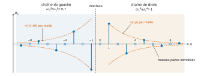
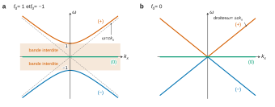

# X-ENS PC — Physique B 2026 · Corrigé guidé

*Corrigé rédigé par IA, non officiel. Signalez toute erreur.*

## Présentation du sujet

**Thème.** *De la topologie dans les ondes : de la matière condensée à El Niño.* Le sujet part d'un objet de cours, la chaîne de masses et de ressorts, et va jusqu'à une notion de recherche : l'**invariant topologique** d'une structure de bandes et la **correspondance volume-bord**, qui prédit le nombre de modes piégés à une interface.

Il transpose ensuite ce schéma aux ondes océaniques équatoriales (ondes de Kelvin et de Yanai), à l'origine du phénomène El Niño. L'épreuve dure 4 heures, **sans calculatrice** et presque sans application numérique. Elle compte **45 questions** (en comptant les sous-questions 7.1–7.5, 13.1–13.4 et 15.1–15.3).

- **Partie I.1, chaîne monoatomique (Q1–7.5).** Équation du mouvement, relation de dispersion en $\lvert\sin(ka/2)\rvert$, zone de Brillouin, vitesse du son, vitesse de groupe nulle en bord de zone. Au-dessus de la pulsation de coupure apparaît une onde évanescente à vecteur d'onde complexe. Ce sont des questions de cours.
- **Partie I.2, chaîne dimérisée SSH (Q8–16).** Deux raideurs alternées donnent une maille de deux masses : problème aux valeurs propres $2\times2$, deux branches (acoustique et optique), bande interdite, modes évanescents dans le gap, lecture d'un diagramme de bandes.
- **Partie I.3, interprétation topologique (Q17–21).** La matrice dynamique s'écrit $d_0\mathbb I+\vec d\cdot\vec\sigma$. Le vecteur $\vec d(k)$ décrit un cercle, et son nombre de tours autour de l'origine distingue deux chaînes qui ont le même spectre. On en déduit le nombre de modes d'interface.
- **Partie II.1, Saint-Venant en rotation (Q22–25).** Identification des équations, paramètre de Coriolis, linéarisation.
- **Partie II.2, plan $f$ constant (Q26–30).** Même structure de problème aux valeurs propres : bandes de Poincaré, bande géostrophique, bandes interdites.
- **Partie II.3, équateur (Q31–36).** Le changement de signe de $f$ fait de l'équateur une interface topologique. On y trouve les ondes de Kelvin et de Yanai, puis la dispersion des ondes de Rossby et le mécanisme d'El Niño.

**Notions mobilisées.** Principe fondamental de la dynamique, notation complexe, relation de dispersion, vitesses de phase et de groupe, ondes évanescentes, fonctions hyperboliques, valeurs propres d'une matrice $2\times2$ et $3\times3$, équations d'Euler et de continuité, force de Coriolis, linéarisation. Le vocabulaire topologique (invariant, indice d'enroulement) est introduit par l'énoncé.

**Difficulté et longueur.** Le jury a trouvé l'épreuve « particulièrement discriminante » : une centaine de copies ont eu moins de 4/20, à peu près autant plus de 15/20. La difficulté est surtout **conceptuelle** et **graphique**.

- Les **tracés** (Q4, Q7.4, Q14, Q15.3, Q18, Q21, Q29) ont été, selon le rapport 2026, « extrêmement discriminantes », dès le tracé de $\lvert\sin x\rvert$ en Q4.
- Les questions de commentaire (Q11, Q12, Q16, Q20, Q21, Q31, Q33) demandent de réinvestir les objets construits plus tôt.
- Q13 (deux branches à distinguer partout), Q27 (les trois racines, avec le signe $\pm$) et Q31 (saut d'invariant) ont fait la différence. Q29 à Q31 n'ont presque jamais été traitées.

**Questions à ne pas laisser passer.** Q1–6, Q7.1, Q8–10, Q12, Q13.1–13.2, Q17, Q22–28, Q30, Q34–35 : du cours ou des calculs directs. Selon le rapport, le début de la partie II (Q23 à Q25) a été bien réussi par presque tous les candidats, et Q34–35 souvent traitées.

**Gestion du temps.** La majorité des candidats n'a traité qu'un peu moins de la moitié des questions. Les parties I et II sont largement indépendantes : si la partie I bloque, on passe à la partie II dès la Q22. On peut viser environ 2 h pour la partie I (dont 30 min pour I.1), 1 h 30 pour la partie II et 30 min de relecture et de tracés.

## Partie I — Chaînes masse-ressort

### 1. Chaîne monoatomique

On établit la relation de dispersion de la chaîne la plus simple et on étudie ce qui se passe au-delà de la pulsation de coupure. Outils : PFD, notation complexe, trigonométrie circulaire et hyperbolique.

### Question 1

> [!INDICATION]
> Faire le bilan des forces exercées par les deux ressorts voisins sur la masse $n$.

> [!INDICATION]
> Écrire la longueur de chaque ressort à l'aide des positions des deux masses qu'il relie, puis en déduire son allongement.

#### Solution

La masse $n$ est reliée à $n+1$ et à $n-1$ par deux ressorts de raideur $\beta$ et de longueur à vide $a$.

Le ressort de droite a pour longueur $a+u_{n+1}-u_n$, donc pour allongement $u_{n+1}-u_n$. Il tire la masse vers $+x$ s'il est étiré. Celui de gauche a pour allongement $u_n-u_{n-1}$ et la tire alors vers $-x$.

Les forces verticales se compensent. Le PFD projeté sur $\vec e_x$ donne

$$\begin{aligned}
m\,\ddot u_n&=\beta\,(u_{n+1}-u_n)-\beta\,(u_n-u_{n-1})\\
&=\beta\,(u_{n+1}+u_{n-1}-2u_n)
\end{aligned}$$

$$\boxed{m\,\ddot u_n=\beta\,(u_{n+1}+u_{n-1}-2u_n)}$$

> [!PIEGE]
> Faire apparaître la longueur à vide dans l'allongement. La position d'équilibre de la masse $n$ est $na$ : la longueur du ressort de droite est $a+u_{n+1}-u_n$, et la longueur à vide $a$ disparaît de l'allongement.

> [!PIEGE]
> Erreur de signe classique : écrire la force du ressort de gauche $+\beta(u_n-u_{n-1})$. Contrôle immédiat : une translation d'ensemble ($u_n$ tous égaux) ne doit produire aucune force.

> [!JURY]
> Le rapport 2026 note que « Beaucoup trop de candidats se sont révélés incapables d'établir correctement l'expression de l'allongement relatif d'un ressort dans une chaîne discrète. » Il relève des expressions qui dépendent encore de la longueur à vide, signe d'une confusion entre déplacement absolu et variation de longueur.

### Question 2

> [!INDICATION]
> En notation complexe, $u_{n\pm1}$ se déduit de $u_n$ par un simple facteur de phase.

> [!INDICATION]
> Regrouper $e^{ika}+e^{-ika}-2$, puis utiliser la formule rappelée avec $\theta=ka/2$. Attention au moment de prendre la racine carrée.

#### Solution

Avec $\underline{u_n}=\underline{U_0}\,e^{i(kna-\omega t)}$ : $\ddot{\underline{u_n}}=-\omega^2\underline{u_n}$ et $\underline{u_{n\pm1}}=e^{\pm ika}\underline{u_n}$. On simplifie par $\underline{u_n}\neq0$ :

$$\begin{aligned}
-m\omega^2&=\beta\left(e^{ika}+e^{-ika}-2\right)\\
&=2\beta(\cos ka-1)\\
&=-4\beta\sin^2\frac{ka}{2}
\end{aligned}$$

On obtient $\omega^2=\dfrac{4\beta}{m}\sin^2\dfrac{ka}{2}$. La pulsation est positive, et la racine carrée d'un carré est une valeur absolue :

$$\boxed{\omega(k)=2\sqrt{\frac{\beta}{m}}\,\left|\sin\frac{ka}{2}\right|}$$

> [!JURY]
> Le rapport 2026 s'étonne que « de nombreux candidats oublient encore que la racine carrée du carré d'un nombre est sa valeur absolue ». Sans la valeur absolue, $\omega$ devient négative pour $k<0$, ce qui est incompatible avec une pulsation.

> [!METHODE]
> Pour un système linéaire invariant par translation discrète, l'onde $e^{i(kna-\omega t)}$ réduit les équations couplées à une seule équation algébrique : c'est la relation de dispersion. On retrouvera la même démarche avec deux masses par maille (Q9) et avec Saint-Venant (Q26).

### Question 3

> [!INDICATION]
> Chercher la période en $k$ de $\sin^2(ka/2)$, puis la centrer sur $0$.

#### Solution

$\sin^2(ka/2)$ est de période $2\pi/a$ en $k$.

D'ailleurs, $k$ et $k+2\pi/a$ donnent les mêmes $u_n$, puisque $e^{2i\pi n}=1$ : le réseau n'est échantillonné qu'aux points $na$. La première zone de Brillouin est

$$\boxed{k\in\left[-\frac{\pi}{a},\frac{\pi}{a}\right]}$$

### Question 4

> [!INDICATION]
> Étudier $\omega(k)$ sur $[0,\pi/a]$ : sens de variation, valeurs et pentes aux bornes. Utiliser ensuite la parité.

> [!INDICATION]
> Que devient la fonction $x\mapsto\lvert\sin x\rvert$ en $x=0$ ? Est-elle dérivable ?

#### Solution

$\omega$ est paire et nulle en $0$. Elle croît sur $[0,\pi/a]$ et atteint son maximum $\omega_{\max}=2\sqrt{\beta/m}$ en $\pm\pi/a$, avec une tangente horizontale.

En $k=0$, la valeur absolue donne un **point anguleux** : demi-pentes $\pm a\sqrt{\beta/m}$.

| $k$ | $-\pi/a$ | $0^-$ | $0$ | $0^+$ | $\pi/a$ |
|---|---|---|---|---|---|
| $\omega$ | $2\sqrt{\beta/m}$ | | $0$ | | $2\sqrt{\beta/m}$ |
| pente | $0$ | $-a\sqrt{\beta/m}$ | point anguleux | $+a\sqrt{\beta/m}$ | $0$ |

L'allure est celle de deux arcs concaves symétriques qui partent de l'origine en V.

> [!PIEGE]
> Tracer une courbe lisse en $k=0$ (une parabole), ou tracer sur un domaine qui n'est pas la zone de Brillouin de la Q3. La courbe s'arrête en $\pm\pi/a$, où elle arrive à tangente horizontale.

> [!JURY]
> Pour le rapport 2026, le tracé de « ce qui n'était essentiellement que la fonction |sin x| sur une période » a révélé qu'« une très grande majorité des candidats s'est montrée incapable de produire un graphe cohérent avec les propriétés élémentaires de la fonction étudiée ». Le jury attend qu'un candidat sache « reconstruire à la main l'allure d'une fonction simple à partir des propriétés qu'il vient lui-même d'établir » : symétries, comportements limites, pentes, points remarquables.

### Question 5

> [!INDICATION]
> Développer $\omega(k)$ au voisinage de $0$ et comparer vitesse de phase et vitesse de groupe.

#### Solution

Pour $\lvert k\rvert a\ll1$ : $\omega\simeq a\sqrt{\beta/m}\,\lvert k\rvert$. La relation est linéaire, donc la propagation est non dispersive, avec $v_\varphi=v_g$ :

$$\boxed{c_s=a\sqrt{\frac{\beta}{m}}}$$

C'est la vitesse du son dans la chaîne. Pour $\lambda\gg a$, la discrétisation n'est plus perçue et la chaîne se comporte comme un milieu élastique continu, régi par l'équation de d'Alembert.

La pente vaut $+c_s$ pour $k>0$ (onde vers $+x$) et $-c_s$ pour $k<0$.

> [!PIEGE]
> Écrire « la pente en $0$ vaut $c_s$ » sans précaution : la fonction n'est pas dérivable en $0$. On parle de demi-tangentes, ou de $\mathrm d\omega/\mathrm d\lvert k\rvert$.

### Question 6

> [!INDICATION]
> Dériver $\omega(k)$ sur $[0,\pi/a]$. Pour l'interprétation, penser à ce que représente $v_g$ et au déphasage entre masses voisines en $k=\pi/a$.

#### Solution

Sur $[0,\pi/a]$, $v_g=a\sqrt{\beta/m}\cos(ka/2)$, donc

$$\boxed{v_g\left(\pm\frac{\pi}{a}\right)=0}$$

Les ondes de bord de zone ne transportent pas d'énergie. Pour $\lambda=2a$, deux masses voisines sont en opposition de phase. Les ondes $k=\pi/a$ et $k=-\pi/a$, qui décrivent le même mouvement, se superposent en une **onde stationnaire**.

C'est la condition de Bragg : les ondes réfléchies par chaque maille interfèrent constructivement.

### Question 7.1

> [!INDICATION]
> Isoler $\sin^2(ka/2)$ dans la relation de dispersion et comparer à 1.

#### Solution

On impose $\omega=\alpha\sqrt{\beta/m}$ avec $\alpha>2$. La relation de la Q2 exige

$$\sin^2\frac{ka}{2}=\frac{m\omega^2}{4\beta}=\frac{\alpha^2}{4}>1$$

C'est impossible pour $k$ réel. La pulsation imposée est supérieure à la pulsation de coupure $2\sqrt{\beta/m}$ : il faut un nombre d'onde complexe $\underline k=k'+ik''$.

### Question 7.2

> [!INDICATION]
> Le carré de $\sin(\underline ka/2)$ doit être un réel positif. Qu'en déduit-on sur $\sin(\underline ka/2)$ lui-même ?

> [!INDICATION]
> Annuler la partie imaginaire donnée par la formule, en écartant le cas $k''=0$.

#### Solution

On pose $x=k'a/2$ et $y=k''a/2$. La formule donne $\sin(\underline ka/2)=\sin x\,\mathrm{ch}\,y+i\cos x\,\mathrm{sh}\,y$.

Son carré vaut $\alpha^2/4>0$, donc $\sin(\underline ka/2)=\pm\alpha/2$ est réel, d'où $\cos x\,\mathrm{sh}\,y=0$.

Le cas $y=0$ ramène au cas réel, impossible. Donc $\cos x=0$ et $k'a/2\equiv\pi/2\ [\pi]$ :

$$\boxed{k'=\pm\frac{\pi}{a}}$$

Ces deux bords de zone sont équivalents, puisque $e^{\pm i\pi n}=(-1)^n$.

### Question 7.3

> [!INDICATION]
> Avec $\cos x=0$, que vaut $\sin x$ ? On obtient une équation sur $\mathrm{ch}(k''a/2)$.

> [!INDICATION]
> Pour le choix du signe, écrire le module de $u_n$ et exiger qu'il reste borné loin de la source.

#### Solution

$\sin x=\pm1$ donne $\sin(\underline ka/2)=\pm\mathrm{ch}(k''a/2)$, donc $\mathrm{ch}(k''a/2)=\alpha/2>1$, ce qui est possible :

$$\boxed{k''=\pm\frac2a\,\mathrm{argch}\frac\alpha2}$$

Alors $\underline{u_n}=\underline{U_0}(-1)^ne^{-k''na}e^{-i\omega t}$ a pour module $\lvert U_0\rvert e^{-k''na}$.

L'énergie est injectée en $n=0$ : une amplitude qui croît exponentiellement loin de la source n'est pas physique. On garde donc **$k''>0$ pour $n>0$** et **$k''<0$ pour $n<0$**.

> [!METHODE]
> Devant deux racines $\pm k''$, on choisit toujours par une condition physique à l'infini : solution bornée, ou énergie venant de la source. C'est le même raisonnement que pour l'onde évanescente en réflexion totale ou dans un plasma.

### Question 7.4

> [!INDICATION]
> Que vaut $e^{ik'na}$ pour $k'=\pi/a$ ? Repasser en notation réelle.

> [!INDICATION]
> Pour quelles valeurs de $n$ la solution a-t-elle un sens ? Le tracé doit le montrer.

#### Solution

Avec $\ell=1/\lvert k''\rvert$ et $U_0$ réel :

$$\boxed{u_n(t)=U_0(-1)^ne^{-\lvert n\rvert a/\ell}\cos\omega t}$$

La solution n'est définie que pour $n$ entier : on trace des **points**, un par masse. Leur signe alterne et ils restent sous l'enveloppe $\pm U_0e^{-\lvert n\rvert a/\ell}$, que l'on dessine seulement pour guider l'œil.

| $n$ | $-2$ | $-1$ | $0$ | $1$ | $2$ |
|---|---|---|---|---|---|
| $u_n/(U_0\cos\omega t)$ | $+e^{-2a/\ell}$ | $-e^{-a/\ell}$ | $1$ | $-e^{-a/\ell}$ | $+e^{-2a/\ell}$ |

> [!PIEGE]
> Tracer une exponentielle continue, ou oublier l'alternance de signe due à $k'=\pi/a$. La chaîne est discrète : seuls les points d'abscisse $na$ ont un sens.

> [!JURY]
> Le rapport 2026 observe que de bons candidats ont tracé un amortissement exponentiel, mais que « très rares ont été ceux qui ont réalisé que la solution est uniquement définie pour $n \in \mathbb{Z}$ » : la courbe devait être « discrétisée ».

### Question 7.5

> [!INDICATION]
> Comparer la dépendance spatiale de la phase dans ce cas et dans celui d'une onde progressive. Les domaines de pulsations se lisent sur la Q7.1.

> [!INDICATION]
> Distinguer cette situation de celle d'une onde amortie : d'où vient la décroissance de l'amplitude ?

#### Solution

Toutes les masses oscillent en phase ou en opposition de phase avec la source. La phase n'avance pas avec $n$, aucun front d'onde ne se déplace, et l'amplitude décroît exponentiellement.

La puissance moyenne transmise d'une masse à l'autre est nulle, car force et vitesse sont en quadrature. On parle donc d'onde **évanescente**.

Une onde **amortie**, au contraire, se propage (sa phase avance avec la position) et perd son amplitude parce que de l'énergie est dissipée en chemin. Ici, la chaîne est sans frottement : la décroissance vient seulement de ce que la pulsation est hors de la bande permise.

$$\boxed{\begin{aligned}
0\leq\omega\leq2\sqrt{\beta/m}&\ :\ \text{propagatives}\\
\omega>2\sqrt{\beta/m}&\ :\ \text{évanescentes}
\end{aligned}}$$

La chaîne se comporte en filtre mécanique passe-bas.

> [!JURY]
> Le rapport 2026 est net : « Les définitions précises d'une onde évanescente et d'une onde amortie et la distinction qui en découle devraient être connues. »

### 2. Chaîne dimérisée : le modèle SSH mécanique

La maille contient désormais deux masses. On obtient un problème aux valeurs propres $2\times2$, deux branches et une bande interdite, puis on retrouve les ondes évanescentes dans le gap.

### Question 8

> [!INDICATION]
> Repérer sur la figure quel ressort relie $2n$ à $2n+1$, et lequel relie $2n-1$ à $2n$.

#### Solution

D'après la figure, le ressort $\beta_1$ relie chaque masse paire à la masse impaire qui la suit.

Le ressort $\beta_2$ relie chaque masse paire à la masse impaire qui la précède :

$$\boxed{\begin{aligned}m\,\ddot u_{2n}&=\beta_1(u_{2n+1}-u_{2n})+\beta_2(u_{2n-1}-u_{2n})\\ m\,\ddot u_{2n+1}&=\beta_2(u_{2n+2}-u_{2n+1})+\beta_1(u_{2n}-u_{2n+1})\end{aligned}}$$

> [!PIEGE]
> Inverser $\beta_1$ et $\beta_2$ ne change pas la relation de dispersion (Q11), mais change le signe de $d_y$ et la valeur de $\nu$ en section 3. Il faut lire la figure.

### Question 9

> [!INDICATION]
> Exprimer $u_{2n-1}$ et $u_{2n+2}$ à l'aide de $U_1$, $U_0$ et d'un facteur de phase $e^{\pm2ika}$.

> [!INDICATION]
> Diviser chaque équation par $-m\,e^{i(2kna-\omega t)}$ et faire apparaître $\omega_1^2$ et $\omega_2^2$.

#### Solution

La masse $2n-1$ appartient à la maille précédente et la masse $2n+2$ à la maille suivante :

$$\begin{aligned}
\underline{u_{2n-1}}&=U_1e^{-2ika}e^{i(2kna-\omega t)}\\
\underline{u_{2n+2}}&=U_0e^{2ika}e^{i(2kna-\omega t)}
\end{aligned}$$

On obtient

$$\begin{aligned}\omega^2U_0&=(\omega_1^2+\omega_2^2)U_0-(\omega_1^2+\omega_2^2e^{-2ika})U_1\\ \omega^2U_1&=-(\omega_1^2+\omega_2^2e^{2ika})U_0+(\omega_1^2+\omega_2^2)U_1\end{aligned}$$

$$\boxed{\mathbf D(k)=\begin{pmatrix}\omega_1^2+\omega_2^2 & -(\omega_1^2+\omega_2^2e^{-2ika})\\ -(\omega_1^2+\omega_2^2e^{2ika}) & \omega_1^2+\omega_2^2\end{pmatrix}}$$

$\mathbf D$ est hermitienne, donc les $\omega^2$ sont réels.

### Question 10

> [!INDICATION]
> Une solution non nulle impose $\det(\mathbf D-\omega^2\mathbb I)=0$. Le terme hors diagonal apparaît par son module au carré.

#### Solution

La condition $\det(\mathbf D-\omega^2\mathbb I)=0$ s'écrit

$$\begin{aligned}
(\omega_1^2+\omega_2^2-\omega^2)^2&=\lvert\omega_1^2+\omega_2^2e^{-2ika}\rvert^2\\
&=(\omega_1^2+\omega_2^2\cos2ka)^2+\omega_2^4\sin^22ka\\
&=\omega_1^4+\omega_2^4+2\omega_1^2\omega_2^2\cos2ka
\end{aligned}$$

d'où

$$\boxed{\omega^2=\omega_1^2+\omega_2^2\pm\sqrt{\omega_1^4+\omega_2^4+2\omega_1^2\omega_2^2\cos(2ka)}}$$

> [!JURY]
> La formule est donnée par l'énoncé. Le rapport 2026 rappelle que « lorsqu'une formule est demandée explicitement dans l'énoncé, il ne suffit jamais de la recopier ou de l'affirmer » : les étapes du calcul du déterminant doivent figurer.

### Question 11

> [!INDICATION]
> Regarder comment la relation dépend de $\omega_1$ et $\omega_2$. Que se passe-t-il si on les échange ?

> [!INDICATION]
> Un rapport $\omega_1/\omega_2$ ne fixe pas les deux pulsations. Comparer les deux cas à $\omega_2$ fixé, puis à raideurs échangées.

> [!INDICATION]
> Au-delà du spectre : dans chacun des deux cas, le ressort le plus raide est-il à l'intérieur de la maille $(2n,2n+1)$ ou entre deux mailles ?

#### Solution

La relation ne dépend que de $\omega_1^2+\omega_2^2$, $\omega_1^4+\omega_2^4$ et $\omega_1^2\omega_2^2$. Elle est symétrique dans l'échange $\omega_1\leftrightarrow\omega_2$.

- Si l'on passe d'un cas à l'autre en **échangeant** les raideurs (comme dans le diagramme de la Q16, où $\delta\omega\to-\delta\omega$), le spectre est exactement le même : mêmes bandes, même gap.
- À $\omega_2$ fixé, les spectres ne coïncident pas. Le gap vaut environ $]0{,}94\,\omega_2;1{,}41\,\omega_2[$ pour $2/3$.
- Pour $3/2$, il vaut environ $]1{,}41\,\omega_2;2{,}12\,\omega_2[$. Le second spectre est l'image du premier par une homothétie de rapport $3/2$ : même forme, autre échelle.

Surtout, les deux chaînes sont **physiquement différentes**. Pour $\omega_1/\omega_2=2/3$, le ressort raide $\beta_2$ relie deux mailles ; pour $3/2$, il est à l'intérieur de la maille $(2n,2n+1)$.

Pour une chaîne infinie, ce n'est qu'un choix de maille : la décaler d'un site échange $\beta_1$ et $\beta_2$, et le spectre de volume ne peut pas faire la différence. Elle se lit sur les vecteurs propres, par la phase du terme non diagonal de $\mathbf D$. Elle devient observable dès que la chaîne a un bord ou une interface, puisque le ressort terminal fixe alors la maille. La section 3 la mesure par l'invariant $\nu$.

> [!PIEGE]
> Conclure de la symétrie de la formule que « les deux cas sont identiques ». La symétrie dit seulement que le spectre ne distingue pas les deux chaînes ; elle ne dit pas qu'elles sont équivalentes, et la suite du sujet repose sur leur différence.

> [!JURY]
> Le rapport 2026 constate que la plupart des candidats ont vu le rôle symétrique de $\omega_1$ et $\omega_2$, mais ajoute qu'« il n'y a aucune raison pour que l'estimation de $\omega_2$ dans le cas où $\omega_1/\omega_2 = 2/3$ donne le même résultat que si $\omega_1/\omega_2 = 3/2$ ». Il faut donc dire précisément ce qui est identique et ce qui ne l'est pas.

### Question 12

> [!INDICATION]
> Période en $k$ de $\cos(2ka)$, puis comparaison avec la Q3 et lien avec la taille de la maille.

#### Solution

$\cos(2ka)$ est de période $\pi/a$ :

$$\boxed{k\in\left[-\frac{\pi}{2a},\frac{\pi}{2a}\right]}$$

La zone est deux fois plus petite que celle de la chaîne monoatomique, car la période spatiale a doublé ($2a$).

En contrepartie, il y a deux branches : celle de la Q4 est **repliée** sur la zone réduite, et une bande interdite s'ouvre au point de repliement dès que $\omega_1\neq\omega_2$.

### Question 13.1

> [!INDICATION]
> La relation de la Q10 comporte deux branches. Pour $k=0$, le radicande est un carré parfait.

#### Solution

En $k=0$, la racine vaut $\omega_1^2+\omega_2^2$. Les deux branches donnent

$$\boxed{\begin{aligned}
\text{branche }-&\ :\ \omega=0\\
\text{branche }+&\ :\ \omega=\sqrt{2(\omega_1^2+\omega_2^2)}
\end{aligned}}$$

La branche $-$ (acoustique) donne la translation d'ensemble $U_0=U_1$. La branche $+$ (optique) correspond à $U_0=-U_1$ : les deux masses de la maille sont en opposition.

> [!JURY]
> Le rapport 2026 indique que les Q13.x préparaient le tracé de la Q14 et que cela a échappé à presque tous les candidats : « La première observation à faire était que cette relation comporte deux branches, associées au symbole ± ». Chaque réponse de Q13 doit donc être donnée pour les deux branches.

### Question 13.2

> [!INDICATION]
> Pour $2ka=\pm\pi$, le radicande est encore un carré parfait. Ne pas oublier la valeur absolue.

#### Solution

La racine vaut $\lvert\omega_1^2-\omega_2^2\rvert$, donc $\omega^2=\omega_1^2+\omega_2^2\pm\lvert\omega_1^2-\omega_2^2\rvert$ :

$$\boxed{\begin{aligned}
\text{branche }-&\ :\ \omega=\sqrt2\min(\omega_1,\omega_2)\\
\text{branche }+&\ :\ \omega=\sqrt2\max(\omega_1,\omega_2)
\end{aligned}}$$

Entre les deux s'ouvre une bande interdite dès que $\omega_1\neq\omega_2$. Pour $\omega_1=\omega_2$, les branches se rejoignent : c'est le seul cas sans gap.

> [!PIEGE]
> Écrire « $\omega=\sqrt2\omega_1$ sur la branche $-$ » sans valeur absolue : c'est faux si $\omega_1>\omega_2$. Les rôles des deux bords s'échangent en $\omega_1=\omega_2$, ce qu'on retrouvera en Q16.

### Question 13.3

> [!INDICATION]
> Développer $\cos 2ka$ à l'ordre 2, puis la racine avec $\sqrt{1-\varepsilon}\simeq1-\varepsilon/2$.

> [!INDICATION]
> Le développement vaut pour les deux branches ; une seule porte des ondes de basse fréquence.

#### Solution

Le radicande vaut $(\omega_1^2+\omega_2^2)^2-4\omega_1^2\omega_2^2a^2k^2+o(k^2)$. Pour chacune des deux branches :

$$\boxed{\begin{aligned}
\omega_-^2&\simeq\frac{2\omega_1^2\omega_2^2a^2}{\omega_1^2+\omega_2^2}k^2\\
\omega_+^2&\simeq2(\omega_1^2+\omega_2^2)-\frac{2\omega_1^2\omega_2^2a^2}{\omega_1^2+\omega_2^2}k^2
\end{aligned}}$$

À basse fréquence (branche acoustique), $\omega\simeq c\lvert k\rvert$ avec

$$\boxed{c=a\,\omega_1\omega_2\sqrt{\frac{2}{\omega_1^2+\omega_2^2}}}$$

La branche optique part de son maximum en $k=0$ et décroît en $k^2$ : elle ne porte pas d'onde de basse fréquence.

> [!METHODE]
> Toujours tester un cas limite connu : pour $\omega_1=\omega_2=\sqrt{\beta/m}$, on retrouve $c=a\sqrt{\beta/m}$ (Q5).

> [!JURY]
> Le rapport 2026 précise que les correcteurs ont davantage valorisé les copies montrant une compréhension qualitative de la structure de la relation de dispersion que celles présentant « un développement limité techniquement correct mais limité à une seule branche sans discussion physique associée ».

### Question 13.4

> [!INDICATION]
> En $k=0$, utiliser les développements de la Q13.3. En bord de zone, dériver $\omega^2$ et vérifier que le dénominateur ne s'annule pas.

#### Solution

On note $R$ le radicande de la Q10.

- $k=0$, branche acoustique : demi-pentes $\pm c$ (point anguleux).
- $k=0$, branche optique : pente **nulle**, car $\omega_+^2$ est une fonction régulière et paire de $k$.
- $k=\pm\pi/(2a)$ avec $\omega_1\neq\omega_2$ : $\dfrac{\mathrm d\omega^2}{\mathrm dk}=\mp\dfrac{2a\omega_1^2\omega_2^2\sin2ka}{\sqrt R}$, avec $\sin2ka=0$ et $R=(\omega_1^2-\omega_2^2)^2\neq0$. La pente est **nulle** pour les deux branches.
- Cas $\omega_1=\omega_2=\omega_0$ : $R$ s'annule au bord et le calcul précédent ne s'applique pas.

Dans ce dernier cas, les branches s'écrivent

$$\begin{aligned}
\omega_-&=2\omega_0\lvert\sin(ka/2)\rvert\\
\omega_+&=2\omega_0\cos(ka/2)
\end{aligned}$$

Elles se rejoignent en $\sqrt2\omega_0$ avec des pentes $\pm a\omega_0/\sqrt2$, non nulles.

> [!PIEGE]
> Conclure « pente nulle en bord de zone » dans le cas $\omega_1=\omega_2$ : la forme $0/0$ n'autorise pas cette conclusion. C'est l'exception que signale aussi le rapport : le cas dégénéré, sans bande interdite.

### Question 14

> [!INDICATION]
> Rassembler les valeurs des Q13.1 à 13.4 dans un tableau avant de tracer, en prenant $\omega_2$ comme unité.

> [!INDICATION]
> Pour $\omega_1=\omega_2$, la racine se simplifie : on doit retrouver la courbe de la Q4.

#### Solution

| cas, branche | $k=0$ | $k=\pm\pi/(2a)$ |
|---|---|---|
| $2/3$, acoustique | $0$, pentes $\pm0{,}78\,a\omega_2$ | $\sqrt2\omega_1\approx0{,}94\,\omega_2$, pente nulle |
| $2/3$, optique | $\sqrt{26}\,\omega_2/3\approx1{,}70\,\omega_2$, pente nulle | $\sqrt2\omega_2\approx1{,}41\,\omega_2$, pente nulle |
| $1$, acoustique | $0$, pentes $\pm a\omega_2$ | $\sqrt2\omega_2$, pente $\pm a\omega_2/\sqrt2$ |
| $1$, optique | $2\omega_2$, pente nulle | $\sqrt2\omega_2$, pente $\mp a\omega_2/\sqrt2$ |

Dans les deux cas, la branche acoustique croît de $0$ jusqu'au bord de zone, et la branche optique décroît de son maximum en $k=0$ jusqu'au bord.

Pour $2/3$, une bande interdite $]0{,}94\,\omega_2;1{,}41\,\omega_2[$ les sépare, et les deux branches l'abordent à tangente horizontale. Pour $1$, elles se raccordent en bord de zone avec des pentes opposées : c'est la courbe de la Q4, repliée.

> [!JURY]
> Le rapport 2026 cite les relations de dispersion et les bandes interdites parmi les tracés qui ont été « un excellent révélateur du degré réel de compréhension physique des candidats ». Ici, il faut placer sur l'axe $\sqrt2\omega_1$, $\sqrt2\omega_2$ et $\sqrt{2(\omega_1^2+\omega_2^2)}$, montrer les tangentes de la Q13.4 et faire voir le gap.

### Question 15.1

> [!INDICATION]
> La relation de dispersion donne $\cos(2\underline ka)$ comme une quantité réelle. Annuler sa partie imaginaire avec la formule rappelée.

#### Solution

On pose $x=2k'a$ et $y=2k''a$. Le cosinus $\cos(2\underline ka)=\cos x\,\mathrm{ch}\,y-i\sin x\,\mathrm{sh}\,y$ doit être réel.

Comme $k''\neq0$, il faut $\sin(2k'a)=0$ :

$$\boxed{\begin{aligned}
&k'=0\\
\text{ou}\quad&k'=\frac{\pi}{2a}
\end{aligned}}$$

On a $-\pi/(2a)\equiv\pi/(2a)$ dans la zone de Brillouin.

### Question 15.2

> [!INDICATION]
> Dans chaque cas, $\cos(2\underline ka)=\pm\mathrm{ch}(2k''a)$. Comparer le radicande à $(\omega_1^2+\omega_2^2)^2$ ou à $(\omega_1^2-\omega_2^2)^2$.

#### Solution

On pose $S=\omega_1^2+\omega_2^2$.

- $k'=0$ : $\cos(2\underline ka)=\mathrm{ch}(2k''a)>1$, et le radicande dépasse $S^2$. On obtient $\omega^2<0$ (exclu) ou $\omega^2>2S$ : au-dessus de la bande optique, pas dans le gap.
- $k'=\pi/(2a)$ : $\cos(2\underline ka)=-\mathrm{ch}(2k''a)<-1$, et le radicande est inférieur à $(\omega_1^2-\omega_2^2)^2$. Donc $\omega^2\in]2\min(\omega_1^2,\omega_2^2),2\max(\omega_1^2,\omega_2^2)[$ : c'est exactement le gap.

$$\boxed{\text{seule }k'=\pi/(2a)\text{ convient}}$$

### Question 15.3

> [!INDICATION]
> Calculer le facteur multiplicatif $e^{2i\underline ka}$ d'une maille à la suivante. Ne pas oublier les masses impaires.

#### Solution

Avec $\underline k=\pi/(2a)+ik''$ et $k''>0$, on a $e^{2i\underline ka}=-e^{-2k''a}$. D'où, pour $n>0$,

$$\boxed{\begin{aligned}
u_{2n}&=U_0(-1)^ne^{-2k''na}\cos\omega t\\
u_{2n+1}&=U_1(-1)^ne^{-2k''na}\cos\omega t
\end{aligned}}$$

avec $U_1/U_0=\dfrac{S-\omega^2}{\omega_1^2-\omega_2^2e^{2k''a}}$ réel.

| maille $n$ | $0$ | $1$ | $2$ | $3$ |
|---|---|---|---|---|
| $u_{2n}/\cos\omega t$ | $U_0$ | $-U_0e^{-\gamma}$ | $U_0e^{-2\gamma}$ | $-U_0e^{-3\gamma}$ |
| $u_{2n+1}/\cos\omega t$ | $U_1$ | $-U_1e^{-\gamma}$ | $U_1e^{-2\gamma}$ | $-U_1e^{-3\gamma}$ |

avec $\gamma=2k''a$. Le profil est celui de la Q7.4 à l'échelle de la maille : le signe s'inverse d'une maille à la suivante et l'enveloppe est exponentielle décroissante. Le tracé est, là encore, fait de points.

> [!PIEGE]
> Confondre l'indice de maille et l'indice de masse. Dans l'énoncé, $n$ numérote les masses de la partie I.1, mais les mailles dans l'ansatz de la Q9.

### Question 16

> [!INDICATION]
> Identifier les trois courbes du diagramme avec les valeurs trouvées en Q13.1 et Q13.2.

> [!INDICATION]
> Pour justifier, se demander pour quelles pulsations il existe un $k$ réel solution, en utilisant la variation de chaque branche entre $k=0$ et le bord de zone.

> [!INDICATION]
> Suivre ce que deviennent les bords de bande quand on passe de $\omega_1<\omega_2$ à $\omega_1>\omega_2$.

#### Solution

Les deux droites qui se croisent sont $\sqrt2\omega_1$ et $\sqrt2\omega_2$ (Q13.2). La courbe du haut est $\sqrt{2(\omega_1^2+\omega_2^2)}\approx2\omega_0$ (Q13.1).

Justification. Chaque branche varie continûment et de façon monotone entre sa valeur en $k=0$ et sa valeur en bord de zone (Q13–14). Toute pulsation comprise entre ces deux valeurs est donc atteinte pour un $k$ réel : l'onde se propage. Au-dehors, aucun $k$ réel ne convient, et la Q15 montre que $\underline k$ a une partie imaginaire non nulle : l'onde est évanescente.

- **Bandes de propagation (zones grises)** : $[0,\sqrt2\min(\omega_1,\omega_2)]$ (acoustique) et $[\sqrt2\max(\omega_1,\omega_2),\sqrt{2(\omega_1^2+\omega_2^2)}]$ (optique).
- **Bandes interdites (zones blanches)** : entre les deux droites (ondes évanescentes à $k'=\pi/(2a)$) et au-dessus de la bande optique ($k'=0$).

En $\omega_1/\omega_2=1$, le gap central se **ferme** : c'est la chaîne monoatomique.

De part et d'autre, les bords de bande échangent leurs rôles : $\sqrt2\omega_1$ est le haut de la bande acoustique pour $\omega_1<\omega_2$, puis le bas de la bande optique pour $\omega_1>\omega_2$. On ne peut pas passer d'un régime à l'autre sans fermer le gap. Ce point de fermeture annonce une transition topologique.

> [!JURY]
> Le rapport 2026 prévient qu'« on ne peut se satisfaire d'une phrase du type recopiant simplement l'énoncé » : dire que les bandes grises sont propagatives et les blanches évanescentes, sans élément nouveau de justification, ne suffit pas. Il faut relier chaque zone aux résultats des Q13 et Q15.

### 3. Interprétation topologique

On décompose $\mathbf D$ sur les matrices de Pauli. L'invariant est l'enroulement de $\vec d(k)$ autour de l'origine, et l'on vérifie qu'il prédit le nombre de modes d'interface.

### Question 17

> [!INDICATION]
> Écrire explicitement $d_0\mathbb I+d_x\sigma_x+d_y\sigma_y$ et identifier terme à terme avec $\mathbf D$.

#### Solution

On a $d_0\mathbb I+d_x\sigma_x+d_y\sigma_y=\begin{pmatrix}d_0 & d_x-id_y\\ d_x+id_y & d_0\end{pmatrix}$. Le coefficient supérieur droit de $\mathbf D$ se développe en

$$\begin{aligned}
d_x-id_y&=-(\omega_1^2+\omega_2^2e^{-2ika})\\
&=-(\omega_1^2+\omega_2^2\cos2ka)+i\omega_2^2\sin2ka
\end{aligned}$$

$$\boxed{\begin{aligned}
d_0&=\omega_1^2+\omega_2^2\\
d_x&=-(\omega_1^2+\omega_2^2\cos2ka)\\
d_y&=-\omega_2^2\sin2ka
\end{aligned}}$$

On vérifie le coefficient inférieur, puis on retrouve $\omega^2=d_0\pm\lVert\vec d\rVert$, c'est-à-dire la Q10.

### Question 18

> [!INDICATION]
> Poser $\theta=2ka$ et reconnaître une équation paramétrique de cercle.

> [!INDICATION]
> L'origine est intérieure si la distance du centre à l'origine est inférieure au rayon.

#### Solution

On pose $\theta=2ka\in[-\pi,\pi]$ :

$$\vec d=\begin{pmatrix}-\omega_1^2\\0\end{pmatrix}+\omega_2^2\begin{pmatrix}\cos(\theta+\pi)\\ \sin(\theta+\pi)\end{pmatrix}$$

**Le cercle a pour centre $(-\omega_1^2,0)$ et pour rayon $\omega_2^2$. Il est parcouru une fois, dans le sens trigonométrique.** Il part de $(\omega_2^2-\omega_1^2,0)$ en $k=-\pi/(2a)$ et passe par $(-\omega_1^2-\omega_2^2,0)$ en $k=0$.

- $\omega_1>\omega_2$ : le cercle est entièrement dans $d_x<0$ et l'origine est **extérieure**.
- $\omega_1<\omega_2$ : le cercle coupe l'axe $d_x>0$ et l'origine est **intérieure**.

Sur chaque dessin, on place un point du cercle, le vecteur $\vec d(k)$ issu de $O$ et l'angle $\phi(k)$ mesuré depuis $(Ox)$.

> [!PIEGE]
> Oublier le sens de parcours. Il se lit sur un point intermédiaire : pour $\theta=-\pi/2$, $\vec d=(-\omega_1^2,\omega_2^2)$, au-dessus du centre, juste après le point de départ situé à droite.

### Question 19

> [!INDICATION]
> Suivre l'angle polaire $\phi$ d'un point qui fait le tour d'un cercle, selon que celui-ci entoure ou non l'origine.

#### Solution

- $\omega_1>\omega_2$ : $\phi$ reste dans un intervalle autour de $\pi$ et revient à sa valeur initiale, donc $\boxed{\nu=0}$.
- $\omega_1<\omega_2$ : $\phi$ augmente de $2\pi$, donc $\boxed{\nu=1}$.

$\nu$ est un entier. Il ne peut changer que si le cercle passe par l'origine, ce qui exige $\lVert\vec d\rVert=0$ pour un $k$, soit $\omega_1=\omega_2$. Changer d'invariant suppose donc de fermer le gap (Q16).

> [!METHODE]
> Pour un indice d'enroulement, il suffit de savoir si la courbe fermée entoure le point et dans quel sens elle est parcourue. Aucun calcul d'intégrale n'est nécessaire.

### Question 20

> [!INDICATION]
> Appliquer la Q19 à chaque chaîne selon la valeur de son rapport $\omega_1/\omega_2$, puis compter les lignes de points dans la zone blanche.

#### Solution

À droite, $\omega_1^d/\omega_2^d>1$ donne $\boxed{\nu_d=0}$ partout.

À gauche, $\nu_g=1$ si $\omega_1^g/\omega_2^g<1$, et $\nu_g=0$ si $\omega_1^g/\omega_2^g>1$. En $1$, le gap est fermé et $\nu_g$ n'est pas défini.

La figure montre **une** ligne de fréquences propres dans la zone blanche pour $\omega_1^g/\omega_2^g<1$, et **aucune** au-delà :

$$\boxed{N_{\text{gap}}=\lvert\nu_g-\nu_d\rvert}$$

C'est la correspondance volume-bord : des invariants de chaînes infinies prédisent le nombre de modes à l'interface.

> [!METHODE]
> Retenir la démarche, qui resservira en Q31 et Q33 : calculer l'invariant de chaque milieu loin de l'interface, faire la différence, et la comparer au nombre de modes qui traversent le gap.

### Question 21

> [!INDICATION]
> La fréquence est dans le gap des deux chaînes. Quelle est, de chaque côté, la forme de la solution trouvée en Q15 ?

> [!INDICATION]
> Pour aller plus loin, lire la fréquence du mode sur la figure (elle ne dépend pas de $\omega_1^g/\omega_2^g$) et reporter $\omega^2=\omega_1^2+\omega_2^2$ dans les équations de la Q8.

#### Solution

De chaque côté, la solution est évanescente avec $k'=\pi/(2a)$. Elle décroît vers $+\infty$ à droite ($k''>0$) et vers $-\infty$ à gauche.

Le mode est donc maximal au voisinage de l'interface et décroît exponentiellement des deux côtés, avec des longueurs différentes. Son signe alterne d'une maille à la suivante.

Plus précisément, la ligne de la figure est horizontale, au milieu du gap : $\omega^2=d_0=\omega_1^2+\omega_2^2$. Les équations de la Q8 deviennent alors

$$\begin{aligned}
\text{masses paires}&\ :\ \omega_1^2u_{2n+1}+\omega_2^2u_{2n-1}=0\\
\text{masses impaires}&\ :\ \omega_2^2u_{2n+2}+\omega_1^2u_{2n}=0
\end{aligned}$$

- À droite ($\omega_1^d>\omega_2^d$), la seule solution décroissante n'occupe que les masses impaires : $u_{2n+1}=-(\omega_2^d/\omega_1^d)^2u_{2n-1}$.
- À gauche ($\omega_1^g/\omega_2^g=0{,}7$), la solution décroissante vers $-\infty$ occupe aussi les masses impaires, avec le facteur $-0{,}49$ par maille.

Les deux solutions vivent sur le même sous-réseau et se raccordent. Les **masses paires restent immobiles**.

Allure du mode (masses $n=-5$ à $5$), avec $\rho=(\omega_2^d/\omega_1^d)^2<1$ et $r>0$ qui dépend du ressort de jonction :

| masse | −5 | −4 | −3 | −2 | −1 | 0 | 1 | 2 | 3 | 4 | 5 |
|---|---|---|---|---|---|---|---|---|---|---|---|
| allure | −0,24 | 0 | +0,49 | 0 | −1 | 0 | +r | 0 | −rρ | 0 | +rρ² |

Si $\omega_1^g>\omega_2^g$, la solution décroissante de gauche vivrait sur les masses paires et ne pourrait pas se raccorder à celle de droite. Il n'y a pas de mode, comme l'annonçait la Q20.

On parle de **mode de bord** parce que l'énergie est confinée sur quelques mailles autour de la jonction. Sa fréquence est interdite dans les deux milieux, si bien qu'il ne peut pas rayonner dans le volume. Son existence, imposée par des entiers, résiste à toute perturbation qui ne ferme pas le gap.

> [!PIEGE]
> Tracer une simple exponentielle décroissante sans alternance, ou un profil qui ne décroît que d'un côté. Les deux côtés sont évanescents, et le profil est discret.

> [!JURY]
> Le rapport 2026 range les « profils de modes localisés » parmi les représentations graphiques qui ont révélé le degré réel de compréhension des candidats. Les meilleures copies se servent du graphe comme d'un outil de raisonnement, ici pour justifier le confinement à l'interface.

## Partie II — Ondes équatoriales : états de bord topologiques

On transpose la partie I aux équations de Saint-Venant en rotation : même problème aux valeurs propres, gaps ouverts par la rotation, puis équateur comme interface.

### 1. Mise en équation du problème

### Question 22

> [!INDICATION]
> Une équation traduit un bilan de matière, l'autre un bilan de quantité de mouvement.

> [!INDICATION]
> Comparer chaque équation à sa forme connue en mécanique des fluides : quelle grandeur remplace la masse volumique ? quel terme remplace le gradient de pression, et sous quelle hypothèse ?

#### Solution

- $\partial_th+\mathrm{div}(h\vec u)=0$ : **équation de continuité** (conservation de la masse). Elle a la forme de $\partial_t\rho+\mathrm{div}(\rho\vec v)=0$, avec la hauteur $h$ à la place de $\rho$. C'est le bilan de volume d'une colonne de fluide **incompressible**, intégré sur l'épaisseur ; $h\vec u$ est le débit par unité de largeur.
- $\partial_t\vec u+(\vec u\cdot\overrightarrow{\mathrm{grad}})\vec u=-g\,\overrightarrow{\mathrm{grad}}\,h+\vec F_c$ : **équation d'Euler** du fluide parfait (Navier-Stokes sans viscosité) dans le référentiel terrestre, où $\vec F_c$ est la force de Coriolis massique.

Le terme $-\frac1\rho\overrightarrow{\mathrm{grad}}\,p$ y est remplacé par $-g\,\overrightarrow{\mathrm{grad}}\,h$. Cela suppose l'**équilibre hydrostatique** sur la verticale, $p=p_0+\rho g(h-z)$, et une vitesse horizontale indépendante de la profondeur.

Ensemble, ce sont les **équations de Saint-Venant** (eau peu profonde).

> [!JURY]
> Le rapport 2026 a accepté « équation de continuité » et « équation d'Euler » à condition d'y joindre une remarque sur les hypothèses implicites, « notamment l'incompressibilité du fluide et l'équilibre hydrostatique ». Relever les différences avec les formes usuelles a été valorisé.

### Question 23

> [!INDICATION]
> Quel angle $\vec\Omega$ fait-il avec la verticale locale $\vec e_z$ à la latitude $\hat\ell$ ?

#### Solution

$\vec\Omega$ fait l'angle $\pi/2-\hat\ell$ avec $\vec e_z$ :

$$\boxed{f=2\Omega\sin\hat\ell}$$

À l'équateur, $f=0$. Le paramètre $f$ change de signe d'un hémisphère à l'autre : positif au nord, négatif au sud.

### Question 24

> [!INDICATION]
> Calculer $\vec e_z\wedge\vec e_x$ et $\vec e_z\wedge\vec e_y$ dans la base directe.

#### Solution

$\vec e_z\wedge\vec u=u\vec e_y-v\vec e_x$, d'où

$$\boxed{\begin{aligned}
F_{c,x}&=fv\\
F_{c,y}&=-fu\\
F_{c,z}&=0
\end{aligned}}$$

> [!PIEGE]
> Oublier le signe $-$ de $\vec F_c=-f\vec e_z\wedge\vec u$. Contrôle : dans l'hémisphère nord ($f>0$), la force de Coriolis dévie vers la droite du mouvement.

### Question 25

> [!INDICATION]
> Repérer les termes d'ordre 2 en $(\eta,u,v)$ et les supprimer.

#### Solution

On a $h\vec u=H\vec u+O(2)$, et le terme convectif est d'ordre 2 :

$$\boxed{\begin{aligned}\partial_t\eta+H(\partial_xu+\partial_yv)&=0\\ \partial_tu&=-g\,\partial_x\eta+fv\\ \partial_tv&=-g\,\partial_y\eta-fu\end{aligned}}$$

> [!JURY]
> Selon le rapport 2026, les Q23 à Q25 ont été bien traitées par presque tous les candidats, et « ce début de partie II ne présentait pas de difficulté ». Ce sont des points à prendre, même après une partie I difficile.

### 2. Hypothèse de Lord Kelvin

### Question 26

> [!INDICATION]
> Remplacer les dérivées par des multiplications ($\partial_t\to-i\omega$, etc.), puis multiplier chaque équation par $i$ pour isoler $\omega$.

#### Solution

On obtient

$$\begin{aligned}
\omega\eta_0&=Hk_xu_0+Hk_yv_0\\
\omega u_0&=gk_x\eta_0+if_0v_0\\
\omega v_0&=gk_y\eta_0-if_0u_0
\end{aligned}$$

$$\boxed{\mathbf M=\begin{pmatrix}0 & Hk_x & Hk_y\\ gk_x & 0 & if_0\\ gk_y & -if_0 & 0\end{pmatrix}}$$

> [!METHODE]
> On retrouve la structure de la Q9 : un problème aux valeurs propres paramétré par le vecteur d'onde. Ici $\omega$ apparaît à la puissance 1, car les équations sont du premier ordre en temps.

> [!JURY]
> Le rapport 2026 signale que des erreurs de transcription dans la matrice « se sont révélées dommageables pour la suite ». Un contrôle rapide : $\mathbf M$ doit redonner, ligne par ligne, les trois équations de la Q25.

### Question 27

> [!INDICATION]
> Développer $\det(\mathbf M-\omega\mathbb I)$ suivant la première ligne. Les termes croisés en $if_0$ se compensent.

> [!INDICATION]
> Le polynôme obtenu est de degré 3 en $\omega$ : combien de racines faut-il garder ?

#### Solution

$$\det(\mathbf M-\omega\mathbb I)=-\omega\left[\omega^2-f_0^2-gH(k_x^2+k_y^2)\right]$$

$$\boxed{\begin{aligned}
&\omega=0\\
\text{ou}\quad&\omega=\pm\sqrt{f_0^2+gHk^2}
\end{aligned}}$$

Les trois racines sont des branches distinctes. Le système est du premier ordre en temps : la racine négative n'est pas une copie de la racine positive.

> [!PIEGE]
> Ne garder que la racine positive, par réflexe hérité de la partie I. Là-bas, l'équation portait sur $\omega^2$ ; ici, elle porte sur $\omega$, et les trois branches $(-)$, $(0)$, $(+)$ servent toute la suite.

> [!JURY]
> Pour le rapport 2026, c'est la première question un peu délicate de la partie II : peu de candidats ont trouvé les trois racines. Il faut considérer les pulsations des deux signes parce que le système est linéaire en $\partial/\partial t$, et non en $\partial^2/\partial t^2$ comme dans la partie I.

### Question 28

> [!INDICATION]
> Que devient la relation de la Q27 quand $\lvert\omega\rvert\gg\lvert f_0\rvert$ ?

#### Solution

$\omega\simeq\pm\sqrt{gH}\,k$ : la propagation est non dispersive, avec

$$\boxed{c=\sqrt{gH}}$$

C'est la célérité des ondes de gravité en eau peu profonde.

### Question 29

> [!INDICATION]
> Pour $k_y=0$, deux branches sont des hyperboles. Chercher leurs asymptotes et leur valeur en $k_x=0$. Que deviennent-elles si $f_0=0$ ?

#### Solution

- $f_0=\pm1$ : on obtient les hyperboles $\omega=\pm\sqrt{1+c^2k_x^2}$. Leur extremum $\pm1$ est atteint en $k_x=0$ à tangente horizontale, et leurs asymptotes sont $\omega=\pm ck_x$. S'y ajoute la bande plate $\omega=0$.
- **Les tracés pour $f_0=1$ et $f_0=-1$ sont identiques**, car seul $f_0^2$ intervient.
- $f_0=0$ : les droites $\omega=\pm ck_x$ et $\omega=0$ concourent à l'origine.

> [!METHODE]
> Comme pour la Q11, deux systèmes distincts (les deux hémisphères) ont le même spectre. Seul un invariant topologique les distingue, ce que l'énoncé introduit juste après.

> [!JURY]
> Le rapport 2026 indique que les Q29–30 ont été très rarement traitées et qu'il fallait avoir la Q27 juste ; « toute réponse même partielle a été largement valorisée ». Un tracé correct des trois branches, asymptotes comprises, rapporte donc beaucoup.

### Question 30

> [!INDICATION]
> Quelles valeurs de $\omega$ ne sont atteintes par aucune des trois branches ?

#### Solution

$$\boxed{0<\lvert\omega\rvert<\lvert f_0\rvert}$$

Cela fait deux bandes interdites, $]0,\lvert f_0\rvert[$ et $]-\lvert f_0\rvert,0[$, et aucune si $f_0=0$. La rotation joue le rôle de la dimérisation : elle ouvre les gaps.

### 3. Le cas équatorial

### Question 31

> [!INDICATION]
> Signe de $f=\beta y$ de part et d'autre de l'équateur, et valeurs des invariants dans chaque hémisphère.

> [!INDICATION]
> Faire le parallèle avec la jonction des deux chaînes SSH de la Q20 : qu'est-ce qui jouait le rôle de $\lvert\nu_g-\nu_d\rvert$ ?

#### Solution

$f>0$ au nord et $f<0$ au sud. Localement, chaque hémisphère est un milieu « de Kelvin » de paramètre $f_0$ de signe fixé, avec les invariants

$$\begin{aligned}
\text{nord}&\ :\ \{\mathscr C^{(-)},\mathscr C^{(0)},\mathscr C^{(+)}\}=\{2,0,-2\}\\
\text{sud}&\ :\ \{\mathscr C^{(-)},\mathscr C^{(0)},\mathscr C^{(+)}\}=\{-2,0,2\}
\end{aligned}$$

Les deux hémisphères ont **le même spectre** (Q29) mais des **invariants opposés**. L'équateur, où $f=0$ et où le gap se ferme, est donc une interface entre deux milieux de topologies différentes, comme la jonction des deux chaînes SSH.

Le saut d'invariant vaut, pour chaque bande de Poincaré :

$$\boxed{\Delta\mathscr C^{(\pm)}=\left|\mathscr C^{(\pm)}_{\text{nord}}-\mathscr C^{(\pm)}_{\text{sud}}\right|=4}$$

et $\Delta\mathscr C^{(0)}=0$.

**Conséquence** : par correspondance volume-bord, il existe des modes piégés près de l'équateur, dont les fréquences traversent les bandes interdites. Leur nombre est fixé par le saut d'invariant, et ils sont robustes. Le décompte est fait en Q33.

> [!PIEGE]
> Prendre $\lvert\mathscr C^{(\pm)}\rvert=2$ comme nombre de modes : c'est l'invariant d'un seul milieu. Comme en Q20, c'est la **différence** entre les deux milieux qui compte.

> [!JURY]
> Le rapport 2026 juge la question « très délicate dans la mesure où il faut avoir compris Q20 et s'en souvenir à ce moment pour savoir comment procéder ». Il donne comme réponse un saut de 4 pour chacune des bandes $(+)$ et $(-)$, et précise : « Pour les quelques copies concernées qui ont trouvé 4 modes de bord au total, tous les points ont été attribués, plus des bonus. »

### Question 32

> [!INDICATION]
> Seules les dérivées en $x$ et en $t$ deviennent des multiplications ; $\partial_y$ reste un opérateur.

#### Solution

$$\boxed{\underline{\mathbf M}(y)=\begin{pmatrix}0 & Hk_x & -iH\dfrac{\mathrm d}{\mathrm dy}\\ gk_x & 0 & i\beta y\\ -ig\dfrac{\mathrm d}{\mathrm dy} & -i\beta y & 0\end{pmatrix}}$$

C'est $\mathbf M$ avec $k_y\to-i\,\mathrm d/\mathrm dy$ et $f_0\to\beta y$. On obtient un opérateur différentiel, dont les solutions localisées près de $y=0$ sont les modes de bord.

> [!PIEGE]
> Remplacer aussi $\partial_y$ par $ik_y$ : le problème n'est plus invariant par translation en $y$, et la forme en onde plane suivant $y$ n'est plus valable.

### Question 33

> [!INDICATION]
> Repérer sur la figure les bandes qui jouent le rôle de $(\pm)$ (Poincaré) et de $(0)$ (Rossby), puis les courbes qui vont continûment de l'une à l'autre quand $k_x$ varie.

> [!INDICATION]
> Pour la compatibilité, comparer avec la Q20 : le nombre de modes est relié au changement d'invariant entre les deux milieux (Q31).

#### Solution

Les modes de Poincaré ($\lvert\omega\rvert\gtrsim\sqrt3\sqrt{\beta c}$) jouent le rôle des bandes $(\pm)$, et les modes de Rossby ($\omega\approx0$) celui de la bande $(0)$. Dans chaque gap, **deux** branches passent d'une bande à l'autre.

- **Gap supérieur** : l'onde de **Kelvin** $\omega=ck_x$ et la branche supérieure de **Yanai**. Celle-ci tend vers $0^+$ (bande de Rossby) quand $k_x\to-\infty$ et rejoint $ck_x$ (Poincaré) quand $k_x\to+\infty$.
- **Gap inférieur** : l'onde de Kelvin et la branche inférieure de Yanai.

Les branches de Yanai viennent de l'équation de Matsuno pour $n=0$. Multipliée par $c^2\omega$, elle se factorise :

$$(\omega+ck_x)(\omega^2-ck_x\omega-\beta c)=0$$

La racine $\omega=-ck_x$ est parasite. Les deux autres sont les branches de Yanai :

$$\omega=\frac12\left(ck_x\pm\sqrt{c^2k_x^2+4\beta c}\right)$$

On compte donc **2 modes par gap**, soit **4 modes de bord au total**. Tous ont une vitesse de groupe positive, c'est-à-dire vers l'Est.

Compatibilité. Comme en Q20, le nombre de modes est fixé par le saut d'invariant entre les deux hémisphères. Avec les valeurs de l'énoncé, $\Delta\mathscr C^{(\pm)}=4$ (Q31), à comparer aux 4 modes de bord comptés au total. Les modes topologiques recherchés sont **l'onde de Kelvin et l'onde de Yanai**.

> [!METHODE]
> Un mode « topologique » se reconnaît sur un diagramme de bandes à ce qu'il relie continûment deux bandes en traversant le gap qui les sépare. Une branche qui reste dans une bande (Rossby, Poincaré) ne compte pas.

> [!PIEGE]
> Compter les ondes de Rossby comme modes de gap. Elles restent collées à $\omega\approx0$ : elles forment la bande géostrophique déformée et ne traversent pas le gap.

> [!PIEGE]
> Un décompte « un mode par unité de saut, dans chaque gap » donnerait 4 modes dans chaque gap, alors que la figure n'en montre que 2. L'invariant calculé directement sur un seul hémisphère vaut $\mp\,\mathrm{signe}(f_0)$ pour les bandes $(\pm)$, soit un saut de 2 par gap, en accord avec la figure : les valeurs $\pm2$ de l'énoncé comptent déjà l'écart entre hémisphères. Le jury a accepté « 4 modes de bord au total » (Q31).

### Question 34

> [!INDICATION]
> Calculer $\omega/k_x$ et étudier le signe du dénominateur.

#### Solution

Avec $A=\beta(2n+1)/c>0$ :

$$\boxed{v_\varphi=-\frac{\beta}{k_x^2+A}<0}$$

pour tout $k_x$. La phase se propage toujours **vers l'Ouest**, puisque $\vec e_x$ pointe vers l'Est.

### Question 35

> [!INDICATION]
> Dériver un quotient. Le signe de $v_g$ est celui d'un polynôme simple en $k_x$.

#### Solution

$$\begin{aligned}
v_g&=-\beta\,\frac{(k_x^2+A)-2k_x^2}{(k_x^2+A)^2}\\
&=\beta\frac{k_x^2-A}{(k_x^2+A)^2}
\end{aligned}$$

$v_g$ change de signe en $\lvert k_x\rvert=\sqrt A$ :

$$\boxed{\lambda_c=2\pi\sqrt{\frac{c}{\beta(2n+1)}}}$$

Pour $\lambda>\lambda_c$, $v_g<0$ : les paquets **longs** vont vers l'**Ouest**. Pour $\lambda<\lambda_c$, $v_g>0$ : les paquets **courts** vont vers l'**Est**, en sens inverse de leur phase.

> [!JURY]
> Le rapport 2026 rappelle que « toute formule manifestement incorrecte du point de vue de l'homogénéité ou des ordres de grandeur devrait conduire le candidat à porter un regard critique sur son résultat ».
>
> Ici, $\beta$ est en $\mathrm{m^{-1}\,s^{-1}}$ et $c$ en $\mathrm{m\,s^{-1}}$.
>
> Donc $c/\beta$ est en $\mathrm{m^2}$ et $\lambda_c$ en mètres. Le rapport note aussi que Q34 et Q35 ont souvent été traitées.

### Question 36

> [!INDICATION]
> Rassembler les propriétés de l'onde de Kelvin établies dans le problème : dispersion, sens de propagation, confinement.

> [!INDICATION]
> Que deviennent les eaux chaudes accumulées à l'Ouest du Pacifique quand les alizés faiblissent, et où peut aller une onde qui ne se propage que vers l'Est ?

#### Solution

L'onde de Kelvin est non dispersive ($v_\varphi=v_g=c$), piégée à l'équateur et **unidirectionnelle vers l'Est** : c'est un mode topologique.

En temps normal, les alizés accumulent les eaux chaudes de surface à l'Ouest du Pacifique, et un upwelling froid règne au large du Pérou.

Lors d'El Niño, les alizés faiblissent. L'excédent d'eau chaude, qui forme une bosse de $\eta$ avec une thermocline enfoncée, est alors emporté par l'onde de Kelvin, qui ne peut aller que vers l'Est.

Elle traverse le Pacifique sans se déformer ni s'étaler en latitude et bute sur la côte américaine : l'eau chaude **s'accumule au large du Pérou**. La thermocline s'y approfondit, l'upwelling est bloqué et la surface se réchauffe anormalement.

## Bilan

**Méthodes à retenir.**

- Relation de dispersion d'un réseau : ansatz $e^{i(kna-\omega t)}$, puis problème aux valeurs propres $\det(\mathbf D-\omega^2\mathbb I)=0$ quand la maille contient plusieurs degrés de liberté.
- Hors des bandes, le nombre d'onde est complexe. Sa partie réelle est fixée par la réalité de la relation de dispersion, et le signe de sa partie imaginaire par la condition à l'infini (Q7, Q15).
- Onde évanescente (pas de transport d'énergie, pas de dissipation) et onde amortie (propagation avec dissipation) : deux notions distinctes.
- Lecture d'une structure de bandes : zone de Brillouin, repliement, valeurs et pentes en $k=0$ et en bord de zone **pour chaque branche**, vitesse de groupe nulle en bord de zone, point anguleux de la branche acoustique.
- Décomposition d'une matrice $2\times2$ hermitienne sur $(\mathbb I,\sigma_x,\sigma_y)$. Les valeurs propres valent $d_0\pm\lVert\vec d\rVert$, et l'invariant est le nombre de tours de $\vec d$ autour de l'origine.
- Correspondance volume-bord : le nombre de modes d'interface est fixé par le saut de l'invariant entre les deux milieux. Changer d'invariant impose de fermer le gap.
- Saint-Venant linéarisé, force de Coriolis $f=2\Omega\sin\hat\ell$, système du premier ordre en temps (racines $\pm\omega$ distinctes), vitesses de phase et de groupe d'une relation de dispersion rationnelle.

**Ce qui a fait la différence selon le rapport 2026.** Les tracés, d'abord : le jury veut des graphes construits à partir des propriétés établies (symétries, pentes, points remarquables, caractère discret), et non une « image qualitative approximative ». Puis les questions qui demandent de réinvestir un objet déjà construit : les deux branches en Q13, les trois racines en Q27, le saut d'invariant en Q31 et Q33. Le jury conclut que les meilleures copies ne sont pas celles qui abordent le plus de questions, mais celles qui gardent une vision d'ensemble du problème.

**Prérequis à revoir.** Fonctions hyperboliques et $\mathrm{argch}$, calcul de déterminants $3\times3$, produit vectoriel en base locale, linéarisation des équations de la mécanique des fluides, tracé à la main de $\lvert\sin x\rvert$ et d'hyperboles avec leurs asymptotes.

**Questions classiques transposables.** La chaîne monoatomique et sa coupure (Q1–7) reviennent très souvent, de même que la chaîne diatomique (branches acoustique et optique). Les ondes en eau peu profonde ($c=\sqrt{gH}$) et la force de Coriolis à la latitude $\hat\ell$ sont des classiques. Les vitesses de phase et de groupe de signes opposés (Q35) se retrouvent pour les ondes de Rossby ou les ondes de capillarité-gravité.

Le rapport 2026 constate que « La majorité des candidats n'a traité qu'un peu moins de la moitié des questions proposées. » Sur ce sujet, les blocs Q1–13 et Q22–30 constituent un socle sûr à traiter vite.
