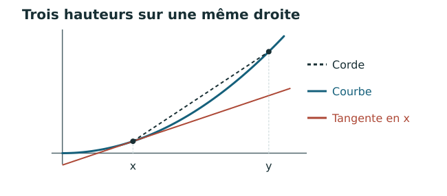
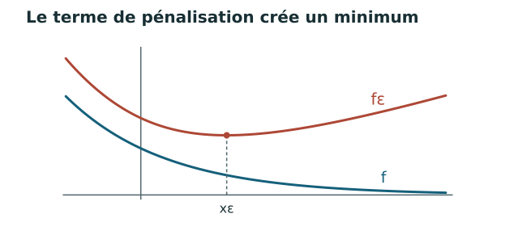
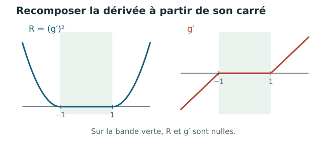
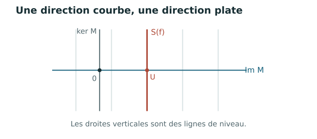
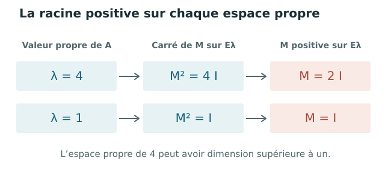
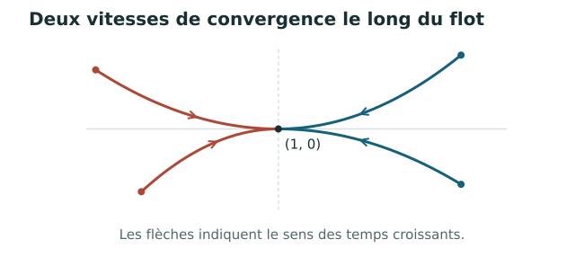

# X-ENS PSI — Mathématiques 2026 · Corrigé guidé

*Corrigé rédigé par IA, non officiel.*

## Présentation du sujet

En connaissant uniquement la longueur d'un gradient, peut-on retrouver la fonction, à une constante près ? Le sujet établit ce résultat dans trois situations, en dimension un, pour des quadratiques minorées, puis pour des fonctions dont la somme est quadratique. On dispose de quatre heures, sans calculatrice.

La partie I fournit deux outils courts, l'inégalité de la tangente et l'existence de points de gradient arbitrairement petit. La question 4 demande une lecture fine des signes. En partie III, la décomposition en noyau et image est le calcul à conserver pour la suite. En partie IV, la question 14 sur les intégrales peut être traitée indépendamment des questions 11 à 13. Pour chercher d'abord la conclusion, relier 15(e), 16 et 17, puis revenir à l'estimation 15(f).

On note $S(f)=\{x:\nabla f(x)=0\}$. Les majuscules $X,B,\dots$ désignent des colonnes et $M^{\mathsf T}$ la transposée de $M$.

Le gradient $\nabla f(x)$ est écrit en ligne. La classe $\mathcal E$ comprend les fonctions $f(x)=X^{\mathsf T}MX/2-B^{\mathsf T}X$, avec $M$ symétrique. Sa sous-classe $\mathcal E_0$ regroupe les fonctions minorées. La transformation étudiée est

$$(Tf)(x)=\tfrac12\|\nabla f(x)\|^2-\tfrac12\|\nabla f(0)\|^2.$$

## Partie I — Généralités sur les fonctions convexes et les fonctions minorées

En restreignant une fonction à un segment, on relie l'inégalité de convexité à une propriété du gradient. La pénalisation de la deuxième question fournit ensuite des points presque critiques, même en l'absence de minimum.

### Question 1

> [!INDICATION]
> Restreindre $f$ à la droite orientée de $x$ vers $y$. Quelle corde relie les valeurs aux paramètres 0 et 1 ?

> [!INDICATION]
> Comparer les accroissements entre les paramètres 0 et $t$, puis laisser $t$ descendre vers zéro. Pour (e), utiliser la caractérisation des minima en (d) et le caractère ouvert de $\mathbb R^n$.

#### Solution

**(a)** La règle de dérivation en chaîne appliquée à $h(t)=f(x+t(y-x))$ donne $h'(t)=\langle\nabla f(x+t(y-x)),y-x\rangle$. Ainsi $h'(0)=\langle\nabla f(x),y-x\rangle$.

**(b)** Pour $0<t\leq 1$, la convexité donne $h(t)\leq (1-t)h(0)+th(1)$. En divisant $h(t)-h(0)$ par $t$, puis en faisant tendre $t$ vers $0$ à droite, on obtient

$$f(y)-f(x)\geq \langle\nabla f(x),y-x\rangle.$$

**(c)** Ajoutons cette inégalité à celle obtenue en échangeant $x$ et $y$. On trouve $\langle\nabla f(y)-\nabla f(x),y-x\rangle\geq 0$.

**(d)** Si $x_0\in S(f)$, l'inégalité de (b) donne $f(y)\geq f(x_0)$ pour tout $y$. Tous les points de $S(f)$ réalisent donc la même valeur, le minimum global.

**(e)** Le gradient est continu, donc $S(f)=(\nabla f)^{-1}(\{0\})$ est fermé. Pour $x,y\in S(f)$ et $\lambda\in[0,1]$, (d) et la convexité encadrent $f((1-\lambda)x+\lambda y)$ entre le minimum et lui-même. Ce point est un minimum global d'une fonction différentiable sur un ouvert, donc son gradient s'annule. Ainsi $S(f)$ est convexe, y compris lorsqu'il est vide.

> [!METHODE]
> Sur un domaine ouvert, une fonction différentiable a un gradient nul en chaque minimum. La convexité permet ici de parcourir l'implication dans l'autre sens.

### Question 2

> [!INDICATION]
> Que devient un sous-niveau de $f_\varepsilon$ quand la norme du point tend vers l'infini ?

> [!INDICATION]
> Au minimum de la fonction pénalisée, exprimer son gradient en séparant les deux termes. Comparer ensuite la norme d'un vecteur à la racine de un plus son carré.

#### Solution

**(a)** Soit $m$ un minorant de $f$. Pour $\varepsilon>0$, on a $f_\varepsilon(x)\geq m+\varepsilon\sqrt{1+\|x\|^2}$, qui tend vers $+\infty$ quand $\|x\|$ tend vers l'infini. Le sous-niveau $K=\{x:f_\varepsilon(x)\leq f_\varepsilon(0)\}$ est donc borné. Il est fermé par continuité et contient $0$. La fonction continue $f_\varepsilon$ atteint son minimum sur ce compact en un point $x_\varepsilon$. Hors de $K$, ses valeurs dépassent $f_\varepsilon(0)$, donc ce minimum est global.

**(b)** En ce minimum, le gradient de $f_\varepsilon$ est nul. Ainsi

$$\nabla f(x_\varepsilon)=-\varepsilon\frac{x_\varepsilon}{\sqrt{1+\|x_\varepsilon\|^2}},\qquad \|\nabla f(x_\varepsilon)\|\leq\varepsilon.$$

**(c)** L'infimum des normes du gradient est positif ou nul et, d'après (b), inférieur ou égal à tout $\varepsilon>0$. Il vaut donc **zéro**.

> [!PIEGE]
> La fonction $x\mapsto e^{-x}$ est minorée sur $\mathbb R$ et sa dérivée ne s'annule nulle part. C'est le minimum de $f_\varepsilon$ qui fournit un point où le gradient de $f$ est petit.

## Partie II — Le cas monodimensionnel

Sur la droite, deux nombres de même module se distinguent seulement par un signe. La minoration et le sens de variation des dérivées permettent de retrouver ce signe.

### Question 3

> [!INDICATION]
> En (a), passer aux infimums sans supposer qu'ils sont atteints. Pour (b) et (c), spécialiser la partie I à une droite.

> [!INDICATION]
> En (d), que sait-on du signe de deux fonctions croissantes de part et d'autre d'un zéro commun ? En l'absence de zéro, examiner ce qu'impliqueraient des signes opposés pour la monotonie.

#### Solution

**(a)** Par la question 2, les deux fonctions $(f_i')^2$ ont pour infimum zéro. Prendre l'infimum dans $(f_1')^2=(f_2')^2+c$ donne $c=0$. On a donc $|f_1'|=|f_2'|$ et $S(f_1)=S(f_2)$.

**(b)** Pour $x<y$, la question 1(c) donne $(f_i'(y)-f_i'(x))(y-x)\geq 0$, donc $f_i'(y)\geq f_i'(x)$.

**(c)** Par 1(e), $S(f_1)$ est convexe dans $\mathbb R$, donc c'est un intervalle, éventuellement vide, réduit à un point ou non borné.

**(d)** Si l'ensemble commun $S$ contient $a$, les deux dérivées sont croissantes et nulles en $a$. Elles sont toutes deux négatives ou nulles à gauche de $a$, positives ou nulles à droite. Leurs modules étant égaux, elles coïncident partout.

Si $S$ est vide, chaque dérivée est continue et de signe strict constant. Des signes identiques donnent encore l'égalité. Des signes opposés impliqueraient $f_1'=-f_2'$ partout. Alors $f_1'$ serait à la fois croissante et décroissante, donc constante. Une fonction affine minorée sur $\mathbb R$ a une pente nulle, en contradiction avec $S=\varnothing$.

**(e)** La dérivée de $f_1-f_2$ s'annule sur l'intervalle $\mathbb R$, donc **$f_1-f_2$ est constante**.

> [!METHODE]
> L'égalité des carrés enlève la taille des dérivées du problème. La convexité et la minoration déterminent ensuite les signes, y compris quand le minimum échappe à l'infini.

### Question 4

> [!INDICATION]
> Un zéro de $R'$ minimise la fonction convexe $R$. Quelle est la valeur de son infimum ?

> [!INDICATION]
> Sur chaque intervalle où $R$ est positive, $g'$ choisit une branche de la racine. Éliminer l'un des signes en intégrant sur la demi-droite qui se prolonge jusqu'à l'infini.

> [!INDICATION]
> Pour (d), prendre un point intermédiaire et comparer les pentes des deux cordes adjacentes.

#### Solution

**(a)** La relation $R'=2g'g''$ donne $S(g)\subset S(R)$. Réciproquement, un point critique de $R$ en est un minimum global par convexité. Or $\inf R=0$ par 2(c) appliquée à $g$. Si $x\in S(R)$, alors $g'(x)^2=0$, ce qui donne $S(R)=S(g)$.

**(b)** Si $S(g)=\varnothing$, $g'$ et $R'$ sont continues, sans zéro, donc chacune garde un signe strict. Si $R$ est croissante, son radical $\sqrt R$ est croissant. L'hypothèse $g'=-\sqrt R$ entraînerait, pour $x\geq 0$, $g(x)\leq g(0)+xg'(0)\to-\infty$. Ainsi $g'=\sqrt R$ est croissante. Si $R$ est décroissante, $g'=\sqrt R$ imposerait $g'(x)\geq g'(0)>0$ pour $x\leq 0$, puis $g(x)\leq g(0)+xg'(0)\to-\infty$ à gauche. Ainsi $g'=-\sqrt R$ est croissante.

**(c)** L'ensemble non vide $S=S(R)$ est un intervalle fermé de minima. La dérivée $R'$ est croissante et nulle sur $S$. Sur la demi-droite située à gauche de $S$, lorsqu'elle existe, $R$ est décroissante et strictement positive. La dérivée $g'$ y garde un signe constant. Si elle était positive, pour tout $a$ dans cette demi-droite on aurait $g'(x)=\sqrt{R(x)}\geq\sqrt{R(a)}>0$ pour $x\leq a$, en contradiction avec la minoration de $g$ à gauche. Ainsi $g'=-\sqrt R$ y est croissante. À droite de $S$, $R$ est croissante et strictement positive. Le choix $g'=-\sqrt R$ donnerait $g'(x)\leq-\sqrt{R(a)}<0$ pour $x\geq a$ et contredirait la minoration à droite. Ainsi $g'=\sqrt R$ y est croissante. Ces branches se raccordent à la valeur zéro sur $S$, donc $g'$ est croissante sur $\mathbb R$. L'argument couvre les demi-droites manquantes et $S=\mathbb R$.

**(d)** Pour $x<u<y$, les accroissements finis sur $[x,u]$ et sur $[u,y]$ expriment les deux pentes par $g'(\xi)$ et $g'(\eta)$, avec $\xi<\eta$. Par croissance de $g'$,

$$\frac{g(u)-g(x)}{u-x}\leq\frac{g(y)-g(u)}{y-u}.$$

Après multiplication, $g(u)\leq\frac{y-u}{y-x}g(x)+\frac{u-x}{y-x}g(y)$. Les extrémités donnent l'égalité, ce qui établit la convexité de $g$.

> [!PIEGE]
> Choisir séparément un signe à chaque point perdrait la continuité de $g'$. Sur une composante de $\{R>0\}$, cette continuité impose un seul signe.

### Question 5

> [!INDICATION]
> Comment déduire la convexité du second carré de dérivée de celle du premier ? Enchaîner ensuite les deux résultats précédents.

#### Solution

$(g_2')^2=(g_1')^2-c_1$ est convexe comme translatée verticale d'une fonction convexe. La question 4 s'applique à $g_1$ et $g_2$, qui sont donc convexes. Comme elles sont minorées et que les carrés de leurs dérivées diffèrent d'une constante, la question 3 donne **$g_1-g_2$ constante**.

## Partie III — Cas des fonctions quadratiques

La fonction quadratique est décrite par une matrice symétrique et un vecteur. Il faut comprendre ce que la minoration impose à chacun avant d'inverser la transformation $T$.

### Question 6

> [!INDICATION]
> Dans les dérivées du terme quadratique, exploiter la symétrie. Pour l'image, déplacer $M$ d'un côté du produit scalaire à l'autre.

> [!INDICATION]
> Tester la minoration sur une droite complète, en choisissant successivement une direction arbitraire puis une direction du noyau. Pour la réciproque, calculer le défaut dans l'inégalité de convexité.

> [!INDICATION]
> Dans (f), regarder quelles valeurs propres subsistent sur l'image et traiter séparément l'image réduite à zéro.

#### Solution

**(a)** Écrivons $f(x)=\frac12\sum_{i,j}m_{ij}x_ix_j-\sum_i b_ix_i$. La dérivée partielle par rapport à $x_k$ vaut $\frac12\sum_jm_{kj}x_j+\frac12\sum_i m_{ik}x_i-b_k$. La symétrie de $M$ donne

$$\nabla f(x)^{\mathsf T}=MX-B.$$

**(b)** En développant le carré, on obtient

$$(Tf)(x)=\tfrac12\|MX-B\|^2-\tfrac12\|B\|^2=\tfrac12X^{\mathsf T}M^2X-(MB)^{\mathsf T}X.$$

Ainsi $Tf$ est caractérisée par $(M^2,MB)$, et sa première expression la minore par $-\|B\|^2/2$. Donc $Tf\in\mathcal E_0$.

**(c)** Un vecteur $Z$ est orthogonal à $\operatorname{Im}M$ exactement lorsque $\langle Z,MX\rangle=\langle MZ,X\rangle=0$ pour tout $X$, donc lorsque $MZ=0$. En prenant l'orthogonal en dimension finie, $\operatorname{Im}M=(\ker M)^\perp$. Ces espaces donnent $\mathbb R^n=\operatorname{Im}M\oplus\ker M$.

**(d)** L'image est stable par $M$. Le noyau de la restriction à l'image est $\operatorname{Im}M\cap\ker M=\{0\}$. Cet endomorphisme injectif d'un espace de dimension finie est bijectif.

**(e)** Supposons (i). Pour toute colonne $V$, l'expression $f(tv)=t^2V^{\mathsf T}MV/2-t B^{\mathsf T}V$ est minorée sur $\mathbb R$. Son coefficient quadratique doit être positif ou nul. Si $V\in\ker M$, cette expression linéaire doit avoir une pente nulle, donc $B\perp\ker M$. C'est (ii).

Sous (ii), choisissons $U$ tel que $MU=B$ grâce à (c). Alors $u\in S(f)$. De plus, pour $\lambda\in[0,1]$, la différence entre $(1-\lambda)f(x)+\lambda f(y)$ et $f((1-\lambda)x+\lambda y)$ vaut $\lambda(1-\lambda)(X-Y)^{\mathsf T}M(X-Y)/2\geq0$. On obtient (iii). Enfin, (iii) implique (i) par 1(d).

**(f)** Par le théorème spectral, l'image de $M$ est engendrée par des vecteurs propres orthonormés de valeurs propres strictement positives, car $M$ est positive et le noyau est l'espace propre de valeur zéro lorsqu'il est non trivial. Si l'image est non nulle, prenons pour $\alpha$ la plus petite valeur propre strictement positive. En coordonnées propres, $X^{\mathsf T}MX=\sum_{\lambda_i>0}\lambda_i X_i^2\geq\alpha\|X\|^2$ sur l'image. Si $M=0$, l'image est nulle et $\alpha=1$ convient.

> [!PIEGE]
> Une matrice positive peut avoir un noyau non nul. Sur ce noyau, la quadratique se réduit au terme linéaire, qui doit s'annuler pour que la fonction reste minorée.

### Question 7

> [!INDICATION]
> Relire la règle qui donne le couple caractérisant $Tf$. Il faut résoudre deux équations, l'une matricielle et l'autre vectorielle.

> [!INDICATION]
> Passer dans une base orthonormée propre de la matrice d'arrivée. Dans quel sous-espace choisir le vecteur de départ pour que la quadratique soit minorée ?

#### Solution

Soit un élément de $\mathcal E_0$ caractérisé par $(M,B)$. D'après 6(e), $M$ est symétrique positive et $B\in\operatorname{Im}M$. Dans une base orthonormée propre de $M$, définissons $N$ par les valeurs propres $\sqrt{\lambda_i}$ sur les mêmes vecteurs. Alors $N$ est symétrique positive, $N^2=M$, et $\operatorname{Im}N=\operatorname{Im}M$. Il existe un unique $C\in\operatorname{Im}N$ tel que $NC=B$ par 6(d). La fonction caractérisée par $(N,C)$ appartient à $\mathcal E_0$ par 6(e). Son image par $T$ est caractérisée par $(N^2,NC)=(M,B)$. **$T$ est surjective.**

> [!METHODE]
> Sur le noyau, prendre la racine carrée de la valeur propre zéro demande seulement de poser zéro. Résoudre ensuite le problème linéaire sur l'image évite toute division par zéro.

### Question 8

> [!INDICATION]
> Une somme directe d'espaces propres peut servir de base de comparaison, même lorsque l'on ignore si les deux matrices commutent entre elles.

> [!INDICATION]
> Chaque racine commute avec son carré. Restreindre chaque racine à un même espace propre de ce carré et utiliser son signe.

#### Solution

Notons $A=M_1^2=M_2^2$. Chaque $M_i$ commute avec $A$, donc préserve chaque espace propre $E_\lambda$ de $A$. Sa restriction à $E_\lambda$ est symétrique positive et son carré y vaut $\lambda I$. Elle est diagonalisable dans cet espace et chacune de ses valeurs propres $\mu$ vérifie $\mu\geq0$ et $\mu^2=\lambda$. Elle y vaut donc $\sqrt{\lambda}\,I$, y compris lorsque $\lambda=0$. Comme $A$ est symétrique, ses espaces propres engendrent tout l'espace. Les deux restrictions coïncidant sur chacun d'eux, **$M_1=M_2$**.

> [!PIEGE]
> Faire apparaître un produit $(M_1-M_2)(M_1+M_2)$ exigerait de connaître la commutation des deux matrices. La stabilité des espaces propres du carré fournit une autre entrée dans la preuve.

### Question 9

> [!INDICATION]
> Pourquoi l'égalité des fonctions entraîne-t-elle l'égalité des couples de coefficients ? Observer le gradient.

> [!INDICATION]
> Une fois la matrice identifiée, la différence des termes linéaires appartient à deux espaces orthogonaux.

#### Solution

Si $Tf_1=Tf_2$, les couples $(M_1^2,M_1B_1)$ et $(M_2^2,M_2B_2)$ qui les caractérisent sont égaux. En effet, 6(a) montre que la connaissance du gradient en $0$ donne le terme linéaire, puis que ses valeurs en tout $x$ déterminent la matrice. Par 6(e) et 8, les matrices positives $M_1$ et $M_2$ sont égales à une même matrice $M$. On a $M(B_1-B_2)=0$, alors que $B_1-B_2\in\operatorname{Im}M$ par 6(e). D'après 6(d), $B_1=B_2$ et $f_1=f_2$. **$T$ est injective.**

### Question 10

> [!INDICATION]
> Traduire l'égalité des normes en une égalité d'images par $T$. Que devient un terme constant dans le gradient ?

#### Solution

$T$ est donc une bijection de $\mathcal E_0$ sur elle-même. Pour deux fonctions de $\mathcal E_0$ dont les gradients ont même norme en tout point, la définition de $T$ donne $Tf=Tg$, donc $f=g$. Plus généralement, si les deux quadratiques convexes minorées ont des termes constants, leur soustraire leurs valeurs en $0$ les ramène à $\mathcal E_0$ en conservant leurs gradients. **Leur différence vaut alors $f(0)-g(0)$ partout.**

## Partie IV — Un cas un peu plus général

Dans cette partie, $h=f+g$ et $\psi=f-g$. Les deux fonctions $f,g$ sont de classe $C^1$, convexes et minorées. La différence des carrés des normes de leurs gradients est constante, $h\in\mathcal E$ et $S(f)$ est non vide.

Lorsque seule la somme $h=f+g$ est quadratique, on suit une trajectoire dirigée par $-\nabla h$. Son point d'arrivée est un minimum et la différence $f-g$ garde sa valeur tout le long.

### Question 11

> [!INDICATION]
> Écrire séparément un minorant global de chacune des deux fonctions.

#### Solution

Par hypothèse $h=f+g\in\mathcal E$. Si $f\geq m_f$ et $g\geq m_g$, alors $h\geq m_f+m_g$. Donc $h\in\mathcal E_0$.

### Question 12

> [!INDICATION]
> L'infimum dans 2(c) utilise seulement la minoration. Comparer les infimums des deux carrés.

#### Solution

La constante $c$ de l'hypothèse donne $\|\nabla f\|^2=\|\nabla g\|^2+c$. Les deux membres sans la constante ont pour infimum zéro d'après 2(c), puisque $f$ et $g$ sont minorées. Il vient $c=0$. En prenant les racines positives, **$\|\nabla f(x)\|=\|\nabla g(x)\|$ pour tout $x$**.

### Question 13

> [!INDICATION]
> Choisir un point critique commun, puis comparer séparément les deux écarts de valeur en un minimum de la somme.

> [!INDICATION]
> Une somme de deux nombres positifs ou nuls s'annule. Que vaut alors chacun des deux termes ?

#### Solution

D'après 12, $S(f)=S(g)$. Un point $a$ de cet ensemble existe par hypothèse et minimise les deux fonctions par 1(d), donc aussi $h$. Tout point commun à $S(f)$ et $S(g)$ annule $\nabla h$. Inversement, si $x\in S(h)$, la convexité de $h$ donne $h(x)=h(a)$. Les écarts $f(x)-f(a)$ et $g(x)-g(a)$ sont positifs ou nuls et de somme nulle. Tous deux sont nuls, donc $x$ minimise $f$ et $g$ et annule leurs gradients. Ainsi **$S(h)=S(f)=S(g)$**.

> [!PIEGE]
> Deux gradients de même norme peuvent avoir des sens opposés. Pour identifier les points critiques de la somme, exploiter la présence d'un minimum commun.

### Question 14

> [!INDICATION]
> Pour (a), dériver le quotient du carré de l'accroissement par $t$, d'abord sur un intervalle éloigné de zéro.

> [!INDICATION]
> Dans (b), utiliser Cauchy-Schwarz sur un intervalle fini. Dans (c), réintroduire $y(0)$ à partir de la définition de $z$.

#### Solution

**(a)** Sur $]0,+\infty[$, $z(t)=(y(t)-y(0))/t$ est continue et tend vers $y'(0)$ en $0$ par dérivabilité à droite. Pour $t>0$, dérivons $t\|z(t)\|^2=\|y(t)-y(0)\|^2/t$. Il vient

$$(t\|z(t)\|^2)'=2\langle z(t),y'(t)\rangle-\|z(t)\|^2.$$

Pour $A>0$, intégrons de $\delta$ à $A$ et faisons tendre $\delta$ vers $0$. La continuité en $0$ annule le terme $\delta\|z(\delta)\|^2$. Ainsi $\int_0^A\|z\|^2=2\int_0^A\langle z,y'\rangle-A\|z(A)\|^2\leq2\int_0^A\langle z,y'\rangle$. La formule vaut aussi pour $A=0$.

**(b)** Posons $I_A=\int_0^A\|z\|^2$ et $J_A=\int_0^A\|y'\|^2$. Par (a) et deux applications de Cauchy-Schwarz, $I_A\leq 2\sqrt{I_AJ_A}$. Si $I_A>0$, on divise par sa racine puis on élève au carré. Si $I_A=0$, la borne reste vraie. Ainsi $I_A\leq4J_A\leq4\int_0^\infty\|y'\|^2$. Par croissance de $I_A$ et passage à la limite,

$$\int_0^\infty\|z(t)\|^2\,dt\leq4\int_0^\infty\|y'(t)\|^2\,dt<\infty.$$

**(c)** De $y(t)=tz(t)+y(0)$ il résulte $\|y(t)\|^2\leq2t^2\|z(t)\|^2+2\|y(0)\|^2$. On divise par $1+t^2$ et on utilise $t^2/(1+t^2)\leq1$, puis $\int_0^\infty dt/(1+t^2)=\pi/2$. D'où la convergence et la borne

$$\int_0^\infty\frac{\|y(t)\|^2}{1+t^2}\,dt\leq 8\int_0^\infty\|y'(t)\|^2\,dt+\pi\|y(0)\|^2.$$

> [!METHODE]
> Travailler sur un segment avant le passage à l'infini permet de diviser par $\sqrt{I_A}$ lorsque $I_A>0$. La majoration uniforme obtenue prouve ensuite l'intégrabilité.

### Question 15

> [!INDICATION]
> Calculer les deux dérivées de (a) et remarquer que $MV=B$. Dans (b), tester l'équation de $Z$ contre un vecteur du noyau.

> [!INDICATION]
> Utiliser 6(f) sur l'image pour (c). Quel facteur intégrant enlève le terme en $\omega$ dans (d) ?

> [!INDICATION]
> Identifier la limite à l'aide de $U$ et de la composante initiale sur le noyau, puis intégrer l'identité pour $F'$.

#### Solution

**(a)** L'équation différentielle donne $Y'=-(MY-B)=-\nabla h(y)^{\mathsf T}$. Par dérivation le long de la trajectoire, $F'=-\|y'\|^2\leq0$. Puisque $MV=B$, on a $D'=-2(Y-V)^{\mathsf T}M(Y-V)\leq0$ par 6(e) et 11. Ainsi $F$ et $D$ décroissent au sens large.

**(b)** $B\in\operatorname{Im}M$ d'après 6(e). La restriction de $M$ à son image étant inversible, il existe un unique $U\in\operatorname{Im}M$ tel que $MU=B$. La décomposition orthogonale de 6(c) détermine $Y_0\in\ker M$ et $Y_1\in\operatorname{Im}M$. Comme $MY_0=0$,

$$Z'=-M(Y-U-Y_0)=-MZ,\qquad Z(0)=Y_1-U\in\operatorname{Im}M.$$

Pour tout $K\in\ker M$, $(\langle Z,K\rangle)'=-\langle Z,MK\rangle=0$. Le produit scalaire est nul initialement, donc $Z(t)\in(\ker M)^\perp=\operatorname{Im}M$ pour tout $t$.

**(c)** La question 6(f) s'applique à $Z(t)$, ce qui donne $\omega'=-2Z^{\mathsf T}MZ\leq-2\alpha\omega$. On peut prendre $\beta=2\alpha>0$.

**(d)** On a $(e^{\beta t}\omega(t))'\leq0$. Par comparaison à la valeur en $0$, $\omega(t)\leq\omega(0)e^{-\beta t}$.

**(e)** Cette majoration donne $Z(t)\to0$, donc $Y(t)\to Y_\infty=U+Y_0$. Comme $MY_\infty=B$, le point correspondant appartient à $S(h)$.

**(f)** Pour $A\geq0$, (a) donne $\int_0^A\|y'\|^2=h(y(0))-h(y(A))$. La continuité de $h$ et (e) permettent de passer à la limite. Le point limite minimise $h$ par 1(d). Ainsi

$$\int_0^\infty\|y'(t)\|^2\,dt=h(y(0))-\inf h.$$

L'hypothèse d'intégrabilité de 14 est donc vérifiée pour cette trajectoire. En appliquant 14(c), on obtient la convergence et

$$\int_0^\infty\frac{\|y(t)\|^2}{1+t^2}\,dt\leq 8\big(h(y(0))-\inf h\big)+\pi\|y(0)\|^2.$$

> [!METHODE]
> La composante sur le noyau reste fixée par la condition initiale. La contraction exponentielle agit sur la composante qui appartient à l'image.

### Question 16

> [!INDICATION]
> Développer le produit scalaire en utilisant la symétrie. Dans quelle direction se déplace la solution de (E1) ?

#### Solution

Par développement du produit scalaire et par 12,

$$\langle\nabla\psi,\nabla h\rangle=\langle\nabla f-\nabla g,\nabla f+\nabla g\rangle=\|\nabla f\|^2-\|\nabla g\|^2=0.$$

Le long de la solution de (E1), $(\psi\circ y)'=\langle\nabla\psi(y),y'\rangle=-\langle\nabla\psi(y),\nabla h(y)\rangle=0$. La fonction $t\mapsto\psi(y(t))$ est donc constante.

### Question 17

> [!INDICATION]
> Chaque point initial définit sa propre trajectoire. Les points limites peuvent être différents : quelle propriété commune garantit la même valeur de $\psi$ ?

#### Solution

Fixons $a\in S(h)$. D'après 13 et 1(d), $f$ et $g$ prennent chacune sa valeur minimale en tout point de $S(h)$, donc $\psi=f-g$ y vaut $\psi(a)$. Pour tout $x\in\mathbb R^n$, le système linéaire à coefficients constants (E1) admet une solution globale issue de $Y(0)=X$. Par 15(e), elle converge vers un point $y_\infty\in S(h)$. La constance de 16 et la continuité de $\psi$ donnent

$$\psi(x)=\lim_{t\to\infty}\psi(y(t))=\psi(y_\infty)=\psi(a).$$

**Sous les hypothèses de la partie IV, $f-g$ est constante sur tout $\mathbb R^n$.**

> [!PIEGE]
> La constance sur chaque trajectoire laisse a priori une constante par trajectoire. C'est la valeur commune de $f-g$ sur l'ensemble des minima qui les identifie.

## Bilan

L'égalité des normes donne un ensemble critique commun, et la convexité transforme les points critiques en minima. Sur la droite, il reste à retrouver le signe de la dérivée, avec une attention particulière aux demi-droites sans minimum. Pour une quadratique, écrire l'espace comme somme orthogonale du noyau et de l'image sépare les directions plates de celles où l'on peut inverser la matrice.

La dernière partie s'appuie sur deux égalités différentes. L'énergie de $h$ décroît au rythme de $\|y'\|^2$, tandis que la valeur de $f-g$ se conserve. Pour transférer cette conservation à tout l'espace, on a besoin à la fois de la convergence de chaque trajectoire et de la même valeur de $f-g$ sur l'ensemble des points d'arrivée.
