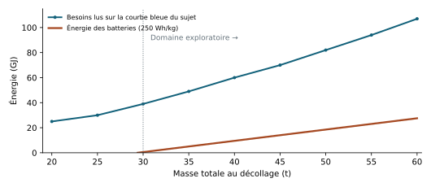
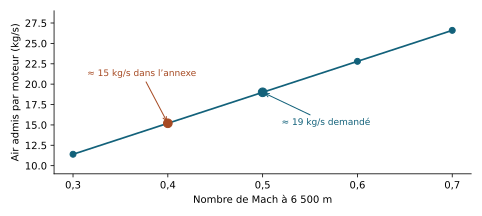
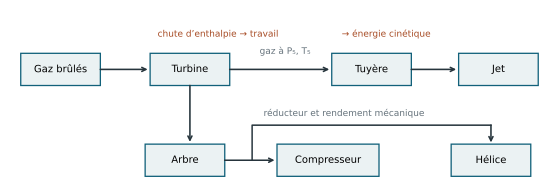
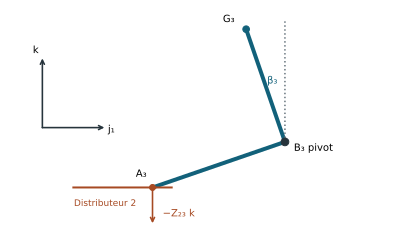
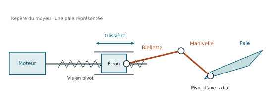
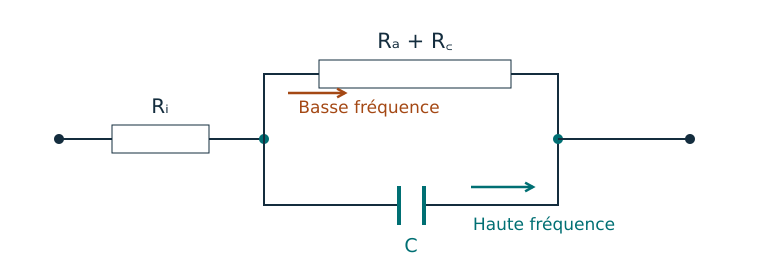
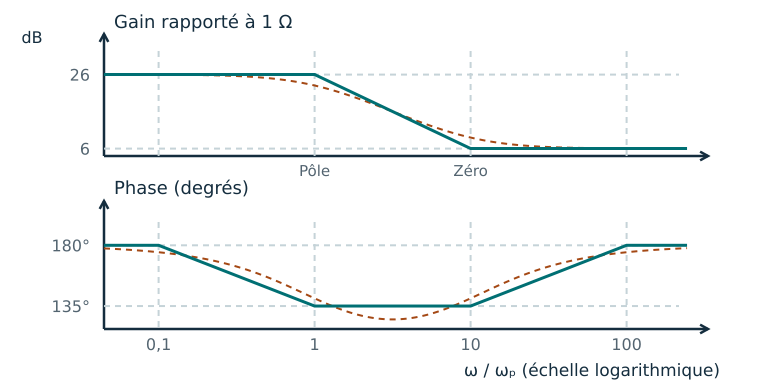
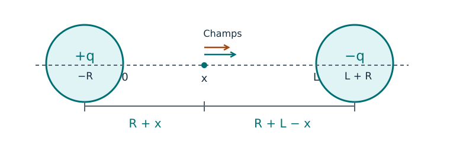

# X-ENS PSI — Modélisation 2026 · Corrigé brut

*Corrigé rédigé par IA, non officiel. Signalez toute erreur.*

**Rédaction** · modèle exact non renseigné (famille GPT-6) · effort non renseigné · vitesse non renseignée

Épreuve du 17 avril 2026, cinq heures sans calculatrice. Le sujet étudie la propulsion d’un ATR 72 puis l’alimentation d’un avion hybride ou électrique. Les lectures du graphe de débit et les valeurs de l’aide numérique sont distinguées aux questions 15, 21 et 22.

## A1. Besoins énergétiques du vol régional

### Question 1

Avec $k=\sqrt{B/A}$, on trouve $u'=B(1-u^2)/k=\omega(1-u^2)$ avec $\omega=\sqrt{AB}$. Puisque $|f_0|<k$, on peut écrire initialement $u=\tanh v$. La dérivation donne $(1-\tanh^2 v)v'=\omega(1-\tanh^2 v)$, donc $v'=\omega$. On obtient sur tout $\mathbb R_+$ la solution
$$
f(t)=\sqrt{B/A}\,\tanh\!\left(\sqrt{AB}\,t+\operatorname{argth}\!\left(f_0\sqrt{A/B}\right)\right).
$$
Elle vérifie l'équation et la condition initiale. L'unicité locale du problème de Cauchy, dont le second membre est polynomial, garantit qu'il s'agit de la solution cherchée.

### Question 2

La masse vaut $M_t=29\,850$ kg. La projection du bilan des forces sur la trajectoire élimine la portance. Posons $F=(T_u)_{\max}-M_tg\sin\theta$ et $V_*=\sqrt{F/K}$. Aux temps de décollage $T_d$ et de fin de montée $T_m$, la vitesse s'écrit par morceaux :

- Roulement, pour $0\le t\le T_d$ : $M_t\dot V=(T_u)_{\max}$, donc $V=(T_u)_{\max}t/M_t$ et $T_d=M_tV_d/(T_u)_{\max}$.
- Montée, pour $T_d\le t<T_m$ : $M_t\dot V=F-KV^2$. Avec $V(T_d)=V_d$, la question 1 donne
$$
V(t)=V_*\tanh\!\left(\frac{\sqrt{KF}}{M_t}(t-T_d)+\operatorname{argth}(V_d/V_*)\right).
$$
La fin de la montée satisfait $H=\sin\theta\int_{T_d}^{T_m}V(t)\,dt$.
- Palier : $V=V_p=153$ m/s par prescription, avec $T_u=KV_p^2/2$.

Les constantes imprimées donnent $T_d=34,2$ s et $V_*=135,7$ m/s. La figure 4 indique $26$ s et une montée vers $153$ m/s. Sans transition supplémentaire ni modification des constantes, la loi de montée et le palier tracé ne se raccordent pas. Pour lire les énergies aux questions 4 et 5, on emploie les durées prescrites sur la figure.

### Question 3

Au roulement, annuler la traînée la sous-estime dès que l'avion avance. À poussée donnée, l'accélération est alors surestimée. En montée, la loi quadratique est plausible, mais conserver le coefficient du sol surestime la traînée à vitesse donnée si la masse volumique décroît avec l'altitude et si la configuration aérodynamique reste fixée. L'accélération est alors sous-estimée. En palier, la division par deux représente la baisse de densité. Pour une atmosphère standard à 6 500 m, le rapport de densités est proche de $0,51$, ce qui donnerait une légère sous-estimation avec un coefficient de traînée constant. Le signe précis dépend de l'atmosphère et de la configuration. Les écarts des phases ont des signes opposés. On ne peut attribuer de signe certain à l'erreur énergétique totale sans pondérer les travaux et connaître la traînée réelle.

### Question 4

Dans le référentiel terrestre supposé galiléen, la portance et la réaction normale du sol ont un travail nul. Entre le repos et le palier à $H$,
$$
E_{TP}=\tfrac12M_tV_p^2+M_tgH
     +K\int_{T_d}^{T_m}V^3(t)\,dt
     +\tfrac K2 V_p^3(T_p-T_m).
$$
Le membre de droite additionne l'accroissement d'énergie cinétique, le gain d'altitude et les deux travaux à fournir contre la traînée. La traînée de roulement est nulle dans le modèle. Il s'agit d'un travail propulsif utile à l'avion.

### Question 5

Avec $T_p-T_m=9\,000$ s, on obtient respectivement $0,349$ GJ d'énergie cinétique, $1,90$ GJ d'énergie potentielle, $0,0027$ GJ contre la traînée en montée (valeur imposée) et $19,66$ GJ contre celle du palier. Le total vaut $21,92$ GJ, dont environ 90 % pour le palier.

La valeur imprimée pour la montée ne peut toutefois pas être l'intégrale annoncée. Sur les $559-26=533$ s de la figure 4, la vitesse est au moins $55$ m/s, donc $K\int V^3\,dt\ge1,22\times55^3\times533=108$ MJ, déjà quarante fois les $2,7$ MJ indiqués. Le total précédent suit la consigne numérique. La précision est également limitée par la masse et le coefficient de traînée supposés constants dans chaque phase, par la transition de vitesse et par l'absence de rendement de conversion.

### Question 6

Un kilogramme de batterie stocke $250\times3\,600=9,0\,10^5$ J. À rendement unité, la première estimation est donc $m_b=21,92\,10^9/(9,0\,10^5)\simeq24\,400$ kg, soit environ $111\,\%$ des $22\,000$ kg de masse à vide. En remplaçant les 450 kg de kérosène, la masse au départ atteindrait déjà environ 53,8 t. Le calcul initial a pourtant été fait pour 29,85 t.

Ce profil régional n'est donc pas réaliste par simple remplacement du carburant avec les batteries considérées. La masse supplémentaire accroît le travail de montée et la portance requise. À géométrie, atmosphère et vitesse fixées, la traînée induite augmente. Un coefficient $K$ global ajusté à la nouvelle configuration et la consommation de mission augmenteraient. Une modification du seul poids ne change pas directement le coefficient de traînée parasite.

### Question 7

La masse hors batteries vaut $M_0=M_v+M_u=29\,400$ kg. À la masse totale $M$, la droite d'énergie disponible vaut $E_b(M)=0,9\,10^6(M-M_0)$ J. Une solution nécessite une intersection avec la courbe des besoins pour $M\ge M_0$.

Sur la branche de pente $0,9\,10^6$ J/kg, un kilogramme de batterie couvre exactement le besoin marginal du kilogramme ajouté, sans combler le déficit initial. Avec l'ordonnée à l'origine imprimée $-22\,10^9$ J, l'écart $E-E_b$ serait constant et égal à $4,46$ GJ. Sur la branche de pente $2\,10^6$ J/kg, chaque kilogramme ajoute $1,1$ MJ de déficit. La droite imprimée $2\,10^6M-1,8\,10^{10}$ donne déjà un déficit à $M_0$. La courbe bleue elle-même est strictement au-dessus de l'énergie disponible au départ et croît plus vite sur la plage accessible. Il n'existe donc pas de solution pour ce profil dans le modèle présenté. L'ordonnée à l'origine imprimée pour la première interpolation ne reproduit pas les ordonnées de la courbe bleue, et le tracé au-delà de 30 t reste exploratoire.



## A2. Thermodynamique du turbopropulseur

### Question 8

À quantité fixée, sur une isentrope d'un gaz parfait de $\gamma$ constant, $PV^\gamma$ est constant. La différentiation donne $dV/V=-dP/(\gamma P)$, donc $\chi_s=1/(\gamma P)$, en $\mathrm{Pa}^{-1}$.

### Question 9

L'équation d'état donne $\rho_a=P M_a/(RT)$. Ainsi $V_{\rm son}=(\rho_a\chi_s)^{-1/2}=\sqrt{\gamma RT/M_a}$. La masse molaire est en kg/mol lorsque $R$ est exprimé en unités SI.

### Question 10

En grandeurs massiques, $c_p-c_v=R/M$ et $\gamma=c_p/c_v$. On obtient $c_p=\gamma R/[(\gamma-1)M]$ en $\mathrm{J\,kg^{-1}\,K^{-1}}$.

### Question 11

Le flux d'une masse volumique uniforme traversant normalement la section $A_e$ est $D_{ma}=\rho_a A_eV_p$. En remplaçant $V_p$ par $\mu_1V_{\rm son}$, on obtient
$$D_{ma}=\rho_a A_e\mu_1\sqrt{\gamma RT_1/M_a}.$$
Il s'agit de l'entrée d'un turbopropulseur.

### Question 12

Le diffuseur est adiabatique, sans travail d'arbre, et sa vitesse de sortie est négligeable. La conservation de $h+V^2/2$ donne $c_p(T_2-T_1)=V_p^2/2$. La relation de Laplace sur la compression isentropique donne ensuite
$$
T_2=T_1\left(1+\tfrac{\gamma-1}{2}\mu_1^2\right),\qquad
P_2=P_1\left(1+\tfrac{\gamma-1}{2}\mu_1^2\right)^{\gamma/(\gamma-1)}.
$$
La stagnation fait croître la température et la pression statiques.

### Question 13

Posons $a=(\gamma-1)/\gamma$. La température idéale est $T_{3s}=T_2r_c^a$. Comme $\eta_c=(T_{3s}-T_2)/(T_3-T_2)$,
$$
T_3=T_2\left(1+\frac{r_c^a-1}{\eta_c}\right),\qquad
P_{\rm comp}=D_{ma}\frac{\gamma R}{(\gamma-1)M_a}T_2
                    \frac{r_c^a-1}{\eta_c}.
$$
La puissance est positive dans ce bilan de l'air. À la température et au Mach du tableau, $T_2=262,5$ K et $T_3\simeq582$ K.

### Question 14

Pour une mole de carburant, les douze atomes de carbone donnent 12 moles de dioxyde de carbone, les 26 hydrogènes donnent 13 moles d'eau et les 37 atomes d'oxygène nécessaires proviennent de 18,5 moles de dioxygène :
$$
\mathrm{C_{12}H_{26}}+18,5\,\mathrm{O_2}+74\,\mathrm{N_2}
 \longrightarrow12\,\mathrm{CO_2}+13\,\mathrm{H_2O}+74\,\mathrm{N_2}.
$$
Il faut $(18,5\times32+74\times28)=2\,664$ g d'air pour $170$ g de carburant. Donc $\mathrm{AFR}=2\,664/170\simeq15,67$ kg d'air par kg de carburant.

### Question 15

À 6 500 m, la courbe Mach $0,5$, troisième en partant du haut sur la figure 11, donne $D_{ma}\simeq19$ kg/s. Seuls 20 % du débit d'air réagissent, donc $D_{mf}=0,2D_{ma}/\mathrm{AFR}\simeq0,242$ kg/s **par moteur**. L'annexe utilise $15$ kg/s, que la figure donne à Mach $0,4$ à la même altitude. Cette autre donnée conduirait à $0,191$ kg/s par moteur. Les deux lectures sont conservées pour chiffrer leurs conséquences aux questions 21 et 22.



### Question 16

La loi de Hess donne, avec les enthalpies molaires fournies et l'eau à l'état gazeux,
$$
\Delta_rH^\circ=12(-392)+13(-237)-(-355)
                 =-7\,430\ \mathrm{kJ/mol}.
$$
La combustion est exothermique. Une mole de dodécane libère $7,43$ MJ, soit $43,7$ MJ par kilogramme pour les valeurs du sujet.

### Question 17

Sur toute la chambre, le surplus d'air chauffe lui aussi. Avec $M_f=0,170$ kg/mol et en assimilant la capacité thermique du courant chauffé à celle de l'air comme proposé, le bilan adiabatique stationnaire donne
$$
D_{ma}c_{p,a}(T_4-T_3)=-\frac{D_{mf}}{M_f}\Delta_r H^\circ,\qquad
T_4=T_3-\frac{0,2M_a(\gamma-1)}{\mathrm{AFR}\,M_f\gamma R}\Delta_rH^\circ .
$$
La stœchiométrie impose $\mathrm{AFR}\,M_f=92,5 M_a$. L'élévation vaut donc $-0,2(\gamma-1)\Delta_rH^\circ/(92,5\gamma R)\simeq552$ K, avec l'enthalpie en joules par mole. On obtient $T_4\simeq1\,134$ K.

### Question 18

Le débit de gaz brûlés est $D_g=D_{ma}(1+0,2/\mathrm{AFR})$. Notons $a_c=(\gamma_c-1)/\gamma_c$ et $c_{p,g}=\gamma_cR/[(\gamma_c-1)M_g]$, où $M_g$ est la masse molaire moyenne des gaz. Pour la dilution indiquée, une mole de carburant reçoit cinq fois l'air stœchiométrique. Les gaz contiennent $12\,\mathrm{CO_2}$, $13\,\mathrm{H_2O}$, $74\,\mathrm{O_2}$ et $370\,\mathrm{N_2}$, soit $M_g=(0,170+5\times2,664)/469\simeq0,02876$ kg/mol.

Avec $P_5=P_1/\pi_e$, le travail réel de la turbine correspond à la chute $T_4-T_5=\eta_T T_4[1-(P_1/(\pi_eP_4))^{a_c}]$. La puissance d'arbre fournie aux deux charges est
$$P_T=D_g c_{p,g}\eta_T T_4\left[1-\left(\frac{P_1}{\pi_e P_4}\right)^{a_c}\right].$$
Dans la tuyère adiabatique, la chute d'enthalpie statique devient énergie cinétique. En supposant en outre la tuyère isentropique, $T_6=T_5\pi_e^{a_c}$. La puissance totale libérée par la détente des gaz sur les deux étages est alors
$$
\begin{aligned}
P_{\rm tot}&=P_T+D_gc_{p,g}T_5(1-\pi_e^{a_c})\\
 &=D_gc_{p,g}T_4\left[1-\pi_e^{a_c}
 \left\{1-\eta_T\left(1-\left(\frac{P_1}{\pi_e P_4}\right)^{a_c}\right)\right\}\right].
\end{aligned}
$$
Si l'on assimile les deux détentes à une turbine équivalente de rendement global $\eta_T$, on écrit $D_gc_{p,g}\eta_T T_4[1-(P_1/P_4)^{a_c}]$. Cette formule coïncide avec la puissance d'arbre dans l'approximation d'une chute de pression négligeable en tuyère ($\pi_e\simeq1$). Un rendement de turbine seul ne détermine pas les pertes d'une tuyère réelle.



### Question 19

Le compresseur prélève $P_{\rm comp}$. La puissance reçue par l'hélice vaut donc $P_{\rm hélice}=\eta_m(P_T-P_{\rm comp})$ pour un moteur. Si $P_{\rm tot}$ désigne la puissance totale libérée au sens de la question 18, on retranche en plus sa part cinétique de tuyère pour retrouver $P_T$. Dans la convention de la détente équivalente entièrement disponible sur l'arbre, la formule devient $\eta_m(P_{\rm tot}-P_{\rm comp})$. Le rendement aérodynamique de l'hélice intervient ultérieurement pour passer à la puissance de propulsion.

### Question 20

À carburant et conditions d'entrée fixés :

- Une fuite de chaleur vers l'extérieur réduit l'enthalpie de sortie par rapport à l'étage adiabatique délivrant le même travail. Le point de sortie descend dans le diagramme $T,s$. L'entropie du fluide vérifie $\Delta s=\int\delta q/T_{\rm paroi}+s_{\rm créée}$, donc un transfert de chaleur sortant ne fixe pas à lui seul le sens de son déplacement horizontal.
- Une combustion incomplète libère moins d'énergie. Sur l'isobare $3\to4$, le point 4 s'arrête à une température plus basse et, dans le modèle à composition fixée, à une entropie plus faible que le point idéal. La détente débute plus bas.
- Les pertes de charge abaissent la pression totale disponible pour la détente. La combustion cesse notamment de suivre une unique isobare. Un écoulement adiabatique dissipatif produit de l'entropie et déplace la trajectoire vers les entropies croissantes à température totale donnée. Le travail disponible sur l'arbre décroît.

### Question 21

Pour $170$ g de carburant on produit $12\times44=528$ g de $\mathrm{CO_2}$, soit $3,106$ kg par kilogramme de carburant. Les deux turbopropulseurs émettent donc ensemble $2\times0,242\times3,106\simeq1,50$ kg/s de $\mathrm{CO_2}$ en croisière selon la figure 11. Avec le débit d'air retenu par l'annexe, on retrouve $2\times0,19\times3,106\simeq1,18$ kg/s.

### Question 22

À 550 km/h, parcourir 100 km prend $100\times3\,600/550\simeq655$ s. Avec la lecture à Mach $0,5$ de la figure 11, les deux moteurs brûlent ensemble $2\times0,2425\times655\simeq318$ kg. Pour 78 passagers et avec une masse volumique de $0,75$ kg/L, cela donne **environ 5,4 L par passager pour 100 km**, soit environ $126\,\%$ de plus que la valeur constructeur de $2,4$ L.

Avec le débit arrondi de $0,19$ kg/s par moteur retenu par l'annexe, le même calcul donne $249$ kg et **4,25 L par passager pour 100 km**, soit environ $77\,\%$ de plus que la valeur constructeur. Le résultat de $2,1$ L suggéré par les opérations de l'annexe utilise $0,19\times655$ pour un seul moteur. Ce comptage est incompatible avec le facteur deux de la question 21. Le modèle à fraction d'air réactive fixée ne valide donc pas quantitativement la consommation de l'avion.

### Question 23

À 6 500 m, la comparaison doit se faire pour un même Mach. Sur les figures 14 et 15 on lit, à la précision graphique, environ $1,8$ MW disponibles contre $1,1$ MW résistants à Mach $0,4$, $2,2$ MW contre $2,15$ MW à Mach $0,5$, puis environ $2,8$ MW contre $3,6$ MW à Mach $0,6$. Les deux puissances décroissent avec l'altitude pour chaque Mach. À altitude fixée, la puissance résistante croît plus vite avec la vitesse que la puissance disponible. Comme $M_tV\dot V=P_{\rm prop}-P_{\rm rés}$ en palier, un excédent accélère l'avion et un déficit le ralentit. Leur croisement voisin de Mach $0,5$ rend compte d'une vitesse de croisière stable au réglage étudié.

## A3. Régulateur centrifuge du pas d'hélice

### Question 24

L'effort de pesanteur représente environ $1,5/100=1,5\,\%$ de l'effort centrifuge. La position du régulateur est donc essentiellement sensible à la vitesse de rotation et peu sensible à l'orientation de la pesanteur lors d'un changement d'assiette. Cette approximation convient autour du régime considéré. À très basse vitesse, la force centrifuge, proportionnelle à $\omega_1^2$, s'effondre.

### Question 25

Par fermeture géométrique, l'altitude de $A_3$ calculée par $O_2$ est $z-c$, et par $B_3$ elle est $-a-b_3\sin\beta_3$. Ainsi
$$\sin\beta_3=(c-a-z)/b_3,\qquad \beta_3\simeq(c-a-z)/b_3.$$
L'origine de $z$ étant définie par le ressort à vide, elle n'impose pas $\beta_3=0$. En linéarisant, $\ddot\beta_3=-\ddot z/b_3$.

### Question 26

Notons $m=M_3$, $\beta=\beta_3$, $J=A_3+ma_3^2$ et $D=C_3-B_3-ma_3^2$ (ici $A_3,B_3,C_3$ désignent les composantes de l'inertie). Le moment du pivot parfait sur son axe est nul. Au point de contact, le bras $-b_3\vec j_3$ et l'effort $-Z_{23}\vec k$ donnent un moment axial $b_3 Z_{23}\cos\beta$.

Pour calculer le moment dynamique au pivot mobile, on utilise l'inertie transportée au pivot, de diagonale $(J,B_3+ma_3^2,C_3)$. La vitesse angulaire est $\dot\beta\vec i_1+\omega_1(\sin\beta\,\vec j_3+\cos\beta\,\vec k_3)$. La dérivée galiléenne du moment cinétique relatif au pivot projetée sur $\vec i_1$ est $J\ddot\beta+D\omega_1^2\sin\beta\cos\beta$ (terme gyroscopique). Il faut ajouter le moment d'entraînement $m\overrightarrow{B_3G_3}\mathbin{\times}\vec a_{B_3}$, avec $\vec a_{B_3}=-b\omega_1^2\vec j_1$. Le théorème demandé s'écrit donc
$$
b_3 Z_{23}\cos\beta
= J\ddot\beta+D\omega_1^2\sin\beta\cos\beta
     +ma_3b\omega_1^2\cos\beta.
$$
Au premier ordre, $b_3Z_{23}=J\ddot\beta+D\omega_1^2\beta+ma_3b\omega_1^2$.



### Question 27

Les deux contacts symétriques exercent chacun $+Z_{23}\vec k$ sur la pièce 2. La glissière parfaite ne transmet pas d'effort selon son axe et le poids a été négligé. Ainsi $M_2\ddot z=2Z_{23}-k_Rz$.

### Question 28

On substitue dans le bilan précédent $b_3Z_{23}=-J\ddot z/b_3+D\omega_1^2(c-a-z)/b_3+M_3a_3b\omega_1^2$. Après regroupement, $K_1\ddot z+K_2z=K_3$ avec
$$
\begin{aligned}
K_1&=M_2+\frac{2J}{b_3^2},\\
K_2&=k_R+\frac{2D\omega_1^2}{b_3^2},\\
K_3&=\frac{2M_3a_3b\omega_1^2}{b_3}
      +\frac{2D\omega_1^2(c-a)}{b_3^2}.
\end{aligned}
$$
Ici $J=A_3+M_3a_3^2$, $D=C_3-B_3-M_3a_3^2$. Les trois termes sont des forces dans cette normalisation. Une multiplication des trois coefficients par une même constante donne la même équation.

### Question 29

Lorsque $K_1,K_2>0$, en posant $\xi=z-K_3/K_2$ on trouve $\ddot\xi+(K_2/K_1)\xi=0$. Le modèle sans frottement prédit des oscillations libres d'amplitude constante et une résonance idéale sans borne. Il ne décrit donc ni le temps d'établissement ni l'amortissement réel du régulateur. Les petits angles et le régime $\omega_1$ constant limitent également l'application aux grands transitoires.

### Question 30

À partir de l'équation numérique, $\omega_0=\sqrt{7\,080/0,0542}\simeq361$ rad/s et $f_0=\omega_0/(2\pi)\simeq57,5$ Hz. La turbine tourne à $18\,000/60=300$ Hz. Le réducteur 1 donne $300/15=20$ Hz à l'hélice. La prise du réducteur 2 est en aval du premier sur la figure 19, donc le régulateur tourne à $0,8\times20=16$ Hz, soit environ $101$ rad/s, en accord avec la valeur annoncée. Aucune des trois fréquences fondamentales ne coïncide avec $57,5$ Hz. Les excitations réelles peuvent inclure des harmoniques (par exemple $3\times20=60$ Hz, proche) et des modes structuraux. Le schéma seul n'en précise pas les amplitudes.

## A4. Validation au point de croisière

### Question 31

À $70\,\%$, le déplacement d'équilibre vaut $14,5/7\,080=2,05$ mm, en accord avec la figure 20. La figure 21 donne un pas de l'ordre de $45,5$ à $46^\circ$. La figure 22 indique alors une poussée totale proche de **14 à 15 kN** pour les deux hélices. L'échelle assez raide justifie de ne pas sur-préciser la dernière lecture.

### Question 32

La loi de palier donne $F_{\rm rés}=KV_p^2/2=1,22\times153^2/2\simeq14,3$ kN. La figure 15 donne environ $2,15$ MW à Mach $0,5$ et 6 500 m, soit $F_{\rm rés}=P_{\rm rés}/V_p\simeq14,1$ kN. Ces estimations sont compatibles avec la poussée lue en question 31 et avec l'équilibre en palier, à quelques pour cent près. L'accord porte sur ce point de fonctionnement. Il ne valide pas les hypothèses de consommation ni la réponse transitoire.

### Question 33

Fixons le stator d'un servomoteur au moyeu tournant. Son rotor entraîne une vis de pas $p$ en pivot dans le moyeu. Un écrou guidé en translation dans ce moyeu est empêché de tourner. Son avance axiale vaut $z=p\varphi/(2\pi)$ pour une rotation relative $\varphi$ de la vis. Une chape et une biellette relient cet écrou au levier excentré du pied de chaque pale. La pale pivote autour de son axe radial, ce qui change le pas. Toutes les biellettes sont entraînées par la même bague pour synchroniser les pales. Un capteur de position autorise l'asservissement et des butées bornent la course. Le schéma représente une pale et les liaisons dans le repère du moyeu.



## B1. Pile à combustible à membrane échangeuse de protons

### Question 34

Quatre protons apportent quatre atomes d’hydrogène, d’où deux molécules d’eau à droite. Il faut alors une molécule de dioxygène à gauche. La demi-équation cathodique s’écrit

$$\mathrm{O_2+4H^++4e^-\longrightarrow 2H_2O}.$$

Les charges se compensent et les deux coefficients demandés sont $a=1$ et $b=2$.

### Question 35

Pour une mole d’eau formée, la réaction est $\mathrm{H_2+\tfrac12 O_2\longrightarrow H_2O}$ et deux moles d’électrons sont transférées. Avec la valeur $-237{,}1\,\mathrm{kJ\,mol^{-1}}$ rapportée à une mole d’eau, on obtient

$$E_{\rm eq}^0=-\frac{\Delta_rG^0}{n\mathcal F}=\frac{237{,}1\times10^3}{2\times96\,485}\,\mathrm V\simeq1{,}23\,\mathrm V.$$

Il y a une ambiguïté de normalisation dans le sujet. Pour l’équation globale **doublée** qu’il affiche, on doit doubler ensemble la grandeur de réaction ($-474{,}2\,\mathrm{kJ}$ par mole d’avancement) et le nombre d’électrons ($n=4$). Lire littéralement $-237{,}1\,\mathrm{kJ}$ par mole d’avancement de l’équation doublée conduirait à $0{,}61\,\mathrm V$, inférieur même à la tension mesurée aux faibles courants de la figure 25. La tension standard cohérente de la cellule est $1{,}23\,\mathrm V$.

### Question 36

Notons $J_i=J_{\rm PEMFC}[i]$ et $p=(p_0,\ldots,p_K)^{\mathsf T}$. La mesure $i$ donne $\widetilde U_i=p_0+p_1J_i+\cdots+p_KJ_i^K=r[i]^{\mathsf T}p$ avec $r[i]^{\mathsf T}=(1,J_i,J_i^2,\ldots,J_i^K)$. Chaque composante $r_k[i]$ est $J_i^k$, en convenant que le terme constant vaut toujours un, même à courant nul.

### Question 37

En empilant les mesures d’indices $0$ à $G$, on construit une matrice $R$ de taille $(G+1)\times(K+1)$, avec $R_{ik}=J_i^k$. On a donc

$$\widetilde U=Rp,\qquad R=\begin{pmatrix}1&J_0&\cdots&J_0^K\\1&J_1&\cdots&J_1^K\\\vdots&\vdots&&\vdots\\1&J_G&\cdots&J_G^K\end{pmatrix}.$$

### Question 38

Dans la fonction de la figure 26, on peut remplir chaque colonne par multiplication de la précédente par le vecteur des densités mesurées. Le nom `POLYNOME_TAILLE` est celui de la signature du sujet et vaut $K+1$.

```python
MAT_REG_CONST = np.ones((len(D_COURANT), POLYNOME_TAILLE), dtype=float)
for k in range(1, POLYNOME_TAILLE):
    MAT_REG_CONST[:, k] = MAT_REG_CONST[:, k - 1] * D_COURANT
return MAT_REG_CONST
```

Il y a $K$ multiplications de vecteurs de longueur $G+1$, soit $K(G+1)$ multiplications scalaires. Avec l’initialisation, le coût en temps est $\Theta((G+1)(K+1))$, ainsi que la taille de la matrice renvoyée. L’initialisation à un traite aussi le polynôme constant.

### Question 39

Notons $U=(U_0,\ldots,U_G)^{\mathsf T}$ le vecteur mesuré. Pour inclure les $G+1$ mesures annoncées, on somme dès l’indice zéro. En développant le carré de la norme,

$$S(p)=(U-Rp)^{\mathsf T}(U-Rp)=U^{\mathsf T}U-2p^{\mathsf T}R^{\mathsf T}U+p^{\mathsf T}R^{\mathsf T}Rp.$$

Sa dérivée par rapport au vecteur $p$ est $2R^{\mathsf T}(Rp-U)$. Ainsi $\boxed{R^{\mathsf T}Rp=R^{\mathsf T}U}$. Ce point est un minimum car, pour tout $h$, le terme linéaire y est nul et $S(p+h)=S(p)+\|Rh\|^2$. Le minimum est unique si les colonnes de $R$ sont indépendantes, notamment pour au moins $K+1$ densités distinctes.

### Question 40

Pour $K=1$, la loi ajustée est $U=p_0+p_1J$. Si $S$ désigne la surface active, $J=I/S$, où $I$ est le courant débité par la cellule. On reconnaît $U=E-rI$, avec $E=p_0$ et $r=-p_1/S$. La caractéristique décroissante donne $p_1<0$, donc $r>0$. Le modèle correspond à une source idéale de tension $E$ en série avec $r$. Si $J$ est exprimée en $\mathrm{A\,cm^{-2}}$, il faut exprimer $S$ en $\mathrm{cm^2}$.

### Question 41

Sur la figure 27, la droite suit la décroissance globale mais sous-estime nettement la tension près de $J=0$ (environ $0{,}95\,\mathrm V$ contre une mesure proche de $1{,}06\,\mathrm V$). Le modèle de degré sept suit mieux le coude initial et les changements de pente aux deux extrémités. On peut comparer l’erreur quadratique moyenne et la plus grande erreur absolue, puis contrôler les résidus dans chaque zone de courant, en particulier dans la zone d’exploitation visée.

Le modèle de degré sept contient huit paramètres, contre deux pour la droite. Son erreur d’ajustement ne peut qu’être inférieure ou égale sur les données qui ont servi au calcul. Des mesures indépendantes permettent de juger son pouvoir prédictif. Il faut aussi vérifier la décroissance, la plausibilité des extrapolations et le coût de simulation. La droite se traduit immédiatement en circuit à deux paramètres.

### Question 42

Posons $R_s=R_a+R_c$, $R_0=R_i+R_s$ et $\tau=R_sC$. Sur la figure 28, le condensateur est en parallèle sur **l’ensemble** $R_a+R_c$. En régime de Laplace, son association avec ces résistances a pour impédance $R_s/(1+p\tau)$. La loi des mailles pour un courant $I_L$ débité vers la charge donne $V_L(p)=E_{\rm eq}/p-[R_i+R_s/(1+p\tau)]I_L(p)$ si la source constante est appliquée dès $t=0$ et que la tension initiale du condensateur est nulle.

À $E_{\rm eq}$ fixé, la fonction de transfert entre les **variations** de courant et de tension est donc

$$H(p)=\frac{\delta V_L(p)}{\delta I_L(p)}=-R_0\frac{1+p/\omega_z}{1+p/\omega_p},\qquad \omega_p=\frac1{R_sC},\quad \omega_z=\frac{R_0}{R_iR_sC}.$$

Une augmentation du courant abaisse la tension de sortie, ce qui explique le signe. À basse fréquence on retrouve $-R_0$ (condensateur ouvert) et à haute fréquence $-R_i$ (branche $R_s$ court-circuitée).



### Question 43

Comme $\omega_z/\omega_p=R_0/R_i>1$, le pôle agit avant le zéro. En rapportant le module à $1\,\Omega$ pour l’exprimer en décibels, les trois asymptotes sont

$$G_{\rm dB}\simeq\begin{cases}20\log_{10}(R_0/1\,\Omega),&\omega<\omega_p,\\20\log_{10}(R_0/1\,\Omega)-20\log_{10}(\omega/\omega_p),&\omega_p<\omega<\omega_z,\\20\log_{10}(R_i/1\,\Omega),&\omega>\omega_z.\end{cases}$$

Pour le signe négatif de Q42, une phase continue est $\phi=180^\circ+\arctan(\omega/\omega_z)-\arctan(\omega/\omega_p)$, les deux angles étant exprimés en degrés. Elle part de $180^\circ$, diminue, puis revient à $180^\circ$ (on peut soustraire $360^\circ$ à toute la courbe). Pour tracer la phase asymptotique usuelle, chaque arctangente est nulle jusqu’à un dixième de sa pulsation de coupure, monte de $45^\circ$ par décade jusqu’au décuple, puis reste à $90^\circ$. On **soustrait** cette rampe pour le pôle et on **ajoute** celle du zéro. Les deux transitions peuvent se recouvrir, car le rapport de leurs pulsations reste inconnu.



## B2. Puissance massique et tension de la machine électrique

### Question 44

La puissance mécanique de rotation est $P=\Gamma\Omega$. Au point de base, avec le couple maximal, $P_b=\Gamma_{\max}\Omega_b$, d’où $P_b/M=(\Gamma_{\max}/M)\Omega_b$. À technologie de refroidissement et couple massique admissible donnés, accroître $\Omega_b$ augmente la puissance délivrée par kilogramme. Le plafond de couple massique vient ici de la capacité à évacuer la chaleur dissipée.

### Question 45

Avec la référence de tension de la figure 29, $e$ est la **chute** de tension interne correspondant à la force contre-électromotrice. En orientant le flux lié $\phi_t$ selon la convention passive, $e(t)=\mathrm d\phi_t/\mathrm dt$. La force électromotrice induite comptée dans le sens de circulation du courant a le signe opposé, $-\mathrm d\phi_t/\mathrm dt$. Le flux $\phi_t$ est ici celui à courant nul, le flux inductif dû au courant étant compté dans $L_c$.

En suivant le courant de gauche à droite dans $L_c$, la loi des mailles est $v(t)=L_c\,\mathrm di/\mathrm dt+e(t)$. Pour des signaux sinusoïdaux avec la convention $e^{j\omega t}$,

$$\underline V(\omega)=j\omega L_c\underline I(\omega)+\underline E(\omega),\qquad \underline E=j\omega\underline\Phi_t.$$

### Question 46

Comme $\underline E$ et $\underline I$ sont en phase, le terme inductif $j\omega_bL_c\underline I$ est en quadrature avec $\underline E$. Pour un flux rotorique sinusoïdal d’amplitude $\widehat\Phi_t$ fixe, Q45 donne $\widehat E=\omega_b\widehat\Phi_t$. La relation de Pythagore donne alors

$$\widehat V=\sqrt{\widehat E^2+(\omega_b L_c\widehat I)^2}=\omega_b\sqrt{\widehat\Phi_t^2+(L_c\widehat I)^2}.$$

À courant maximal et flux fixés, avec $\omega_b=p\Omega_b$, l’amplitude de tension requise augmente proportionnellement à la vitesse de base. Le gain de puissance massique de Q44 s’accompagne donc d’une tension d’alimentation plus grande et de contraintes accrues sur les isolants.

## B3. Champ électrique et décharges entre conducteurs

### Question 47

On assimile le conducteur à un cylindre très long devant les distances transverses étudiées, de charge totale par unité de longueur $\lambda=q\pi R^2$. L’hypothèse d’invariance suivant son axe néglige les effets de bord aux extrémités de la longueur $H$. Le champ est radial et de norme constante sur la surface latérale d’un cylindre de Gauss coaxial, de rayon $r\ge R$ et de longueur $h$. Le flux est nul à travers ses bases. Avec la permittivité du vide $\varepsilon_0$ pour l’air, $E_r\,2\pi rh=q\pi R^2 h/\varepsilon_0$, donc

$$\vec E(r)=\frac{qR^2}{2\varepsilon_0 r}\,\vec e_r,\qquad r\ge R.$$

Le champ est sortant si $q>0$. Pour un conducteur fini, cette expression vaut dans la région où les effets de bord sont négligeables.

### Question 48

La figure 31 place l’origine à la **surface** du conducteur positif, et $L$ à celle du conducteur négatif. Les axes des deux cylindres sont donc en $-R$ et $L+R$. Entre les deux surfaces, les distances aux axes sont $x+R$ et $L+R-x$. Les deux champs pointent vers le conducteur négatif. Avec $q>0$ pour la charge volumique du premier, leur superposition donne

$$\vec E(x)=\frac{qR^2}{2\varepsilon_0}\left(\frac1{R+x}+\frac1{R+L-x}\right)\vec u_x,\qquad 0\le x\le L.$$

On applique ici le modèle du sujet qui superpose les distributions cylindriques prescrites. Le profil est symétrique autour de $L/2$.



### Question 49

Comme $\vec E=-\nabla V$, la circulation dans le sens des $x$ croissants est égale à la chute de potentiel du conducteur positif au conducteur négatif :

$$V(0)-V(L)=\int_0^L\vec E(x)\cdot\vec u_x\,\mathrm dx=\frac{qR^2}{2\varepsilon_0}\int_0^L\left(\frac1{R+x}+\frac1{R+L-x}\right)\mathrm dx.$$

L’expression est positive. Si l’on évalue l’intégrale, les deux termes donnent chacun $\ln((R+L)/R)$, d’où $V(0)-V(L)=(qR^2/\varepsilon_0)\ln(1+L/R)$.

### Question 50

L’abscisse de la figure 32 est le produit de la pression **en bars** par la distance **en millimètres**. Avec $d=0{,}1\,\mathrm{mm}$, on obtient $p d=0{,}1013\,\mathrm{bar\,mm}$ au sol et $p d=0{,}0264\,\mathrm{bar\,mm}$ à l’altitude considérée, en utilisant les pressions fournies. Sur ces axes logarithmiques, la figure donne environ $1{,}0\times10^3\,\mathrm V$ au sol et $5\times10^2\,\mathrm V$ à $6\,500\,\mathrm m$. Ce sont des lectures approchées de la courbe de claquage de l’air.

### Question 51

Dans les conditions modélisées, $150\,\mathrm V$ reste en dessous des deux seuils. La tension de claquage du film d’air autour des conducteurs est cependant environ deux fois plus faible en altitude sur la branche de la figure considérée. Augmenter la tension d’alimentation pour atteindre de plus grandes puissances massiques réduit la marge disponible. Il faut alors tenir compte de la tension réellement appliquée entre spires voisines et dimensionner l’isolation pour les pressions, espacements et tensions de crête rencontrés.

## Conclusion

### Question 52

1. **Énergie embarquée et masse.** Le kérosène fournit environ $11{,}9\,\mathrm{kWh\,kg^{-1}}$ d’énergie chimique contre $0{,}10$ à $0{,}25\,\mathrm{kWh\,kg^{-1}}$ pour les batteries citées. Même en tenant compte des rendements de conversion, le stockage électrique pèse fortement sur la masse disponible pour les passagers et sur l’autonomie. L’hybridation se juge à l’échelle du vol régional complet.
2. **Puissance selon la phase de vol.** Le décollage demande un pic de puissance, la croisière une alimentation soutenue et l’approche comporte des variations rapides. Une pile à combustible pour une puissance relativement régulière et un stockage tampon pour les pointes permettent de répartir les sollicitations. Il faut dimensionner l’ensemble avec les profils de mission et leurs durées.
3. **Masse et fiabilité de l’entraînement.** Augmenter la vitesse de rotation améliore la puissance massique de la machine, mais exige une tension plus élevée. En altitude, la marge au claquage peut diminuer. Les gains de masse doivent donc être compatibles avec l’évacuation des pertes et la tenue des isolants sur tout le vol.
