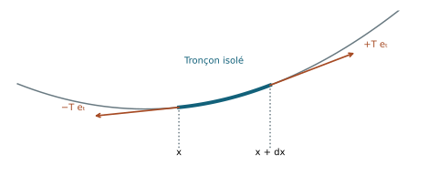
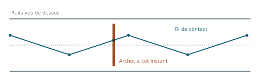
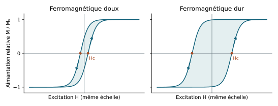
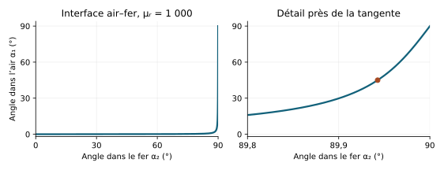
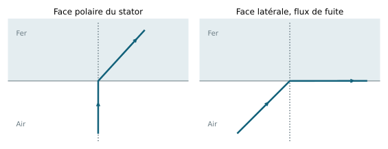
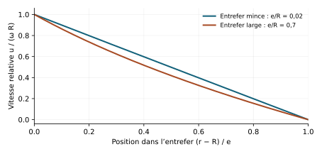
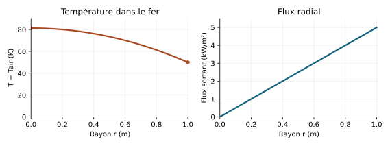
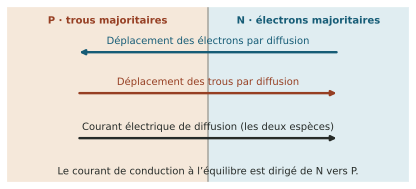
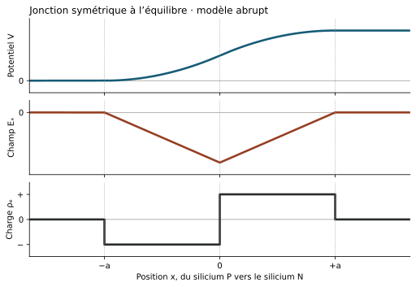
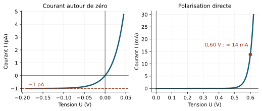

# X-ENS PSI — Physique XSR 2026 · Corrigé guidé

*Corrigé rédigé par IA, non officiel. Signalez toute erreur.*

## Présentation du sujet

L’épreuve du 15 avril 2026 dure quatre heures sans calculatrice. Elle suit trois éléments d’une installation de traction électrique. La caténaire conduit le courant jusqu’au train, le circuit magnétique assure la conversion électromécanique et les jonctions de puissance permettent de commander le moteur.

| Questions | Grandeur à suivre | Calcul ou tracé décisif |
|---|---|---|
| 1–7 | Déplacement du fil de contact | Tension minimale pour dépasser la vitesse du train |
| 8–16 | Champ dans le fer et dans l’air | Relations de passage et deux traversées d’entrefer |
| 17–23 | Vitesse azimutale du fluide | Couple transmis, puis puissance dissipée |
| 24–31 | Rayon du rotor chaud | Flux radial, température et conservation de la masse |
| 32–47 | Courant à travers la jonction PN | Diffusion des minoritaires et tension thermique |

Un partage possible réserve 30 minutes à la caténaire, 40 au circuit magnétique, 35 à l’écoulement, 45 au rotor chaud et 75 aux semi-conducteurs, avec 15 minutes pour vérifier signes, unités et hypothèses numériques. Le sujet demande des ordres de grandeur à un chiffre significatif et des applications numériques à deux chiffres au plus. Les parties sont largement indépendantes.

## I. Ondes transversales sur la caténaire

### Question 1

> [!INDICATION]
> Isoler un cylindre de fil de longueur unité.

> [!INDICATION]
> La section est perpendiculaire à l'axe du fil.

#### Solution

Une tranche de longueur $dx$ au repos possède le volume $\pi R_c^2dx$ et la masse $\rho_{\rm Cu}\pi R_c^2dx$. On en déduit la masse par unité de longueur $\mu=\rho_{\rm Cu}\pi R_c^2$, en kg/m.

> [!METHODE]
> Le produit d'une masse volumique par une aire donne une masse par unité de longueur.

### Question 2

> [!INDICATION]
> Former le triangle dont le fil déformé constitue l'hypoténuse.

> [!INDICATION]
> Comparer longueur réelle et projection horizontale grâce au cosinus.

#### Solution

La projection horizontale du tronçon déformé est $dx=d\ell\cos\alpha$. Ainsi $d\ell/dx=1/\cos\alpha=\sqrt{1+(\partial_xy)^2}$ avec $\tan\alpha=\partial_xy$. L'allongement relatif est $1/\cos\alpha-1$. S'il est très inférieur à 1, l'angle de la tangente orientée vers les $x$ croissants est petit. Plus précisément, $(d\ell-dx)/dx\simeq\alpha^2/2$ pour $|\alpha|\ll1$ (en radians).

> [!PIEGE]
> La pente est du premier ordre en angle, tandis que l'allongement est du deuxième ordre.

### Question 3

> [!INDICATION]
> Dessiner les tractions sur les deux extrémités du tronçon.

> [!INDICATION]
> La somme des composantes horizontales doit s'annuler.

#### Solution

L'extrémité gauche du tronçon subit $-T(x)\vec e_t(x)$ et la droite $T(x+dx)\vec e_t(x+dx)$. L'accélération horizontale est nulle, donc $\partial_x(T\cos\alpha)=0$. Comme $\cos\alpha=1+O(\alpha^2)$, la tension est uniforme en $x$ à l'ordre linéaire. Sa valeur est imposée par la mise en tension du fil.

> [!METHODE]
> Le résultat exact porte d'abord sur la composante horizontale de la tension.

### Question 4

> [!INDICATION]
> Projeter cette fois la somme des forces verticalement.

> [!INDICATION]
> Remplacer le sinus du petit angle par la pente du fil.

#### Solution

La masse du tronçon est $\mu dx$. La projection verticale du bilan dynamique donne $\mu\,dx\,\partial_t^2y=\partial_x(T\sin\alpha)\,dx$. Or $\sin\alpha\simeq\tan\alpha=\partial_xy$. Avec la tension uniforme, on trouve $\partial_t^2y=(T/\mu)\partial_x^2y$, équation d'onde de célérité $c=\sqrt{T/\mu}$. Ses solutions progressives ont la forme $f(x-ct)$ et $g(x+ct)$.

> [!PIEGE]
> La traction à gauche du tronçon et celle à droite n'ont pas le même signe.

### Question 5

> [!INDICATION]
> Comparer la vitesse du point d'excitation à celle des perturbations.

> [!INDICATION]
> Choisir et annoncer la section estimée, puis convertir les kilomètres par heure en mètres par seconde.

#### Solution

Pour que les perturbations puissent s'éloigner vers l'avant du pantographe, on impose $c>v$. Le seuil est $T_{\min}=\mu v^2=\rho_{\rm Cu}\pi R_c^2v^2$. Estimons une section de fil de contact à $1,0$ cm$^2$, soit $R_c\simeq5,6$ mm et $\mu\simeq0,90$ kg/m. À $300$ km/h, $v\simeq83$ m/s, ce qui place le seuil vers **$6\,10^3$ N**. La tension en exploitation doit être supérieure à ce seuil. Le résultat varie comme le carré du rayon choisi.

> [!METHODE]
> La tension seuil quadratique en vitesse doit être dépassée pour conserver une marge.

### Question 6

> [!INDICATION]
> Distinguer le seuil imposé par les ondes de la flèche admissible entre les supports.

> [!INDICATION]
> La célérité dépend de la tension et de la masse linéique, la flèche statique dépend aussi de la portée.

#### Solution

La vitesse d'un tramway urbain est bien plus faible. À section égale, passer de 300 à 60 km/h divise par 25 le seuil dynamique $\mu v^2$. En outre, des supports plus rapprochés permettent de limiter la flèche sous le poids propre avec une tension moindre. Pour une flèche petite, $f\simeq\mu gL_c^2/(8T)$ entre deux supports de même hauteur. À flèche maximale et masse linéique fixées, la tension statique requise décroît donc comme le carré de la portée. Une section plus faible, si le courant admissible le permet, réduirait aussi les deux seuils.

> [!PIEGE]
> La puissance plus faible du véhicule ne garantit pas à elle seule un courant inférieur si la tension d'alimentation est différente.

### Question 7

> [!INDICATION]
> Situer le point de frottement sur une bande de captage de largeur finie.

> [!INDICATION]
> Comparer la trace laissée par un contact centré en permanence à celle d'un contact oscillant latéralement.

#### Solution

Vu d'en haut, le fil se décale alternativement de part et d'autre du milieu de la voie. Le point de contact balaie ainsi la largeur utile de l'archet du pantographe au cours du trajet. L'usure se distribue sur la bande de frottement, ce qui empêche un sillon local profond de se former. Le déport doit rester à l'intérieur de la largeur de captage.

> [!METHODE]
> La géométrie demandée s'observe en vue de dessus.

## II.A. Champ magnétique dans l’entrefer de la machine à courant continu

### Question 8

> [!INDICATION]
> Comparer la largeur horizontale des deux cycles d'aimantation.

> [!INDICATION]
> Repérer le champ appliqué lorsque l'aimantation revient à zéro.

#### Solution

Dans un cycle d'aimantation $M(H)$, le champ coercitif est la valeur absolue de l'excitation opposée nécessaire pour annuler l'aimantation après saturation. Le matériau doux a un cycle étroit et une faible coercivité. Le matériau dur conserve une aimantation difficile à inverser et présente un cycle large. L'énergie dissipée par unité de volume sur un cycle est $\oint H\,dB=\mu_0\oint H\,dM$ pour l'orientation dissipative. Le stator doit canaliser le flux produit par la bobine, avec une excitation modérée, puis suivre un changement de réglage. On privilégie un matériau doux, à forte perméabilité et faibles pertes d'hystérésis lors des variations de flux. En régime strictement statique il ne dissipe pas à répétition une énergie de cycle.

> [!PIEGE]
> La coercivité se lit horizontalement. La rémanence se lit verticalement à excitation nulle.

### Question 9

> [!INDICATION]
> Traduire la continuité tangentielle énoncée pour l'excitation magnétique.

> [!INDICATION]
> Introduire ensuite la loi constitutive propre à chaque milieu.

#### Solution

Dans l'air $\vec B_1=\mu_0\vec H_1$ et dans le fer linéaire $\vec B_2=\mu_0\mu_r\vec H_2$. La continuité de la composante tangentielle de $\vec H$ donne $\vec B_{T2}=\mu_r\vec B_{T1}$.

> [!METHODE]
> Identifier à quelle grandeur s'applique chaque relation de passage avant d'utiliser la perméabilité.

### Question 10

> [!INDICATION]
> Décomposer chaque induction parallèle et perpendiculairement à la normale.

> [!INDICATION]
> Exprimer la tangente comme le quotient des normes tangentielle et normale.

#### Solution

Pour une incidence entre $0$ et $90^\circ$, $\tan\alpha_i=B_{Ti}/B_{Ni}$ en normes. La composante normale de $\vec B$ se conserve, tandis que sa composante tangentielle est multipliée par $\mu_r$ en entrant dans le fer. D'où $\tan\alpha_1=\tan\alpha_2/\mu_r$. Le cas tangent à l'interface se traite par passage à la limite.

> [!PIEGE]
> Les angles sont mesurés à partir de la normale à l'interface.

### Question 11

> [!INDICATION]
> Tracer quelques points avec une grande perméabilité relative et vérifier les limites aux bornes.

> [!INDICATION]
> Pour savoir quand l'angle dans l'air devient important, fixer celui-ci à 45 degrés et remonter à l'angle dans le fer.

#### Solution

Une valeur représentative pour un fer doux hors saturation est $\mu_r\sim10^3$. Sur $0\le\alpha_2<90^\circ$, la courbe est $\alpha_1=\arctan(\tan\alpha_2/10^3)$ avec $\alpha_1(90^\circ)=90^\circ$ par continuité. À $\alpha_2=88^\circ$, on obtient seulement $\alpha_1\simeq1,7^\circ$. Pour obtenir $\alpha_1=45^\circ$, il faut déjà $\alpha_2\simeq89,94^\circ$. Tant que la direction dans le fer s'écarte nettement de la tangente, le champ dans l'air est presque normal. Si l'angle dans l'air est appréciable, le champ dans le fer est pratiquement tangent.

> [!METHODE]
> Une graduation resserrée très près de 90 degrés permet de voir la remontée du graphe.

### Question 12

> [!INDICATION]
> Identifier les faces polaires par lesquelles le flux du stator doit pénétrer le rotor.

> [!INDICATION]
> Pour produire l'autre régime, considérer la face latérale d'une barre qui guide le flux longitudinalement.

#### Solution

Sous les pièces polaires du stator, le flux utile traverse l'entrefer et rejoint le rotor. Les lignes dans le fer arrivent sous un angle qui n'est pas presque tangent à la surface polaire. Le champ dans l'air est donc sensiblement normal à la surface, ici radial. Pour l'autre régime, considérons une longue barre de fer doux parcourue par un flux essentiellement longitudinal. Près de sa face latérale, une ligne de fuite peut quitter la barre obliquement dans l'air alors que son tronçon dans le fer est presque tangent à cette face. Par exemple, une incidence de $45^\circ$ dans l'air correspond à environ $89,94^\circ$ dans le fer si $\mu_r=10^3$.

> [!PIEGE]
> Une même pièce de fer peut présenter des géométries de champ différentes selon la face observée.

### Question 13

> [!INDICATION]
> Construire un tube dont les parois latérales suivent les lignes de champ.

> [!INDICATION]
> Évaluer sur quelles faces le flux peut contribuer au bilan.

#### Solution

Un tube de flux compris entre deux sections de fer a un flux latéral nul. Comme $\operatorname{div}\vec B=0$, le flux $\Phi$ est le même à travers les deux sections. Le modèle de la figure 4 suppose une section constante $S$ et des lignes quasi parallèles et perpendiculaires aux sections, avec un champ uniforme sur chaque section. Ainsi $\Phi=BS$ impose le même $B$ le long du circuit. Cette conclusion sur la norme emploie l'approximation de section uniforme. Avec une section variable, le flux resterait constant avec des valeurs locales différentes de $B$. Le modèle néglige également l'épanouissement du flux dans les deux entrefers.

> [!PIEGE]
> La conservation du flux implique celle du champ moyen uniquement si la section reste constante.

### Question 14

> [!INDICATION]
> Écrire l'excitation dans chacun des milieux à induction fixée.

> [!INDICATION]
> Remplacer dans la formule de densité d'énergie fournie.

#### Solution

Les excitations sont $H_{\rm air}=B/\mu_0$ et $H_{\rm fer}=B/(\mu_0\mu_r)$. Les densités d'énergie magnétique valent donc
$$\mathcal E_{\rm air}=\frac{B^2}{2\mu_0},\qquad \mathcal E_{\rm fer}=\frac{B^2}{2\mu_0\mu_r}.$$
À induction égale, la densité d'énergie est $\mu_r$ fois plus grande dans l'air.

> [!METHODE]
> Comparer les densités à induction égale reproduit les conditions du circuit en série.

### Question 15

> [!INDICATION]
> Parcourir le chemin magnétique une fois et repérer chaque passage dans l'air.

> [!INDICATION]
> La circulation de l'excitation est égale à la somme algébrique des courants enlacés.

#### Solution

Le contour moyen orienté dans le sens du flux enlace $NI$ ampère-tours. Il traverse une longueur totale $\ell$ de fer et **deux** entrefers d'épaisseur $e$. Le théorème d'Ampère donne $H_{\rm fer}\ell+2eH_{\rm air}=NI$, d'où
$$B=\frac{\mu_0NI}{\ell/\mu_r+2e}.$$
On néglige ici les fuites de flux et l'on utilise une perméabilité constante.

> [!PIEGE]
> Le trajet contient deux passages dans l'air, mais la longueur de fer fournie représente déjà leur circuit complet dans le fer.

### Question 16

> [!INDICATION]
> Comparer le terme associé au fer et celui associé à l'air au dénominateur du champ.

> [!INDICATION]
> Envisager successivement une excitation imposée et un champ utile imposé.

#### Solution

À ampère-tours fixés, diminuer $e$ augmente $B$, donc la force de Laplace disponible pour un même courant rotorique. Réciproquement, pour un champ imposé, un entrefer plus court demande moins de courant d'excitation et réduit les pertes Joule du bobinage. La limite formelle $e=0$ est incompatible avec le jeu nécessaire à la rotation. La saturation du fer peut aussi rendre l'approximation linéaire trop optimiste.

> [!METHODE]
> Le jeu minimal résulte d'un compromis entre le circuit magnétique et des limites mécaniques.

## II.B. Écoulement et cisaillement de l’air

### Question 17

> [!INDICATION]
> Calculer la force de pression sur deux faces opposées d'un petit cube.

> [!INDICATION]
> La différence de pression est du premier ordre en longueur, et la force totale du premier ordre en volume.

#### Solution

Une longueur mésoscopique est grande devant les distances moléculaires et le libre parcours moyen, mais petite devant la longueur caractéristique de variation du champ. Un petit volume de cette taille contient assez de molécules pour définir pression, masse volumique et vitesse locales. En suivant le même ensemble de matière, on définit la particule fluide. Pour un cube de côté $\delta$, les deux faces normales à $x$ reçoivent une force résultante $[P(x-\delta/2)-P(x+\delta/2)]\delta^2\simeq-\partial_xP\,\delta^3$. En divisant par le volume et en répétant le calcul selon $y,z$, on obtient la densité de force $\vec f_{\rm pr}=-\nabla P$, dirigée vers les basses pressions.

> [!PIEGE]
> La force de pression exercée par l'extérieur sur une face pointe vers l'intérieur du cube.

### Question 18

> [!INDICATION]
> Appliquer le principe fondamental à un volume de matière qui se déplace avec le fluide.

> [!INDICATION]
> Développer la dérivée de la vitesse le long de la trajectoire de la particule.

#### Solution

Le principe fondamental de la dynamique appliqué à la particule de volume $dV$ donne $\rho_{\rm air}dV\,D\vec u/Dt=(\vec f_{\rm pr}+\vec f_{\rm visc})dV$. Avec les lois admises et la pesanteur négligée,
$$\rho_{\rm air}\left[\partial_t\vec u+(\vec u\cdot\nabla)\vec u\right]=-\nabla P+\eta\Delta\vec u.$$
La dérivée à gauche suit la matière. Elle peut être non nulle en régime permanent.

> [!METHODE]
> Suivre une particule et observer un point fixe donnent deux dérivées différentes dans un champ non uniforme.

### Question 19

> [!INDICATION]
> Établir les invariances du problème loin des extrémités du cylindre.

> [!INDICATION]
> Une particule sur une trajectoire circulaire garde sa norme de vitesse mais change de direction.

#### Solution

Loin des extrémités d'un rotor très long, les conditions sont invariantes par translation axiale et rotation autour de l'axe. Sans entraînement ou gradient de pression axial, on retient l'écoulement laminaire circulaire. L'incompressibilité et l'imperméabilité des parois éliminent la vitesse radiale. Ainsi $P=P(r)$ et $\vec u=u(r)\vec e_\theta$. La dérivée particulaire vaut $-u^2\vec e_r/r$ par rotation de la base, et le laplacien vaut $(u''+u'/r-u/r^2)\vec e_\theta$. L'équation de mouvement donne
$$P'(r)=\rho_{\rm air}\frac{u^2}{r},\qquad u''+\frac1r u'-\frac{u}{r^2}=0.$$
La pression augmente en allant vers l'extérieur. Un écoulement instable ou turbulent sort du modèle adopté.

> [!PIEGE]
> Le laplacien vectoriel comporte un terme géométrique dû à la base cylindrique.

### Question 20

> [!INDICATION]
> Tester une puissance de rayon dans l'équation d'Euler.

> [!INDICATION]
> Imposer l'adhérence à la vitesse locale de chacune des deux surfaces.

#### Solution

Une solution $kr^n$ non nulle impose $n(n-1)+n-1=n^2-1=0$. Les deux solutions indépendantes $r$ et $1/r$ engendrent la solution générale $u=ar+b/r$. Posons $R_s=R+e$. L'adhérence aux parois impose $u(R)=\omega R$, $u(R_s)=0$, ainsi
$$a=-\frac{\omega R^2}{R_s^2-R^2},\qquad b=\frac{\omega R^2R_s^2}{R_s^2-R^2}.$$
Pour $\omega>0$, le profil est décroissant ($a-b/r^2<0$) et convexe ($2b/r^3>0$), de $\omega R$ à 0. Dans un entrefer mince, il est presque linéaire.

> [!METHODE]
> Les valeurs de bord, la pente et la convexité déterminent l'allure du profil.

### Question 21

> [!INDICATION]
> Exprimer le moment axial d'une contrainte répartie sur une surface cylindrique.

> [!INDICATION]
> Relier le couple entrant et le couple sortant d'une couronne stationnaire.

#### Solution

Au rayon $r$, le fluide intérieur exerce sur l'extérieur une contrainte tangentielle $\tau(r)=-\eta r\,d(u/r)/dr$. Le couple qu'il transmet sur la surface latérale de longueur $L$ vaut $\Gamma(r)=2\pi Lr^2\tau(r)$. Dans une couronne $[r,r+dr]$, la vitesse radiale est nulle, les efforts de pression n'ont pas de moment axial et l'on néglige les effets des bords. En régime permanent, les couples reçus $\Gamma(r)-\Gamma(r+dr)$ se compensent. Donc
$$\frac d{dr}\!\left[r^3\frac d{dr}(u/r)\right]=0.$$
En développant la dérivée, on trouve $r^2u''+ru'-u=0$, soit l'équation tangentielle cherchée.

> [!PIEGE]
> Le facteur rayon apparaît dans le bras de levier et dans l'aire de la surface latérale.

### Question 22

> [!INDICATION]
> Utiliser la forme en deux termes de la vitesse pour dériver la vitesse angulaire locale.

> [!INDICATION]
> Évaluer le couple sur le cylindre interne et déterminer son sens.

#### Solution

Comme $u/r=a+b/r^2$, on a $\tau=2\eta b/r^2$. Le couple transmis vaut $2\pi Lr^2\tau=4\pi\eta Lb$ quel que soit le rayon. Au contact du rotor, $\vec\Gamma_{\rm rotor/air}=4\pi\eta Lb\,\vec e_z$ pour $\omega>0$. Le préfacteur $A$ vaut $4\pi$. Le couple sur le rotor a le signe opposé.

> [!METHODE]
> L'indépendance du couple transmis par rapport au rayon est une vérification du bilan de la question 21.

### Question 23

> [!INDICATION]
> Faire le produit scalaire du couple par la vitesse angulaire de sa surface d'application.

> [!INDICATION]
> Pour une estimation simple, développer la différence des rayons au carré en entrefer mince.

#### Solution

La puissance cédée par la paroi mobile est $\Gamma\omega$, soit
$$P_{\rm rotor/air}=\frac{4\pi\eta L\omega^2 R^2(R+e)^2}{(R+e)^2-R^2}
\simeq\frac{2\pi\eta L R^3\omega^2}{e}\quad(e\ll R).$$
Prenons à titre d'estimation $R=L=1$ m, $\omega=100$ rad/s (environ $950$ tr/min), $e=3$ mm et $\eta=1,7\,10^{-5}$ Pa·s. Il vient environ $4\,10^2$ W, soit quelques dix-millièmes de la puissance utile de 1 MW. Le rotor alimente la dissipation visqueuse en chaleur dans l'air. L'estimation correspond au régime laminaire idéal et ignore les effets d'extrémité.

> [!PIEGE]
> La paroi fixe reçoit un couple mais ne développe aucune puissance mécanique.

## II.C. Échauffement et dilatation du rotor

### Question 24

> [!INDICATION]
> Suivre un point du rotor qui traverse successivement les pôles du stator.

> [!INDICATION]
> Séparer les pertes liées au cycle d'aimantation et celles dues aux courants induits.

#### Solution

Chaque élément du fer rotorique traverse le champ des pôles successifs. Il subit des cycles d'aimantation, dissipatifs par hystérésis, et des variations de flux qui induisent des courants de Foucault, dissipatifs par effet Joule. À amplitude d'induction fixée, la fréquence de ces phénomènes augmente avec $|\omega|$. Les pertes d'hystérésis sont proportionnelles au nombre de cycles par seconde et les pertes classiques par courants de Foucault croissent approximativement comme son carré. L'homogénéité du fer et la moyenne sur plusieurs tours motivent une source volumique **effective** uniforme. La moyenne sur la rotation efface les variations azimutales mais ne prouve pas l'uniformité radiale.

> [!METHODE]
> La vitesse convertit une variation spatiale du champ en une fréquence d'excitation pour la matière.

### Question 25

> [!INDICATION]
> Délimiter une couronne de fer et compter les deux flux radiaux avec leurs signes.

> [!INDICATION]
> La production volumique est multipliée par le volume de la couronne.

#### Solution

Sur une couronne de hauteur $L$, comprise entre $r$ et $r+dr$, la variation d'énergie interne est nulle en régime permanent. Le flux sortant moins le flux entrant égale la production intérieure :
$$2\pi L[(r+dr)j_{\rm th}(r+dr)-rj_{\rm th}(r)]=p_{\rm th}\,2\pi Lr\,dr.$$
La dérivation donne $(rj_{\rm th})'=rp_{\rm th}$. Les échanges axiaux sont négligés dans ce modèle radial.

> [!PIEGE]
> Le flux surfacique ne se conserve pas seul, car la surface de passage varie avec le rayon et le fer produit de la chaleur.

### Question 26

> [!INDICATION]
> Intégrer la relation sur le flux puis examiner le comportement sur l'axe.

> [!INDICATION]
> La loi de Fourier impose un signe entre le gradient de température et le flux.

#### Solution

L'intégration donne $rj_{\rm th}=p_{\rm th}r^2/2+K$. La densité de flux reste finie sur l'axe, donc $K=0$. La loi de Fourier radiale $j_{\rm th}=-\lambda_{\rm Fe}T'$ entraîne alors
$$j_{\rm th}(r)=\frac{p_{\rm th}r}{2},\qquad T(r)=C-\frac{p_{\rm th}r^2}{4\lambda_{\rm Fe}}.$$
Le centre est le point le plus chaud et la chaleur s'écoule vers l'entrefer.

> [!PIEGE]
> Une constante donnant un flux en inverse du rayon correspondrait à une source singulière sur l'axe.

### Question 27

> [!INDICATION]
> Égaler le flux sortant du solide et celui que reçoit le fluide.

> [!INDICATION]
> Exprimer d'abord la température de surface, puis revenir au centre.

#### Solution

À la surface, la continuité du flux impose $p_{\rm th}R/2=h[T(R)-T_{\rm air}]$. On obtient
$$C=T_{\rm air}+\frac{p_{\rm th}R}{2h}+\frac{p_{\rm th}R^2}{4\lambda_{\rm Fe}}.$$
Au centre, le premier excès de température sur l'air provient de la convection de surface et le second de la conduction dans le fer.

> [!METHODE]
> Les écarts de température liés à la convection de surface et à la conduction interne s'additionnent.

### Question 28

> [!INDICATION]
> Intégrer la définition du coefficient de dilatation à pression constante.

> [!INDICATION]
> La masse est conservée alors que le volume et la masse volumique varient.

#### Solution

À pression fixée, $dV/V=\beta\,dT$. Pour $\beta$ constant, $V_f=V_i\exp[\beta(T_f-T_i)]$. La masse d'une particule de fer se conserve, si bien que $\rho(r)=\rho_0\exp[-\beta(T(r)-T_0)]$. Un élément plus chaud possède donc une masse volumique plus petite si $\beta>0$.

> [!PIEGE]
> Le coefficient donné est volumique. L'hypothèse du sujet fixe la longueur du rotor.

### Question 29

> [!INDICATION]
> Écrire la même masse dans l'état initial et dans la configuration chaude.

> [!INDICATION]
> Dans l'intégrale cylindrique, le facteur rayon accompagne exactement la différentielle de son carré.

#### Solution

Posons $\kappa=\beta p_{\rm th}/(4\lambda_{\rm Fe})$. La masse s'écrit dans l'état de référence $m=\pi L\rho_0R_0^2$, tandis que dans l'état chaud elle vaut
$$m=2\pi L\rho_0 e^{-\beta(C-T_0)}\int_0^R e^{\kappa r^2}r\,dr
=\pi L\rho_0e^{-\beta(C-T_0)}\frac{e^{\kappa R^2}-1}{\kappa}.$$
En égalant ces deux expressions, on retrouve $\kappa R_0^2e^{\beta(C-T_0)}=e^{\kappa R^2}-1$.

> [!METHODE]
> Employer la masse volumique locale du rotor chaud sur son volume actuel.

### Question 30

> [!INDICATION]
> Identifier le petit paramètre numérique dans l'exponentielle du membre droit de l'équation (4).

> [!INDICATION]
> Vérifier la précision nécessaire selon que l'on cherche le rayon total ou l'accroissement de ce rayon.

#### Solution

Les données donnent $\kappa R^2\simeq(3\,10^{-5})(10^4)/(4\times80)\simeq9\,10^{-4}$ pour $R\sim1$ m. En retenant $e^{\kappa R^2}-1\simeq\kappa R^2$ dans l'équation (4), on obtient bien la forme demandée **au niveau d'approximation indiqué** :
$$R\simeq R_0\exp[\beta(C-T_0)/2].$$
La formule exacte avec $C$ évalué au rayon chaud est $R^2=\kappa^{-1}\ln(1+\kappa R_0^2e^{\beta(C-T_0)})$. Le premier développement donne une bonne approximation du rayon total, mais si l'on s'intéresse à sa très petite augmentation, le terme suivant du logarithme apporte une correction de même ordre en $\beta$ que la dilatation elle-même.

> [!PIEGE]
> Une approximation relative excellente sur un mètre peut laisser une erreur appréciable sur un millimètre.

### Question 31

> [!INDICATION]
> Estimer la température centrale avec la condition de convection et une température d'air de référence annoncée.

> [!INDICATION]
> Développer l'exponentielle pour une dilatation très petite, puis comparer au jeu typique.

#### Solution

Pour estimer un nombre, supposons $T_{\rm air}\simeq T_0=298$ K et $R\simeq R_0\simeq1$ m. La question 27 donne $C-T_0\simeq50+31=81$ K. La formule demandée en 30 conduit à $(R-R_0)/R_0\simeq\beta(C-T_0)/2\simeq1,2\,10^{-3}$.

On peut conserver au même ordre l'effet du gradient radial : développer l'expression exacte de $R^2$ donne
$$\frac{R-R_0}{R_0}\simeq\frac{\beta}{2}\left(C-T_0-\frac{p_{\rm th}R_0^2}{8\lambda_{\rm Fe}}\right)\simeq9,8\,10^{-4}.$$
Le terme entre parenthèses est l'échauffement moyen du rotor. Les deux approches donnent l'ordre de grandeur **$10^{-3}$**, soit environ 1 mm de jeu radial pour un rayon de 1 m. Avec les valeurs retenues en 23, des pertes visqueuses de l'ordre du mégawatt n'apparaîtraient qu'en extrapolant le modèle d'entrefer mince vers $e\sim10^{-6}$ m. Le jeu imposé par l'échauffement est donc le plus contraignant dans cette comparaison.

> [!METHODE]
> La formule précise de dilatation au premier ordre fait intervenir l'échauffement moyen du volume.

## III.A. Porteurs majoritaires et minoritaires dans le silicium

### Question 32

> [!INDICATION]
> Partir de la neutralité du cristal avec les donneurs ionisés.

> [!INDICATION]
> Éliminer les trous à l’aide du produit des densités.

#### Solution

Chaque atome donneur pentavalent ionisé apporte une charge fixe $+e$ et un électron de conduction. La neutralité électrique du volume donne $p_N+n_D=n_N$. En outre, $n_N p_N=n_i^2$. En éliminant $p_N$, on obtient $n_N^2-n_Dn_N-n_i^2=0$. Seule la racine positive convient. La densité atomique donnée dans le sujet est de l'ordre de $10^{29}\,\mathrm{m^{-3}}$, donc même le dopage le plus faible donne $n_D\sim10^{21}\,\mathrm{m^{-3}}\gg n_i=2\times10^{16}\,\mathrm{m^{-3}}$. Ainsi
$$n_N=\frac{n_D+\sqrt{n_D^2+4n_i^2}}2\simeq n_D,\qquad p_N\simeq\frac{n_i^2}{n_D}.$$

> [!METHODE]
> La racine positive est la seule admissible.

### Question 33

> [!INDICATION]
> Convertir les fractions de sites en densités par mètre cube.

> [!INDICATION]
> Le dopage le plus élevé fournit la plus petite concentration de trous.

#### Solution

Le dopage d'un site sur $10^8$ donne $n_D\sim10^{21}\,\mathrm{m^{-3}}$ et celui d'un site sur $10^5$ donne $10^{24}\,\mathrm{m^{-3}}$. Les majoritaires sont donc de l'ordre de $10^{21}$ à $10^{24}\,\mathrm{m^{-3}}$. Pour les trous, $n_i^2=4\times10^{32}\,\mathrm{m^{-6}}$. On passe de $4\times10^{11}\,\mathrm{m^{-3}}$ au dopage faible à $4\times10^{8}\,\mathrm{m^{-3}}$ au dopage fort. Leurs densités varient en sens opposés.

> [!PIEGE]
> Vérifier les unités du produit des densités.

## III.B. Jonction PN à l’équilibre

### Question 34

> [!INDICATION]
> Orienter séparément le mouvement de chaque espèce.

> [!INDICATION]
> Multiplier ensuite le flux de particules par sa charge.

#### Solution

L'axe $x$ va de P vers N. Les électrons, plus nombreux en N, diffusent de N vers P. Leur charge négative fait que leur courant est dirigé vers $+x$. Les trous, plus nombreux en P, diffusent de P vers N et leur courant suit ce mouvement. Les deux contributions au **courant électrique de diffusion** s'ajoutent donc selon $+\vec e_x$.

> [!PIEGE]
> Les électrons se déplacent en sens opposé à leur courant.

### Question 35

> [!INDICATION]
> Quels ions du réseau restent immobiles après diffusion ?

> [!INDICATION]
> Comparer les deux côtés proches de la jonction.

#### Solution

En N, le départ d'électrons laisse à découvert les donneurs ionisés, fixés au cristal. La densité volumique de charge y est positive au voisinage de l'interface. En P, le départ des trous laisse les accepteurs ionisés négatifs non compensés. La densité y est négative. Loin de l'interface, les porteurs mobiles compensent les ions du dopage et les matériaux restent quasi neutres.

> [!METHODE]
> La charge fixe jusque-là compensée devient apparente.

### Question 36

> [!INDICATION]
> Faire partir le champ des charges positives.

> [!INDICATION]
> La conductivité est positive pour les deux espèces.

#### Solution

Par symétrie plane, le champ est perpendiculaire à l'interface. Il va des charges positives du côté N vers les charges négatives du côté P, donc selon $-\vec e_x$. La densité de courant de conduction étant $\sigma\vec E$ avec $\sigma>0$, ce courant va aussi vers $-x$ pour l'ensemble des porteurs. Il s'oppose au courant de diffusion. À l'équilibre, leurs sommes se compensent.

> [!METHODE]
> Au repos, le courant total doit s’annuler.

### Question 37

> [!INDICATION]
> L’énergie d’un électron varie comme −eV.

> [!INDICATION]
> Dériver le potentiel, puis appliquer la loi de Gauss.

#### Solution

L'énergie potentielle d'un électron est $-eV$. La descente des bandes $E_C$ et $E_V$ de P vers N signifie donc que $V$ **monte** d'un palier vers un autre. Le champ $E_x=-\mathrm dV/\mathrm dx$ est négatif autour de la jonction et tend vers zéro dans les deux volumes. La loi de Gauss à permittivité uniforme donne $\rho_e=\varepsilon\,\mathrm dE_x/\mathrm dx$ : $\rho_e<0$ du côté P, $\rho_e>0$ du côté N, et $\rho_e\simeq0$ loin de l'interface. Dans l'approximation abrupte, cette charge forme deux rectangles opposés. Le champ descend linéairement jusqu'à son minimum puis remonte linéairement. Le potentiel présente donc deux arcs paraboliques raccordés avec la même pente à $x=0$, de courbures opposées. Hors zone, sa pente est quasi nulle.

> [!METHODE]
> Les signes des pentes suffisent à vérifier les trois courbes.

### Question 38

> [!INDICATION]
> Employer le dopage faible des deux côtés.

> [!INDICATION]
> Calculer séparément la tension thermique et le logarithme.

#### Solution

Ici les deux matériaux sont faiblement et également dopés, $n_D=n_A\sim10^{21}\,\mathrm{m^{-3}}$. Le logarithme porte sur le rapport sans dimension $n_Dn_A/n_i^2\simeq2{,}5\times10^9$. Avec $k_BT/e\simeq 0{,}0257\,\mathrm V$ à $298\,\mathrm K$ on trouve
$$U_0\simeq0{,}0257\ln(2{,}5\times10^9)\simeq0{,}56\,\mathrm V.$$
La barrière interne positive est donc de plusieurs dixièmes de volt, soit une vingtaine de tensions thermiques. À l'équilibre elle compense la tendance à la diffusion sans produire de courant extérieur.

> [!PIEGE]
> Le logarithme porte sur un rapport sans dimension.

## III.C.a. Transport dans le cristal P hors de la zone de charge d’espace

### Question 39

> [!INDICATION]
> Choisir une tranche et compter les particules qui entrent et sortent.

> [!INDICATION]
> Ajouter le terme volumique de création.

#### Solution

Dans la tranche P de section $S$ entre $x$ et $x+\mathrm dx$, le flux **de particules** vaut $\Gamma_n=-D_n n'$. Le bilan de particules est $S\mathrm dx\,\partial_t n=S[\Gamma_n(x)-\Gamma_n(x+\mathrm dx)]+S\mathrm dx\,c_n$. En régime stationnaire on a $0=-\mathrm d\Gamma_n/\mathrm dx+(n_P-n)/\tau_n$, soit
$$n''-\frac{n}{D_n\tau_n}=-\frac{n_P}{D_n\tau_n}.$$
Le facteur $-e$ n'intervient que lorsqu'on passe du flux de particules au courant électrique.

> [!PIEGE]
> La loi de Fick s’applique ici au flux de particules.

### Question 40

> [!INDICATION]
> Soustraire la solution constante avant de résoudre.

> [!INDICATION]
> Rejeter le mode qui diverge à gauche.

#### Solution

Pour l'excès $\delta n=n-n_P$, l'équation devient $\delta n''=\delta n/L_n^2$ avec $L_n=\sqrt{D_n\tau_n}$, en mètres. Sur la demi-droite $x\leq-a$, la solution qui croîtrait lorsque $x\to-\infty$ est exclue par $n(-\infty)=n_P$. La valeur au bord fixe le facteur restant :
$$n(x)=n_P+[n(-a)-n_P]\exp\!\left(\frac{x+a}{L_n}\right).$$

> [!METHODE]
> Le produit du temps de vie par le coefficient de diffusion est un carré de longueur.

### Question 41

> [!INDICATION]
> Dériver la solution au bord du cristal P.

> [!INDICATION]
> Multiplier le flux électronique par −eS.

#### Solution

Le courant des électrons dans la région P, orienté positivement vers $+x$, est $I_n=(-e)S\Gamma_n=eSD_n n'$. En dérivant Q40 au bord $x=-a$, on trouve
$$I_n=\frac{SeD_n}{L_n}\,[n(-a)-n_P].$$
En polarisation directe l'excès d'électrons donne un flux de particules vers $-x$ et un courant vers $+x$.

> [!METHODE]
> La tension directe doit produire un courant conventionnel positif.

## III.C.b. Zone de charge d’espace et caractéristique de la diode

### Question 42

> [!INDICATION]
> Écrire les deux densités de courant pour les électrons.

> [!INDICATION]
> Leur somme est faible devant chacune.

#### Solution

Dans la zone de charge d'espace où la création nette de porteurs est négligée, la conservation du flux rend $j_n=I_n/S$ constant. Les contributions locales de diffusion et de conduction sont grandes devant ce courant total et se compensent au premier ordre :
$$j_n=eD_n n'+\mu_n en E_x=eD_n n'-\mu_n en V'\simeq0.$$
Il en résulte $\mathrm dn/n\simeq(\mu_n/D_n)\,\mathrm dV$. L'égalité du sujet vaut dans l'approximation de quasi-équilibre de la zone. Un courant total faible peut subsister malgré cette compensation au premier ordre.

> [!PIEGE]
> La compensation est une approximation locale de la zone.

### Question 43

> [!INDICATION]
> Choisir une seule direction d’intégration pour les deux membres.

> [!INDICATION]
> Recommencer sans polarisation extérieure.

#### Solution

Intégrer de $a$ (côté N, $n(a)=n_N$) à $-a$ (côté P) donne
$$\ln\!\frac{n(-a)}{n_N}=\frac{\mu_n}{D_n}[V(-a)-V(a)]=\frac{\mu_n}{D_n}(U-U_0).$$
À l'équilibre sans tension appliquée, $U=0$ et $n(-a)=n_P$. La même intégrale donne $\ln(n_P/n_N)=-(\mu_n/D_n)U_0$.

> [!METHODE]
> Différencier la tension appliquée de la barrière interne.

### Question 44

> [!INDICATION]
> Soustraire les deux logarithmes de la question 43.

> [!INDICATION]
> Introduire la relation d’Einstein.

#### Solution

La soustraction des deux relations précédentes élimine $U_0$ et $n_N$. On obtient $\ln[n(-a)/n_P]=(\mu_n/D_n)U$. La relation d'Einstein $\mu_n/D_n=e/(k_BT)$ fournit
$$n(-a)=n_P\exp\!\left(\frac{eU}{k_BT}\right).$$
On retrouve bien $n_P$ pour $U=0$.

> [!METHODE]
> Pour U nul, retrouver la densité d’équilibre.

### Question 45

> [!INDICATION]
> Injecter la valeur au bord dans le courant de Q41.

> [!INDICATION]
> Vérifier le signe en polarisation directe.

#### Solution

En remplaçant la concentration au bord dans le courant de Q41,
$$I_n=\frac{SeD_n n_P}{L_n}\left[\exp\!\left(\frac{eU}{k_BT}\right)-1\right].$$
Le coefficient $SeD_nn_P/L_n$ a pour unité le coulomb par seconde.

> [!METHODE]
> Contrôler la dimension du préfacteur en ampères.

### Question 46

> [!INDICATION]
> Les minoritaires en N sont les trous.

> [!INDICATION]
> Échanger les régions et les charges avant d’additionner les courants.

#### Solution

Dans le cristal N, les trous sont minoritaires. Le raisonnement symétrique échange les deux régions, les charges et le sens de leur flux. Les deux changements de signe laissent le **même sens de courant conventionnel**. La contribution des trous a donc le même facteur en $U$ et le coefficient $SeD_p p_N/L_p$. Leur somme donne
$$I=I_0[\exp(U/V_T)-1],\qquad V_T=\frac{k_BT}{e},\qquad I_0=Se\left(\frac{D_n n_P}{L_n}+\frac{D_p p_N}{L_p}\right).$$

> [!PIEGE]
> Les flux de particules opposés donnent des courants de même sens.

### Question 47

> [!INDICATION]
> Évaluer la tension thermique en kelvins.

> [!INDICATION]
> Étudier séparément les régimes de tension négative et positive.

#### Solution

Avec $T=298\,\mathrm K$, $V_T=1{,}38\times10^{-23}\times298/(1{,}60\times10^{-19})\simeq25{,}7\,\mathrm{mV}$, soit quelques dizaines de millivolts. Pour $U\ll-V_T$, le courant tend vers $-I_0\sim-1\,\mathrm{pA}$. La caractéristique passe par l'origine, avec une pente $I_0/V_T$. En direct, une augmentation de $V_T\ln10\simeq59\,\mathrm{mV}$ multiplie approximativement le courant par dix dès que $I\gg I_0$. Pour $I_0=1\,\mathrm{pA}$, $U=0{,}60\,\mathrm V$ donne environ $14\,\mathrm{mA}$. Le « seuil » dépend du courant retenu. Dans cette loi idéale ni le claquage en inverse ni la résistance série à fort courant ne sont modélisés.

> [!METHODE]
> Deux échelles de courant permettent de voir le plateau inverse et la montée directe.

## Bilan

La célérité détermine le seuil dynamique de tension du fil. Dans le moteur, le jeu radial doit simultanément limiter la réluctance, permettre la rotation et absorber la dilatation. La comparaison de ces exigences demande de garder la même définition de l’épaisseur, du couple et du rayon tout au long du calcul.

Pour la diode, préciser le sens de l’axe dès le dessin de la jonction. Les courants conventionnels associés aux électrons et aux trous ont le même sens sous polarisation directe. La barrière du potentiel fixe la concentration minoritaire de bord, puis la diffusion fixe le courant restitué au circuit extérieur.
