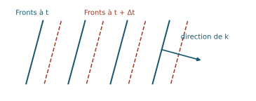
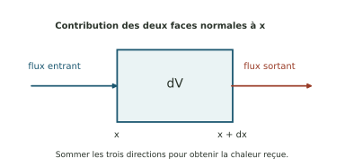
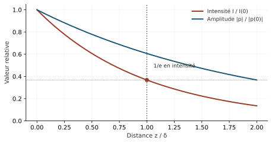
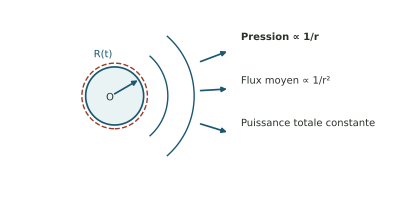
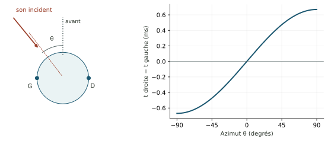
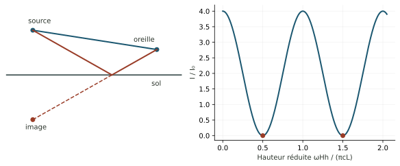
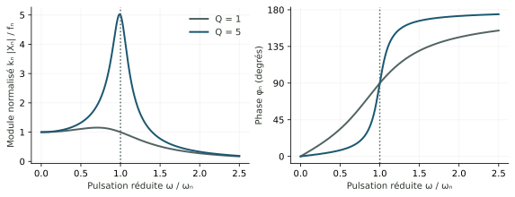
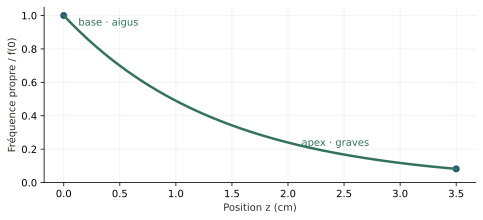
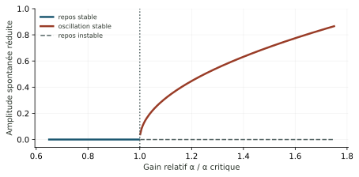
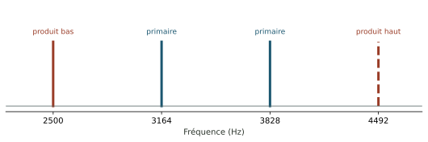

# X-ENS PSI — Physique U 2026 · Corrigé guidé

*Corrigé rédigé par IA, non officiel. Signalez toute erreur.*

**Rédaction** · Modèle : OpenAI Codex (famille GPT-6) · Effort de raisonnement : non renseigné · Mode de vitesse : non renseigné.

**Révision** · Modèle : OpenAI Codex (famille GPT-6) · Effort de raisonnement : non renseigné · Mode de vitesse : non renseigné.

## Présentation du sujet

À partir d’un même phénomène, ce sujet de six heures sans calculatrice fait passer de la propagation sonore à la détection de l’azimut et de l’élévation, puis au son que peut émettre la cochlée. La convention temporelle du sujet est $e^{-i\omega t}$.

| Questions | Grandeur à suivre | Vérification |
|---|---|---|
| 1–28 | Surpression, entropie et température de l’air | La puissance décroît deux fois plus vite que l’amplitude dans l’exponentielle. |
| 29–55 | Puissance rayonnée, différence de marche et retard entre oreilles | En champ libre la puissance totale qui traverse une sphère se conserve. |
| 56–70 | Déplacement et vitesse des membranes | L’amortissement effectif change de signe au seuil des émissions spontanées. |

Les trois parties sont largement indépendantes. Gardez près de vous deux conversions utiles, $\omega=2\pi f$ et $1^\circ=\pi/180$ rad. À la dernière page, repérez les deux fréquences primaires sur l’axe avant d’appliquer les formules établies avec des indices abstraits.

## I.1 · Propagation sans dissipation

La perturbation de pression est mesurable. Son amplitude complexe est une représentation du régime harmonique.

### Question 1

> [!INDICATION]
> Identifier les deux dérivées qui figurent dans l'équation.

#### Solution

Il s'agit de l'équation d'onde de d'Alembert, linéaire, homogène et sans dissipation. La célérité $c$ compare la variation spatiale et la variation temporelle de la surpression.

### Question 2

> [!INDICATION]
> Appliquer séparément le laplacien et la dérivée seconde en temps à la même phase.

#### Solution

Pour une amplitude non nulle, $\Delta p=-k^2p$ et $\partial_t^2 p=-\omega^2p$. Il faut et il suffit donc que $\omega^2=c^2k^2$. Avec $\omega\geq0$ et $k=\|\vec k\|$, la **relation de dispersion** est $\omega=ck$.

### Question 3

> [!INDICATION]
> Suivre un point qui conserve sa phase lorsque le temps augmente.

#### Solution

À l'instant $t$, un front satisfait $\vec k\cdot\vec r=\mathrm{constante}+\omega t$. Pour $k>0$, c'est un plan perpendiculaire à $\vec k$. En dérivant la condition de phase constante, la composante normale de la vitesse du front vaut $\omega/k=c$ dans le sens de $\vec k$. Le mode uniforme $k=\omega=0$ ne donne pas un front mobile.

## I.2 · Conservation et compressibilité de l’air

Pour les bilans, distinguez la masse volumique de référence, la perturbation acoustique, le volume de contrôle et la parcelle matérielle.

### Question 4

> [!INDICATION]
> Conserver la masse d'une même parcelle quand son volume change légèrement.

#### Solution

Pour une masse fixée, $\mathrm d\rho_{\rm tot}/\rho_{\rm tot}=-\mathrm dV/V$. Sur l'isentrope, ce dernier membre est $\chi_S\mathrm dP$. Au premier ordre autour de l'équilibre, $\rho_{\rm tot}$ et $\chi_S$ dans le coefficient peuvent être évalués à l'état de repos. D'où $\rho=\rho_0\chi_Sp+O(p^2)$ pour une surpression suffisamment petite, en l'absence de fluctuation d'entropie indépendante.

### Question 5

> [!INDICATION]
> Prendre la différentielle logarithmique de la loi de Laplace.

#### Solution

Une masse fixe de gaz parfait en transformation isentropique, à capacités thermiques constantes, vérifie $PV^\gamma=\mathrm{constante}$. Ainsi $\mathrm dV/V=-\mathrm dP/(\gamma P)$. À l'équilibre, $\chi_S=1/(\gamma P_0)\simeq7{,}1\times10^{-6}\,\mathrm{Pa^{-1}}$.

### Question 6

> [!INDICATION]
> Distinguer la masse volumique totale de sa variation acoustique.

#### Solution

La conservation locale donne $\partial_t(\rho_0+\rho)+\nabla\cdot[(\rho_0+\rho)\vec v]=0$. Le produit $\rho\vec v$ est du second ordre et $\rho_0$ est uniforme. Il reste $\partial_t\rho+\rho_0\nabla\cdot\vec v=0$. Un champ de vitesse identiquement nul imposerait $\partial_t\rho=0$, et par Q4 $\partial_tp=0$, incompatible avec une onde de pression variable. Il peut exister des instants ou des points où la vitesse est nulle.

### Question 7

> [!INDICATION]
> Sur deux faces opposées du parallélépipède, les forces de pression ont des sens opposés.

#### Solution

Les deux forces orthogonales à $x$ ont une résultante $[P(x)-P(x+\mathrm dx)]\mathrm dy\mathrm dz\simeq-\partial_xp\,\mathrm dV$. Les autres faces donnent les deux autres dérivées. La masse du petit volume matériel est $\rho_0\mathrm dV$ au premier ordre dans son accélération. Le terme convectif $(\vec v\cdot\nabla)\vec v$ est quadratique. Le bilan de quantité de mouvement devient $\rho_0\partial_t\vec v=-\nabla p$.

### Question 8

> [!INDICATION]
> Quels sont les effets d'une dérivation sur une exponentielle complexe ?

#### Solution

La surpression mesurable est la partie réelle de la solution complexe. L'amplitude complexe contient l'amplitude réelle et la phase initiale. Pour ces équations linéaires à coefficients réels, prendre la partie réelle commute aux opérateurs différentiels. Sur un mode $e^{i(kz-\omega t)}$, on remplace $\partial_t$ par $-i\omega$ et $\partial_z$ par $ik$. Les produits de champs réels, tels les flux d'énergie, demandent en revanche une moyenne appropriée.

### Question 9

> [!INDICATION]
> Respecter l'ordre des colonnes, masse volumique, vitesse, surpression.

#### Solution

La continuité donne $-i\omega\rho+ik\rho_0v=0$, le bilan d'impulsion $-i\omega\rho_0v+ikp=0$, et l'isentrope $\rho-\rho_0\chi_Sp=0$. Dans l'ordre $(\rho,v,p)$, les coefficients forment bien
$$A=\begin{pmatrix}-i\omega&ik\rho_0&0\\0&-i\omega\rho_0&ik\\1&0&-\rho_0\chi_S\end{pmatrix}.$$

### Question 10

> [!INDICATION]
> Un système linéaire homogène carré possède une solution non nulle si et seulement si son noyau n'est pas réduit à zéro.

#### Solution

On trouve $\det A=\rho_0^2\chi_S\omega^2-\rho_0 k^2$. L'annuler redonne $\omega^2=c^2k^2$ avec $c=1/\sqrt{\rho_0\chi_S}=\sqrt{\gamma P_0/\rho_0}\simeq343\,\mathrm{m\,s^{-1}}$. La racine positive définit la célérité.

### Question 11

> [!INDICATION]
> Que change une rotation des axes dans de l'air homogène au repos ?

#### Solution

L'isotropie permet de choisir l'axe $z$ dans la direction de tout vecteur d'onde. Pour un mode acoustique de pulsation non nulle, l'équation d'impulsion impose une vitesse longitudinale. Enfin la linéarité et l'homogénéité autorisent à superposer des modes de vecteurs d'onde et de phases variés pour construire un paquet ou une onde plus générale.

### Question 12

> [!INDICATION]
> Éliminer le volume entre les lois du gaz parfait et de Laplace.

#### Solution

Sur une isentrope, $T_{\rm tot}P^{(1-\gamma)/\gamma}$ est constant. En prenant une différentielle logarithmique autour de $(P_0,T_0)$, il vient
$$T=\frac{\gamma-1}{\gamma}\frac{T_0}{P_0}\,p.$$
Ici $T$ est la petite fluctuation, et non la température absolue. Le coefficient vaut environ $8{,}3\times10^{-4}\,\mathrm{K\,Pa^{-1}}$ et les maxima de pression et de température coïncident.

## I.3 · Conduction thermique et atténuation

La conduction autorise un échange de chaleur entre parcelles voisines. On compare d’abord un simple mode de diffusion au mode sonore, puis on les couple au premier ordre.

### Question 13

> [!INDICATION]
> Dans le bilan d'entropie, séparer ce qui est échangé de ce qui est produit.

#### Solution

Une parcelle évolue de façon isentropique si elle est thermiquement isolée sur le temps considéré et si les irréversibilités sont négligeables. Pour le son usuel, la vitesse particulaire est faible devant $c$, les gradients et les dissipations sont petits, et l'équilibre thermodynamique local reste une bonne approximation. Cela ne signifie pas que le son se propage lentement. Le faible nombre de Mach justifie la linéarisation, tandis que la comparaison du temps de diffusion thermique à la période justifie de négliger les échanges.

### Question 14

> [!INDICATION]
> Diviser la chaleur reçue par la température absolue de la source.

#### Solution

Le bilan $\Delta S=S_{\rm éch}+S_{\rm créée}$ donne $\Delta S=Q/T_0$ pour un transfert avec une unique source à température constante $T_0$ et sans création d'entropie. Un apport de chaleur fait augmenter $S$.

### Question 15

> [!INDICATION]
> Sur chaque paire de faces, additionner les courants entrants et retrancher les sortants.

#### Solution

Pendant $\mathrm dt$, la contribution des faces normales à $x$ est $[j_{Q,x}(x)-j_{Q,x}(x+\mathrm dx)]\mathrm dy\,\mathrm dz\,\mathrm dt$. En ajoutant les deux autres directions on obtient $\delta Q=-\mathrm dV\,\mathrm dt\,\nabla\cdot\vec j_Q$. Une divergence positive correspond à une perte locale de chaleur.

### Question 16

> [!INDICATION]
> Dans quel sens la chaleur diffuse-t-elle spontanément ?

#### Solution

La loi de Fourier est $\vec j_Q=-\kappa\nabla(T_0+T)=-\kappa\nabla T$ pour une température de référence uniforme. Avec $\kappa$ en $\mathrm{W\,m^{-1}\,K^{-1}}$, le flux surfacique est en $\mathrm{W\,m^{-2}}$.

### Question 17

> [!INDICATION]
> À pression constante, quelle fonction d'état tient compte du travail de dilatation ?

#### Solution

Pour la petite masse $\mathrm dm=\rho_0\mathrm dV$, le premier principe avec le seul travail des forces de pression donne $\delta Q=\mathrm dU+P_0\mathrm dV_{\rm parcelle}=\mathrm dH$ à pression constante, donc $\delta Q=\rho_0\mathrm dV\,c_P\mathrm dT$. Le volume $\mathrm dV$ devant $c_P$ désigne ici la taille de la parcelle, non sa variation. L'« absence de travail » doit s'entendre comme absence de travail **autre que** celui déjà pris en compte dans l'enthalpie. Pour un gaz parfait dans un volume strictement fixe sans travail, c'est $c_V$ qui interviendrait. Au premier ordre, $\mathrm ds=\delta Q/(T_0\mathrm dm)=c_P\mathrm dT/T_0$.

### Question 18

> [!INDICATION]
> Combiner la chaleur reçue pendant un instant et la loi de Fourier.

#### Solution

Au premier ordre, le bilan local est $\rho_0\mathrm dV\,T_0\,\mathrm ds=-\mathrm dV\,\mathrm dt\,\nabla\cdot\vec j_Q$. Avec une conductivité uniforme, $\rho_0\mathrm ds/\mathrm dt=(\kappa/T_0)\Delta T$. Le terme de production irréversible est quadratique en gradient de température et n'entre pas dans ce bilan linéarisé.

### Question 19

> [!INDICATION]
> Remplacer la dérivée d'entropie par celle de la température.

#### Solution

Les Q17 et Q18 donnent $\partial_tT=D\Delta T$, avec $D=\kappa/(\rho_0c_P)\simeq2{,}1\times10^{-5}\,\mathrm{m^2\,s^{-1}}$. L'advection d'une fluctuation de température par une petite vitesse est du second ordre.

### Question 20

> [!INDICATION]
> Remplacer le laplacien par $-k^2$ et la dérivée en temps par $-i\omega$.

#### Solution

Les amplitudes fluctuantes vérifient $c_PT-T_0s=0$ et $-(\kappa/T_0)k^2T+i\omega\rho_0s=0$. Les deux lignes de la matrice, dans les colonnes $(T,s)$, sont donc $(c_P,-T_0)$ et $(-\kappa k^2/T_0,i\omega\rho_0)$.

### Question 21

> [!INDICATION]
> Vérifier le signe par le sens d'évolution temporelle d'une modulation de température.

#### Solution

Pour un mode non nul, $\det B=i\omega\rho_0c_P-\kappa k^2=0$, soit $i\omega=Dk^2$. Avec $k$ réel, $\omega=-iDk^2$ donne $e^{-Dk^2t}$, bien décroissant. À pulsation réelle imposée, la racine décroissante pour $z>0$ est $k=(1+i)\sqrt{\omega/(2D)}$.

### Question 22

> [!INDICATION]
> Quelle hypothèse empêche l'échange de chaleur d'une parcelle vers la suivante ?

#### Solution

Dans le modèle isentropique des ondes on néglige la conduction, ce qui revient à **poser $\kappa=0$ dans les équations de propagation**. Le matériau réel conserve la conductivité finie du formulaire. L'approximation peut convenir lorsque la chaleur échangée pendant une période est négligeable.

### Question 23

> [!INDICATION]
> Utiliser la proportionnalité du volume à la température à pression fixée.

#### Solution

Dans le gaz parfait, $V=mRT_{\rm tot}/(MP)$ pour une masse de gaz $m$ de masse molaire $M$. À $P$ constant, $\beta=(1/V)(\partial V/\partial T_{\rm tot})_P=1/T_{\rm tot}$. Sa valeur d'équilibre est donc $1/T_0$.

### Question 24

> [!INDICATION]
> Faire varier indépendamment la pression et l'entropie massique près de l'équilibre.

#### Solution

L'isentrope de Q4 fournit le coefficient de $p$ dans $\rho$. Les autres dérivées données et $\beta T_0=1$ conduisent à
$$\rho=\rho_0\chi_Sp-\frac{\rho_0}{c_P}s,\qquad T=\frac{p}{\rho_0c_P}+\frac{T_0}{c_P}s.$$
À $s=0$, on retrouve Q12 puisque $1/(\rho_0c_P)=(\gamma-1)T_0/(\gamma P_0)$ pour un gaz parfait.

### Question 25

> [!INDICATION]
> Repérer les deux coefficients qui relient les blocs mécanique et thermique.

#### Solution

Les deux premières lignes de Q9 ne changent pas. Les relations de Q24 et le bilan de Q18 complètent les cinq équations. Dans l'ordre $(\rho,v,p,T,s)$, on trouve
$$M=\begin{pmatrix}-i\omega&ik\rho_0&0&0&0\\0&-i\omega\rho_0&ik&0&0\\1&0&-\rho_0\chi_S&0&\rho_0/c_P\\0&0&-1/\rho_0&c_P&-T_0\\0&0&0&-\kappa k^2/T_0&i\omega\rho_0\end{pmatrix}.$$
La conduction agit sur $T$, qui n'est plus proportionnelle à la seule surpression.

### Question 26

> [!INDICATION]
> Développer le produit des déterminants en utilisant $\det A(k_0)=0$.

#### Solution

Fixons $\omega>0$, $k_0=\omega/c$ et $b=\kappa\rho_0/(c_PT_0)$. Au premier ordre en $\varepsilon$, le terme en $(\det B)'$ s'annule car il est multiplié par $\det A(k_0)$. On a
$$0=-b\omega^2k_0^2+\varepsilon\big[(\partial_k\det A)_{k_0}\det B(k_0)-2b\omega^2k_0\big]+O(\varepsilon^2).$$
En isolant $\varepsilon$, on obtient l'expression (9), avec au numérateur $b(k_0\omega)^2$. La dérivée nécessaire à l'étape suivante vaut $-2\rho_0k_0$.

### Question 27

> [!INDICATION]
> Au premier ordre en conductivité, à quel ordre faut-il évaluer le dénominateur de Q26 ?

#### Solution

Le numérateur est d'ordre $\kappa$. Il suffit donc de garder $\det B(k_0)=i\omega\rho_0c_P+O(\kappa)$ au dénominateur. Il vient
$$k=k_0+i\frac{\kappa k_0\omega}{2\rho_0c_P^2T_0}+O(\kappa^2)=k_0+i k_0\frac{\omega}{\omega_{\rm th}}+O(\kappa^2).$$
La partie imaginaire est positive pour $e^{i(kz-\omega t)}$. L'amplitude décroît comme $e^{-\operatorname{Im}(k)z}$ et son carré comme $e^{-2\operatorname{Im}(k)z}$. La longueur d'atténuation **en intensité** est $\delta=1/[2\operatorname{Im}(k)]=c\omega_{\rm th}/(2\omega^2)$.

### Question 28

> [!INDICATION]
> Convertir la fréquence en pulsation avant d'évaluer une longueur qui dépend du carré de la pulsation.

#### Solution

Avec les valeurs du formulaire, $\omega_{\rm th}\simeq2{,}85\times10^{10}\,\mathrm{s^{-1}}$. À $1\,\mathrm{kHz}$, $\omega\simeq6{,}28\times10^3\,\mathrm{s^{-1}}$. On obtient $\delta\simeq1{,}2\times10^5\,\mathrm m$, soit environ **120 km**. L'effet de la seule conduction est très faible à l'échelle d'une salle. Cette distance concerne une onde plane et exclut la dilution géométrique, la viscosité et les autres mécanismes d'absorption de l'air.

## II.1 · Rayonnement d’une sphère pulsante

Le symbole S désigne désormais un débit volumique. La fonction sphérique g porte à la fois l’étalement géométrique et la phase de propagation.

### Question 29

> [!INDICATION]
> Quelles transformations laissent à la fois la source et le milieu inchangés ?

#### Solution

L'air initialement au repos est homogène, l'espace est sans obstacle et la sphère pulse uniformément. Toute rotation autour de $O$ laisse le problème invariant. Les scalaires $p,\rho,T$ ont donc la même valeur en tous les points d'une même sphère à un instant donné. Ils dépendent de $r$ et de $t$. La vitesse respecte la même symétrie sous forme d'un vecteur radial.

### Question 30

> [!INDICATION]
> Poser $u=rp$ pour ôter le terme géométrique du laplacien sphérique.

#### Solution

Pour $r>R(t)$, un champ radial vérifie $\Delta p=r^{-2}\partial_r(r^2\partial_rp)=r^{-1}\partial_r^2(rp)$. De plus $\partial_t^2p=r^{-1}\partial_t^2(rp)$. L'équation se ramène à l'équation d'onde à une dimension pour $u=rp$. Toute fonction deux fois dérivable $u=f(t-r/c)$ la satisfait. La solution $p=u/r$ transporte le même profil vers les rayons croissants avec une amplitude décroissante.

### Question 31

> [!INDICATION]
> Dans la solution sortante, imposer une dépendance harmonique en temps.

#### Solution

Écrivons $f(t-r/c)=F_\omega e^{-i\omega(t-r/c)}$. Avec $k=\omega/c$ et $A_\omega=4\pi F_\omega$,
$$p(r,t)=A_\omega\frac{e^{ikr}}{4\pi r}e^{-i\omega t}=A_\omega g(r)e^{-i\omega t}.$$
La condition de rayonnement sortant exclut une onde arrivant de l'infini ; en son absence la solution radiale harmonique serait une combinaison des deux sens.

### Question 32

> [!INDICATION]
> Quel profil conserverait sa phase tout en allant vers le centre ?

#### Solution

Le remplacement de $t$ par $-t$ conserve l'équation d'onde. À la convention temporelle $e^{-i\omega t}$, l'onde entrante s'écrit $p_{\rm in}=A' e^{-ikr}e^{-i\omega t}/(4\pi r)$. Ses fronts se déplacent vers $r$ décroissant. Pour $\omega>0$ les deux dépendances spatiales sont linéairement indépendantes.

### Question 33

> [!INDICATION]
> Relier la dérivée de la masse au flux à travers la frontière fixe de rayon $r$.

#### Solution

Aucune masse d'air ne traverse la surface matérielle de la source, car l'air y suit sa vitesse normale. Le seul flux sortant du volume d'air enfermé dans la sphère de contrôle est donc le flux à $r$, soit $\dot M=-4\pi r^2\rho_0v_r$ à l'ordre linéaire. En régime périodique, $M(t+2\pi/\omega)=M(t)$ implique $\langle\dot M\rangle=0$, donc $\langle v_r\rangle=0$ à ce rayon. Cela n'empêche pas le transport d'énergie.

### Question 34

> [!INDICATION]
> Calculer $g'(r)/g(r)$ en distinguant le terme de phase du terme d'étalement.

#### Solution

Le gradient de $p$ est radial. Pour sa composante oscillante, $-i\omega\rho_0 v_r=-\partial_rp$. Or $g'/g=ik-1/r$. Ainsi
$$v_r=B_\omega g(r)\left(1-\frac1{ikr}\right)e^{-i\omega t},\qquad B_\omega=\frac{kA_\omega}{\rho_0\omega}.$$
En champ proche, la partie en $1/(kr)$ modifie la phase de la vitesse par rapport à celle de la pression.

### Question 35

> [!INDICATION]
> Passer à la limite $kr\gg1$ dans le rapport des amplitudes.

#### Solution

À grande distance $p/v_r\to A_\omega/B_\omega=\rho_0\omega/k=\rho_0c=Z$. Dans l'air du formulaire, $Z\simeq4{,}1\times10^2\,\mathrm{Pa\,s\,m^{-1}}$. C'est l'impédance caractéristique de l'onde plane progressive, retrouvée localement loin de la sphère.

### Question 36

> [!INDICATION]
> Écrire l'imperméabilité puis ne conserver que le premier ordre en déplacement.

#### Solution

À la paroi, $v_r(R(t),t)=\dot R(t)$. Dans son coefficient déjà d'ordre un en amplitude acoustique, on peut remplacer $R(t)$ par $R_0$ si $|\epsilon_\omega|/R_0\ll1$ et $k|\epsilon_\omega|\ll1$, ce qui contrôle respectivement l'amplitude géométrique et la phase. On obtient
$$-i\omega\epsilon_\omega=B_\omega g(R_0)\left(1-\frac1{ikR_0}\right),\qquad \epsilon_\omega=\frac{i B_\omega g(R_0)}{\omega}\left(1-\frac1{ikR_0}\right).$$

### Question 37

> [!INDICATION]
> Dériver le volume instantané de la source.

#### Solution

Le débit volumique orienté vers l'extérieur vaut $S=\mathrm d(4\pi R^3/3)/\mathrm dt=4\pi R^2\dot R=4\pi R^2v_r(R,t)$. En ne gardant que l'ordre linéaire,
$$S_\omega=-i\omega4\pi R_0^2\epsilon_\omega=4\pi R_0^2 B_\omega g(R_0)\left(1-\frac1{ikR_0}\right)=R_0B_\omega e^{ikR_0}\left(1+\frac{i}{kR_0}\right).$$
Le débit est une amplitude de volume par unité de temps, en $\mathrm{m^3\,s^{-1}}$.

### Question 38

> [!INDICATION]
> Développer le produit des parties réelles en quatre termes.

#### Solution

Pour deux grandeurs réelles données par les parties réelles de $p=P e^{-i\omega t}$ et $v=V e^{-i\omega t}$, les termes en $e^{\pm2i\omega t}$ ont une moyenne nulle. Les deux termes restants sont conjugués. Ainsi $\vec\Pi=(1/2)\operatorname{Re}(p\vec v^{\,*})=(1/2)\operatorname{Re}(PV^*)\vec e_r$. Le facteur $1/2$ correspond à des amplitudes crêtes.

### Question 39

> [!INDICATION]
> Isoler, dans $p v_r^*$, la partie qui transporte de l'énergie en moyenne.

#### Solution

Les amplitudes vérifient $A_\omega=ZB_\omega$. Avec $k$ réel, le terme en $1/(kr)$ dans le produit est purement imaginaire. Il vient $\Pi_r=Z|B_\omega|^2/(32\pi^2r^2)$ et
$$\Phi(r)=4\pi r^2\Pi_r=\frac{Z|B_\omega|^2}{8\pi}.$$
L'indépendance en $r$ traduit la conservation de l'énergie en milieu non dissipatif. D'après Q37, $|S_\omega|^2=|B_\omega|^2(R_0^2+1/k^2)$. On a donc $\Phi=Zk^2|S_\omega|^2/[8\pi(1+k^2R_0^2)]$. Pour une source compacte $kR_0\ll1$, $\Phi\simeq Zk^2|S_\omega|^2/(8\pi)$.

### Question 40

> [!INDICATION]
> Éliminer le débit à l'aide de Q37, sans commencer par l'approximation de source compacte.

#### Solution

En substituant $|S_\omega|=4\pi R_0^2\omega|\epsilon_\omega|$ dans Q39 on obtient
$$|\epsilon_\omega|=\frac{1}{\omega R_0}\sqrt{\frac{\Phi}{2\pi Z}}\sqrt{1+\frac{c^2}{\omega^2R_0^2}}.$$
Pour $R_0=0{,}015\,\mathrm m$, $\Phi=1\,\mathrm W$, $f=1\,\mathrm{kHz}$ on a $kR_0\simeq0{,}27$ et $|\epsilon_\omega|\simeq0{,}79\,\mathrm{mm}$. Le rapport au rayon est d'environ $5\,\%$, et $k|\epsilon_\omega|\simeq0{,}014$. Les conditions de Q36 sont raisonnables pour cette estimation, la première imposant la limitation la plus forte.

## II.2 · Localisation par différence temporelle

Fixez avant tout calcul l’ordre de soustraction des temps d’arrivée. Une différence temporelle détermine la projection de la séparation entre oreilles sur la direction du son.

### Question 41

> [!INDICATION]
> À incidence normale, les coefficients de puissance doivent avoir une somme égale à un en l'absence de pertes.

#### Solution

$Z_{\rm eau}=\rho_e c_e\simeq1{,}5\times10^6\,\mathrm{Pa\,s\,m^{-1}}$, contre $Z_{\rm air}\simeq4{,}1\times10^2$. En raccordant pression et vitesse normale entre deux milieux semi-infinis,
$$\mathcal R=\left(\frac{Z_{\rm eau}-Z_{\rm air}}{Z_{\rm eau}+Z_{\rm air}}\right)^2\simeq0{,}9989,\qquad \mathcal T=\frac{4Z_{\rm eau}Z_{\rm air}}{(Z_{\rm eau}+Z_{\rm air})^2}\simeq1{,}1\times10^{-3}.$$
La forte désadaptation d'impédance ne laisse directement passer qu'environ $0{,}1\,\%$ de la puissance. L'oreille moyenne contribue à la transmission vers le milieu liquide de la cochlée.

### Question 42

> [!INDICATION]
> Projeter la séparation des oreilles sur le rayon incident en champ lointain.

#### Solution

Pour une source du côté gauche, la droite est la plus éloignée. En posant $\Delta t=t_{\rm droite}-t_{\rm gauche}$ et en projetant le diamètre $D$ sur la direction qui fait l'angle $\theta$ avec le nez, la différence de marche vaut $D\sin\theta$ au premier ordre en $D/R$. Donc $\Delta t=(D/c)\sin\theta$. Si les deux temps sont soustraits dans l'ordre inverse, le signe change.

### Question 43

> [!INDICATION]
> Dans quelle direction la séparation projetée est-elle maximale ?

#### Solution

Une source latérale ($|\theta|=90^\circ$) donne $|\Delta t|_{\max}=D/c=0{,}23/343{,}5\simeq6{,}7\times10^{-4}\,\mathrm s$, soit $0{,}67\,\mathrm{ms}$.

### Question 44

> [!INDICATION]
> Comparer un retard entre oreilles et un retard entre deux événements acoustiques perçus.

#### Solution

Un seul clic peut arriver aux deux oreilles avec une différence allant jusqu'à $0{,}67\,\mathrm{ms}$. Le système auditif doit pouvoir regrouper ces arrivées en un seul événement spatial. Il est donc cohérent que la séparation temporelle de deux clics comme événements distincts se manifeste à des délais de l'ordre de $1$ à $5\,\mathrm{ms}$, au-delà du décalage binaural. Les deux seuils concernent des tâches perceptives différentes.

### Question 45

> [!INDICATION]
> Le cerveau interprète le retard avec la célérité apprise dans l'air.

#### Solution

Pour la branche frontale de la reconstruction en champ lointain, $\theta_{\rm perçu}=\arcsin(c_{\rm air}\Delta t/D)$. Si le retard réel provient d'une propagation dans l'eau,
$$\theta_{\rm perçu}=\arcsin\!\left(\frac{c_{\rm air}}{c_{\rm eau}}\sin\theta\right).$$
Avec le rapport $343{,}5/1500\simeq0{,}23$, une source réellement à $90^\circ$ est ainsi ramenée à environ $13^\circ$. L'ITD seule confond avant et arrière. La mention d'une distance égale à $D$ dans la question déroge à l'hypothèse $R\gg D$ posée pour cette partie. Si elle est prise à la lettre, on utilise $r_{d,g}=\sqrt{R^2+D^2/4\mathbin{\pm}RD\sin\theta}$ et $\Delta t=(r_d-r_g)/c$, En posant $d=c\Delta t$, on a alors $\sin\theta=d\sqrt{4R^2+D^2-d^2}/(2RD)$. Cette formule permet de traiter séparément le retard réel et son interprétation lorsque $R$ est connu. La loi en arcsinus simple est celle de l'approximation annoncée.

### Question 46

> [!INDICATION]
> Comparer les retards obtenus pour la même petite variation d'angle.

#### Solution

En radians, $\mathrm d\Delta t/\mathrm d\theta=(D/c)\cos\theta$. À incertitude temporelle fixée $\sigma_t$, $\sigma_\theta\simeq c\sigma_t/[D|\cos\theta|]$. La discrimination locale en azimut est meilleure sur l'axe avant-arrière, en particulier devant le nez, et moins bonne près des directions latérales. L'ambiguïté avant-arrière reste entière avec ce seul indice.

### Question 47

> [!INDICATION]
> Convertir l'écart angulaire en radians et se placer près de l'avant.

#### Solution

Pour $3^\circ$ à $4^\circ$, soit $0{,}052$ à $0{,}070$ rad, le retard correspondant près de $\theta=0$ est $\delta t\simeq(D/c)\delta\theta$. On obtient **35 à 47 microsecondes**, soit environ $4\times10^{-5}\,\mathrm s$. La pulsation à 1 kHz situe l'expérience ; elle ne remplace pas le facteur géométrique $D/c$.

### Question 48

> [!INDICATION]
> Appliquer le critère à la plus haute fréquence de la bande audio.

#### Solution

Pour un signal limité à $20\,\mathrm{kHz}$, il faut échantillonner à au moins $40\,\mathrm{kHz}$, soit un pas d'au plus $25\,\mathrm{\mu s}$. Cette échelle est du même ordre que les $35$ à $47\,\mathrm{\mu s}$ de Q47. Le théorème fixe une condition de reconstruction du signal et ne détermine pas à lui seul le seuil physiologique, ni une limite absolue de mesure d'un retard à partir de données échantillonnées.

## II.3 · Élévation de la source et réflexion au sol

Le sol est supposé rigide. Une source image de même signe rend la pression symétrique, de sorte que sa dérivée normale est nulle sur le plan.

### Question 49

> [!INDICATION]
> Le sol est imperméable. Sur quelle composante de vitesse porte cette condition ?

#### Solution

Pour un plan rigide fixe en $z=0$, $v_z(x,y,0,t)=0$. En dérivant ce zéro en temps et en utilisant $\rho_0\partial_tv_z=-\partial_zp$, on obtient $\partial_zp=0$ au sol. C'est une condition de Neumann sur la pression.

### Question 50

> [!INDICATION]
> Chercher une pression symétrique par rapport au plan $z=0$.

#### Solution

À la source réelle $\vec r_0=\vec r_{0,\perp}+h\vec e_z$ on associe l'image de même amplitude $\vec r_S=\vec r_{0,\perp}-h\vec e_z$. Les deux solutions sortantes se somment par linéarité. Pour $d_-=|\vec r-\vec r_0|$ et $d_+=|\vec r-\vec r_S|$, $\partial_zd_-=(z-h)/d_-$ et $\partial_zd_+=(z+h)/d_+$. À $z=0$ les distances sont égales et les dérivées opposées, donc la dérivée normale de la somme est nulle. Dans le demi-espace physique, seule la source réelle est singulière ; à l'infini les deux termes décroissent en $1/r$ et sont sortants.

### Question 51

> [!INDICATION]
> Écrire les deux distances avant de sommer les amplitudes.

#### Solution

À l'auditeur, $r_1=\sqrt{L^2+(H-h)^2}$ et $r_2=\sqrt{L^2+(H+h)^2}$. La surpression complexe commune aux deux trajets est
$$p(t)=\frac{A_\omega e^{-i\omega t}}{4\pi}\left(\frac{e^{ikr_1}}{r_1}+\frac{e^{ikr_2}}{r_2}\right).$$

### Question 52

> [!INDICATION]
> Le terme croisé dans un module carré contient la différence des phases.

#### Solution

Écrire $I=C(p_1+p_2)(p_1^*+p_2^*)$. Avec $I_j=C|A_\omega|^2/(16\pi^2r_j^2)$, les deux termes croisés donnent $2\sqrt{I_1I_2}\cos[k(r_1-r_2)]$. Ainsi les deux ondes cohérentes ne peuvent être remplacées par une simple somme de leurs intensités.

### Question 53

> [!INDICATION]
> Rationaliser la différence de deux racines, puis seulement approximer leur somme.

#### Solution

Sans sol, seul le trajet direct subsiste, donc $I_0=I_1$. Or
$$r_1-r_2=\frac{(H-h)^2-(H+h)^2}{r_1+r_2}=-\frac{4Hh}{r_1+r_2}\simeq-\frac{2Hh}{L}.$$
De plus $I_1\simeq I_2$. En injectant ces approximations au premier ordre utile dans Q52, $I/I_0\simeq 2+2\cos[2\omega Hh/(cL)]=4\cos^2[\omega Hh/(cL)]$. Pour des fréquences élevées, l'erreur de différence de marche doit aussi rester petite devant la longueur d'onde.

### Question 54

> [!INDICATION]
> Choisir une abscisse sans dimension pour que les maxima aient un espacement entier.

#### Solution

Prenons $u=\omega Hh/(\pi cL)$. La courbe $I/I_0=4\cos^2(\pi u)$ a une période unité, des maxima de 4 aux entiers et des minima nuls aux demi-entiers. À $h=0$ les pressions s'ajoutent, ce qui explique le facteur quatre en intensité. À distance finie la différence des amplitudes des deux trajets peut laisser subsister un minimum non nul.

### Question 55

> [!INDICATION]
> Destructivité des interférences : quelle différence de phase faut-il ?

#### Solution

Pour $hH>0$, les creux se produisent lorsque $\omega Hh/(cL)=(n+1/2)\pi$, donc $\omega_n=(n+1/2)\pi cL/(Hh)$ pour $n\geq0$. Leur espacement est $\Delta\omega=\pi cL/(Hh)$ et diminue lorsque la source s'élève. Comme dans les interférences de Young, une source et son image cohérente donnent des renforcements et des extinctions selon la différence de marche ; l'analogie avec le miroir de Lloyd concerne la géométrie, ici sans inversion de phase de la pression sur le sol.

## III.1 · Résonateurs passifs de Helmholtz

La grandeur mesurée est un déplacement. La résonance du déplacement et la pulsation propre se distinguent lorsque l’amortissement est sensible.

### Question 56

> [!INDICATION]
> Faire le bilan des forces sur l'élément matériel qui se déplace de $x_n$.

#### Solution

Masse, ressort et amortisseur donnent $m_n\ddot x_n+h_n\dot x_n+k_nx_n=f_n(t)$. La pulsation propre est $\omega_n=\sqrt{k_n/m_n}$ et le facteur de qualité $Q_n=m_n\omega_n/h_n=\sqrt{k_nm_n}/h_n$. L'énoncé appelle $\omega_n$ « pulsation de résonance ». Pour le **maximum du déplacement** à force fixée, la valeur exacte est $\omega_{\rm pic}=\omega_n\sqrt{1-1/(2Q_n^2)}$, si $Q_n>1/\sqrt2$ ; pour un grand $Q_n$ la distinction est faible.

### Question 57

> [!INDICATION]
> Avec $e^{-i\omega t}$, quel est le signe du terme d'amortissement dans le dénominateur ?

#### Solution

La réponse complexe est $X_n=f_n/[k_n-m_n\omega^2-i h_n\omega]$. Pour une amplitude réelle positive du forçage, posons $u=\omega/\omega_n$. Il vient
$$|X_n|=\frac{f_n/k_n}{\sqrt{(1-u^2)^2+(u/Q_n)^2}},\qquad \varphi_n=\operatorname{atan2}(u/Q_n,1-u^2).$$
La phase passe de 0 à $\pi$ en traversant $\pi/2$ pour $u=1$. C'est un retard physique car $\operatorname{Re}[|X_n|e^{i\varphi_n}e^{-i\omega t}]=|X_n|\cos(\omega t-\varphi_n)$. Le module part de $f_n/k_n$, présente un pic si $Q_n>1/\sqrt2$, puis décroît comme $1/\omega^2$. Pour une force négative, on rapporte la phase à celle de la force.

### Question 58

> [!INDICATION]
> La raideur entre-t-elle dans la pulsation propre ou dans son carré ?

#### Solution

Comme $m_n=m$, la relation $k_n=k_0e^{-z_n/\ell}$ donne $\omega_n=\sqrt{k_0/m}\,e^{-z_n/(2\ell)}$. Les oscillateurs de base répondent aux fréquences les plus élevées et les zones de plus en plus éloignées à des fréquences plus graves. Cette correspondance entre fréquence et position, appelée **tonotopie**, sépare les composantes du son comme un dispositif dispersif sépare les couleurs.

### Question 59

> [!INDICATION]
> Comparer les deux extrémités de la membrane dans le profil exponentiel.

#### Solution

Le rapport estimé est $f_{\max}/f_{\min}=\exp[L/(2\ell)]=e^{2{,}5}\simeq12$. Or de $20\,\mathrm{Hz}$ à $20\,\mathrm{kHz}$ le rapport vaut $1000$. La variation de raideur du modèle explique le sens de la séparation spatiale, mais sous-estime fortement l'étendue de la bande effectivement audible. À elle seule cette discordance ne permet pas d'identifier la correction physiologique manquante.

## III.2 · Couplage des membranes et gain actif

Calculez la réponse mécanique secondaire avant d’introduire la force exercée par les cellules. Le signe du terme qui multiplie la vitesse décide de la stabilité.

### Question 60

> [!INDICATION]
> La force sur la membrane secondaire est proportionnelle à l'opposé d'une accélération.

#### Solution

Avec la convention $e^{-i\omega t}$, $-C_n\ddot x_n$ a pour amplitude $C_n\omega^2X_n$. L'équation de l'oscillateur secondaire conduit à
$$H(\omega)=\frac{Y_n}{X_n}=\frac{C_n\omega^2}{k'_n-m'_n\omega^2-i h'_n\omega}.$$

### Question 61

> [!INDICATION]
> Comparer le terme d'écart à la fréquence propre au terme d'amortissement du second oscillateur.

#### Solution

Les deux pulsations propres coïncident. Comme $h'_n/m'_n\gg h_n/m_n$, on a $Q'_n=m'_n\omega_n/h'_n\ll Q_n$. Le premier résonateur sélectionne la bande étroite autour de $\omega_n$ où sa réponse est grande. Pour $|\omega-\omega_n|\lesssim\omega_n/(2Q_n)$, on a donc $|\omega-\omega_n|\ll\omega/(2Q'_n)$. Dans cette bande, $|k'_n-m'_n\omega^2|\simeq2m'_n\omega_n|\omega-\omega_n|\ll h'_n\omega$. Alors $H\simeq i C_n\omega/h'_n$. En revenant au temps, $y_n\simeq-(C_n/h'_n)\dot x_n$. Cette approximation s'applique aux composantes dans la bande considérée.

### Question 62

> [!INDICATION]
> Substituer l'approximation de $y_n$ dans les termes linéaire et cubique avant de déplacer la force à gauche.

#### Solution

La rétroaction est $f_{\rm cc}\simeq(\alpha C_n/h'_n)\dot x_n-\beta(C_n/h'_n)^3\dot x_n^3$. Avec les notations du sujet,
$$\ddot x_n+\left(\frac{\omega_n}{Q_n}-\alpha'\right)\dot x_n+\omega_n^2x_n+\beta'\dot x_n^3=\frac{f_n}{m_n}.$$
Aux très petites amplitudes le terme cubique est négligeable. La cellule fournit un terme de frottement **négatif** $-\alpha C_n/h'_n$ dans le membre de gauche. Si $h''_n$ désigne la valeur positive du gain, $h''_n=\alpha C_n/h'_n$ et le frottement résultant est $h_n-h''_n$. Si c'est le coefficient algébrique de ce frottement actif que l'on note $h''_n$, il vaut $-\alpha C_n/h'_n$.

## III.3 · Oscillations spontanées et émissions de distorsion

En régime réel le cube d’une somme de deux sinusoïdes crée des fréquences de combinaison. Le phasor d’une composante réelle est le double du coefficient de son exponentielle à fréquence positive.

### Question 63

> [!INDICATION]
> Écrire le signe du taux d'amortissement de l'équation homogène au voisinage du repos.

#### Solution

Le coefficient linéaire $\Gamma=\omega_n/Q_n-\alpha'$ devient négatif exactement lorsque $\alpha>\alpha_c=h_nh'_n/C_n$. Les racines de $s^2+\Gamma s+\omega_n^2=0$ ont alors une partie réelle positive. Une perturbation infime s'amplifie même en l'absence de stimulus. À l'égalité le terme d'amortissement linéaire s'annule. Le terme cubique ne modifie pas le seuil de stabilité linéaire car sa dérivée en vitesse est nulle au repos.

### Question 64

> [!INDICATION]
> Multiplier l'équation sans excitation par la vitesse pour repérer apport et dissipation d'énergie.

#### Solution

Pour $E=m_n(\dot x_n^2+\omega_n^2x_n^2)/2$, on a $\dot E=-m_n\Gamma\dot x_n^2-m_n\beta'\dot x_n^4$. Au-dessus du seuil, le premier terme apporte de l'énergie à petite vitesse. Le dernier domine aux grandes vitesses et limite l'amplitude. Avec $x_n=x_0\sin\omega t$, $\dot x_n^3=(\omega x_0)^3[3\cos\omega t+\cos3\omega t]/4$. La composante fondamentale vaut donc $3(\omega x_0)^3\cos\omega t/4$.

### Question 65

> [!INDICATION]
> Projeter l'équation sur deux fonctions indépendantes pendant une période.

#### Solution

En ne retenant que la fondamentale de Q64, les coefficients de $\sin\omega t$ et $\cos\omega t$ sont
$$A=(\omega_n^2-\omega^2)x_0,\qquad B=\Gamma\omega x_0+\frac34\beta'(\omega x_0)^3.$$
Leur combinaison ne peut être nulle à tous les instants que si $A=B=0$. Pour une oscillation non nulle, $\omega=\omega_n$ et
$$x_0\simeq\frac{2}{\omega_n}\sqrt{\frac{\alpha'-\omega_n/Q_n}{3\beta'}}.$$
L'amplitude croît comme la racine carrée de l'excès de gain au-dessus du seuil. Il s'agit de l'approximation harmonique, appropriée près du seuil lorsque l'harmonique 3 est faible.

### Question 66

> [!INDICATION]
> Faire agir une réponse linéaire successivement sur chaque fréquence positive et son conjugué.

#### Solution

La force réelle est $f_n(t)=\operatorname{Re}[F_1e^{-i\Omega_1t}+F_2e^{-i\Omega_2t}]$. En régime stable ($\Gamma>0$) et pour $\beta'=0$, la superposition s'applique en régime forcé permanent ; le transitoire libre a disparu. La sensibilité est
$$\chi(\omega)=\frac{1}{m_n[\omega_n^2-\omega^2-i\omega(\omega_n/Q_n-\alpha')]}.$$
Pour $j=1,2$, $X_j=\chi(\Omega_j)F_j$. Le déplacement est la demi-somme de $X_1 e^{-i\Omega_1t}$, $X_2 e^{-i\Omega_2t}$ et de leurs conjugués. On retrouve ainsi les quatre termes de l'équation (12) sans créer d'autre fréquence positive.

### Question 67

> [!INDICATION]
> Un produit de trois exponentielles additionne leurs fréquences algébriques.

#### Solution

Au premier ordre en $\beta'$, on calcule le forçage non linéaire sur la solution linéaire : $f_{\rm NL}=-m_n\beta'\dot x_{n,\rm lin}^{\,3}$. Le placer au membre de droite de l'équation linéaire donne la forme demandée. Les fréquences positives génériques du cube sont $\Omega_1,\Omega_2,3\Omega_1,3\Omega_2,2\Omega_1+\Omega_2,2\Omega_2+\Omega_1,|2\Omega_1-\Omega_2|,|2\Omega_2-\Omega_1|$. Les deux primaires étant proches de $\omega_n$, quatre fréquences sont voisines de la résonance : les deux primaires et les deux différences. Pour la convention du texte $\Omega_1>\Omega_2$, $\Omega_{s1}=2\Omega_1-\Omega_2$ et $\Omega_{s2}=2\Omega_2-\Omega_1$, toutes deux positives.

### Question 68

> [!INDICATION]
> Combien de permutations des trois facteurs donnent la fréquence $2\Omega_1-\Omega_2$ ?

#### Solution

Les phasors de vitesse sont $V_j=-i\Omega_jX_j$. Avec la demi-somme de Q66, le coefficient de $e^{-i(2\Omega_1-\Omega_2)t}$ dans $\dot x^3$ vaut $3V_1^2V_2^*/8$, car le facteur conjugué peut occuper trois places. Le **phasor** correspondant est le double de ce coefficient, soit $3V_1^2V_2^*/4$. En appliquant $-m_n\beta'$ puis $\chi(\Omega_{s1})$, on trouve
$$X_{s1}=\frac{3i}{4}m_n\beta'\Omega_1^2\Omega_2\,\chi(\Omega_{s1})\chi(\Omega_1)^2\chi(\Omega_2)^*F_1^2F_2^*.$$
Le facteur $+i$ provient de $(-i)^2(+i)=-i$ et du signe du forçage non linéaire. L'échange des indices donne le produit symétrique.

### Question 69

> [!INDICATION]
> Repérer d'abord lequel des deux sons primaires est le plus grave sur les axes réellement imprimés.

#### Solution

La figure 5A nomme $f_1=3164\,\mathrm{Hz}$ et $f_2=3828\,\mathrm{Hz}$, dans l'ordre opposé à $\Omega_1>\Omega_2$ du texte. Les deux différences attendues sont $2f_1-f_2=2500\,\mathrm{Hz}$ et $2f_2-f_1=4492\,\mathrm{Hz}$. La première donne un pic identifié à environ $14\,\mathrm{dB\ SPL}$. La seconde tombe à l'extrême bord droit de la bande tracée, sans pic clairement identifiable. Le triangle décalé de 50 Hz indique la mesure du bruit.
À fréquences fixes et couplage linéaire entre pression et force primaire, l'amplitude de la raie basse est proportionnelle à $|p_1|^2|p_2|$ **avec les indices de la figure**. Si les deux pressions changent dans le même rapport, la réponse perturbative est cubique. Son niveau en décibels devrait croître de 3 dB par dB de niveau primaire commun. La figure 5B montre un signal initialement masqué par le bruit, une montée marquée entre environ 55 et 70 dB SPL, puis un tassement. La loi perturbative ne décrit donc pas toute la gamme, notamment la saturation à forte excitation.

### Question 70

> [!INDICATION]
> Lire l'écart au bruit et sa dispersion, pas seulement la plus haute ordonnée.

#### Solution

Dans la figure 5B, une excitation primaire d'environ **65 à 70 dB SPL** fait ressortir nettement l'émission au-dessus du bruit et du critère de 3 dB. Augmenter encore les primaires élève aussi le plancher de bruit et s'accompagne d'une saturation du signal. Le graphe donne une plage de fonctionnement, sans imposer un optimum unique. Pour une exposition brève avec un matériel de mesure étalonné, ce niveau n'est habituellement pas considéré comme dangereux ; une évaluation de l'exposition tient aussi compte de sa durée. Le pic effectivement utilisé sur la figure est le produit **inférieur**, malgré la dernière mention de $\Omega_{s1}$, défini comme supérieur à la Q67. Une émission détectée témoigne du fonctionnement des cellules ciliées externes testées et contribue au dépistage, sans suffire à établir seule une audition normale à tous les niveaux de la voie auditive.

## Bilan

Pour la propagation, vérifiez le signe de la partie imaginaire du nombre d’onde avec la convention temporelle choisie. Pour la localisation, contrôlez ce qui change lorsque la source passe de la gauche à la droite et ce qui reste identique quand elle passe de l’avant à l’arrière. Pour les émissions, reformulez la prédiction en hertz avec les fréquences observées avant de discuter la détectabilité du pic.
