# X-ENS PSI — Sciences industrielles 2026 · Corrigé guidé

*Corrigé rédigé par IA, non officiel. Signalez toute erreur.*

**Rédaction** · modèle exact non renseigné (famille GPT-6) · effort non renseigné · vitesse non renseignée

**Révision (tour 1)** · modèle exact non renseigné (famille GPT-6) · effort non renseigné · vitesse non renseignée

**Révision (tour 2)** · GPT-6.2 Astra Ultra · vitesse non renseignée · 24 novembre 2026

**Révision (tour 3)** · GPT-6.2 Astra Ultra · vitesse non renseignée · 26 novembre 2026

Les 63 questions et les annexes A à F figurent au livret. Les deux documents réponse annoncés en page 2 manquent dans les exemplaires de Saclay et d’Éduscol, identiques octet pour octet. Les constructions de Q4.2 et Q4.10 sont données sur des grilles reconstituées. La couverture de ces deux reports graphiques reste partielle.

[Sujet original](https://ens-paris-saclay.fr/sites/default/files/CONCOURS/ANNALES_1C/1C_PSI/2026/2026_PSI_SI_XSR.pdf) · [Présentation Éduscol](https://sti.eduscol.education.fr/concours_examens/concours-cpge-2026-x-ens-epreuve-de-sciences-industrielles-filiere-psi-systemes) · [Exemplaire Éduscol](https://sti.eduscol.education.fr/sites/eduscol.education.fr.sti/files/concours-examens/19517/19517-x-ens-psi-2026-si-robots-polyarticules.pdf)

## Présentation du sujet

Le sujet du 14 avril 2026 étudie le robot industriel KUKA KR 500, depuis ses effecteurs jusqu’au frein de sécurité. Les six parties de cette épreuve de cinq heures comportent 63 questions. Les valeurs tirées des tracés et des vues sans cotes sont indiquées comme des lectures graphiques. [Sujet officiel de l’ENS Paris-Saclay](https://ens-paris-saclay.fr/sites/default/files/CONCOURS/ANNALES_1C/1C_PSI/2026/2026_PSI_SI_XSR.pdf)

## Partie 1 — Les effecteurs

La pince, le harnais et le rouleau transforment chacun une force par un bras de levier différent. Pour chaque modèle, identifier le solide isolé et les directions de mouvement permises.

### Question 1.1

> [!INDICATION]
> Comparer les côtés opposés du quadrilatère portant la mâchoire.

> [!INDICATION]
> Écrire la vitesse du point extrême de chacune des deux barres partant d’un pivot fixe.

#### Solution

Le quadrilatère $CEFD$ est un parallélogramme. Les pivots fixes donnent
$$
\vec V(E,4/0)=\dot\beta\,\vec z_0\wedge b\vec x_4=b\dot\beta\vec y_4=\vec V(F,5/0).
$$
Les pivots en $E,F$ transmettent ces deux vitesses à 6. La différence des vitesses étant nulle et $EF\ne0$, la rotation plane de 6 est nulle. Au point $H$, le torseur a pour éléments $\vec\Omega_{6/0}=\vec0$ et $\vec V(H,6/0)=b\dot\beta\vec y_4$. C’est une translation circulaire, chaque point décrivant un arc de rayon $b$.

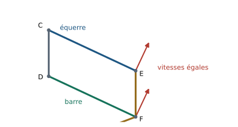

### Question 1.2

> [!INDICATION]
> C est fixe et A mobile. Quelle projection de AC est appelée λ ?

> [!INDICATION]
> Projeter AB et BC, puis dériver avant de remplacer α par zéro.

#### Solution

Projeter $\overrightarrow{AC}=a\vec x_3+c\vec y_4$ sur $\vec x_0$ donne $\lambda=a\cos\alpha-c\sin\beta$. Sa dérivée est $\dot\lambda=-a\sin\alpha\,\dot\alpha-c\cos\beta\,\dot\beta$. Au premier ordre autour de $\alpha=0$, $\beta=\beta_0$,
$$\dot\lambda=-c\cos\beta_0\,\dot\beta.$$

### Question 1.3

> [!INDICATION]
> Sur le dessin, l’axe horizontal est celui du vecteur y₀.

> [!INDICATION]
> Relier d’abord la vitesse horizontale en H à la vitesse de l’écrou, puis compter un pas par tour de vis.

#### Solution

L’horizontale est $\vec y_0$. La vitesse d’une mâchoire en $H$ vaut $V_f=b\cos\beta_0\,\dot\beta=-(b/c)\dot\lambda$. Comme $C$ est fixe, $\dot\lambda=-\vec V(A,2/0)\cdot\vec x_0$. En orientant la vis pour qu’une vitesse $\omega_m>0$ fasse avancer l’écrou selon $+\vec x_0$, on a
$$V_f=\frac{b p_v}{2\pi c}\,\omega_m,\qquad |\omega_m|<\frac{2\pi c}{b p_v}V_{f0}.$$
Un autre sens de filetage change le signe. Il s’agit de la vitesse en $H$ d’une mâchoire. La vitesse de rapprochement des deux mâchoires en aurait le double.

### Question 1.4

> [!INDICATION]
> Commencer par le solide dont il faut éviter le glissement.

> [!INDICATION]
> À la limite du glissement, les réactions normales deviennent calculables à partir des efforts tangentiels.

#### Solution

Isoler l’objet et placer le poids et les deux réactions de contact. Fixer la trajectoire la plus sollicitante et l’accélération associée. Appliquer le principe fondamental de la dynamique, ou la statique pour une prise immobile, puis utiliser le frottement de Coulomb à la limite du glissement pour trouver l’effort normal minimal par mâchoire. L’égalité de partage suppose le centrage et la symétrie des contacts. Isoler ensuite les pièces de la pince successivement, ou appliquer les puissances virtuelles au mécanisme entier, afin de ramener les efforts des deux mâchoires au couple de la vis. Vérifier les positions de prise requises et intégrer le rendement réel de la transmission pour choisir le motoréducteur.

### Question 1.5

> [!INDICATION]
> Un vérin en mouvement possède un corps et une tige distincts.

> [!INDICATION]
> Chaque pivot ou glissière dans un problème plan enlève deux libertés relatives.

#### Solution

Distinguer corps et tige du vérin. Trois solides mobiles dans le plan donnent neuf composantes de vitesse. Les trois pivots $A,B,C$ et la glissière corps–tige imposent chacun deux contraintes. Il reste un mouvement de fermeture indépendant. Le degré d’hyperstatisme vaut $h=8-9+1=0$ hors position singulière.

### Question 1.6

> [!INDICATION]
> Quel point choisir pour éliminer la réaction de la nacelle sur le harnais ?

> [!INDICATION]
> Le moment d’une force a pour module son intensité multipliée par la distance de sa droite d’action au pivot.

#### Solution

Le vérin, articulé à ses extrémités et de poids négligé, agit suivant $AC$. Isoler le harnais et prendre le moment en $B$ pour éliminer la réaction de son pivot. Les bras de levier de $F_f$ et $F_v$ valent respectivement $|y_P|$ et $BA|\sin\alpha|$. Pour un seul vérin,
$$ F_f=F_v\frac{\sqrt{x_A^2+y_A^2}}{|y_P|}\,|\sin\alpha|.$$
Les deux vérins identiques additionnent leurs moments. Si $F_v$ désigne la force dans chacun, il faut alors multiplier le membre de droite par deux.

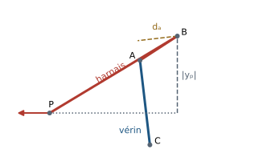

### Question 1.7

> [!INDICATION]
> Le nombre de vérins représentés dans la simulation est-il celui du système réel ?

> [!INDICATION]
> Distinguer le maximum de l’effort du passager, lu directement, et l’effort axial du vérin, qui exige un rapport de longueurs.

#### Solution

L’effort simulé croît jusqu’à $110{,}1\ \mathrm N$ vers $d=6\ \mathrm{cm}$ puis décroît jusqu’à $32{,}2\ \mathrm N$. La variation vient du bras de levier, la force du vérin restant constante. Au maximum intérieur, si le vérin franchit la perpendiculaire à $BA$, $F_v=110{,}1|y_P|/BA$. Les longueurs du harnais ne sont pas cotées numériquement. Une mesure indicative sur le dessin fermé donne $|y_P|/BA\simeq 2{,}9$, d’où $F_v\simeq 0{,}32\ \mathrm{kN}$ par vérin sous cette hypothèse. La vérification ergonomique découle directement du graphe, sans mesure du dessin : avec deux vérins, le maximum vaut $220{,}2\ \mathrm N<250\ \mathrm N$. C1 est satisfaite.

### Question 1.8

> [!INDICATION]
> Quand l’hydraulique bloque le vérin, la longueur AC est fixée.

> [!INDICATION]
> Compter les contraintes apportées par les contacts sur le passager, puis refaire le bilan du harnais seul.

#### Solution

En configuration bloquée la longueur $AC$ est fixée. Le triangle articulé $ABC$ seul est isostatique. Le passager rigide apporte trois composantes de vitesse, ses deux appuis-plans perpendiculaires avec le siège quatre contraintes planes et le contact ponctuel avec le harnais une cinquième. L’ensemble immobile a donc $h=5-3=2$. Si l’on représente encore le vérin par une glissière libre avec son effort comme entrée au lieu d’imposer le verrouillage hydraulique, on retranche une contrainte et on obtient $h=1$ pour cet autre modèle. Le bilan de moment du **harnais seul** ne contient toujours que les efforts en $A$ et en $P$ en plus du pivot en $B$. La relation de 1.6 en module reste donc valable avec $F_b$ à la place de $F_f$.

### Question 1.9

> [!INDICATION]
> Répartir le moment produit par l’effort de 3 000 N entre les deux vérins.

> [!INDICATION]
> Pour tester le cas défavorable à pression donnée, retirer du disque du piston la section de la tige.

#### Solution

Soit $d_A=\operatorname{dist}(B,(AC))$ en position fermée. Chaque vérin reprend $F_{v,\mathrm{req}}=3000|y_P|/(2d_A)$. Le schéma donne à titre indicatif $d_A/|y_P|\simeq0{,}28$, soit environ $5{,}4\ \mathrm{kN}$ par tige. Du côté le plus défavorable, la section annulaire vaut $\pi(32^2-20^2)/4\simeq490\ \mathrm{mm^2}$. À $200\ \mathrm{bar}=20\ \mathrm{N/mm^2}$, la force admissible atteint $9{,}80\ \mathrm{kN}$ par tige (et $16{,}1\ \mathrm{kN}$ côté plein). C2 est compatible avec ces vérins. Le critère exact à vérifier sur un plan coté est $d_A/|y_P|\ge 3000/(2\times9800)\simeq0{,}153$.

### Question 1.10

> [!INDICATION]
> Compter les inconnues par liaison et les équations des cinq solides mobiles.

> [!INDICATION]
> Distinguer le contact linéaire parfait du modèle auquel on ajoute deux contraintes de non-glissement.

#### Solution

Le graphe comporte cinq solides mobiles. Pour la modélisation statique par une linéaire rectiligne parfaite, les inconnues de liaison sont au nombre de $4+4+3+5+5+5+2=28$ (deux pivots glissants, une rotule, trois pivots, le contact). Le moule horizontal et le support de hauteur imposée fixent la configuration du bras et du vérin. Il reste deux rotations internes libres dans ce décompte : la tige tourne autour de son axe dans le corps, et le rouleau autour de son axe dans le support. Ainsi $h=28-30+2=0$. Si l’on ajoute au modèle statique les deux conditions tangentielles d’adhérence sur un moule fixe, la rotation libre du rouleau disparaît et la condition latérale est redondante. Ce modèle de contact avec adhérence donne $h=30-30+1=1$.

### Question 1.11

> [!INDICATION]
> Chercher une projection du moment qui élimine la réaction du pivot A.

> [!INDICATION]
> Dans le moule horizontal, le bras de levier de la réaction normale est une distance horizontale.

#### Solution

Isoler tige et corps pour identifier la force axiale $F_v=pS$ du vérin, $S$ étant la section active et la contre-pression étant négligée. Le guidage selon $\vec y_0$ ne transmet pas de moment suivant cet axe. Dans le plan de travail, le vérin agit en $B$ suivant $DB$, autour du pivot $A$. Isoler ensuite $\{3,4,5\}$ et sommer les moments suivant $(A,\vec y_0)$. Le bras de levier de l’effort du vérin est $L|\sin(\alpha_2-\alpha_3)|$ ; celui de la force verticale en $P$ est $|2L\cos\alpha_3+a|$. La réaction du pivot en $A$ et l’éventuel couple du contact linéaire suivant $\vec x_4$ n’interviennent pas dans cette projection. Il vient
$$p_0=\frac{F_d\,|2L\cos\alpha_3+a|}{S L|\sin(\alpha_2-\alpha_3)|}.$$
En alignement des bras de levier, un effort axial fini ne peut produire le moment requis.

### Question 1.12

> [!INDICATION]
> Décomposer la rotation du rouleau en inclinaison du support et rotation autour de son axe.

> [!INDICATION]
> Transporter la vitesse du centre E au contact P et comparer les deux composantes au torseur imprimé.

#### Solution

L’orientation du support vérifie $\vec\Omega_{4/0}=\dot\beta_4\vec x_0$. En notant $\dot\varphi$ la rotation du rouleau dans son support, $\vec\Omega_{5/0}=\dot\beta_4\vec x_0+\dot\varphi\vec y_4$. La projection sur $\vec x_0$ donne la loi d’inclinaison attendue, $\dot\beta_4=\omega$. Si $\beta_4(0)=0$, l’angle reste nul avant $t_1$, vaut $\omega_0(t-t_1)$ jusqu’à $t_2$, puis $\omega_0(t_2-t_1)-\omega_0(t-t_2)$ jusqu’à $t_3$ ; il reste ensuite constant, nul si les deux créneaux ont même durée.

Une incompatibilité affecte le torseur imprimé. Comme $\overrightarrow{CE}=a\vec x_0$ et que $C$ est fixe dans la configuration imposée, le transport de $E$ à $P$ donne $\vec V(P,5/0)=-r\dot\varphi\vec x_0+r\dot\beta_4\vec y_4$. Pour une vitesse longitudinale $-V_P\vec x_0$, le roulement demande $\dot\varphi=V_P/r$. Or le torseur écrit exclut cette composante de rotation et exclut aussi la vitesse latérale accompagnant l’inclinaison. Il n’existe donc pas de mouvement rigide satisfaisant ses deux lignes pour les signaux fournis. Le tracé d’angle utilise sa seule composante d’inclinaison compatible.

### Question 1.13

> [!INDICATION]
> Qu’est-ce qui change dans le moment de la réaction normale en A lorsque le support s’incline ?

> [!INDICATION]
> Projeter la normale sur la verticale et composer le résultat avec l’angle obtenu à la question précédente.

#### Solution

Le mouvement d’inclinaison conserve la hauteur de $C$ et les angles du bras et du vérin. Dans le moment de la réaction $F_d\vec z_4$ autour de $(A,\vec y_0)$, le déplacement $-r\vec z_4$ de $P$ ne contribue pas et la composante verticale de la force devient $F_d\cos\beta_4$. Le modèle quasi statique donne donc $p(t)=p_0\cos\beta_4(t)$ dans le domaine de contact considéré. Avec deux créneaux de même durée et une inclinaison inférieure au quart de tour, la pression est d’abord $p_0$, décroît en arc de cosinus jusqu’à $t_2$, remonte symétriquement jusqu’à $t_3$, puis reste égale à $p_0$. Cette courbe emploie la loi d’inclinaison explicitée en 1.12.

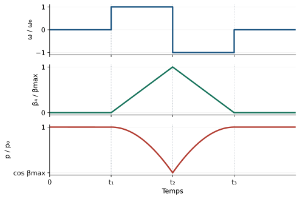

### Question 1.14

> [!INDICATION]
> Comparer une masse de quelques kilogrammes, une nacelle chargée et une bande de composite.

> [!INDICATION]
> Séparer le maintien d’une trajectoire régulière et la précision nécessaire pour placer une fibre.

#### Solution

La pince porte quelques kilogrammes. L’effort demandé au bras est modéré, mais la précision doit suffire pour engager l’objet entre les mâchoires et centrer la prise. Avec la nacelle, la masse embarquée atteint $600\ \mathrm{kg}$ : forces, couples et accélérations admissibles dominent le dimensionnement. Une trajectoire régulière et sûre importe davantage que la précision millimétrique. Pour la tête de dépose, l’effort normal est modéré, de l’ordre de $100\ \mathrm N$, et doit être réglé tandis que position et orientation de la bande exigent une grande précision. Charge, vitesse de mouvement et précision se combinent donc différemment suivant l’effecteur.

## Partie 2 — Les fixations

Le socle peut basculer ou glisser. Au poignet, six billes reprennent au contraire un arrachement axial. Ces deux fixations demandent des bilans de forces différents.

### Question 2.1

> [!INDICATION]
> Isoler le boulon lié par deux rotules parfaites.

> [!INDICATION]
> Quelles composantes de force manquent encore pour empêcher le glissement dans le plan de la plaque ?

#### Solution

Les deux rotules font du boulon une biellette à deux forces. Il transmet une force suivant la droite verticale de ses centres et, instantanément, n’impose au socle que $\vec V(O_{b2},\mathrm{socle/sol})\cdot\vec z_0=0$. L’appui-plan impose déjà cette condition en tout point de sa surface. Les deux translations horizontales et le lacet restent possibles dans le modèle instantané de liaisons parfaites. Plusieurs biellettes parallèles n’ajoutent toujours aucune composante tangentielle. Dans la fixation réelle, le serrage maintient la surface en contact ; l’adhérence reprend les deux composantes tangentielles et le moment de lacet. Les boulons répartis s’opposent également au soulèvement des côtés de la plaque.

### Question 2.2

> [!INDICATION]
> Remplacer chaque boulon par son action axiale après élimination des mobilités internes.

> [!INDICATION]
> Compter le rang des torseurs réellement transmissibles par les liaisons parfaites de l’énoncé.

#### Solution

Remplaçons les 16 couples de rotules par leurs biellettes axiales en éliminant les rotations internes. L’appui transmet trois inconnues indépendantes ($Z,M_x,M_y$), auxquelles s’ajoutent 16 tensions verticales. L’espace des torseurs transmissibles du modèle parfait garde le rang trois. Ainsi $h=3+16-3=16$. En incluant trois réactions indépendantes d’adhérence pour l’encastrement réel, le nombre d’inconnues et le rang augmentent chacun de trois, ce qui conserve le même excès. Soustraire six aux 19 inconnues du premier modèle supposerait à tort que celui-ci transmet six composantes. Le partage des tensions dépend notamment de la précharge et des rigidités, d’où l’hypothèse supplémentaire d’équidistribution.

### Question 2.3

> [!INDICATION]
> Calculer d’abord les coordonnées de O₃. Au-delà du coude, le bras redevient horizontal.

> [!INDICATION]
> Faire la moyenne pondérée des coordonnées des six centres, en utilisant les mêmes unités.

#### Solution

Posons $u=\cos12^\circ$, $v=\sin12^\circ$, $X=a_1+a_2u$, $Z=c_1+a_2v$. L’épaule monte lorsque $\theta_2=-12^\circ$ et le bras retrouve l’horizontale puisque $\theta_2+\theta_3=0$. Les coordonnées de chaque centre dans la base du socle sont donc les suivantes.

| Solide | $x_i$ | $y_i$ | $z_i$ |
|---|---:|---:|---:|
| 1 | $x_{G_1}$ | $y_{G_1}$ | $z_{G_1}$ |
| 2 | $a_1+x_{G_2}u$ | $y_{G_2}$ | $c_1+x_{G_2}v$ |
| 3 | $X+x_{G_3}$ | $0$ | $Z+z_{G_3}$ |
| 4 | $X+a_3+x_{G_4}$ | $0$ | $Z+c_3$ |
| 5 | $X+a_3+a_4+x_{G_5}$ | $0$ | $Z+c_3$ |
| 6 | $X+a_3+a_4+a_5+x_{G_6}$ | $0$ | $Z+c_3+z_{G_6}$ |

Écrire $(x_G,y_G,z_G)=\sum_{i=1}^6 m_i(x_i,y_i,z_i)/M$ et $M=\sum_{i=1}^6m_i=1650\ \mathrm{kg}$. Avec $u\simeq1$, $v\simeq0{,}2$ et les masses du modèle dynamique de l’annexe D, on obtient $(1{,}815;0{,}0227;1{,}817)\ \mathrm m$. Pour la coordonnée $z_{G_6}$ divergente entre les annexes B (50 mm) et D (20 mm), on a employé D, qui fournit tous les centres de masse. B donnerait $z_G\simeq1{,}828\ \mathrm m$. La force due au poids en 2.4 ne dépend pas de cette cote.

### Question 2.4

> [!INDICATION]
> Prendre le moment autour du bord de basculement pour éliminer la réaction d’appui.

> [!INDICATION]
> La somme des abscisses de seize points uniformément répartis sur un cercle centré est nulle.

#### Solution

Au soulèvement, la réaction d’appui passe par le bord $K$. Le poids tend à basculer avec le moment $Mg(x_G-x_K)$ autour de l’axe parallèle à $\vec y_0$ passant par $K$. Le boulon $j$ a pour bras de levier $x_K-x_{b,j}$. Sur la couronne centrée, $\sum_j x_{b,j}=0$. L’équilibre limite donne
$$F_{\rm basc,g}=\frac{Mg(x_G-x_K)}{16x_K}\simeq 0{,}92\ \mathrm{kN}$$
par boulon pour $g=9{,}81\ \mathrm{m\,s^{-2}}$. La résultante des boulons sur le socle est dirigée vers le sol.

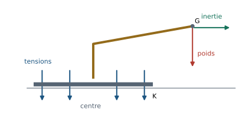

### Question 2.5

> [!INDICATION]
> Le centre de masse en rotation décrit un cercle de rayon égal à sa distance à l’axe vertical.

> [!INDICATION]
> Comparer l’effort tangent par boulon à la capacité d’adhérence, puis écrire séparément le moment en K.

#### Solution

Dans le modèle de résultante centrifuge appliquée en $G$, elle vaut $\vec R=M\omega^2(x_G\vec x_0+y_G\vec y_0)$. Avec $\rho_G=\sqrt{x_G^2+y_G^2}$, la part tangentielle par emplacement vaut $M\omega^2\rho_G/16$. La condition de Coulomb donne l’effort normal de serrage requis
$$F_f\ge\frac{M\omega^2\rho_G}{16 f}.$$
Le moment de renversement suivant $\vec y_0$ autour de $K$ est $M\omega^2 x_Gz_G$, d’où $F_{\rm basc,i}=M\omega^2x_Gz_G/(16x_K)$. À la vitesse haute de l’axe 1 de l’annexe A, $69^\circ/\mathrm s=1{,}20\ \mathrm{rad/s}$, ces contributions valent environ $0{,}905$ et $0{,}519\ \mathrm{kN}$ par boulon.

La réduction de l’inertie à sa seule résultante en $G$ est une approximation de dimensionnement. Pour une distribution réelle de masse en rotation, le moment exact selon le même axe est $\omega^2\int xz\,\mathrm dm$. Il faut alors substituer ce moment au numérateur précédent, y compris les produits d’inertie propres des pièces si on les conserve.

### Question 2.6

> [!INDICATION]
> Recenser les contributions à la tension des boulons établies aux deux questions précédentes.

> [!INDICATION]
> Ramener chaque contribution à une force axiale en newtons avant d’appliquer la superposition demandée.

#### Solution

Dans la superposition des trois besoins de serrage demandée et l’hypothèse d’une force d’inertie concentrée en $G$,
$$F_{\rm dim}=\frac{Mg(x_G-x_K)}{16x_K}+\frac{M\omega^2 x_Gz_G}{16x_K}+\frac{M\omega^2\rho_G}{16f}.$$
À $69^\circ/\mathrm s$ cela donne $0{,}921+0{,}519+0{,}905\simeq2{,}35\ \mathrm{kN}$ de tension par boulon. On additionne des efforts axiaux de dimensionnement. La force tangentielle est transmise au contact sol-socle. Dans un calcul couplé de contact avec précharge, une même réaction normale peut simultanément assurer de l’adhérence et reprendre un moment.

### Question 2.7

> [!INDICATION]
> Dessiner séparément le guidage par deux pions et les six chemins passant par les billes.

> [!INDICATION]
> Sur une bille, les trois forces de contact sont dans un même plan et passent par son centre.

#### Solution

Le graphe comporte les sommets $6,7,10$ et $9_i$ ($i=1,\ldots,6$). Entre 6 et 7, deux pions parallèles en $D,E$ assurent le guidage ; entre 6 et 10, on trouve le guidage de la tige en $C$. Chaque $9_i$ touche 6 (cage), 7 (butée) et 10 (came) par trois contacts ponctuels.

Les deux pions cylindriques assimilés à deux pivots glissants apportent huit contraintes pour un guidage de rang cinq, d’où trois redondances. Les trois normales de chaque bille sont coplanaires et concourantes. L’équilibre des forces dans ce plan laisse une intensité interne à déterminer pour chaque bille ; la résultante axiale du piston fixe la somme des six intensités. Les cinq répartitions restantes sont indéterminées. On trouve $h=3+5=8$. Le guidage unique de 10 ne crée aucune redondance. Une portée cylindrique longue complétée par un pion dégagé transversalement (une seule contrainte d’anti-rotation) supprime les trois redondances de guidage. Un dispositif égaliseur ou des éléments élastiques caractérisés règlent le partage entre billes ; réduire le nombre de billes réduit aussi les chemins d’effort parallèles, sous réserve de conserver tenue et centrage.

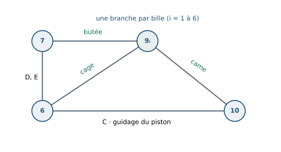

### Question 2.8

> [!INDICATION]
> Les actions de contact sans frottement sont normales aux surfaces.

> [!INDICATION]
> Isoler tour à tour une bille, le piston puis la platine. Choisir les projections qui éliminent la réaction inconnue de la cage.

#### Solution

Notons $N_7,N_{10}$ les normes des réactions de la platine et du piston sur une bille. Avec $\alpha=-28^\circ$, $\beta=16^\circ$, les deux normales ont respectivement pour projections axiale et radiale $(-\sin\alpha,\cos\alpha)$ et $(\sin\beta,-\cos\beta)$. La cage fournit la troisième réaction, axiale. Projeter l’équilibre de la bille dans la direction radiale donne $N_7\cos\alpha=N_{10}\cos\beta$. Les moments en son centre sont nuls. Isoler le piston : la chambre haute agit sur la pleine section $S_p=\pi d_p^2/4$, sans contre-pression, et $p_p S_p=6N_{10}\sin\beta$. Isoler la platine à la limite de séparation : $F_7=6N_7(-\sin\alpha)$. La symétrie annule les résultantes radiales et les moments. On en déduit
$$F_7=p_p S_p\frac{-\tan\alpha}{\tan\beta}.$$
La valeur obtenue est la capacité d’arrachement pour une pression donnée, sous répartition symétrique.

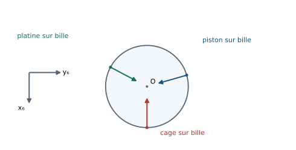

### Question 2.9

> [!INDICATION]
> L’arrachement est repris par six billes sous l’hypothèse de symétrie.

> [!INDICATION]
> Projeter la réaction normale d’une bille sur l’axe du piston avant de multiplier par six.

#### Solution

L’équilibre axial de la platine seul donne $F_{79a}=N_7=k F_7$, avec $k=1/[6(-\sin\alpha)]\simeq0{,}355$. Le module de l’effort de contact est plus grand que sa projection axiale.

### Question 2.10

> [!INDICATION]
> Convertir les degrés par seconde du constructeur en radians par seconde.

> [!INDICATION]
> Le seuil de pression s’obtient en divisant l’effort requis par la section et par le rapport de transmission.

#### Solution

La position de $G_6$ en 2.3 donne $x_6\simeq3{,}401\ \mathrm m$. À la vitesse nominale maximale de l’axe 1, l’arrachement radial maximal vaut $F_7=m_6\omega^2x_6\simeq2{,}96\ \mathrm{kN}$. Les autres composantes de charge sont exclues du torseur d’arrachement imposé. Avec $S_p=5{,}03\times10^{-3}\ \mathrm{m^2}$, le seuil est
$$p_{p,\min}=\frac{F_7\tan 16^\circ}{S_p\tan28^\circ}\simeq3{,}18\ \mathrm{bar}.$$
Le constructeur prescrit une alimentation entre $4{,}1$ et $6{,}9\ \mathrm{bar}$. Même sa borne basse dépasse le seuil calculé et correspond à une capacité d’environ $3{,}82\ \mathrm{kN}$ dans le modèle.

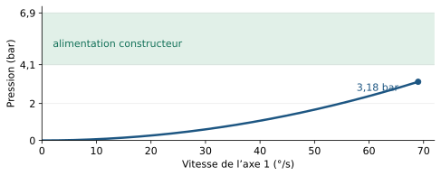

### Question 2.11

> [!INDICATION]
> Dans la coupe axiale, comparer les pentes des tangentes aux deux contacts du piston.

> [!INDICATION]
> La direction de la corde joignant les contacts est bissectrice des directions tangentes au cercle.

#### Solution

Le second contact place la bille à cheval sur deux pentes de signes opposés. On peut le vérifier dans la section axiale. La corde $I'_{910}I''_{910}$ a pour vecteur $(b_{10}-a_{10})\vec u_{10}+c_{10}\vec x_6$. Son angle avec $\vec x_6$ vérifie
$$\tan\gamma=\frac{(b_{10}-a_{10})\sin\beta}{c_{10}+(b_{10}-a_{10})\cos\beta},$$
soit $\gamma\simeq5{,}3^\circ$. Les tangentes au cercle en ses deux extrémités sont symétriques par rapport à la direction de cette corde : si la première est inclinée de $16^\circ$, la seconde l’est de $2\gamma-16^\circ\simeq-5{,}4^\circ$. Les normales de contact ont donc des composantes axiales de signes opposés. Avec des réactions compressives on peut équilibrer la poussée radiale sans résultante remontant le piston. Une augmentation de $F_7$ augmente les réactions sans produire de déverrouillage. Dans le modèle rigide parfait, aucune limite finie de $F_7$ ne résulte de ce critère. Dans le mécanisme réel, les pressions de contact et la résistance des matériaux bornent la capacité.

## Partie 3 — La géométrie et la cinématique

On passe des rotations des roues dentées aux coordonnées de l’effecteur, puis de la pose visée aux consignes articulaires. Plusieurs positions du coude peuvent donner la même pose.

### Question 3.1

> [!INDICATION]
> Sur l’axe vertical, que devient l’inertie à accélérer lorsque le bras s’étend ?

> [!INDICATION]
> Écrire l’égalité des puissances à rendement idéal, puis distinguer vitesse et couple.

#### Solution

L’axe 1 entraîne autour de la verticale toute la partie mobile du robot. Quand le bras est déployé, des masses importantes se trouvent loin de cet axe et son moment d’inertie augmente. Accélérer et freiner l’embase exige donc un couple élevé, alors que la vitesse angulaire demandée est faible. Le réducteur adapte le moteur, rapide, à cette charge. Pour un rapport de vitesse $k=\omega_{\rm sortie}/\omega_{\rm moteur}$ et un rendement $\eta$, le couple disponible en sortie vaut en module $\eta |C_{\rm moteur}/k|$.

### Question 3.2

> [!INDICATION]
> Observer les deux contacts dans le référentiel du porte-satellite.

> [!INDICATION]
> L’engrènement avec le pignon central est extérieur, celui avec la couronne fixe est intérieur. Éliminer la vitesse du satellite.

#### Solution

Notons $\omega_i=\omega_{i/0}$ les vitesses algébriques sur des axes orientés dans le même sens. Dans le repère du porte-satellite 3, les axes des roues sont fixes. L’engrènement extérieur entre 1 et 2 et l’engrènement intérieur entre 0 et 2 donnent respectivement
$$
Z_1(\omega_1-\omega_3)=-Z_{21}(\omega_2-\omega_3),\qquad
Z_0(0-\omega_3)=Z_{20}(\omega_2-\omega_3).
$$
En éliminant la vitesse du satellite double, on obtient
$$
\boxed{k_{r0}=\frac{\omega_3}{\omega_1}
=\frac{Z_1 Z_{20}}{Z_1 Z_{20}+Z_0 Z_{21}}.}
$$
Le rapport est positif et inférieur à 1. L’embase tourne dans le sens du moteur.

### Question 3.3

> [!INDICATION]
> Écrire l’énergie cinétique de rotation de chaque pièce dans le référentiel du socle.

> [!INDICATION]
> Exprimer la rotation absolue du satellite grâce au contact avec 0. Suivre aussi le déplacement de son centre pour identifier le terme de transport.

#### Solution

La seconde relation d’engrènement donne $\omega_2=(1-Z_0/Z_{20})\omega_3$. Posons $k=k_{r0}$ donné à la question 3.2. Le bilan des énergies de **rotation autour des axes propres** est
$$
\tfrac12 J_{\rm eq,rot}\omega_1^2
=\tfrac12 J_1\omega_1^2+\tfrac12 J_2\omega_2^2+\tfrac12 J_3\omega_3^2,
$$
d’où l’expression avec les seules données demandées,
$$
\boxed{J_{\rm eq,rot}=J_1+
\left[\frac{Z_1(Z_{20}-Z_0)}{Z_1Z_{20}+Z_0Z_{21}}\right]^2 J_2+
\left[\frac{Z_1Z_{20}}{Z_1Z_{20}+Z_0Z_{21}}\right]^2 J_3.}
$$
Le centre du satellite parcourt aussi un cercle de rayon $e$ à la vitesse $e|\omega_3|$. Pour un satellite équilibré de masse $m_2$, si $J_3$ est l’inertie du porte-satellite **seul**, l’inertie équivalente complète est $J_{\rm eq}=J_{\rm eq,rot}+m_2e^2k^2$. Ce terme est déjà compté si une inertie de porte-satellite incluant le transport de cette masse est fournie. Des inerties autour des seuls axes propres ne suffisent pas à le chiffrer.

### Question 3.4

> [!INDICATION]
> Quel est le signe de la relation d’engrènement entre 1 et 2 lorsque 1 devient une couronne ?

> [!INDICATION]
> Reprendre l’élimination de 3.2, puis examiner le carré du rapport de vitesse dans une inertie ramenée à l’entrée.

#### Solution

La nouvelle entrée 1 est une couronne. Le contact 1–2 devient intérieur. La relation avec la couronne fixe reste celle de la question 3.2, tandis que $Z_1(\omega_1-\omega_3)=+Z_{21}(\omega_2-\omega_3)$. Si $A=Z_0Z_{21}/(Z_1Z_{20})$ est calculé avec les dentures de la configuration considérée,
$$
k_{\rm intérieur}=\frac{1}{1+A},\qquad
k_{\rm périphérique}=\frac{1}{1-A}.
$$
À même valeur de $A>0$, le montage périphérique a un rapport de vitesse de plus grand module et multiplie moins le couple. Il peut inverser le sens de sortie ($A>1$), voire multiplier la vitesse ($0<A<2$, hors $A=1$). Pour $A=1$, les contraintes imposent une entrée immobile lorsque 0 est fixe. La disposition périphérique peut donc servir un autre besoin de vitesse ou de sens. Elle est moins favorable à une forte démultiplication de l’embase pour des dentures comparables.

L’inertie de la charge ramenée au moteur vaut $J_{\rm charge}k^2$. Elle est donc plus pénalisante lorsque $|k|$ augmente. La couronne d’entrée répartit aussi sa matière plus loin de l’axe qu’un pignon central de masse comparable, ce qui tend à augmenter $J_1$. Une comparaison numérique des deux appareils nécessiterait les nouvelles dentures, masses et inerties.

### Question 3.5

> [!INDICATION]
> Avec trois positions successives et un pas de temps constant, comment estimer le vecteur accélération ?

> [!INDICATION]
> Écarter le point final qui double le premier pour le calcul périodique. Comparer la norme au seuil dans la même unité et contrôler la jonction.

#### Solution

Pour un point $P_i$ échantillonné à intervalle $T_e$, la différence centrée donne $\vec a_i\simeq(P_{i+1}-2P_i+P_{i-1})/T_e^2$. On compare la norme euclidienne au seuil, y compris au raccord du cycle. La liste est fournie en millimètres. Le code adopte un seuil en $\mathrm{m\,s^{-2}}$ et convertit les positions. Si le seuil est en $\mathrm{mm\,s^{-2}}$, on supprime le facteur $10^{-3}$.

```python
from math import sqrt

def cycle_valide(OG6, a_max):
    if len(OG6) < 2 or OG6[0] != OG6[-1] or a_max < 0:
        return False

    Te = 0.01
    facteur = 1e-3 / Te**2
    n = len(OG6) - 1  # le dernier point répète le premier
    for i in range(n):
        avant = OG6[(i - 1) % n]
        p = OG6[i]
        apres = OG6[(i + 1) % n]
        a2 = sum((facteur * (apres[j] - 2*p[j] + avant[j]))**2
                 for j in range(3))
        if sqrt(a2) > a_max:
            return False
    return True
```

Les indices périodiques testent le passage de la fin d’un cycle au début du suivant. Les répétitions qui matérialisent un maintien sont conservées. Deux positions identiques formant à elles seules le cycle donnent une accélération nulle. Le parcours prend $O(n)$ opérations et $O(1)$ cases auxiliaires.

Par exemple, pour des abscisses successives $0,1,1,0$ en millimètres et des ordonnées et altitudes nulles, les accélérations centrées valent $+20,-10,-10$ m/s². Au seuil de $15$ m/s², seul le calcul au raccord révèle le dépassement. Au seuil de $20$ m/s², le cycle est accepté. Cette vérification porte sur les différences finies des échantillons. Une garantie entre les instants de mesure suppose une loi d’interpolation ou un modèle de trajectoire.

### Question 3.6

> [!INDICATION]
> Sommer les segments de l’annexe B en les exprimant chacun dans la base 0.

> [!INDICATION]
> Écrire les axes successifs de rotation. Les colonnes de la matrice de passage sont les vecteurs de la nouvelle base exprimés dans la précédente.

#### Solution

La relation de Chasles appliquée à $O_0,O_2,O_3,O_4,O_5,O_6,G_6$ utilise les six décalages de l’annexe B. En notant $R_{0i}$ la matrice qui exprime dans $\mathcal B_0$ des coordonnées données dans $\mathcal B_i$, on obtient directement les trois coordonnées demandées,
$$
\begin{aligned}
(x,y,z)^T={}&R_{01}(a_1,0,c_1)^T+R_{02}(a_2,0,0)^T\\
&+R_{03}(a_3,0,c_3)^T+R_{04}(a_4,0,0)^T\\
&+R_{05}(a_5,0,0)^T+R_{06}(x_{G_6},0,z_{G_6})^T .
\end{aligned}
$$
Les longueurs doivent être exprimées dans la même unité. Avec $C_i=\cos\theta_i$ et $S_i=\sin\theta_i$, les colonnes de chaque matrice sont les nouveaux vecteurs de base exprimés dans l’ancienne base,
$$
R_{01}=\begin{pmatrix}C_1&-S_1&0\\ S_1&C_1&0\\0&0&1\end{pmatrix},\quad
R_{12}=\begin{pmatrix}C_2&0&S_2\\0&1&0\\-S_2&0&C_2\end{pmatrix},\quad
R_{34}=\begin{pmatrix}1&0&0\\0&C_4&-S_4\\0&S_4&C_4\end{pmatrix}.
$$
Les six rotations autour des axes successifs $z,y,y,x,y,x$ donnent
$$
\boxed{R_{06}=R_z(\theta_1)R_y(\theta_2)R_y(\theta_3)
R_x(\theta_4)R_y(\theta_5)R_x(\theta_6).}
$$
$R_{0i}$ est le produit arrêté après le facteur $i$. Par exemple, à angles nuls, $x=a_1+a_2+a_3+a_4+a_5+x_{G_6}$ et $z=c_1+c_3+z_{G_6}$.

### Question 3.7

> [!INDICATION]
> Dans le plan imposé, maintenir le poignet O₅ et la direction de l’outil fixes. Quelles distances du coude sont imposées ?

> [!INDICATION]
> Chercher les intersections de deux cercles et utiliser l’articulation du poignet pour rétablir la même orientation.

#### Solution

Fixons $\theta_1=\theta_4=\theta_6=0$ et imposons la même position $O_5$ et la même direction terminale dans le plan $(O_0,\vec x_0,\vec z_0)$. La distance $O_2O_3$ vaut $a_2$. Comme $\vec x_4=\vec x_3$, la liaison géométrique de $O_3$ à $O_5$ est le vecteur $(a_3+a_4)\vec x_3+c_3\vec z_3$, de longueur fixe $d=\sqrt{(a_3+a_4)^2+c_3^2}$. En position non singulière, pour $|a_2-d|<O_2O_5<a_2+d$, les cercles de centres $O_2$ et $O_5$ et de rayons $a_2$ et $d$ ont deux intersections. Chacune donne une position possible du coude $O_3$. On règle $\theta_5$ pour obtenir la même orientation terminale dans les deux cas. Avec ce réglage, les décalages de $O_5$ à $G_6$ sont également identiques.

Le modèle géométrique direct admet donc plusieurs antécédents pour certaines poses accessibles, sous réserve des butées réelles. Une consigne extérieure à l’espace atteignable n’en a aucun. Un inverse global univoque n’existe pas. Sur une trajectoire, on choisit une branche admissible, par exemple la solution la plus proche de la configuration précédente, en respectant les limites articulaires.

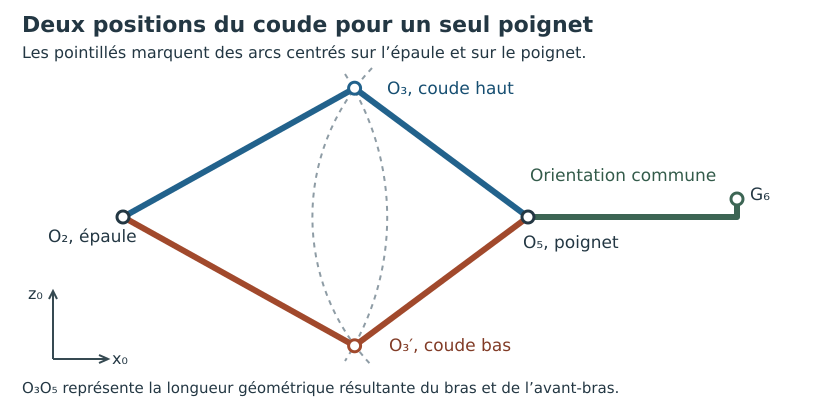

### Question 3.8

> [!INDICATION]
> Le codeur mesure un tour du moteur. Combien de pas code-t-il, et combien de tours moteur font un tour d’embase ?

> [!INDICATION]
> Une petite rotation à la distance de 3,4 m produit un déplacement presque égal au rayon multiplié par l’angle en radians.

#### Solution

Le codeur fournit $2^{10}=1024$ positions par tour moteur. Un tour moteur produit $1/360$ tour d’embase. Le pas angulaire de l’axe 1 vaut
$$
\Delta\theta_1=\frac{2\pi}{1024\times360}
=1{,}70\times10^{-5}\ \mathrm{rad}
=9{,}77\times10^{-4}\ {}^\circ.
$$
Pour $l_1=3{,}4\ \mathrm m$, la corde correspondante vaut $2l_1\sin(\Delta\theta_1/2)\simeq l_1\Delta\theta_1$, soit **$5{,}8\times10^{-5}\ \mathrm m$**, ou **$0{,}058\ \mathrm{mm}$** par pas. C’est le seuil de position pris pour la comparaison du sujet. À lecture arrondie au code le plus proche, la seule erreur de quantification maximale vaut un demi-pas.

### Question 3.9

> [!INDICATION]
> Identifier la dimension de chacun des deux vecteurs que relie le réseau avant le recodage.

> [!INDICATION]
> Compter les liaisons entre deux couches consécutives, puis les biais. Distinguer une cible scalaire d’un exemple à plusieurs sorties.

#### Solution

Sur le réseau dessiné, la pose $(x,y,z,\alpha,\beta,\gamma)$ a six composantes et le vecteur des angles articulaires en a six. Ainsi $n_e=n_s=6$ avant le recodage trigonométrique. Pour $n_c\geq1$ couches cachées de largeur $n_n$, les trois groupes de connexions donnent
$$
N_{\rm poids}=n_e n_n+(n_c-1)n_n^2+n_n n_s,\qquad
\boxed{N_{\rm par}=N_{\rm poids}+n_c n_n+n_s.}
$$
La dernière somme compte un biais par neurone caché ou de sortie. Si l’on modélise les neurones sans biais, seul $N_{\rm poids}$ intervient.

Par comptage, ajuster $N_{\rm par}$ coefficients indépendants exige au moins autant de **contraintes scalaires** indépendantes. Si chaque pose d’apprentissage fournit $n_s$ cibles scalaires indépendantes, cela donne $N_{\rm exemples}\geq\lceil N_{\rm par}/n_s\rceil$ pour ce comptage. Par exemple, les quatre couches de douze neurones de la configuration 1 comptent $6\times12+3\times12^2+12\times6+4\times12+6=630$ paramètres avec biais, avant le recodage angulaire. Six contraintes indépendantes par pose donneraient le seuil de comptage de $105$ poses. Répéter une pose donne les mêmes équations, quelle que soit la taille du jeu d’entraînement. Aucun de ces comptages ne garantit la généralisation ni un seuil d’erreur en fonctionnement.

Pour coder en sinus et cosinus les six angles **à prédire**, chaque angle cible donne deux valeurs. On aurait alors douze sorties puis une reconstruction avec `atan2(sin, cos)`. La phrase qui suit la question parle d’une couche d’entrée doublée. Avec le sens pose-vers-angles du schéma, le recodage des angles prédits porte sur la sortie. Un recodage distinct des seuls trois angles de la pose d’entrée porterait sa dimension de six à neuf.

### Question 3.10

> [!INDICATION]
> Lire l’unité portée sur l’ordonnée et comparer les configurations extrêmes au pas de la question 3.8.

> [!INDICATION]
> Si deux coudes différents mènent à la même pose, la moyenne de leurs angles articulaires mène-t-elle aussi à cette pose ?

#### Solution

La première courbe représente une erreur **cartésienne en mètres**. Elle passe approximativement de $7{,}3$ à $4{,}9\ \mathrm m$ de la configuration 1 à la 6, avec très peu de gain entre les deux dernières. Même le meilleur résultat dépasse de plus de quatre ordres de grandeur le pas de position de $5{,}8\times10^{-5}\ \mathrm m$.

La question 3.7 en donne une explication. À une même pose peuvent correspondre deux vecteurs articulaires. Un apprentissage par écart quadratique aux angles cibles peut privilégier un angle intermédiaire pour chaque articulation. La cinématique directe d’un tel vecteur moyen ne redonne en général pas la pose demandée. Augmenter la profondeur sans résoudre cette ambiguïté améliore peu le résultat.

### Question 3.11

> [!INDICATION]
> Comparer le gain entre les configurations 5 et 6 à leur différence de profondeur.

> [!INDICATION]
> Convertir l’ordonnée en millimètres. Comment corriger l’estimation du réseau en réutilisant le modèle géométrique direct ?

#### Solution

Avec la perte géométrique $\|\vec f(\widetilde{\theta})-\vec X\|^2$, une branche articulaire est acceptée si elle replace effectivement l’effecteur. La courbe donne environ $0{,}086$, $0{,}054$, $0{,}029$, $0{,}015$, $0{,}006$ et $0{,}004\ \mathrm m$ pour les configurations 1 à 6. **La configuration 5**, avec 32 couches de 48 neurones, offre un compromis. La configuration 6 descend encore d’environ 2 mm, mais double la profondeur à largeur égale. La courbe renseigne sur l’erreur et la taille du réseau donne un indicateur de coût. Aucun temps mesuré n’est fourni.

La meilleure moyenne reste proche de $4\ \mathrm{mm}$, environ 70 fois le pas de $0{,}058\ \mathrm{mm}$. Le modèle seul est donc insuffisant. On peut utiliser ses six angles comme point de départ d’une **correction itérative par le modèle direct**. À chaque étape, on calcule l’écart cartésien et on le réduit avec la jacobienne, sous contraintes de butées et de continuité du mouvement. On vérifie ensuite l’erreur finale sur des trajectoires de test, notamment près des singularités. La courbe ne contrôle ni l’erreur maximale du cycle ni l’erreur d’orientation.

## Partie 4 — La commande des actionneurs

La boucle de courant produit le couple. La boucle de vitesse l’emploie pour accélérer les masses. Le dernier modèle compense les interactions entre les six articulations.

### Question 4.1

> [!INDICATION]
> Écrire les deux équations de Laplace avant de remplacer la vitesse.

> [!INDICATION]
> Pour obtenir le dénominateur canonique, diviser chaque coefficient par le terme constant.

#### Solution

Pour des conditions initiales nulles et sans couple résistant, $(R+Lp)I=U-k_e\Omega$ et $(Jp+f)\Omega=k_cI$. L'élimination de $\Omega$ donne
$$H_I(p)=\frac{I}{U}=\frac{Jp+f}{(R+Lp)(Jp+f)+k_ek_c}=K_1\frac{1+\tau_1p}{1+a_1p+a_2p^2}.$$
En posant $D=Rf+k_ek_c$, on lit $K_1=f/D$, $\tau_1=J/f$, $a_1=(RJ+Lf)/D$ et $a_2=LJ/D$. Avec les données, $D=625{,}02$, $K_1\simeq1{,}60\,10^{-5}\ \mathrm{A/V}$, $\tau_1=1{,}25\,10^4\ \mathrm{s}$, $a_1\simeq0{,}400\ \mathrm{s}$ et $a_2\simeq0{,}0400\ \mathrm{s}^2$.

### Question 4.2

> [!INDICATION]
> Les deux entrées du comparateur sont des tensions.

> [!INDICATION]
> Choisir le gain d'adaptation pour que deux courants égaux donnent exactement deux tensions égales.

#### Solution

En entrée, l'adaptateur transforme $I^*$ en $k_{I0}I^*$. Le comparateur soustrait la tension mesurée $U_I=k_{cap}I$. L'écart $\varepsilon_I=k_{I0}I^*-U_I$ traverse successivement le correcteur $C_I$ puis le moteur $H_I$, qui fournit le courant $I$. La chaîne de retour contient le capteur $k_{cap}$. Pour qu'un écart nul signifie $I=I^*$, il faut $k_{I0}=k_{cap}=1\ \mathrm{V/A}$.

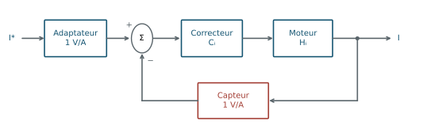

Le schéma ci-dessus reconstruit les blocs depuis les équations des pages imprimées 23 et 24. La grille du document réponse 1, annoncée sur la garde intérieure, manque aux deux exemplaires institutionnels vérifiés.

[Feuillet officiel, p. 25 du PDF](https://ens-paris-saclay.fr/sites/default/files/CONCOURS/ANNALES_1C/1C_PSI/2026/2026_PSI_SI_XSR.pdf#page=25)

### Question 4.3

> [!INDICATION]
> Un écart permanent nul exige que le gain de boucle tende vers l'infini en basse fréquence.

> [!INDICATION]
> Calculer le gain statique disponible puis ajouter une action qui change la classe de la boucle.

#### Solution

Sans correction, le gain statique de boucle est $k_{cap}K_1\simeq1{,}6\,10^{-5}$. L'erreur relative permanente à un échelon de courant est $1/(1+k_{cap}K_1)$, soit environ $0{,}999984$. La spécification impose zéro. Un correcteur PI apporte un intégrateur, donc un gain de boucle infini à fréquence nulle, et conserve un paramètre de réglage de la rapidité. L'erreur d'échelon s'annulera si la boucle fermée est stable.

### Question 4.4

> [!INDICATION]
> Compenser un des deux pôles du moteur ; conserver le zéro déjà présent.

> [!INDICATION]
> Identifier la pulsation propre au dénominateur fermé. Pour le dépassement, situer le zéro du numérateur par rapport aux deux pôles.

#### Solution

On compense un des deux pôles identiques en prenant $\tau_I=\tau_{BO}=0{,}2\ \mathrm{s}$. Posons $b=K_{pI}K_{BO}/\tau_I$. La boucle ouverte se réduit à $b(1+\tau_0p)/[p(1+\tau_{BO}p)]$. En retour unitaire, le transfert fermé consigne–courant est
$$T_I(p)=\frac{b(1+\tau_0p)}{\tau_{BO}p^2+(1+b\tau_0)p+b}.$$
Sa pulsation propre vaut $\omega_0=\sqrt{b/\tau_{BO}}$. La condition stricte $\omega_0>10^5\ \mathrm{rad/s}$ impose $K_{pI}>(10^5)^2\tau_I\tau_{BO}/K_{BO}=2{,}5\,10^{13}\ \mathrm{V/A}$. On peut par exemple prendre $2{,}6\,10^{13}\ \mathrm{V/A}$. Les coefficients du second ordre sont positifs et $T_I(0)=1$, donc la stabilité et la précision à un échelon sont acquises.

Pour contrôler le dépassement malgré le zéro du numérateur, notons $D(p)$ le dénominateur non normalisé ci-dessus et $z=1/\tau_0$. On a $D(0)=b>0$, $D(-z)=-z(1-\tau_{BO}z)<0$ et $D(p)\to+\infty$ lorsque $p\to-\infty$. Il y a donc deux pôles $-b_2<-z<-b_1<0$. La décomposition de $(p+z)/[(p+b_1)(p+b_2)]$ donne deux résidus positifs puisque $b_1<z<b_2$. Ainsi la réponse impulsionnelle est positive et l'échelon croît jusqu'à sa valeur finale sans dépassement. Le premier dépassement est bien inférieur à $10\,\%$.

### Question 4.5

> [!INDICATION]
> Dans le correcteur, les voies proportionnelle et intégrale sont en parallèle.

> [!INDICATION]
> Suivre le courant, le couple, la vitesse puis le signal du capteur pour former la boucle entière.

#### Solution

Le montage parallèle additionne la sortie proportionnelle et la sortie intégrale,
$$C_V(p)=K_{pV}+\frac{K_{iV}}p=K_{pV}\frac{p+\omega_V}{p},\qquad \omega_V=\frac{K_{iV}}{K_{pV}}.$$
Avec la boucle de courant réduite à l'unité, le moteur fournit $k_c I^*$, ensuite converti en vitesse par $1/(Jp+f)$. Le capteur multiplie cette vitesse par $k_V$. Le transfert de boucle ouverte vaut donc
$$L_V(p)=\frac{U_V}{\varepsilon_V}=\frac{k_ck_V K_{pV}(p+\omega_V)}{p(Jp+f)}.$$

### Question 4.6

> [!INDICATION]
> Fixer la pulsation de coupure au seuil demandé. Quelle phase donne la marge minimale ?

> [!INDICATION]
> Additionner les phases du PI et du premier ordre mécanique, puis prendre la tangente.

#### Solution

Plaçons la coupure à la valeur minimale demandée $\omega_c=40\ \mathrm{rad/s}$. La phase de boucle à cette fréquence vaut $-90^\circ+\arctan(\omega_c/\omega_V)-\arctan(J\omega_c/f)$. Pour une marge de $45^\circ$ exactement, la phase doit valoir $-135^\circ$, d'où
$$\omega_V=\omega_c\frac{J\omega_c+f}{J\omega_c-f}.$$
Ce calcul utilise $J\omega_c>f$. Numériquement on trouve $40{,}00016\ \mathrm{rad/s}$. Une pulsation de cassure un peu inférieure donne une marge supérieure à $45^\circ$ à la même coupure. Le sujet arrondit à $40\ \mathrm{rad/s}$. Le gain proportionnel sera choisi pour assurer la coupure.

### Question 4.7

> [!INDICATION]
> Lire le gain et la phase à la pulsation de coupure visée.

> [!INDICATION]
> Une multiplication du gain translate la courbe en décibels sans affecter sa phase. Conserver la cassure en ajustant les deux gains ensemble.

#### Solution

Avec $\omega_V=40\ \mathrm{rad/s}$ et $K_{pV}=1\ \mathrm{A/V}$, on lit à $40\ \mathrm{rad/s}$ un gain d'environ $-43\ \mathrm{dB}$ et une phase proche de $-135^\circ$. Il faut remonter le gain d'environ $43\ \mathrm{dB}$ sans changer cette phase, soit le multiplier par $10^{43/20}\simeq141$. L'expression de 4.5 donne plus précisément, à la coupure souhaitée,
$$K_{pV}=\frac{\sqrt{f^2+(40J)^2}}{k_ck_V\sqrt2}\simeq141{,}42\ \mathrm{A/V},\qquad K_{iV}=40K_{pV}\simeq5{,}66\,10^3\ \mathrm{A/(V\,s)}.$$
Si l'on arrondit les gains pour les appliquer, $K_{pV}=142$ et $K_{iV}=5680$ conservent le rapport prescrit et placent la coupure légèrement au-dessus de $40\ \mathrm{rad/s}$.

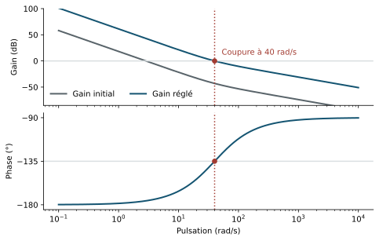

### Question 4.8

> [!INDICATION]
> Recenser les quatre spécifications avant de conclure.

> [!INDICATION]
> La rampe exige la limite du produit de la variable de Laplace par le transfert de boucle ouverte au voisinage de zéro.

#### Solution

Avec les valeurs de 4.7 la coupure atteint au moins $40\ \mathrm{rad/s}$ et la marge vaut au moins $45^\circ$. Le dénominateur fermé $Jp^2+(f+k_ck_VK_{pV})p+k_ck_VK_{iV}$ est stable. La boucle est de classe un, donc l'erreur permanente de vitesse pour un échelon est nulle. Pour une rampe de pente $a=10\ \mathrm{rad/s^2}$, l'erreur de traînage exprimée en vitesse vaut
$$e_\infty=\frac{a}{\lim_{p\to0}pL_V(p)}=\frac{af}{k_ck_VK_{iV}}\simeq7{,}1\,10^{-7}\ \mathrm{rad/s}.$$
Elle est inférieure à $0{,}01\ \mathrm{rad/s}$. Les quatre exigences de la boucle de vitesse sont satisfaites dans le modèle.

### Question 4.9

> [!INDICATION]
> Dessiner la même masse près de l'épaule puis en bout de bras.

> [!INDICATION]
> Dans le théorème de Huygens, quelle distance intervient au carré ?

#### Solution

Considérons deux positions de l'axe d'épaule, avec la même charge et la même transmission. Bras déployé, la charge et plusieurs centres de masse se trouvent à grande distance perpendiculaire de l'axe $(O_2,\vec y_2)$. Bras replié, ils se rapprochent de cet axe. Pour chaque solide, le moment d'inertie comporte le terme $m r_\perp^2$ en plus du moment propre autour de l'axe parallèle passant par son centre. Un même réducteur ramène les deux inerties à l'arbre moteur avec le même facteur. Le déplacement des masses modifie donc l'inertie équivalente, qui augmente dans la configuration déployée.

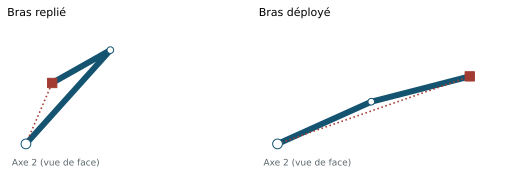

### Question 4.10

> [!INDICATION]
> Identifier le gain statique et la constante de temps pour chaque valeur de l'inertie.

> [!INDICATION]
> Placer chaque cassure sur le même axe logarithmique et poursuivre avec la pente d'un premier ordre.

#### Solution

Sans correction $L_J(p)=(k_ck_V/f)/(1+Jp/f)$. Le plateau de gain vaut $20\log_{10}(2500)\simeq68\ \mathrm{dB}$ pour les deux inerties. Pour $J_1=10^2\ \mathrm{kg\,m^2}$ (vert), la cassure est $f/J_1=10^{-4}\ \mathrm{rad/s}$. Pour $J_2=10^3\ \mathrm{kg\,m^2}$ (rouge), elle est $10^{-5}\ \mathrm{rad/s}$. Après leur cassure, les deux asymptotes de gain décroissent de $20\ \mathrm{dB}$ par décade. À haute fréquence, la rouge se trouve $20\ \mathrm{dB}$ sous la verte. La phase exacte est $-\arctan(J\omega/f)$, de $0^\circ$ à $-90^\circ$ avec $-45^\circ$ à la cassure. Le tracé asymptotique usuel relie les deux plateaux entre un dixième et dix fois la pulsation de cassure. Multiplier l'inertie par dix déplace les courbes d'une décade vers la gauche.

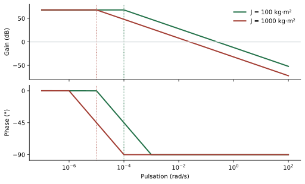

La lecture du feuillet imprimé p. 27 confirme les exposants positifs 2 et 3. À $10^{-4}$ rad/s, les asymptotes placent la courbe verte sur son plateau et la rouge à 20 dB sous celui-ci. Le tracé ci-dessus restitue ces réponses sur une grille reconstruite. Le document réponse 2 annoncé manque aux exemplaires vérifiés.

[Feuillet officiel, p. 28 du PDF](https://ens-paris-saclay.fr/sites/default/files/CONCOURS/ANNALES_1C/1C_PSI/2026/2026_PSI_SI_XSR.pdf#page=28)

### Question 4.11

> [!INDICATION]
> Former la fonction de transfert fermée en conservant l'inertie dans les coefficients.

> [!INDICATION]
> Qu'est-ce qui change dans un premier ordre si l'on déplace son pôle sans toucher à son gain statique ?

#### Solution

Pour un échelon de consigne de vitesse sans correcteur, la réponse fermée est un premier ordre de gain statique $k_ck_V/(f+k_ck_V)$ et de constante de temps $J/(f+k_ck_V)$. L'erreur relative d'échelon $f/(f+k_ck_V)$ est indépendante de l'inertie. Le pôle $-(f+k_ck_V)/J$ reste réel négatif pour tout $J>0$, la réponse est stable et monotone. La multiplication de $J$ par dix divise par dix la fréquence de coupure et multiplie par dix la constante de temps. La marge de phase de la boucle ouverte est inchangée puisque les courbes de gain et de phase subissent la même translation horizontale.

### Question 4.12

> [!INDICATION]
> Lire d'abord les trois apports au sommateur qui produit la consigne d'accélération virtuelle.

> [!INDICATION]
> Substituer cette consigne dans l'expression du modèle inverse donnée sous le schéma.

#### Solution

Écrivons $K_p$ et $K_v$ comme matrices diagonales des six gains. Avec $\varepsilon=\theta_c-\theta_m$, l'accélération virtuelle est
$$\ddot\mu=\ddot\theta_c+K_v(\dot\theta_c-\dot\theta_m)+K_p(\theta_c-\theta_m).$$
La commande de couple lue sur le schéma est
$$\Gamma=A(\theta_m)\bigl[\ddot\theta_c+K_v(\dot\theta_c-\dot\theta_m)+K_p(\theta_c-\theta_m)\bigr]+B(\theta_m,\dot\theta_m)\dot\theta_m+C(\theta_m).$$
Les termes de vitesse et de position présents dans le modèle sont calculés à partir de l'état mesuré.

### Question 4.13

> [!INDICATION]
> Dans le modèle parfait, la commande et le couple réel comportent deux termes identiques.

> [!INDICATION]
> Identifier le discriminant de l'équation scalaire de chaque axe et distinguer les trois régimes.

#### Solution

Dans le modèle parfait, l'égalité de la commande et du couple réel permet de simplifier les termes en $B$ et $C$. Comme la matrice d'inertie $A(\theta_m)$ est inversible, $\ddot\theta_m=\ddot\mu$. Ainsi $\ddot\varepsilon+K_v\dot\varepsilon+K_p\varepsilon=0$. Chaque axe a ses deux pôles propres. Posons $\Delta_i=K_{vi}^2-4K_{pi}$. Si $\Delta_i>0$, la solution est $a_i e^{r_+t}+b_i e^{r_-t}$ avec $r_\pm=(-K_{vi}\pm\sqrt{\Delta_i})/2$. Si $\Delta_i=0$, elle est $(a_i+b_i t)e^{-K_{vi}t/2}$. Si $\Delta_i<0$, elle est
$$e^{-K_{vi}t/2}\bigl[a_i\cos(\omega_dt)+b_i\sin(\omega_dt)\bigr],\qquad \omega_d=\sqrt{-\Delta_i}/2.$$
Les constantes dépendent des erreurs initiales d'angle et de vitesse. Avec des gains strictement positifs, ces erreurs tendent vers zéro. La compensation rend ce comportement indépendant de la configuration et découple les six erreurs dans le modèle parfait.

### Question 4.14

> [!INDICATION]
> Comparer le polynôme caractéristique à la forme canonique d'un second ordre.

> [!INDICATION]
> Pour accélérer l'axe à amortissement fixé, comment faut-il faire varier le gain de vitesse avec le gain de position ?

#### Solution

L'identification de $p^2+K_{vi}p+K_{pi}$ à $p^2+2\xi_i\omega_{ni}p+\omega_{ni}^2$ donne $\omega_{ni}=\sqrt{K_{pi}}$ et $\xi_i=K_{vi}/(2\sqrt{K_{pi}})$. Le gain de position fixe la pulsation propre. À gain de position fixé, le gain de vitesse règle l'amortissement. Un réglage critique $K_{vi}=2\sqrt{K_{pi}}$ évite les oscillations. Un gain de vitesse plus élevé donne deux pôles réels et peut ralentir le mode dominant. On peut accélérer la dynamique à amortissement constant en augmentant conjointement $K_{pi}$ et $K_{vi}$ dans les proportions indiquées.

## Partie 5 — La dynamique du robot

Le mouvement d’épaule déplace tous les centres de masse. Une rotation simultanée de l’effecteur ajoute des termes gyroscopiques dans les bilans de moment.

### Question 5.1

> [!INDICATION]
> Repérer quels axes de rotation passent par le centre de gravité et lesquels le déplacent.

> [!INDICATION]
> Dériver deux fois la position dans le repère fixe, en conservant la composante centripète.

#### Solution

Posons $q=\dot\theta_2$, $s=\dot\theta_6$. Dans la position étudiée, $\vec x_2=\vec x_3=\vec x_6$ et $\vec y_2=\vec y_3=\vec y_5$. L’axe 2 est fixe et $O_2$ immobile. Comme $G_6$ est sur l’axe 6 et que $\overrightarrow{O_2G_6}=L_6\vec x_3$, la rotation propre à la vitesse $s$ ne déplace pas ce point. De $\mathrm d\vec x_3/\mathrm dt=-q\vec z_3$ et $\mathrm d\vec z_3/\mathrm dt=q\vec x_3$, on déduit
$$\vec V(G_6,6/0)=-L_6 q\vec z_3,\qquad \vec a(G_6,6/0)=-L_6 \dot q\vec z_3-L_6 q^2\vec x_3.$$
Le second terme est dirigé vers le centre de la trajectoire circulaire.

### Question 5.2

> [!INDICATION]
> Exprimer la vitesse angulaire dans les axes principaux du solide 6.

> [!INDICATION]
> Dériver le moment cinétique dans la base mobile, puis ajouter le produit vectoriel de transport.

#### Solution

Utilisons la base propre $\mathcal B_6$ de l’effecteur, où l’inertie en $G_6$ est diagonale. Posons $c=\cos\theta_6$, $h=\sin\theta_6$ et $(A,B,C)=(A_6,B_6,C_6)$. Puisque $\vec y_5=c\vec y_6-h\vec z_6$,
$$[\vec\Omega_{6/0}]_6=(s,qc,-qh)^T,\qquad [\vec H_{G_6}]_6=(As,Bqc,-Cqh)^T.$$
Le moment dynamique est la dérivée galiléenne du moment cinétique au centre de masse. En ajoutant $\vec\Omega\times\vec H$ à la dérivée des composantes dans la base mobile, il vient
$$[\vec\delta_{G_6}]_6=\begin{pmatrix}
 A\dot s+(B-C)q^2hc\\
 B\dot q c+(C-A-B)qsh\\
 -C\dot q h+(B-A-C)qsc
\end{pmatrix}.$$
Conserver le terme $\dot s$ permet aussi de traiter la phase d’accélération propre de l’effecteur.

### Question 5.3

> [!INDICATION]
> Projeter le théorème du moment dynamique sur l’axe du pivot 6.

> [!INDICATION]
> Distinguer la rotation de vitesse imposée de la situation où son accélération est quelconque.

#### Solution

Isolons l’effecteur et projetons le théorème du moment dynamique sur son axe de pivot. En $G_6$ situé sur cet axe, le poids n’a pas de moment ; la réaction d’un pivot parfait ne transmet pas de couple selon son axe. Transporter le moment dynamique de $G_6$ à $O_6$ ne change pas cette projection. Il reste le couple moteur,
$$C_{m6}=A_6\ddot\theta_6+\tfrac12(B_6-C_6)\sin(2\theta_6)\dot\theta_2^{\,2}.$$
Pour une rotation propre **à vitesse constante**, comme dans les deux simulations, on obtient la forme demandée avec $k=(B_6-C_6)/2$. Cette forme suppose $\ddot\theta_6=0$ ; cette hypothèse est nécessaire si l’on part du mouvement général à deux axes annoncé. Si $B_6=C_6$, le couplage disparaît. Un couple d’accélération propre $A_6\ddot\theta_6$ subsisterait lors d’une variation de la vitesse de l’axe 6.

### Question 5.4

> [!INDICATION]
> L’énergie cinétique et l’énergie potentielle de toute la chaîne permettent d’éliminer les efforts internes.

> [!INDICATION]
> Regrouper les termes en vitesse d’épaule au carré et calculer la dérivée temporelle de leur coefficient.

#### Solution

Les solides 2 à 6 constituent le sous-ensemble en mouvement. Introduisons pour chaque solide $L_i$ donné dans le sujet et son décalage perpendiculaire $h_i$ selon $\vec z_3$. L’annexe D donne $h_3=z_{G3}$ ; $h_2=h_4=h_5=h_6=0$ avec les simplifications du texte. Le décalage $y_{G2}$, parallèle au pivot de l’épaule, ne contribue ni à la distance à l’axe 2 ni à la variation d’altitude. L’inertie ramenée à l’axe 2 est
$$J(\theta_6)=\sum_{i=2}^{6} m_i(L_i^2+h_i^2)+\sum_{i=2}^5 B_i+B_6\cos^2\theta_6+C_6\sin^2\theta_6.$$
En effet $\vec y_2$ est un axe principal de 2 à 5 ; pour 6 il a les coordonnées $(0,c,-h)$ dans la base principale. Avec ces inerties diagonales, $T=\tfrac12 Jq^2+\tfrac12 A_6s^2$. La hauteur de $G_i$, à une constante près, vaut $-L_i\sin\theta_2+h_i\cos\theta_2$ puisque $\vec x_3\cdot\vec z_0=-\sin\theta_2$. L’équation de Lagrange pour $\theta_2$ donne
$$C_{m2}=J\ddot\theta_2+(C_6-B_6)\sin(2\theta_6)\dot\theta_6\dot\theta_2-g\sum_{i=2}^{6}m_i(L_i\cos\theta_2+h_i\sin\theta_2).$$
On retrouve l’inertie d’accélération, le couplage entre les axes et la compensation du poids. Les distances s’expriment en mètres et les inerties en $\mathrm{kg\,m^2}$.

### Question 5.5

> [!INDICATION]
> Le poids vertical possède-t-il un moment projeté sur un axe vertical ?

> [!INDICATION]
> Suivre ce qui arrive à la direction du moment cinétique de l’effecteur lorsque le bras pivote.

#### Solution

L’axe 1 reste immobile dans les deux simulations. Sans rotation propre de l’effecteur, le couple simulé sur cet axe est voisin de zéro. Avec $\dot\theta_6=2\ \mathrm{rad/s}$, il croît jusqu’à environ $320$–$330\ \mathrm{N\,m}$ avant de redescendre vers $150\ \mathrm{N\,m}$. Pour toute pièce, la projection sur l’axe vertical de $\overrightarrow{O_1G_i}\times(-m_i g\vec z_0)$ est nulle. Le poids ne peut donc expliquer l’écart entre les deux courbes. Le changement de direction du moment cinétique de l’effecteur en rotation, lorsque l’épaule bascule, crée un couple gyroscopique que doit reprendre l’actionneur bloqué.

### Question 5.6

> [!INDICATION]
> Un point hors de l’axe 6 décrit un cercle même quand les autres articulations sont immobiles.

> [!INDICATION]
> La force d’inertie d’un balourd a une direction tournante et une amplitude qui dépend de sa distance à l’axe.

#### Solution

Si $G_6$ est excentré, la rotation propre lui impose une accélération centripète d’ordre $|z_{G6}|\dot\theta_6^2$, dont la direction tourne. Les paliers et les articulations amont subissent un effort tournant de balourd, pouvant engendrer vibrations et charges alternées. En accélération propre s’ajoute une composante tangentielle de module $|z_{G6}\ddot\theta_6|$.

### Question 5.7

> [!INDICATION]
> Additionner l’énergie cinétique de translation du centre et l’énergie de rotation propre de chaque solide.

> [!INDICATION]
> Les deux vitesses sont des fonctions linéaires des vitesses articulaires à configuration fixée.

#### Solution

Pour le solide $i$, $T_i=\tfrac12 m_i\|\vec V_{G_i}\|^2+\tfrac12\vec\Omega_i^{\,T}I_{G_i}\vec\Omega_i$, vitesses et tenseur exprimés dans des bases cohérentes. Les vitesses sont linéaires en $\dot{\boldsymbol\theta}$ pour une configuration donnée. Notons $J_{vi}$ et $J_{\omega i}$ les matrices qui les donnent. La somme est
$$T=\tfrac12\dot{\boldsymbol\theta}^{T}M(\boldsymbol\theta)\dot{\boldsymbol\theta},\qquad M=\sum_i(m_i J_{vi}^{T}J_{vi}+J_{\omega i}^{T} I_{G_i}J_{\omega i}).$$
$M$ est la matrice d’inertie articulaire symétrique, définie positive pour des coordonnées indépendantes et des inerties non dégénérées. Les termes hors diagonale expriment les couplages entre axes.

### Question 5.8

> [!INDICATION]
> Choisir les six angles comme coordonnées généralisées.

> [!INDICATION]
> Dans l’équation de Lagrange, regrouper accélérations, produits de vitesses et dérivées du potentiel.

#### Solution

Former $T$ puis l’énergie potentielle de pesanteur $U=\sum_i m_i g z_{G_i}$. Écrire pour chacune des six coordonnées $\mathrm d(\partial T/\partial\dot\theta_j)/\mathrm dt-\partial T/\partial\theta_j+\partial U/\partial\theta_j=C_{mj}$. Les liaisons parfaites et les coordonnées articulaires éliminent les inconnues de réaction. On regroupe les coefficients des accélérations dans $M(\boldsymbol\theta)\ddot{\boldsymbol\theta}$, les produits de vitesses dans $B(\boldsymbol\theta,\dot{\boldsymbol\theta})\dot{\boldsymbol\theta}$ (termes centrifuges et de Coriolis), puis les couples de gravité dans $C=\mathrm{grad}_{\boldsymbol\theta} U$. Le membre de droite $\Gamma$ rassemble les six couples moteurs. Pour dimensionner un axe, évaluer son couple sur les trajectoires de positions, vitesses et accélérations prescrites.

## Partie 6 — Le frein de sécurité

Le dispositif doit limiter la chute et produire un couple de frottement dans le délai prescrit. Les courbes d’alimentation, de course et d’effort ne commencent pas toutes à évoluer au même instant.

### Question 6.1

> [!INDICATION]
> Au voisinage de l’horizontale, dans quelle direction accélère initialement le centre de masse ?

> [!INDICATION]
> Comparer les 10 mm de descente au rayon de 2,45 m avant de choisir l’approximation.

#### Solution

Au départ, le bras est horizontal et l’effecteur immobile. On assimile la charge à un point de masse $m_6$ sur un bras rigide sans masse, à pivot sans frottement ; les autres articulations sont bloquées. Pour une petite rotation descendante $\alpha$, $m_6L_6^2\ddot\alpha=m_6gL_6\cos\alpha$. À la descente imposée, $\sin\alpha=0{,}010/2{,}450\simeq0{,}0041$, donc l’approximation $\cos\alpha\simeq1$ est justifiée. La chute vérifie $\Delta z\simeq L_6\alpha\simeq gt^2/2$ et
$$t\simeq\sqrt{2\times0{,}010/9{,}81}=0{,}045\ \mathrm s.$$
Le frein doit réellement limiter puis arrêter la descente avant 10 mm. Un délai d’action de 45 ms consommerait déjà toute la marge avant même le ralentissement ; le délai de détection et d’établissement du couple doit être sensiblement inférieur.

### Question 6.2

> [!INDICATION]
> Dessiner la normale et la tangente sur un élément de la surface frottante.

> [!INDICATION]
> L’action en O comporte le moment de la force élémentaire initialement appliquée en M.

#### Solution

Notons $\vec e_r,\vec e_\theta,\vec z$ la base cylindrique directe et $\mathrm dS=r\,\mathrm dr\,\mathrm d\theta$. La garniture presse le disque vers $-\vec z$. Pour un mouvement imminent horaire vu de $+\vec z$, sa traction de frottement sur le disque est dans le sens $+\vec e_\theta$. Au seuil d’adhérence, sa norme est $fp\,\mathrm dS$, la pression normale étant $p$. Le torseur élémentaire, réduit en $O$ dans le plan de contact, a pour résultante et moment
$$\mathrm d\vec R=p(f\vec e_\theta-\vec z)\,\mathrm dS,\qquad \mathrm d\vec M_O=r\vec e_r\times\mathrm d\vec R=pr(\vec e_\theta+f\vec z)\,\mathrm dS.$$
Avant le seuil, la traction tangentielle s’ajuste et reste de norme au plus $fp\,\mathrm dS$.

### Question 6.3

> [!INDICATION]
> Un élément de garniture à distance r produit un moment proportionnel à r.

> [!INDICATION]
> Écrire la surface élémentaire en coordonnées polaires, puis remplacer la pression par la force normale divisée par l’aire.

#### Solution

Seule la traction tangentielle contribue à la projection du couple sur $\vec z$. Le secteur de contact a pour ouverture $\gamma=\pi-2\theta_0$, pour rayons $r_1,r_2$ et pour aire $S=\gamma(r_2^2-r_1^2)/2$. Avec $F=pS$, le couple limite sur la face représentée vaut
$$C_f=\int_S fpr\,\mathrm dS=fp\gamma\frac{r_2^3-r_1^3}{3}=\frac{2fF}{3}\frac{r_2^3-r_1^3}{r_2^2-r_1^2}.$$
Le rayon efficace est entre $r_1$ et $r_2$. L’ouverture disparaît lorsqu’on prescrit la force axiale totale et une pression uniforme.

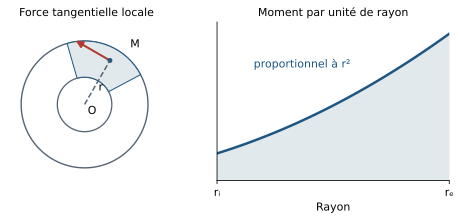

En posant $r_1\to r_2$ dans le quotient du couple par $fF$, on retrouve le rayon unique de contact. Pour un disque plein $r_1=0$, le même quotient tend vers $2r_2/3$. Ces deux limites vérifient l’intégration.

[Feuillet officiel, p. 34 du PDF](https://ens-paris-saclay.fr/sites/default/files/CONCOURS/ANNALES_1C/1C_PSI/2026/2026_PSI_SI_XSR.pdf#page=34)

### Question 6.4

> [!INDICATION]
> Comparer la tension d’alimentation à la force contre-électromotrice pendant la mise en vitesse.

> [!INDICATION]
> Distinguer le déplacement avant contact de la compression de la garniture après contact.

#### Solution

Après l’échelon de 15 V, la force contre-électromotrice est d’abord nulle. L’inductance limite la montée initiale du courant ; le moteur accélère à vide, la force contre-électromotrice croît et le courant retombe presque à zéro. Vers 26–27 ms, le contact charge et ralentit le moteur. Le courant remonte, dépasse brièvement sa valeur finale (environ 9 A au pic, 7,5 A en régime permanent) puis se stabilise. Le déplacement de l’écrou commence dès la rotation de la vis, mais il faut d’abord rattraper le jeu entre disque et garniture. L’effort naît au contact puis augmente avec la compression.

### Question 6.5

> [!INDICATION]
> Lire séparément le maximum et la valeur finale de l’effort.

> [!INDICATION]
> Le temps de réponse est la date à partir de laquelle le signal reste dans toute la bande de 5 %.

#### Solution

Le plateau vaut environ $4{,}0\times10^4\ \mathrm N$ et le maximum $5{,}4\times10^4\ \mathrm N$. Le dépassement est donc voisin de $35\,\%$, inférieur aux $40\,\%$ autorisés. Pour le temps de réponse **à compter de l’échelon**, tracer la bande $[3{,}8;4{,}2]\times10^4\ \mathrm N$. Après une première traversée, la courbe redescend un peu sous la limite basse vers 39–40 ms. Son dernier retour dans la bande se situe vers 42–43 ms, au-delà des 40 ms exigées. La lecture est graphique à quelques millisecondes près. Le critère de dépassement est respecté, la double spécification de maintien n’est pas validée par cette simulation.

Le plateau autorise 2 000 N d’écart de part et d’autre de 40 000 N. Le contact prend à lui seul environ 26 ms sur le budget de 40 ms, avant la montée et l’oscillation de l’effort.

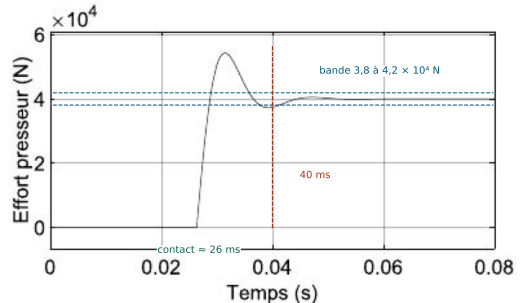

[Feuillet officiel, p. 36 du PDF](https://ens-paris-saclay.fr/sites/default/files/CONCOURS/ANNALES_1C/1C_PSI/2026/2026_PSI_SI_XSR.pdf#page=36)

## Bilan

La mesure de vitesse n’assure pas à elle seule la précision de pose ou la tenue du frein. Ces vérifications s’appuient sur des grandeurs distinctes : la résolution du codeur, l’erreur de reconstruction de la pose, les marges de la boucle et le temps d’établissement de l’effort de freinage.
