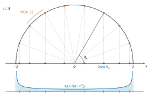
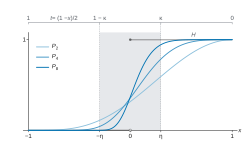
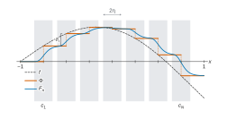

# X MP — Mathématiques B 2026 · Corrigé brut

*Corrigé rédigé par IA, non officiel. Signalez toute erreur.*

Épreuve de 4 heures, calculatrice interdite. Thème : répartition des valeurs propres de matrices tridiagonales (loi de l'arcsinus), théorème de Weierstrass, loi du demi-cercle pour les matrices de Wigner. Trente questions, de 1 à 17b.

Notations utilisées dans tout le corrigé : pour $f$ continue sur $[-2,2]$, $I(f)=\dfrac1\pi\displaystyle\int_{-2}^2\frac{f(x)}{\sqrt{4-x^2}}\,\mathrm dx$, et $f_k(x)=x^k$.

## Préliminaire

### Question 1

L'équation caractéristique de la récurrence est $r^2-\alpha r+1=0$. Son discriminant vaut $\Delta=\alpha^2-4$, et le produit de ses racines vaut $1$.

**Cas $|\alpha|>2$.** Il y a deux racines réelles distinctes :

$$r_\pm=\frac{\alpha\pm\sqrt{\alpha^2-4}}2.$$

Il existe donc des réels $A,B$ tels que $u_n=Ar_+^n+Br_-^n$ pour tout $n$.

La condition $u_0=0$ donne $A+B=0$. La condition $u_1=1$ donne alors $A(r_+-r_-)=1$, avec $r_+-r_-=\sqrt{\alpha^2-4}$ :

$$\boxed{u_n=\frac{1}{\sqrt{\alpha^2-4}}\left[\left(\frac{\alpha+\sqrt{\alpha^2-4}}2\right)^n-\left(\frac{\alpha-\sqrt{\alpha^2-4}}2\right)^n\right]}$$

**Cas $|\alpha|<2$.** On écrit $\alpha=2\cos\theta$ avec un unique $\theta\in\,]0,\pi[$, à savoir $\theta=\arccos\frac\alpha2$.

Les racines sont $e^{i\theta}$ et $e^{-i\theta}$, distinctes puisque $\sin\theta\neq0$.

La suite (réelle) s'écrit $u_n=Ae^{in\theta}+Be^{-in\theta}$ avec $A,B\in\mathbb C$. La condition $u_0=0$ donne $B=-A$, puis $u_1=1$ donne $2iA\sin\theta=1$, donc

$$\boxed{u_n=\frac{\sin(n\theta)}{\sin\theta}}$$

avec $\theta=\arccos\frac\alpha2\in\,]0,\pi[$.

**Cas $\alpha=2$.** Racine double $1$ : $u_n=A+Bn$, puis $A=0$ et $B=1$ :

$$\boxed{u_n=n.}$$

**Cas $\alpha=-2$.** Racine double $-1$ : $u_n=(A+Bn)(-1)^n$, puis $A=0$ et $-B=1$ :

$$\boxed{u_n=(-1)^{n+1}\,n.}$$

## Première Partie

### Question 2

Soit $R_n=\dfrac1n\displaystyle\sum_{k=1}^nf\!\left(\frac kn\right)$. Comme $f$ est continue sur le segment $[0,1]$, le théorème sur les sommes de Riemann donne $R_n\to\int_0^1f$.

Par le théorème de Heine, $f$ est uniformément continue sur $[0,1]$.

Soit $\varepsilon>0$, et soit $\delta>0$ tel que, pour $s,t\in[0,1]$, $|s-t|\le\delta$ entraîne $|f(s)-f(t)|\le\varepsilon$.

Pour $1\le k\le n$, les points $\frac k{n+1}$ et $\frac{2k}{2n+1}$ sont dans $[0,1]$, et

$$\begin{aligned}
\left|\frac{k}{n+1}-\frac kn\right|&=\frac{k}{n(n+1)}\le\frac1{n+1},\\
\left|\frac{2k}{2n+1}-\frac kn\right|&=\frac{k}{n(2n+1)}\le\frac1{2n+1}\le\frac1{n+1}.
\end{aligned}$$

Dès que $\frac1{n+1}\le\delta$, chaque terme vérifie $\left|f\!\left(\frac k{n+1}\right)-f\!\left(\frac kn\right)\right|\le\varepsilon$. Par inégalité triangulaire, $|v_n-R_n|\le\varepsilon$, et de même $|w_n-R_n|\le\varepsilon$.

Donc $v_n-R_n\to0$ et $w_n-R_n\to0$. Les deux suites convergent, et

$$\boxed{\lim_{n\to\infty}v_n=\lim_{n\to\infty}w_n=\int_0^1f(t)\,\mathrm dt.}$$

### Question 3a

**Convergence.** $f$ est continue sur le segment $[-2,2]$, donc bornée par $\|f\|_\infty$. Sur $]-2,2[$, on a la majoration

$$\left|\frac{f(x)}{\sqrt{4-x^2}}\right|\le\frac{\|f\|_\infty}{\sqrt{4-x^2}}.$$

La fonction $x\mapsto\frac1{\sqrt{4-x^2}}$ est intégrable sur $]-2,2[$ : une primitive est $\arcsin\frac x2$, qui a des limites finies $\pm\frac\pi2$ en $\pm2$. Par comparaison, l'intégrale $I(f)$ est absolument convergente.

**Changement de variable.** L'application $\varphi:\theta\mapsto2\cos\theta$ est une bijection de $]0,\pi[$ sur $]-2,2[$, de classe $\mathcal C^1$ et strictement décroissante, avec $\varphi'(\theta)=-2\sin\theta$.

Pour $\theta\in\,]0,\pi[$, on a $\sin\theta>0$, donc $\sqrt{4-4\cos^2\theta}=2\sin\theta$. Le théorème de changement de variable pour les intégrales généralisées (l'une converge, donc l'autre aussi, et elles sont égales) donne

$$\begin{aligned}
\int_{-2}^2\frac{f(x)}{\sqrt{4-x^2}}\,\mathrm dx&=\int_0^\pi\frac{f(2\cos\theta)}{2\sin\theta}\,2\sin\theta\,\mathrm d\theta\\
&=\int_0^\pi f(2\cos\theta)\,\mathrm d\theta,
\end{aligned}$$

$$\boxed{I(f)=\frac1\pi\int_0^\pi f(2\cos\theta)\,\mathrm d\theta.}$$

### Question 3b

Par 3a :

$$\begin{aligned}
I(f_0)&=\frac1\pi\int_0^\pi\mathrm d\theta=1,\\
I(f_1)&=\frac1\pi\int_0^\pi2\cos\theta\,\mathrm d\theta=\frac2\pi\big[\sin\theta\big]_0^\pi=0,\\
I(f_2)&=\frac1\pi\int_0^\pi4\cos^2\theta\,\mathrm d\theta=\frac2\pi\int_0^\pi(1+\cos2\theta)\,\mathrm d\theta=2.
\end{aligned}$$

$$\boxed{\begin{aligned}I(f_0)&=1\\ I(f_1)&=0\\ I(f_2)&=2\end{aligned}}$$

### Question 3c

La fonction $\theta\mapsto(2\cos\theta)^n$ est paire et $2\pi$-périodique, donc

$$\int_0^\pi(2\cos\theta)^n\,\mathrm d\theta=\frac12\int_{-\pi}^{\pi}(2\cos\theta)^n\,\mathrm d\theta.$$

Par la formule du binôme,

$$\begin{aligned}
(2\cos\theta)^n&=(e^{i\theta}+e^{-i\theta})^n\\
&=\sum_{j=0}^n\binom nj e^{i(2j-n)\theta}.
\end{aligned}$$

Pour $p\in\mathbb Z$, l'intégrale $\int_{-\pi}^{\pi}e^{ip\theta}\,\mathrm d\theta$ vaut $2\pi$ si $p=0$ et $0$ sinon.

Seul le terme $2j=n$ contribue, ce qui n'est possible que si $n$ est pair.

Ainsi $I(f_n)=0$ si $n$ est impair, et si $n$ est pair :

$$I(f_n)=\frac1\pi\cdot\frac12\cdot2\pi\binom n{n/2}=\binom{n}{n/2}.$$

$$\boxed{\begin{aligned}I(f_{2m+1})&=0\\ I(f_{2m})&=\binom{2m}{m}\qquad(m\ge0)\end{aligned}}$$

On retrouve $1,0,2$ pour $n=0,1,2$.

### Question 4a

$f$ est définie aux points $2\cos\frac{\pi k}{n+1}\in[-2,2]$. Par la formule de transfert, avec $h(t)=f(2\cos\pi t)$ :

$$\begin{aligned}
\mathbb E\!\left(f\!\left(2\cos\frac{\pi U_n}{n+1}\right)\right)&=\frac1n\sum_{k=1}^nf\!\left(2\cos\frac{k\pi}{n+1}\right)\\
&=\frac1n\sum_{k=1}^nh\!\left(\frac{k}{n+1}\right).
\end{aligned}$$

$h$ est continue sur $[0,1]$ (composée de fonctions continues, et $2\cos\pi t\in[-2,2]$). Le membre de droite est la suite $(v_n)$ de la question 2 associée à $h$ ; elle converge vers $\int_0^1h(t)\,\mathrm dt$.

Le changement de variable affine $\theta=\pi t$, puis 3a, donnent

$$\int_0^1f(2\cos\pi t)\,\mathrm dt=\frac1\pi\int_0^\pi f(2\cos\theta)\,\mathrm d\theta=I(f),$$

$$\boxed{\mathbb E\!\left(f\!\left(2\cos\frac{\pi U_n}{n+1}\right)\right)\xrightarrow[n\to\infty]{}\frac1\pi\int_{-2}^2\frac{f(x)}{\sqrt{4-x^2}}\,\mathrm dx.}$$

### Question 4b

Notons $Z_n=2\cos\frac{\pi U_n}{n+1}$. Notons aussi $F(y)=\frac1\pi\int_{-2}^y\frac{\mathrm dx}{\sqrt{4-x^2}}$, fonction continue de $y$ sur $[-2,2]$. La question 4a ne s'applique pas telle quelle, car $\mathbf 1_{]-\infty,y[}$ n'est pas continue : on l'encadre par des fonctions continues.

**Cas $y=\pm2$.** On a $\frac{\pi U_n}{n+1}\in\,]0,\pi[$, donc $Z_n\in\,]-2,2[$. Ainsi $\mathbb P(Z_n<2)=1=F(2)$, car $\frac1\pi\big[\arcsin\frac x2\big]_{-2}^2=1$. De même $\mathbb P(Z_n<-2)=0=F(-2)$.

**Cas $y\in\,]-2,2[$.** Soit $\eta>0$ avec $[y-\eta,y+\eta]\subset[-2,2]$. On définit deux fonctions continues sur $[-2,2]$, affines par morceaux :
- $\phi^-$ vaut $1$ sur $[-2,y-\eta]$, $0$ sur $[y,2]$, et est affine sur $[y-\eta,y]$ ;
- $\phi^+$ vaut $1$ sur $[-2,y]$, $0$ sur $[y+\eta,2]$, et est affine sur $[y,y+\eta]$.

Sur $[-2,2]$, on a $0\le\phi^-\le\mathbf 1_{]-\infty,y[}\le\phi^+\le1$. Par croissance de l'espérance,

$$\mathbb E(\phi^-(Z_n))\le\mathbb P(Z_n<y)\le\mathbb E(\phi^+(Z_n)).$$

Par ailleurs, $\phi^-$ et $\phi^+$ coïncident avec $\mathbf 1_{]-\infty,y[}$ hors de $[y-\eta,y+\eta]$ et en diffèrent d'au plus $1$. Donc

$$\begin{aligned}
F(y)-\frac1\pi\int_{y-\eta}^{y}\frac{\mathrm dx}{\sqrt{4-x^2}}&\le I(\phi^-)\le F(y),\\
F(y)&\le I(\phi^+)\le F(y)+\frac1\pi\int_{y}^{y+\eta}\frac{\mathrm dx}{\sqrt{4-x^2}}.
\end{aligned}$$

Soit $\varepsilon>0$. Par continuité de $F$, on choisit $\eta$ tel que $I(\phi^+)\le F(y)+\frac\varepsilon2$ et $I(\phi^-)\ge F(y)-\frac\varepsilon2$.

Par 4a appliquée aux fonctions continues $\phi^-$ et $\phi^+$, il existe un rang $N$ à partir duquel $\mathbb E(\phi^\pm(Z_n))$ est à moins de $\frac\varepsilon2$ de $I(\phi^\pm)$.

Pour $n\ge N$ :

$$F(y)-\varepsilon\le\mathbb P(Z_n<y)\le F(y)+\varepsilon.$$

$$\boxed{\mathbb P\!\left(2\cos\frac{\pi U_n}{n+1}<y\right)\xrightarrow[n\to\infty]{}\frac1\pi\int_{-2}^y\frac{\mathrm dx}{\sqrt{4-x^2}}=\frac12+\frac1\pi\arcsin\frac y2.}$$

## Deuxième partie

### Question 5a

$$\chi_2(X)=\det\begin{pmatrix}X&-1\\-1&X\end{pmatrix}=X^2-1.$$

En développant selon la première ligne,

$$\begin{aligned}
\chi_3(X)&=\det\begin{pmatrix}X&-1&0\\-1&X&-1\\0&-1&X\end{pmatrix}\\
&=X(X^2-1)+1\cdot(-X)\\
&=X^3-2X=X(X^2-2).
\end{aligned}$$

$$\boxed{\begin{aligned}\chi_2&=X^2-1, &\mathrm{Sp}(T_2)&=\{(-1,1),(1,1)\}\\ \chi_3&=X^3-2X, &\mathrm{Sp}(T_3)&=\{(-\sqrt2,1),(0,1),(\sqrt2,1)\}\end{aligned}}$$

### Question 5b

On développe $\chi_n=\det(XI_n-T_n)$ selon la dernière colonne. Elle n'a que deux coefficients non nuls : $X$ en position $(n,n)$ et $-1$ en position $(n-1,n)$.

- Le cofacteur de $(n,n)$ est $\det(XI_{n-1}-T_{n-1})=\chi_{n-1}$.
- Le mineur de $(n-1,n)$ est le déterminant de la matrice obtenue en supprimant la ligne $n-1$ et la colonne $n$. Sa dernière ligne est $(0,\dots,0,-1)$ ; en développant selon cette ligne, il vaut $-\chi_{n-2}$. Le cofacteur vaut donc $(-1)^{(n-1)+n}(-\chi_{n-2})=\chi_{n-2}$.

D'où $\chi_n=X\chi_{n-1}+(-1)\chi_{n-2}$ :

$$\boxed{\chi_n=X\,\chi_{n-1}-\chi_{n-2}\qquad(n\ge4).}$$

Le même calcul vaut pour $n=3$ en posant $\chi_1=X$ (polynôme caractéristique de la matrice nulle d'ordre 1).

### Question 5c

Fixons $\alpha\in\mathbb C$ avec $|\alpha|<2$.

On pose $u_0=0$ et $u_m=\chi_{m-1}(\alpha)$ pour $m\ge3$, et l'on complète par $u_1=1$, $u_2=\alpha$.

L'indice est décalé d'une unité par rapport à la question 1.

Vérifions la récurrence $u_m=\alpha u_{m-1}-u_{m-2}$ pour tout $m\ge2$. Pour $m=2$, elle s'écrit $\alpha=\alpha\cdot1-0$. Pour $m=3$ et $m=4$, on utilise 5a :

$$\begin{aligned}
u_3&=\chi_2(\alpha)=\alpha^2-1=\alpha u_2-u_1,\\
u_4&=\chi_3(\alpha)=\alpha^3-2\alpha=\alpha(\alpha^2-1)-\alpha=\alpha u_3-u_2.
\end{aligned}$$

Pour $m\ge5$, c'est la relation de 5b au rang $n=m-1\ge4$. La suite $(u_m)$ est donc celle de la question 1, ici à paramètre complexe.

Comme $|\alpha|<2$, on a $\alpha\neq\pm2$, donc $4-\alpha^2\ne0$.

Soit $\beta$ une racine carrée complexe de $4-\alpha^2$, notée $\sqrt{4-\alpha^2}$. Posons $r_\pm=\frac{\alpha\pm i\beta}{2}$. Alors

$$\begin{aligned}
r_++r_-&=\alpha,\\
r_+r_-&=\frac{\alpha^2+\beta^2}4=1,
\end{aligned}$$

donc $r_\pm$ sont les racines de $r^2-\alpha r+1$. Elles sont distinctes, car $r_+-r_-=i\beta\neq0$.

La théorie des suites récurrentes linéaires d'ordre 2 sur $\mathbb C$ donne $u_m=Ar_+^m+Br_-^m$. Avec $u_0=0$ et $u_1=1$, on obtient $u_m=\dfrac{r_+^m-r_-^m}{r_+-r_-}$. Pour $m=n+1$ :

$$\boxed{\chi_n(\alpha)=\frac{1}{i\sqrt{4-\alpha^2}}\left(\left(\frac{\alpha+i\sqrt{4-\alpha^2}}2\right)^{n+1}-\left(\frac{\alpha-i\sqrt{4-\alpha^2}}2\right)^{n+1}\right).}$$

L'expression ne dépend pas du choix de la racine carrée : changer $\beta$ en $-\beta$ échange les deux termes et change le signe du dénominateur.

### Question 5d

Avec $\beta=\sqrt{4-\alpha^2}$, la formule du binôme donne une somme où les termes d'exposant pair en $i\beta$ se compensent. En écrivant l'exposant impair $p=2j+1$ et $(i\beta)^{2j+1}=i\beta(-1)^j(4-\alpha^2)^j$ :

$$\begin{aligned}
(\alpha+i\beta)^{n+1}-(\alpha-i\beta)^{n+1}&=2\sum_{\substack{0\le p\le n+1\\ p\text{ impair}}}\binom{n+1}{p}\alpha^{n+1-p}(i\beta)^p\\
&=2i\beta\sum_{j=0}^{\lfloor n/2\rfloor}(-1)^j\binom{n+1}{2j+1}\alpha^{n-2j}(4-\alpha^2)^j.
\end{aligned}$$

En divisant par $2^{n+1}i\beta$ (formule de 5c), pour tout $\alpha\in\mathbb C$ tel que $|\alpha|<2$ :

$$\chi_n(\alpha)=\frac{1}{2^n}\sum_{j=0}^{\lfloor n/2\rfloor}(-1)^j\binom{n+1}{2j+1}\alpha^{n-2j}(4-\alpha^2)^j .$$

**Passage aux polynômes.** Notons $G_n=\frac{1}{2^n}\sum_{j}(-1)^j\binom{n+1}{2j+1}X^{n-2j}(4-X^2)^j\in\mathbb R[X]$. Le polynôme $\chi_n-G_n$ s'annule en tout point du disque $\{|\alpha|<2\}$, ensemble infini. Un polynôme non nul n'ayant qu'un nombre fini de racines, $\chi_n-G_n=0$ : l'égalité a lieu dans $\mathbb R[X]$.

En développant $(4-X^2)^j=\sum_{l=0}^{j}\binom jl4^{j-l}(-1)^lX^{2l}$ :

$$\begin{aligned}
\chi_n(X)&=\frac1{2^n}\sum_{j=0}^{\lfloor n/2\rfloor}\sum_{l=0}^{j}(-1)^{j+l}\binom{n+1}{2j+1}\binom jl4^{j-l}\\
&\qquad\times X^{n-2j+2l}.
\end{aligned}$$

En regroupant selon $m=j-l$, le coefficient de $X^{n-2m}$, pour $0\le m\le\lfloor n/2\rfloor$, est

$$c_{n,m}=\frac{(-1)^m}{2^{n-2m}}\sum_{j=m}^{\lfloor n/2\rfloor}\binom{n+1}{2j+1}\binom{j}{m},$$

et les coefficients de $X^{n-2m-1}$ sont nuls.

**Forme close.** Montrons par récurrence double que

$$\chi_n=\sum_{m=0}^{\lfloor n/2\rfloor}(-1)^m\binom{n-m}{m}X^{n-2m},$$

avec la convention $\binom{a}{b}=0$ si $b>a$ ou $b<0$, et $\chi_0=1$, $\chi_1=X$.

C'est vrai pour $n=0,1$. La relation $\chi_n=X\chi_{n-1}-\chi_{n-2}$ vaut pour $n\ge2$ (5b et 5a, avec ces conventions).

Si la formule est vraie aux rangs $n-1$ et $n-2$, le coefficient de $X^{n-2m}$ dans $X\chi_{n-1}-\chi_{n-2}$ vaut

$$\begin{aligned}
&(-1)^m\binom{n-1-m}{m}-(-1)^{m-1}\binom{n-2-(m-1)}{m-1}\\
&=(-1)^m\left[\binom{n-1-m}{m}+\binom{n-1-m}{m-1}\right]\\
&=(-1)^m\binom{n-m}{m}
\end{aligned}$$

par la formule de Pascal. Par unicité des coefficients :

$$\boxed{\chi_n(X)=\sum_{m=0}^{\lfloor n/2\rfloor}(-1)^m\binom{n-m}{m}X^{n-2m}}$$

En comparant avec $c_{n,m}$, on obtient au passage l'identité

$$\frac{1}{2^{n-2m}}\sum_{j=m}^{\lfloor n/2\rfloor}\binom{n+1}{2j+1}\binom jm=\binom{n-m}{m}.$$

Contrôle : $\chi_2=X^2-1$, $\chi_3=X^3-2X$, $\chi_4=X^4-3X^2+1$.

### Question 6

Soit $\theta\in\,]0,\pi[$ et $\alpha=2\cos\theta$. Comme $|\cos\theta|<1$, on a $|\alpha|<2$, et 5c s'applique. De plus $\sqrt{4-\alpha^2}=2\sin\theta$, et

$$\frac{\alpha\pm i\sqrt{4-\alpha^2}}2=e^{\pm i\theta}.$$

Par 5c :

$$\begin{aligned}
\chi_n(2\cos\theta)&=\frac{e^{i(n+1)\theta}-e^{-i(n+1)\theta}}{2i\sin\theta}\\
&=\frac{\sin((n+1)\theta)}{\sin\theta}.
\end{aligned}$$

Pour $\theta_k=\frac{k\pi}{n+1}$ et $k=1,\dots,n$, on a $\theta_k\in\,]0,\pi[$, donc $|2\cos\theta_k|<2$, et $\sin((n+1)\theta_k)=\sin(k\pi)=0$. Ainsi $\chi_n(2\cos\theta_k)=0$.

Les réels $2\cos\theta_k$ sont deux à deux distincts, car $\cos$ est strictement décroissante sur $[0,\pi]$. On obtient $n$ racines distinctes du polynôme $\chi_n$, unitaire de degré $n$. Ce sont donc toutes ses racines, chacune simple :

$$\chi_n=\prod_{k=1}^n\left(X-2\cos\frac{k\pi}{n+1}\right).$$

$$\boxed{\mathrm{Sp}(T_n)=\left\{\left(2\cos\frac{k\pi}{n+1},\,1\right)\ :\ k=1,\dots,n\right\}.}$$

### Question 7

Par 6, les valeurs propres de $T_n$ sont les $2\cos\frac{k\pi}{n+1}$. Elles sont simples et dans $[-2,2]$, où $f$ est définie :

$$\begin{aligned}
S_f(T_n)&=\frac1n\sum_{k=1}^nf\!\left(2\cos\frac{k\pi}{n+1}\right)\\
&=\mathbb E\!\left(f\!\left(2\cos\frac{\pi U_n}{n+1}\right)\right).
\end{aligned}$$

Par 4a, cette quantité converge, et

$$\boxed{\lim_{n\to+\infty}S_f(T_n)=\frac1\pi\int_{-2}^2\frac{f(x)}{\sqrt{4-x^2}}\,\mathrm dx.}$$

### Question 8a

On a $T_n(a,b,c)=aI_n+T_n(0,b,c)$, donc

$$\begin{aligned}
\chi_{T_n(a,b,c)}(X)&=\det\big((X-a)I_n-T_n(0,b,c)\big)\\
&=\chi_{T_n(0,b,c)}(X-a).
\end{aligned}$$

**Multiplicités.** Soit $\lambda$ une racine réelle de multiplicité $m$ de $\chi_{T_n(0,b,c)}$. On écrit $\chi_{T_n(0,b,c)}=(X-\lambda)^mR$ avec $R(\lambda)\neq0$. Alors

$$\chi_{T_n(a,b,c)}=(X-a-\lambda)^m\,R(X-a),$$

et $R(X-a)$ ne s'annule pas en $\lambda+a$.

Donc $\lambda+a$ est racine de multiplicité exactement $m$ de $\chi_{T_n(a,b,c)}$.

Comme $a$ est réel, la translation $\lambda\mapsto\lambda+a$ est une bijection des racines réelles de l'un sur celles de l'autre :

$$\boxed{\mathrm{Sp}(T_n(a,b,c))=\{(\lambda+a,\,m_\lambda)\ :\ (\lambda,m_\lambda)\in\mathrm{Sp}(T_n(0,b,c))\}.}$$

### Question 8b

Supposons $c\neq0$ et soit $D=\mathrm{diag}(1,c,c^2,\dots,c^{n-1})$, inversible. Pour toute $M\in\mathcal M_n(\mathbb R)$, on a $(D^{-1}MD)_{i,j}=c^{\,j-i}M_{i,j}$.

Pour $M=T_n(0,b,c)$, les coefficients non nuls sont $b$ en $(i,i+1)$ et $c$ en $(i+1,i)$.

Ils deviennent respectivement $bc$ et $c\cdot c^{-1}=1$. Donc $D^{-1}T_n(0,b,c)D=T_n(0,bc,1)$.

Ces matrices sont semblables : elles ont le même polynôme caractéristique, donc le même spectre réel avec multiplicités.

Si $c=0$, les matrices $T_n(0,b,0)$ et $T_n(0,0,1)$ sont strictement triangulaires, de polynôme caractéristique $X^n$. Leurs spectres sont tous deux $\{(0,n)\}$.

Dans tous les cas, avec 8a :

$$\boxed{\mathrm{Sp}(T_n(a,b,c))=\{(\mu+a,\,m_\mu)\ :\ (\mu,m_\mu)\in\mathrm{Sp}(T_n(0,bc,1))\}.}$$

### Question 8c

Supposons $bc>0$ et posons $s=\sqrt{bc}>0$. On se ramène d'abord au cas $b=c$.

Par 8b (ici $c\neq0$), $T_n(0,b,c)$ est semblable sur $\mathbb R$ à $T_n(0,bc,1)=T_n(0,s^2,1)$.

Le même calcul qu'en 8b, avec $D'=\mathrm{diag}(1,s,\dots,s^{n-1})$, donne $(D')^{-1}T_n(0,s,s)D'=T_n(0,s^2,1)$.

Ainsi $T_n(0,b,c)$ est semblable à $T_n(0,s,s)=s\,T_n$, et $T_n(a,b,c)$ est semblable à $aI_n+sT_n$.

Par homogénéité du polynôme caractéristique ($\chi_{sA}(X)=s^n\chi_A(X/s)$) et par 6 :

$$\begin{aligned}
\det(XI_n-aI_n-sT_n)&=s^n\chi_n\!\left(\frac{X-a}s\right)\\
&=\prod_{k=1}^n\left(X-a-2s\cos\frac{k\pi}{n+1}\right).
\end{aligned}$$

Ce polynôme est scindé à racines réelles simples. Les valeurs propres complexes de $T_n(a,b,c)$ sont donc réelles, simples, et valent

$$\boxed{\lambda_k=a+2\sqrt{bc}\,\cos\frac{k\pi}{n+1}}$$

pour $k=1,\dots,n$.

### Question 9a

Soit $f$ continue sur $\mathbb R$, et $g(x)=f(a+\sqrt{bc}\,x)$, continue sur $[-2,2]$. Par 8c, les valeurs propres de $T_n(a,b,c)$ sont simples, et

$$\begin{aligned}
S_f(T_n(a,b,c))&=\frac1n\sum_{k=1}^nf\!\left(a+2\sqrt{bc}\cos\frac{k\pi}{n+1}\right)\\
&=\frac1n\sum_{k=1}^ng\!\left(2\cos\frac{k\pi}{n+1}\right)\\
&=S_g(T_n).
\end{aligned}$$

Par 7 appliquée à $g$ :

$$\boxed{\lim_{n\to\infty}S_f(T_n(a,b,c))=\frac1\pi\int_{-2}^2\frac{f(a+\sqrt{bc}\,x)}{\sqrt{4-x^2}}\,\mathrm dx.}$$

### Question 9b

Posons $s=\sqrt{bc}$ et $z=\frac{y-a}{s}$. Par 8c :

$$q_n(y)=\#\left\{k\in\{1,\dots,n\}\ :\ 2\cos\frac{k\pi}{n+1}\le z\right\}.$$

**Si $z\ge2$** : toutes les valeurs propres sont $\le y$, donc $q_n(y)=n$.

**Si $z\le-2$** : pour tout $k$, $\frac{k\pi}{n+1}\in\,]0,\pi[$, donc $2\cos\frac{k\pi}{n+1}>-2\ge z$. Ainsi $q_n(y)=0$ pour tout $n$.

**Si $-2<z<2$** : soit $\varphi=\arccos\frac z2\in\,]0,\pi[$. Par stricte décroissance de $\cos$ sur $[0,\pi]$ :

$$\begin{aligned}
2\cos\frac{k\pi}{n+1}\le z&\iff\frac{k\pi}{n+1}\ge\varphi\\
&\iff k\ge\frac{(n+1)\varphi}{\pi}.
\end{aligned}$$

Le nombre d'entiers $k\in\{1,\dots,n\}$ vérifiant cette condition est compris entre $n-\frac{(n+1)\varphi}\pi$ et $n+1-\frac{(n+1)\varphi}\pi$. Donc $\frac{q_n(y)}n\to1-\frac\varphi\pi$, limite strictement positive. Enfin $1-\frac1\pi\arccos\frac z2=\frac12+\frac1\pi\arcsin\frac z2$.

$$\boxed{\begin{aligned}
q_n(y)&\underset{n\to\infty}{\sim}n\left(\frac12+\frac1\pi\arcsin\frac{y-a}{2\sqrt{bc}}\right) &&\text{si }|y-a|<2\sqrt{bc},\\
q_n(y)&=n &&\text{si }y\ge a+2\sqrt{bc},\\
q_n(y)&=0 &&\text{si }y\le a-2\sqrt{bc}.
\end{aligned}}$$

Dans le premier cas, la limite de $\frac{q_n(y)}n$ s'écrit aussi $\frac1\pi\int_{-2}^{z}\frac{\mathrm dx}{\sqrt{4-x^2}}$, en accord avec 4b : $\frac{q_n(y)}n$ est la probabilité que $2\cos\frac{\pi U_n}{n+1}$ soit $\le z$.

Pour $y\le a-2\sqrt{bc}$, la suite $q_n(y)$ est identiquement nulle : elle n'admet pas d'équivalent non nul.

## Troisième partie

### Question 10a

Pour $t\in[0,1]$, on a $0\le t^n\le1$, donc $0\le Q_n(t)=(1-t^n)^{2^n}\le1$, et $Q_n$ est décroissante sur $[0,1]$.

**Sur $[0,\kappa]$.** Par décroissance, $Q_n(t)\ge(1-\kappa^n)^{2^n}$.

On utilise l'inégalité de Bernoulli $(1-u)^N\ge1-Nu$, pour $u\in[0,1]$ et $N\in\mathbb N$ (récurrence immédiate sur $N$).

Pour tout $t\in[0,\kappa]$ :

$$\begin{aligned}
0\le1-Q_n(t)&\le1-(1-\kappa^n)^{2^n}\\
&\le2^n\kappa^n=(2\kappa)^n .
\end{aligned}$$

Ce majorant ne dépend pas de $t$, et il tend vers $0$ car $0\le2\kappa<1$. Donc $\sup_{[0,\kappa]}|Q_n-1|\to0$ : convergence uniforme vers $1$.

**Sur $[1-\kappa,1]$.** On a $t\ge1-\kappa>\frac12$. Avec $1-u\le e^{-u}$ (convexité de l'exponentielle), pour tout $t\in[1-\kappa,1]$ :

$$\begin{aligned}
0\le Q_n(t)&\le\exp(-2^nt^n)\\
&=\exp(-(2t)^n)\\
&\le\exp\!\big(-(2-2\kappa)^n\big).
\end{aligned}$$

Comme $2-2\kappa>1$, $(2-2\kappa)^n\to+\infty$. Le majorant, indépendant de $t$, tend vers $0$ : $\sup_{[1-\kappa,1]}Q_n\to0$, convergence uniforme vers $0$.

$$\boxed{\begin{aligned}&Q_n\to1\ \text{uniformément sur }[0,\kappa]\\ &Q_n\to0\ \text{uniformément sur }[1-\kappa,1]\end{aligned}}$$

### Question 10b

Soit $\eta\in\,]0,1]$ et $\kappa=\frac{1-\eta}2\in\left[0,\frac12\right[$. L'application $x\mapsto t=\frac{1-x}2$ envoie $[-1,1]$ sur $[0,1]$, et $P_n(x)=Q_n(t)$.
- Si $x\in[\eta,1]$, alors $t\in[0,\kappa]$ et $H(x)=1$. Donc $\sup_{[\eta,1]}|P_n-H|\le\sup_{[0,\kappa]}|Q_n-1|$.
- Si $x\in[-1,-\eta]$, alors $t\in\left[\frac{1+\eta}2,1\right]=[1-\kappa,1]$ et $H(x)=0$. Donc $\sup_{[-1,-\eta]}|P_n-H|\le\sup_{[1-\kappa,1]}Q_n$.

Comme $[-1,1]\setminus[-\eta,\eta]\subset[-1,-\eta]\cup[\eta,1]$, 10a donne :

$$\boxed{\sup_{x\in[-1,1]\setminus[-\eta,\eta]}|P_n(x)-H(x)|\xrightarrow[n\to\infty]{}0.}$$

On note aussi que $0\le P_n\le1$ sur $[-1,1]$.

### Question 11

$f$ est continue sur le segment $[-1,1]$, donc uniformément continue (théorème de Heine). Soit $\delta>0$ tel que $|s-t|\le\delta$ entraîne $|f(s)-f(t)|\le\varepsilon$.

Soit $N\ge1$ tel que $\frac2{N+1}\le\delta$. On pose $c_i=-1+\frac{2i}{N+1}$ pour $0\le i\le N+1$. Ainsi $c_0=-1<c_1<\dots<c_N<1=c_{N+1}$, et $c_{i+1}-c_i\le\delta$. On pose

$$a_i=f(c_i)-f(c_{i-1}),$$

pour $1\le i\le N$.

Comme $|c_i-c_{i-1}|\le\delta$, on a $|a_i|\le\varepsilon$. Soit $\Phi=\sum_{i=1}^Na_iH(\cdot-c_i)$.

Pour $x\in[c_j,c_{j+1}[$, avec $0\le j\le N$, on a $H(x-c_i)=1$ exactement pour $i\le j$. La somme télescope, et $f(c_0)=f(-1)=0$ :

$$\begin{aligned}
\Phi(x)&=\sum_{i=1}^ja_i\\
&=f(c_j)-f(c_0)=f(c_j).
\end{aligned}$$

De même $\Phi(1)=f(c_N)$. Dans tous les cas $\Phi(x)=f(c_j)$ avec $|x-c_j|\le\delta$, d'où $|f(x)-\Phi(x)|\le\varepsilon$.

$$\boxed{\forall x\in[-1,1],\ \left|f(x)-\sum_{i=1}^Na_iH(x-c_i)\right|\le\varepsilon,}$$

avec $a_i=f(c_i)-f(c_{i-1})\in[-\varepsilon,\varepsilon]$.

### Question 12

**Réduction.** Si un polynôme $P_0$ convient pour $f-f(-1)$, alors $P_0+f(-1)$ convient pour $f$. On suppose donc $f(-1)=0$.

**Remarque sur l'indication.** Pour $x\in[-1,1]$ et $c_i>0$, le réel $x-c_i$ peut être $<-1$.

Alors $\frac{1-(x-c_i)}2>1$, et $P_n(x-c_i)$ est une valeur de $Q_n$ hors de $[0,1]$, où $(1-t^n)^{2^n}\to+\infty$.

On utilise donc $P_n\!\left(\frac{X-c_i}2\right)$, ce qui garde l'argument dans $[-1,1]$ sans changer la position du saut.

**Construction.** Appliquons 11 avec $\frac\varepsilon3$.

On obtient $N$, des réels $-1<c_1<\dots<c_N<1$ et des $a_i$ avec $|a_i|\le\frac\varepsilon3$.

La fonction $\Phi=\sum_ia_iH(\cdot-c_i)$ vérifie $|f-\Phi|\le\frac\varepsilon3$ sur $[-1,1]$.

Soit $\eta\in\,]0,1]$ tel que les intervalles $[c_i-\eta,c_i+\eta]$ soient deux à deux disjoints. On pose

$$F_n=\sum_{i=1}^Na_i\,P_n\!\left(\frac{X-c_i}2\right)\in\mathbb R[X].$$

Pour $x\in[-1,1]$, on a $\frac{x-c_i}2\in[-1,1]$ et $H\!\left(\frac{x-c_i}2\right)=H(x-c_i)$. Par 10b appliquée avec $\frac\eta4\in\,]0,1]$, la quantité

$$\varepsilon_n=\sup_{u\in[-1,1]\setminus[-\eta/4,\,\eta/4]}|P_n(u)-H(u)|$$

tend vers $0$. Si $|x-c_i|\ge\eta$, alors $\left|\frac{x-c_i}2\right|\ge\frac\eta2>\frac\eta4$, donc $\left|P_n\!\left(\frac{x-c_i}2\right)-H(x-c_i)\right|\le\varepsilon_n$.

Fixons $x\in[-1,1]$ et distinguons selon la distance de $x$ aux $c_i$.

Par disjonction des intervalles, au plus un indice $i_0$ vérifie $|x-c_{i_0}|<\eta$.

Pour cet indice, l'écart $\left|P_n\!\left(\frac{x-c_{i_0}}2\right)-H(x-c_{i_0})\right|$ est $\le1$, car les deux valeurs sont dans $[0,1]$. Pour les autres indices, il est $\le\varepsilon_n$. Donc

$$\begin{aligned}
|\Phi(x)-F_n(x)|&\le|a_{i_0}|+\sum_{i\neq i_0}|a_i|\varepsilon_n\\
&\le\frac\varepsilon3+N\frac\varepsilon3\varepsilon_n .
\end{aligned}$$

(S'il n'y a pas d'indice $i_0$, le premier terme disparaît.) On fixe $n$ tel que $N\varepsilon_n\le1$. Alors $|\Phi-F_n|\le\frac{2\varepsilon}3$ sur $[-1,1]$, et

$$\begin{aligned}
|f-F_n|&\le|f-\Phi|+|\Phi-F_n|\\
&\le\frac\varepsilon3+\frac{2\varepsilon}3=\varepsilon.
\end{aligned}$$

**Conclusion.** Pour $n$ assez grand, le polynôme

$$\boxed{P=f(-1)+\sum_{i=1}^Na_iP_n\!\left(\frac{X-c_i}2\right)}$$

vérifie $|f-P|\le\varepsilon$ sur $[-1,1]$. Ici, $a_i$ et $c_i$ sont construits pour $f-f(-1)$.

## Quatrième partie

Dans toute la partie, $X_n(\omega)$ est symétrique réelle. Ses coefficients sont des polynômes en des variables aléatoires ayant des moments de tout ordre. Donc $\operatorname{Tr}(X_n^k)$ et $\operatorname{Tr}(X_n^k)^2$ sont d'espérance finie : un produit $Z_1\cdots Z_p$ de telles variables est intégrable, car $|Z_1\cdots Z_p|\le\frac1p\sum_i|Z_i|^p$ (inégalité arithmético-géométrique).

### Question 13a

$X_n(\omega)$ est symétrique réelle. Par le théorème spectral, il existe $P$ orthogonale et $D=\mathrm{diag}(\lambda_1,\dots,\lambda_n)$ réelle avec $X_n(\omega)=PDP^{\top}$. Le polynôme $\chi_{X_n(\omega)}=\prod_i(X-\lambda_i)$ est donc scindé sur $\mathbb R$.

Ainsi $\mathrm{Sp}(X_n(\omega))$ contient toutes les valeurs propres, et $\sum m_\lambda=n$. De plus

$$\begin{aligned}
\operatorname{Tr}(X_n(\omega)^k)&=\operatorname{Tr}(PD^kP^\top)=\operatorname{Tr}(D^k)\\
&=\sum_{(\lambda,m_\lambda)\in\mathrm{Sp}(X_n(\omega))}m_\lambda\lambda^k.
\end{aligned}$$

Donc, pour tout $\omega$,

$$\boxed{S_n(f_k)(\omega)=\frac1n\sum_{(\lambda,m_\lambda)\in\mathrm{Sp}(X_n(\omega))}m_\lambda\lambda^k=\frac1n\operatorname{Tr}\big(X_n(\omega)^k\big).}$$

### Question 13b

Pour $g$ continue sur $[-2,2]$, on écrit $\sqrt{4-x^2}=\frac{4-x^2}{\sqrt{4-x^2}}$ :

$$\begin{aligned}
\Sigma(g)&=\frac1{2\pi}\int_{-2}^2\frac{g(x)(4-x^2)}{\sqrt{4-x^2}}\,\mathrm dx\\
&=\frac12\big(4I(g)-I(f_2g)\big).
\end{aligned}$$

Pour $g=f_k$, on a $f_2g=f_{k+2}$, et l'on conclut avec 3c.
- Si $k$ est impair, $k+2$ l'est aussi, donc $\Sigma(f_k)=0$.
- Si $k=2m$, alors $\Sigma(f_{2m})=2\binom{2m}m-\frac12\binom{2m+2}{m+1}$.

Or

$$\binom{2m+2}{m+1}=\frac{(2m+2)(2m+1)}{(m+1)^2}\binom{2m}m=\frac{2(2m+1)}{m+1}\binom{2m}m,$$

donc

$$\begin{aligned}
\Sigma(f_{2m})&=\left(2-\frac{2m+1}{m+1}\right)\binom{2m}m\\
&=\frac1{m+1}\binom{2m}m.
\end{aligned}$$

$$\boxed{\begin{aligned}\Sigma(f_{2m+1})&=0\\ \Sigma(f_{2m})&=\frac{1}{m+1}\binom{2m}{m}\end{aligned}}$$

Ce sont les nombres de Catalan $1,1,2,5,14,\dots$

### Question 13c

**$k=0$.** $X_n^0=I_n$ et $\operatorname{Tr}(I_n)=n$. Donc $\frac1n\mathbb E(n)=1=\Sigma(f_0)$, et $\frac1{n^2}\mathbb E(n^2)=1=\Sigma(f_0)^2$.

**$k=1$.** $\operatorname{Tr}(X_n)=\frac1{\sqrt n}\sum_{i=1}^nW_{i,i}$, d'espérance nulle. Donc $\frac1n\mathbb E(\operatorname{Tr}X_n)=0=\Sigma(f_1)$.

Les $W_{i,i}$ sont **indépendantes**, centrées, de variance $1$. La variance d'une somme de variables indépendantes est la somme des variances :

$$\mathbb E\Big(\big(\textstyle\sum_iW_{i,i}\big)^2\Big)=\mathrm{Var}\big(\textstyle\sum_iW_{i,i}\big)=n.$$

Donc $\mathbb E(\operatorname{Tr}(X_n)^2)=1$, et $\frac1{n^2}\mathbb E(\operatorname{Tr}(X_n)^2)=\frac1{n^2}\to0=\Sigma(f_1)^2$.

**$k=2$.** On a $\operatorname{Tr}(X_n^2)=\sum_{i,j}(X_n)_{i,j}^2=\frac1nY$, où

$$Y=\sum_{i}W_{i,i}^2+2\sum_{i<j}W_{i,j}^2.$$

Comme $\mathbb E(W^2)=1$, on a $\mathbb E(Y)=n+n(n-1)=n^2$. D'où $\frac1n\mathbb E(\operatorname{Tr}X_n^2)=1=\Sigma(f_2)$.

Soit $v=\mathrm{Var}(W_{1,1}^2)=\mathbb E(W_{1,1}^4)-1<\infty$. Les variables $W_{i,j}^2$, pour $i\le j$, sont indépendantes, donc

$$\begin{aligned}
\mathrm{Var}(Y)&=nv+4\cdot\frac{n(n-1)}2v=(2n^2-n)v,\\
\mathbb E(Y^2)&=\mathbb E(Y)^2+\mathrm{Var}(Y)=n^4+(2n^2-n)v.
\end{aligned}$$

Par conséquent

$$\begin{aligned}
\frac1{n^2}\mathbb E(\operatorname{Tr}(X_n^2)^2)&=\frac{\mathbb E(Y^2)}{n^4}\\
&=1+\frac{(2n^2-n)v}{n^4}\xrightarrow[n\to\infty]{}1=\Sigma(f_2)^2.
\end{aligned}$$

$$\boxed{(H_0),\ (H_1),\ (H_2)\ \text{sont vraies.}}$$

### Question 14

On a $g_{k,B}\ge0$, donc $S_n(g_{k,B})=\frac1n\sum m_\lambda g_{k,B}(\lambda)\ge0$ : la variable est **positive**.

Pour $|x|>B$, on a $|x|^k>B^k$, donc

$$|x|^k=\frac{x^{2k}}{|x|^k}\le\frac{x^{2k}}{B^k}.$$

Ainsi $0\le g_{k,B}\le B^{-k}f_{2k}$ sur $\mathbb R$. L'application $S_n$ est linéaire et croissante (coefficients $m_\lambda/n\ge0$). Donc $0\le S_n(g_{k,B})\le B^{-k}S_n(f_{2k})$, et $S_n(g_{k,B})$ est d'espérance finie.

L'inégalité de Markov, appliquée à la variable positive $S_n(g_{k,B})$, puis la croissance de l'espérance donnent, pour $\varepsilon>0$ :

$$\begin{aligned}
\mathbb P(S_n(g_{k,B})\ge\varepsilon)&\le\frac{\mathbb E(S_n(g_{k,B}))}{\varepsilon}\\
&\le\frac{\mathbb E(S_n(f_{2k}))}{\varepsilon B^k}.
\end{aligned}$$

$$\boxed{\mathbb P(S_n(g_{k,B})\ge\varepsilon)\le\frac{\mathbb E(S_n(f_{2k}))}{\varepsilon B^k}.}$$

### Question 15

Soit $k\ge0$, $B>4$, $\varepsilon>0$, et $k'\ge k$.

Si $|x|>B>1$, alors $|x|^k\le|x|^{k'}$. Donc $g_{k,B}\le g_{k',B}$, puis $S_n(g_{k,B})\le S_n(g_{k',B})$.

Par 14 à l'ordre $k'$ :

$$\begin{aligned}
\mathbb P(S_n(g_{k,B})\ge\varepsilon)&\le\mathbb P(S_n(g_{k',B})\ge\varepsilon)\\
&\le\frac{\mathbb E(S_n(f_{2k'}))}{\varepsilon B^{k'}}.
\end{aligned}$$

Par 13a et $(H_{2k'})$, $\mathbb E(S_n(f_{2k'}))=\frac1n\mathbb E(\operatorname{Tr}X_n^{2k'})$ tend vers $\Sigma(f_{2k'})=C_{k'}$. Par 13b,

$$\begin{aligned}
C_{k'}&=\frac1{k'+1}\binom{2k'}{k'}\\
&\le\sum_j\binom{2k'}j=4^{k'}.
\end{aligned}$$

Soit $\gamma>0$. Comme $\frac4B<1$, on choisit $k'\ge k$ tel que $\frac1\varepsilon\left(\frac4B\right)^{k'}\le\frac\gamma2$.

Puis on choisit $N$ tel que, pour $n\ge N$, $\mathbb E(S_n(f_{2k'}))\le C_{k'}+\frac{\gamma\varepsilon B^{k'}}2$. Pour $n\ge N$ :

$$\begin{aligned}
\mathbb P(S_n(g_{k,B})\ge\varepsilon)&\le\frac{C_{k'}}{\varepsilon B^{k'}}+\frac\gamma2\\
&\le\frac1\varepsilon\left(\frac4B\right)^{k'}+\frac\gamma2\\
&\le\gamma.
\end{aligned}$$

$$\boxed{\lim_{n\to+\infty}\mathbb P(S_n(g_{k,B})\ge\varepsilon)=0.}$$

### Question 16

Par 13a, $S_n(f_k)=\frac1n\operatorname{Tr}(X_n^k)$. Par $(H_k)$ :

$$\begin{aligned}
\mathrm{Var}(S_n(f_k))&=\frac1{n^2}\mathbb E(\operatorname{Tr}(X_n^k)^2)-\left(\frac1n\mathbb E(\operatorname{Tr}X_n^k)\right)^2\\
&\xrightarrow[n\to\infty]{}\Sigma(f_k)^2-\Sigma(f_k)^2=0.
\end{aligned}$$

L'inégalité de Bienaymé-Tchebychev donne

$$\mathbb P(|S_n(f_k)-\mathbb E(S_n(f_k))|\ge\varepsilon)\le\frac{\mathrm{Var}(S_n(f_k))}{\varepsilon^2},$$

d'où

$$\boxed{\lim_{n\to+\infty}\mathbb P\big(|S_n(f_k)-\mathbb E(S_n(f_k))|\ge\varepsilon\big)=0.}$$

### Question 17a

**Choix de $P$.** Soit $\delta=\frac\varepsilon6$. La fonction $t\mapsto f(Bt)$ est continue sur $[-1,1]$.

Par 12, il existe $R\in\mathbb R[X]$ avec $|f(Bt)-R(t)|\le\delta$ pour tout $t\in[-1,1]$.

Le polynôme $P(X)=R(X/B)$ vérifie $|f-P|\le\delta$ sur $[-B,B]$.

**Décomposition.** Comme $f$ est nulle hors de $[-B,B]$,

$$\begin{aligned}
f&=P\,\mathbf 1_{[-B,B]}+(f-P)\mathbf 1_{[-B,B]}\\
&=P-P\,\mathbf 1_{|x|>B}+(f-P)\mathbf 1_{[-B,B]}.
\end{aligned}$$

Par linéarité de $S_n$, $S_n(f)-\Sigma(f)=A_n-C_n+D_n$, où

$$\begin{aligned}
A_n&=S_n(P)-\mathbb E(S_n(P)),\\
C_n&=S_n(P\mathbf 1_{|x|>B}),\\
D_n&=S_n\big((f-P)\mathbf 1_{[-B,B]}\big)+\mathbb E(S_n(P))-\Sigma(f).
\end{aligned}$$

**Contrôle de $D_n$.** On a $|(f-P)\mathbf 1_{[-B,B]}|\le\delta$, et $\frac1n\sum m_\lambda=1$ (13a). Donc $|S_n((f-P)\mathbf 1_{[-B,B]})|\le\delta$.

Comme $[-2,2]\subset[-B,B]$ et $\Sigma(1)=1$, on a $|\Sigma(P)-\Sigma(f)|\le\delta$. En effet, $\Sigma(1)=\frac1{2\pi}\int_{-2}^2\sqrt{4-x^2}\,\mathrm dx$ est l'aire du demi-disque de rayon 2 divisée par $2\pi$.

Enfin, si $P=\sum_{j=0}^dp_jf_j$, alors $\mathbb E(S_n(P))=\sum_jp_j\frac1n\mathbb E(\operatorname{Tr}X_n^j)$. Par $(H_j)$, cette quantité tend vers $\sum_jp_j\Sigma(f_j)=\Sigma(P)$.

Soit $N$ tel que $|\mathbb E(S_n(P))-\Sigma(P)|\le\delta$ pour $n\ge N$.

Alors $|D_n|\le3\delta=\frac\varepsilon2$ pour $n\ge N$.

**Conclusion.** Soit $n\ge N$. Si $|S_n(f)-\Sigma(f)|\ge\varepsilon$, alors $|A_n|+|C_n|\ge\varepsilon-|D_n|\ge\frac\varepsilon2$. Donc $|A_n|\ge\frac\varepsilon4$ ou $|C_n|\ge\frac\varepsilon4$. Par sous-additivité, pour tout $n\ge N$ :

$$\boxed{\begin{aligned}\mathbb P(|S_n(f)-\Sigma(f)|\ge\varepsilon)\le{}&\mathbb P\big(|S_n(P\mathbf 1_{|x|>B})|\ge\varepsilon/4\big)\\ &+\mathbb P\big(|S_n(P)-\mathbb E(S_n(P))|\ge\varepsilon/4\big).\end{aligned}}$$

### Question 17b

Écrivons $P=\sum_{j=0}^dp_jf_j$ et posons

$$\varepsilon'=\frac{\varepsilon}{4(d+1)(1+\max_j|p_j|)}>0.$$

**Second terme.** On a $S_n(P)-\mathbb E(S_n(P))=\sum_jp_j\big(S_n(f_j)-\mathbb E(S_n(f_j))\big)$. Si cette quantité est $\ge\frac\varepsilon4$ en valeur absolue, l'un des $d+1$ termes vérifie $|p_j|\,|S_n(f_j)-\mathbb E(S_n(f_j))|\ge\frac{\varepsilon}{4(d+1)}$. Pour cet indice, $|S_n(f_j)-\mathbb E(S_n(f_j))|\ge\varepsilon'$. Par sous-additivité et par 16 :

$$\begin{aligned}
&\mathbb P\big(|S_n(P)-\mathbb E(S_n(P))|\ge\tfrac\varepsilon4\big)\\
&\le\sum_{j=0}^d\mathbb P\big(|S_n(f_j)-\mathbb E(S_n(f_j))|\ge\varepsilon'\big),
\end{aligned}$$

et le membre de droite tend vers $0$.

**Premier terme.** Pour $|x|>B$, on a $|P(x)|\le\sum_j|p_j||x|^j$. Donc $|P\mathbf 1_{|x|>B}|\le\sum_j|p_j|g_{j,B}$. Par croissance et linéarité de $S_n$, $|S_n(P\mathbf 1_{|x|>B})|\le\sum_j|p_j|S_n(g_{j,B})$. Par le même argument et par 15 (car $B>4$) :

$$\begin{aligned}
&\mathbb P\big(|S_n(P\mathbf 1_{|x|>B})|\ge\tfrac\varepsilon4\big)\\
&\le\sum_{j=0}^d\mathbb P\big(S_n(g_{j,B})\ge\varepsilon'\big),
\end{aligned}$$

et le membre de droite tend vers $0$.

Par 17a, pour $n\ge N$, la probabilité $\mathbb P(|S_n(f)-\Sigma(f)|\ge\varepsilon)$ est positive et majorée par une quantité qui tend vers $0$ :

$$\boxed{\lim_{n\to+\infty}\mathbb P\big(|S_n(f)-\Sigma(f)|\ge\varepsilon\big)=0.}$$
