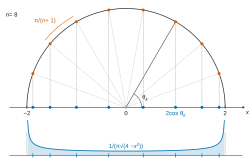
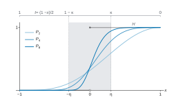
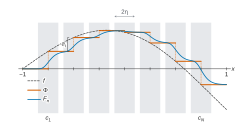

# X MP — Mathématiques B 2026 · Corrigé guidé

*Corrigé rédigé par IA, non officiel. Signalez toute erreur.*

## Présentation du sujet

**Thème.** Le sujet étudie la répartition des valeurs propres de grandes matrices symétriques à travers la statistique

$$S_f(M)=\frac1n\sum_{(\lambda,m_\lambda)\in\mathrm{Sp}(M)}m_\lambda f(\lambda),$$

moyenne de $f$ sur le spectre. Deux lois limites apparaissent.

Pour la matrice tridiagonale déterministe $T_n$ (et ses variantes $T_n(a,b,c)$), c'est la **loi de l'arcsinus**, de densité $\frac{1}{\pi\sqrt{4-x^2}}$ sur $]-2,2[$.

Pour une matrice symétrique aléatoire $X_n$ à coefficients indépendants normalisés par $\sqrt n$ (matrice de Wigner), c'est la **loi du demi-cercle**, de densité $\frac{\sqrt{4-x^2}}{2\pi}$. On démontre, sous une hypothèse sur les moments $(H_k)$, que $S_n(f)$ se concentre autour de $\Sigma(f)$.

Au passage, la partie III donne une preuve du **théorème de Weierstrass**.

**Format.** 4 heures, calculatrice interdite, 30 questions (1 à 17b, avec sous-questions). L'énoncé autorise à admettre les résultats des questions précédentes. La partie III est indépendante des parties I et II, et la partie IV l'est essentiellement.

**Découpage.**

| Partie | Questions | Contenu | Outils |
|---|---|---|---|
| Préliminaire | 1 | suite récurrente linéaire d'ordre 2 à paramètre | équation caractéristique |
| I | 2 à 4b | sommes de Riemann décalées, intégrale de l'arcsinus, moments $\binom{2m}m$, limite d'une loi uniforme discrète | uniforme continuité, changement de variable, intégrales généralisées |
| II | 5a à 9b | polynôme caractéristique de $T_n$, valeurs propres $2\cos\frac{k\pi}{n+1}$, matrices $T_n(a,b,c)$, comptage des valeurs propres | déterminants, similitude, formule du binôme |
| III | 10a à 12 | théorème de Weierstrass par les polynômes $(1-X^n)^{2^n}$ | convergence uniforme, uniforme continuité |
| IV | 13a à 17b | matrices de Wigner, moments de Catalan, inégalités de queue, concentration, conclusion | théorème spectral, Markov, Bienaymé-Tchebychev |

**Notions du programme mobilisées.** Suites récurrentes linéaires d'ordre 2, théorème de Heine, sommes de Riemann, intégrales généralisées et changement de variable, déterminants tridiagonaux, matrices semblables et polynôme caractéristique, théorème spectral, convergence uniforme, espérance et variance, inégalités de Markov et de Bienaymé-Tchebychev.

**Difficulté.** Le rapport 2026 juge que « le sujet de l'épreuve de cette année était assez classique ». Il est long mais très guidé, de difficulté croissante.

**Ce que disent les taux de réussite (rapport 2026).** Les questions les mieux réussies sont 5b (94 %), 3b (89 %), 4a (85 %), 7 (81 %), 5a (75 %) et 3a (72 %) : elles ne doivent pas être laissées passer.

Plusieurs questions abordables ont pourtant été mal réussies, faute d'une justification attendue : 5c (27 %), 5d (19 %), 6 (23 %), 4b (23 %), 11 (20 %), 13a (25 %) et 13b (21 %). Les encadrés « Jury » ci-dessous disent laquelle.

Les questions **discriminantes** sont 8b (10 %), 8c (8 %), 9b (6 %), 12 (5 %, « Sans doute une des questions les plus difficiles du sujet ») et toute la fin de la partie IV : 13c (3 %), 14 (8 %), 15 (2 %), 16 (4 %), 17a (0 %) et 17b (2 %).

**Stratégie.** Le jury préfère une suite de questions consécutives traitées correctement, difficiles comprises, au survol de toutes les parties : « Le barème est établi de sorte qu'une telle stratégie est finalement peu rentable. » Il autorise en revanche à admettre une question pour avancer, à condition de vérifier les hypothèses du résultat admis.

**Gestion du temps.** Un rythme raisonnable : 45 minutes pour le préliminaire et la partie I, 70 minutes pour la partie II, 50 minutes pour la partie III, 75 minutes pour la partie IV. Les questions 14 et 16 sont courtes une fois $(H_k)$ admise : elles sont accessibles même sans avoir fini la partie III.

Notations de ce corrigé : pour $f$ continue sur $[-2,2]$, $I(f)=\frac1\pi\int_{-2}^2\frac{f(x)}{\sqrt{4-x^2}}\,\mathrm dx$, et $f_k(x)=x^k$.

## Préliminaire

Une question de cours sur les suites récurrentes linéaires d'ordre 2. Elle sert directement en 5c : le polynôme caractéristique de $T_n$ vérifiera la même récurrence.

### Question 1

> [!INDICATION]
> Écrire l'équation caractéristique et discuter le signe de son discriminant.

> [!INDICATION]
> Quand $|\alpha|<2$, poser $\alpha=2\cos\theta$ : les racines s'écrivent alors très simplement. Les cas $\alpha=\pm2$ donnent une racine double.

#### Solution

L'équation caractéristique de la récurrence est $r^2-\alpha r+1=0$. Son discriminant vaut $\Delta=\alpha^2-4$, et le produit de ses racines vaut $1$.

**Cas $|\alpha|>2$.** Il y a deux racines réelles distinctes :

$$r_\pm=\frac{\alpha\pm\sqrt{\alpha^2-4}}2.$$

Il existe donc des réels $A,B$ tels que $u_n=Ar_+^n+Br_-^n$ pour tout $n$.

La condition $u_0=0$ donne $A+B=0$. La condition $u_1=1$ donne alors $A(r_+-r_-)=1$, avec $r_+-r_-=\sqrt{\alpha^2-4}$ :

$$\boxed{u_n=\frac{1}{\sqrt{\alpha^2-4}}\left[\left(\frac{\alpha+\sqrt{\alpha^2-4}}2\right)^n-\left(\frac{\alpha-\sqrt{\alpha^2-4}}2\right)^n\right]}$$

**Cas $|\alpha|<2$.** On écrit $\alpha=2\cos\theta$ avec un unique $\theta\in\,]0,\pi[$, à savoir $\theta=\arccos\frac\alpha2$.

Les racines sont $e^{i\theta}$ et $e^{-i\theta}$, distinctes puisque $\sin\theta\neq0$.

La suite (réelle) s'écrit $u_n=Ae^{in\theta}+Be^{-in\theta}$ avec $A,B\in\mathbb C$. La condition $u_0=0$ donne $B=-A$, puis $u_1=1$ donne $2iA\sin\theta=1$, donc

$$\boxed{u_n=\frac{\sin(n\theta)}{\sin\theta}}$$

avec $\theta=\arccos\frac\alpha2\in\,]0,\pi[$.

**Cas $\alpha=2$.** Racine double $1$ : $u_n=A+Bn$, puis $A=0$ et $B=1$ :

$$\boxed{u_n=n.}$$

**Cas $\alpha=-2$.** Racine double $-1$ : $u_n=(A+Bn)(-1)^n$, puis $A=0$ et $-B=1$ :

$$\boxed{u_n=(-1)^{n+1}\,n.}$$

> [!PIEGE]
> La formule $\frac{r_+^n-r_-^n}{r_+-r_-}$ est commune aux deux premiers cas, mais elle n'a plus de sens pour une racine double : les cas $\alpha=\pm2$ se traitent à part, comme l'énoncé le demande. Vérifier sa formule sur $u_2=\alpha$ est un contrôle rapide.

> [!JURY]
> Rapport 2026 : « On note régulièrement des lacunes sur cette question d'application directe du cours. » Taux de réussite : 51 %.

## Première Partie — loi de l'arcsinus

On identifie la limite de moyennes du type $\frac1n\sum_kf\big(2\cos\frac{k\pi}{n+1}\big)$ : c'est l'intégrale de $f$ contre la densité de l'arcsinus. Outils : sommes de Riemann, uniforme continuité, changement de variable dans une intégrale généralisée.

### Question 2

> [!INDICATION]
> Comparer $v_n$ et $w_n$ à la somme de Riemann usuelle $\frac1n\sum_{k=1}^nf(k/n)$.

> [!INDICATION]
> Majorer l'écart entre les points $\frac k{n+1}$ et $\frac kn$ indépendamment de $k$, puis invoquer un théorème qui transforme un petit écart entre points en un petit écart entre valeurs de $f$.

#### Solution

Soit $R_n=\dfrac1n\displaystyle\sum_{k=1}^nf\!\left(\frac kn\right)$. Comme $f$ est continue sur le segment $[0,1]$, le théorème sur les sommes de Riemann donne $R_n\to\int_0^1f$.

Par le théorème de Heine, $f$ est uniformément continue sur $[0,1]$.

Soit $\varepsilon>0$, et soit $\delta>0$ tel que, pour $s,t\in[0,1]$, $|s-t|\le\delta$ entraîne $|f(s)-f(t)|\le\varepsilon$.

Pour $1\le k\le n$, les points $\frac k{n+1}$ et $\frac{2k}{2n+1}$ sont dans $[0,1]$, et

$$\begin{aligned}
\left|\frac{k}{n+1}-\frac kn\right|&=\frac{k}{n(n+1)}\le\frac1{n+1},\\
\left|\frac{2k}{2n+1}-\frac kn\right|&=\frac{k}{n(2n+1)}\le\frac1{2n+1}\le\frac1{n+1}.
\end{aligned}$$

Dès que $\frac1{n+1}\le\delta$, chaque terme vérifie $\left|f\!\left(\frac k{n+1}\right)-f\!\left(\frac kn\right)\right|\le\varepsilon$. Par inégalité triangulaire, $|v_n-R_n|\le\varepsilon$, et de même $|w_n-R_n|\le\varepsilon$.

Donc $v_n-R_n\to0$ et $w_n-R_n\to0$. Les deux suites convergent, et

$$\boxed{\lim_{n\to\infty}v_n=\lim_{n\to\infty}w_n=\int_0^1f(t)\,\mathrm dt.}$$

> [!METHODE]
> Pour une somme de Riemann « décalée », on se ramène à la somme usuelle par uniforme continuité dès que le décalage des points tend vers $0$ uniformément en $k$. Ce schéma resservira en 4a.

> [!PIEGE]
> Écrire « $v_n$ est une somme de Riemann » ne suffit pas. Les points $\frac{k}{n+1}$ ne sont pas ceux d'une subdivision régulière de pas $\frac1n$, et le facteur $\frac1n$ ne correspond pas au pas $\frac1{n+1}$ : c'est précisément ce qu'il faut justifier.

> [!JURY]
> Le rapport 2026 attend soit une partition et des points explicités, soit un retour au cas standard par continuité uniforme, comme ci-dessus. Il ajoute : « Le théorème sur les sommes de Riemann avec subdivision quelconque (dont le pas tend vers 0) n'a été que rarement utilisé ou bien justifié. Il était pourtant le moyen le plus rapide de répondre à la question. » Taux de réussite : 46 %.

### Question 3a

> [!INDICATION]
> Pour la convergence, comparer à $\frac1{\sqrt{4-x^2}}$, dont on connaît une primitive.

> [!INDICATION]
> Pour l'égalité, poser $x=2\cos\theta$ et vérifier que c'est une bijection de classe $\mathcal C^1$ entre les bons intervalles ouverts. Attention au signe de $\sin\theta$.

#### Solution

**Convergence.** $f$ est continue sur le segment $[-2,2]$, donc bornée par $\|f\|_\infty$. Sur $]-2,2[$, on a la majoration

$$\left|\frac{f(x)}{\sqrt{4-x^2}}\right|\le\frac{\|f\|_\infty}{\sqrt{4-x^2}}.$$

La fonction $x\mapsto\frac1{\sqrt{4-x^2}}$ est intégrable sur $]-2,2[$ : une primitive est $\arcsin\frac x2$, qui a des limites finies $\pm\frac\pi2$ en $\pm2$. Par comparaison, l'intégrale $I(f)$ est absolument convergente.

**Changement de variable.** L'application $\varphi:\theta\mapsto2\cos\theta$ est une bijection de $]0,\pi[$ sur $]-2,2[$, de classe $\mathcal C^1$ et strictement décroissante, avec $\varphi'(\theta)=-2\sin\theta$.

Pour $\theta\in\,]0,\pi[$, on a $\sin\theta>0$, donc $\sqrt{4-4\cos^2\theta}=2\sin\theta$. Le théorème de changement de variable pour les intégrales généralisées (l'une converge, donc l'autre aussi, et elles sont égales) donne

$$\begin{aligned}
\int_{-2}^2\frac{f(x)}{\sqrt{4-x^2}}\,\mathrm dx&=\int_0^\pi\frac{f(2\cos\theta)}{2\sin\theta}\,2\sin\theta\,\mathrm d\theta\\
&=\int_0^\pi f(2\cos\theta)\,\mathrm d\theta,
\end{aligned}$$

$$\boxed{I(f)=\frac1\pi\int_0^\pi f(2\cos\theta)\,\mathrm d\theta.}$$

> [!PIEGE]
> Majorer $\left|\int f(x)/\sqrt{4-x^2}\,\mathrm dx\right|$ puis conclure « donc l'intégrale converge » ne prouve rien : on ne majore la valeur absolue d'une intégrale qu'une fois son existence acquise. Le rapport 2026 cite une rédaction de ce type et précise : « c'est la majoration de l'intégrale de valeur absolue qui permet de montrer la convergence, et pas de la valeur absolue de l'intégrale ».

> [!JURY]
> Rapport 2026 : « les hypothèses sur le changement de variables sont rarement vérifiées ». Il rappelle qu'« un changement de variables dans une intégrale généralisée doit être bijectif, strictement monotone et de classe $\mathcal C^1$ ». Le jury signale aussi un argument plus rapide que la preuve séparée de la convergence : un tel changement de variable préserve la nature de l'intégrale.

### Question 3b

> [!INDICATION]
> Utiliser la forme trigonométrique de 3a et linéariser $\cos^2$.

#### Solution

Par 3a :

$$\begin{aligned}
I(f_0)&=\frac1\pi\int_0^\pi\mathrm d\theta=1,\\
I(f_1)&=\frac1\pi\int_0^\pi2\cos\theta\,\mathrm d\theta=\frac2\pi\big[\sin\theta\big]_0^\pi=0,\\
I(f_2)&=\frac1\pi\int_0^\pi4\cos^2\theta\,\mathrm d\theta=\frac2\pi\int_0^\pi(1+\cos2\theta)\,\mathrm d\theta=2.
\end{aligned}$$

$$\boxed{\begin{aligned}I(f_0)&=1\\ I(f_1)&=0\\ I(f_2)&=2\end{aligned}}$$

> [!JURY]
> Rapport 2026 : « Les candidates et candidats ne doivent pas bâcler ce type de questions, car une erreur peut être pénalisante pour la suite. » Ces valeurs servent de contrôle en 3c et en 13b.

### Question 3c

> [!INDICATION]
> Étendre l'intégrale à une période complète en utilisant la parité de $\cos$.

> [!INDICATION]
> Écrire $2\cos\theta=e^{i\theta}+e^{-i\theta}$, développer par le binôme et intégrer terme à terme les exponentielles.

#### Solution

La fonction $\theta\mapsto(2\cos\theta)^n$ est paire et $2\pi$-périodique, donc

$$\int_0^\pi(2\cos\theta)^n\,\mathrm d\theta=\frac12\int_{-\pi}^{\pi}(2\cos\theta)^n\,\mathrm d\theta.$$

Par la formule du binôme,

$$\begin{aligned}
(2\cos\theta)^n&=(e^{i\theta}+e^{-i\theta})^n\\
&=\sum_{j=0}^n\binom nj e^{i(2j-n)\theta}.
\end{aligned}$$

Pour $p\in\mathbb Z$, l'intégrale $\int_{-\pi}^{\pi}e^{ip\theta}\,\mathrm d\theta$ vaut $2\pi$ si $p=0$ et $0$ sinon.

Seul le terme $2j=n$ contribue, ce qui n'est possible que si $n$ est pair.

Ainsi $I(f_n)=0$ si $n$ est impair, et si $n$ est pair :

$$I(f_n)=\frac1\pi\cdot\frac12\cdot2\pi\binom n{n/2}=\binom{n}{n/2}.$$

$$\boxed{\begin{aligned}I(f_{2m+1})&=0\\ I(f_{2m})&=\binom{2m}{m}\qquad(m\ge0)\end{aligned}}$$

On retrouve $1,0,2$ pour $n=0,1,2$.

> [!METHODE]
> Pour $\int\cos^n$ sur une période, le passage aux exponentielles évite la récurrence de Wallis : tout se réduit à extraire le terme constant d'un développement binomial. Si l'on préfère les intégrales de Wallis, il faut en redémontrer la valeur (intégration par parties), pas la citer.

> [!PIEGE]
> Par la voie de Wallis, $I(f_{2m})=\frac{4^m}\pi\int_0^\pi\cos^{2m}\theta\,\mathrm d\theta$ : le facteur $\frac{4^m}\pi$ se perd facilement. Le contrôle $I(f_2)=2$ de 3b le détecte aussitôt.

> [!JURY]
> Rapport 2026 : calcul standard d'intégrales de Wallis, à un coefficient près, et « Ce coefficient multiplicatif a régulièrement été oublié. » Taux de réussite : 41 %.

### Question 4a

> [!INDICATION]
> Écrire l'espérance par la formule de transfert : c'est une moyenne arithmétique.

> [!INDICATION]
> Reconnaître la suite $(v_n)$ de la question 2 pour une fonction auxiliaire bien choisie sur $[0,1]$, puis conclure avec 3a.

#### Solution

$f$ est définie aux points $2\cos\frac{\pi k}{n+1}\in[-2,2]$. Par la formule de transfert, avec $h(t)=f(2\cos\pi t)$ :

$$\begin{aligned}
\mathbb E\!\left(f\!\left(2\cos\frac{\pi U_n}{n+1}\right)\right)&=\frac1n\sum_{k=1}^nf\!\left(2\cos\frac{k\pi}{n+1}\right)\\
&=\frac1n\sum_{k=1}^nh\!\left(\frac{k}{n+1}\right).
\end{aligned}$$

$h$ est continue sur $[0,1]$ (composée de fonctions continues, et $2\cos\pi t\in[-2,2]$). Le membre de droite est la suite $(v_n)$ de la question 2 associée à $h$ ; elle converge vers $\int_0^1h(t)\,\mathrm dt$.

Le changement de variable affine $\theta=\pi t$, puis 3a, donnent

$$\int_0^1f(2\cos\pi t)\,\mathrm dt=\frac1\pi\int_0^\pi f(2\cos\theta)\,\mathrm d\theta=I(f),$$

$$\boxed{\mathbb E\!\left(f\!\left(2\cos\frac{\pi U_n}{n+1}\right)\right)\xrightarrow[n\to\infty]{}\frac1\pi\int_{-2}^2\frac{f(x)}{\sqrt{4-x^2}}\,\mathrm dx.}$$

> [!JURY]
> Le rapport 2026 attend la formule de transfert, puis la question 2 via un changement de variable linéaire (85 % de réussite). Il rappelle à propos des résultats admis ou réutilisés : « Il faut alors veiller à vérifier soigneusement toutes les hypothèses requises pour appliquer un tel résultat. » Ici : $h$ est bien continue sur $[0,1]$, et $f$ n'est évaluée que sur $[-2,2]$.

### Question 4b

> [!INDICATION]
> La fonction $x\mapsto\mathbf 1_{x<y}$ n'est pas continue : 4a ne s'applique pas directement. Traiter à part $y=\pm2$.

> [!INDICATION]
> Encadrer l'indicatrice entre deux fonctions continues affines par morceaux qui ne diffèrent d'elle que sur un petit intervalle autour de $y$, puis contrôler l'intégrale de la différence.

> [!INDICATION]
> Variante plus élémentaire : compter directement les $k$ tels que $2\cos\frac{k\pi}{n+1}<y$. Ce nombre s'écrit avec une partie entière et un arccos.

#### Solution

Notons $Z_n=2\cos\frac{\pi U_n}{n+1}$. Notons aussi $F(y)=\frac1\pi\int_{-2}^y\frac{\mathrm dx}{\sqrt{4-x^2}}$, fonction continue de $y$ sur $[-2,2]$. La question 4a ne s'applique pas telle quelle, car $\mathbf 1_{]-\infty,y[}$ n'est pas continue : on l'encadre par des fonctions continues.

**Cas $y=\pm2$.** On a $\frac{\pi U_n}{n+1}\in\,]0,\pi[$, donc $Z_n\in\,]-2,2[$. Ainsi $\mathbb P(Z_n<2)=1=F(2)$, car $\frac1\pi\big[\arcsin\frac x2\big]_{-2}^2=1$. De même $\mathbb P(Z_n<-2)=0=F(-2)$.

**Cas $y\in\,]-2,2[$.** Soit $\eta>0$ avec $[y-\eta,y+\eta]\subset[-2,2]$. On définit deux fonctions continues sur $[-2,2]$, affines par morceaux :
- $\phi^-$ vaut $1$ sur $[-2,y-\eta]$, $0$ sur $[y,2]$, et est affine sur $[y-\eta,y]$ ;
- $\phi^+$ vaut $1$ sur $[-2,y]$, $0$ sur $[y+\eta,2]$, et est affine sur $[y,y+\eta]$.

Sur $[-2,2]$, on a $0\le\phi^-\le\mathbf 1_{]-\infty,y[}\le\phi^+\le1$. Par croissance de l'espérance,

$$\mathbb E(\phi^-(Z_n))\le\mathbb P(Z_n<y)\le\mathbb E(\phi^+(Z_n)).$$

Par ailleurs, $\phi^-$ et $\phi^+$ coïncident avec $\mathbf 1_{]-\infty,y[}$ hors de $[y-\eta,y+\eta]$ et en diffèrent d'au plus $1$. Donc

$$\begin{aligned}
F(y)-\frac1\pi\int_{y-\eta}^{y}\frac{\mathrm dx}{\sqrt{4-x^2}}&\le I(\phi^-)\le F(y),\\
F(y)&\le I(\phi^+)\le F(y)+\frac1\pi\int_{y}^{y+\eta}\frac{\mathrm dx}{\sqrt{4-x^2}}.
\end{aligned}$$

Soit $\varepsilon>0$. Par continuité de $F$, on choisit $\eta$ tel que $I(\phi^+)\le F(y)+\frac\varepsilon2$ et $I(\phi^-)\ge F(y)-\frac\varepsilon2$.

Par 4a appliquée aux fonctions continues $\phi^-$ et $\phi^+$, il existe un rang $N$ à partir duquel $\mathbb E(\phi^\pm(Z_n))$ est à moins de $\frac\varepsilon2$ de $I(\phi^\pm)$.

Pour $n\ge N$ :

$$F(y)-\varepsilon\le\mathbb P(Z_n<y)\le F(y)+\varepsilon.$$

$$\boxed{\mathbb P\!\left(2\cos\frac{\pi U_n}{n+1}<y\right)\xrightarrow[n\to\infty]{}\frac1\pi\int_{-2}^y\frac{\mathrm dx}{\sqrt{4-x^2}}=\frac12+\frac1\pi\arcsin\frac y2.}$$

> [!METHODE]
> Passer de « $\mathbb E(f(Z_n))$ converge pour $f$ continue » à « $\mathbb P(Z_n<y)$ converge » se fait par encadrement de l'indicatrice par des fonctions continues. L'argument marche dès que la loi limite ne charge pas le point $y$, ce qui est le cas ici puisqu'elle a une densité. On évite ainsi les limites supérieures et inférieures.

> [!METHODE]
> Variante par dénombrement. Pour $y\in\,]-2,2[$, posons $\varphi=\arccos\frac y2\in\,]0,\pi[$. Par stricte décroissance de $\cos$ sur $[0,\pi]$, $Z_n<y$ équivaut à $U_n>\frac{(n+1)\varphi}\pi$.
>
> Il y a $n-\big\lfloor\frac{(n+1)\varphi}\pi\big\rfloor$ tels entiers dans $\{1,\dots,n\}$. Donc $\mathbb P(Z_n<y)$ tend vers $1-\frac\varphi\pi$, qui vaut $F(y)$.

> [!PIEGE]
> Appliquer 4a à $f=\mathbf 1_{]-\infty,y[}$ est faux : 4a exige une fonction continue. C'est toute la difficulté de la question.

> [!JURY]
> Rapport 2026 : « On ne pouvait pas appliquer tel quel la question 2, compte tenu de l'hypothèse de continuité manquante. » Le jury acceptait une extension justifiée au cas continu par morceaux, et juge la variante par la partie entière d'un arccos plus élémentaire. Taux de réussite : 23 %.

## Deuxième partie — spectre des matrices tridiagonales

On calcule exactement le spectre de $T_n$ (valeurs propres $2\cos\frac{k\pi}{n+1}$) grâce au préliminaire. On étend ensuite le résultat aux matrices tridiagonales de Toeplitz $T_n(a,b,c)$ par translation et similitude diagonale. Les résultats de la partie I donnent alors la répartition asymptotique des valeurs propres.

### Question 5a

> [!INDICATION]
> Calcul direct ; pour $n=3$, développer selon la première ligne.

#### Solution

$$\chi_2(X)=\det\begin{pmatrix}X&-1\\-1&X\end{pmatrix}=X^2-1.$$

En développant selon la première ligne,

$$\begin{aligned}
\chi_3(X)&=\det\begin{pmatrix}X&-1&0\\-1&X&-1\\0&-1&X\end{pmatrix}\\
&=X(X^2-1)+1\cdot(-X)\\
&=X^3-2X=X(X^2-2).
\end{aligned}$$

$$\boxed{\begin{aligned}\chi_2&=X^2-1, &\mathrm{Sp}(T_2)&=\{(-1,1),(1,1)\}\\ \chi_3&=X^3-2X, &\mathrm{Sp}(T_3)&=\{(-\sqrt2,1),(0,1),(\sqrt2,1)\}\end{aligned}}$$

> [!PIEGE]
> L'énoncé définit $\mathrm{Sp}(M)$ comme un ensemble de couples (valeur propre, multiplicité). Donner les multiplicités fait partie de la réponse.

### Question 5b

> [!INDICATION]
> Développer le déterminant selon la dernière colonne : elle n'a que deux coefficients non nuls.

> [!INDICATION]
> Le second mineur obtenu se développe à son tour selon sa dernière ligne.

#### Solution

On développe $\chi_n=\det(XI_n-T_n)$ selon la dernière colonne. Elle n'a que deux coefficients non nuls : $X$ en position $(n,n)$ et $-1$ en position $(n-1,n)$.

- Le cofacteur de $(n,n)$ est $\det(XI_{n-1}-T_{n-1})=\chi_{n-1}$.
- Le mineur de $(n-1,n)$ est le déterminant de la matrice obtenue en supprimant la ligne $n-1$ et la colonne $n$. Sa dernière ligne est $(0,\dots,0,-1)$ ; en développant selon cette ligne, il vaut $-\chi_{n-2}$. Le cofacteur vaut donc $(-1)^{(n-1)+n}(-\chi_{n-2})=\chi_{n-2}$.

D'où $\chi_n=X\chi_{n-1}+(-1)\chi_{n-2}$ :

$$\boxed{\chi_n=X\,\chi_{n-1}-\chi_{n-2}\qquad(n\ge4).}$$

Le même calcul vaut pour $n=3$ en posant $\chi_1=X$ (polynôme caractéristique de la matrice nulle d'ordre 1).

> [!METHODE]
> La relation à trois termes $\chi_n=X\chi_{n-1}-\chi_{n-2}$ est celle des polynômes de Tchebychev de seconde espèce, à changement de variable près. C'est elle qui porte toute la suite de la partie : 5c, 5d, puis 8b.

### Question 5c

> [!INDICATION]
> Comparer la récurrence de 5b à celle de la question 1, en décalant l'indice d'une unité. La relation de 5b ne vaut que pour $n\ge4$ : les premiers termes se vérifient avec 5a.

> [!INDICATION]
> Pour $\alpha$ complexe, la résolution d'une récurrence linéaire d'ordre 2 à racines caractéristiques distinctes fonctionne de la même façon que sur $\mathbb R$. Identifier les deux racines et leur différence.

#### Solution

Fixons $\alpha\in\mathbb C$ avec $|\alpha|<2$.

On pose $u_0=0$ et $u_m=\chi_{m-1}(\alpha)$ pour $m\ge3$, et l'on complète par $u_1=1$, $u_2=\alpha$.

L'indice est décalé d'une unité par rapport à la question 1.

Vérifions la récurrence $u_m=\alpha u_{m-1}-u_{m-2}$ pour tout $m\ge2$. Pour $m=2$, elle s'écrit $\alpha=\alpha\cdot1-0$. Pour $m=3$ et $m=4$, on utilise 5a :

$$\begin{aligned}
u_3&=\chi_2(\alpha)=\alpha^2-1=\alpha u_2-u_1,\\
u_4&=\chi_3(\alpha)=\alpha^3-2\alpha=\alpha(\alpha^2-1)-\alpha=\alpha u_3-u_2.
\end{aligned}$$

Pour $m\ge5$, c'est la relation de 5b au rang $n=m-1\ge4$. La suite $(u_m)$ est donc celle de la question 1, ici à paramètre complexe.

Comme $|\alpha|<2$, on a $\alpha\neq\pm2$, donc $4-\alpha^2\ne0$.

Soit $\beta$ une racine carrée complexe de $4-\alpha^2$, notée $\sqrt{4-\alpha^2}$. Posons $r_\pm=\frac{\alpha\pm i\beta}{2}$. Alors

$$\begin{aligned}
r_++r_-&=\alpha,\\
r_+r_-&=\frac{\alpha^2+\beta^2}4=1,
\end{aligned}$$

donc $r_\pm$ sont les racines de $r^2-\alpha r+1$. Elles sont distinctes, car $r_+-r_-=i\beta\neq0$.

La théorie des suites récurrentes linéaires d'ordre 2 sur $\mathbb C$ donne $u_m=Ar_+^m+Br_-^m$. Avec $u_0=0$ et $u_1=1$, on obtient $u_m=\dfrac{r_+^m-r_-^m}{r_+-r_-}$. Pour $m=n+1$ :

$$\boxed{\chi_n(\alpha)=\frac{1}{i\sqrt{4-\alpha^2}}\left(\left(\frac{\alpha+i\sqrt{4-\alpha^2}}2\right)^{n+1}-\left(\frac{\alpha-i\sqrt{4-\alpha^2}}2\right)^{n+1}\right).}$$

L'expression ne dépend pas du choix de la racine carrée : changer $\beta$ en $-\beta$ échange les deux termes et change le signe du dénominateur.

> [!METHODE]
> Quand une suite de polynômes vérifie une récurrence linéaire à coefficients indépendants de $n$, on l'évalue en un point et on applique la théorie des suites récurrentes : le polynôme caractéristique de $T_n$ devient une suite numérique.

> [!PIEGE]
> La question 1 porte sur un paramètre réel, alors qu'ici $\alpha$ est complexe : il faut redire que la méthode de l'équation caractéristique vaut sur $\mathbb C$. Le choix de la racine carrée complexe doit aussi être commenté.

> [!JURY]
> Rapport 2026 : « Il fallait noter le décalage d'indice avec la question 1. » Le jury indique qu'on s'y ramenait sans calcul compliqué en calculant $u_3$ et $u_4$ avec 5a, comme ci-dessus. Taux de réussite : 27 %.

### Question 5d

> [!INDICATION]
> Développer les deux puissances $(n+1)$-ièmes par le binôme : les termes pairs en $i\beta$ se compensent.

> [!INDICATION]
> Il ne reste que des puissances paires de $\beta$, c'est-à-dire des puissances de $4-\alpha^2$ : l'expression est polynomiale en $\alpha$. Justifier qu'une égalité sur le disque $|\alpha|<2$ suffit.

> [!INDICATION]
> Pour une forme plus compacte, conjecturer le coefficient de $X^{n-2m}$ sur les petits cas et le prouver avec la relation de 5b.

#### Solution

Avec $\beta=\sqrt{4-\alpha^2}$, la formule du binôme donne une somme où les termes d'exposant pair en $i\beta$ se compensent. En écrivant l'exposant impair $p=2j+1$ et $(i\beta)^{2j+1}=i\beta(-1)^j(4-\alpha^2)^j$ :

$$\begin{aligned}
(\alpha+i\beta)^{n+1}-(\alpha-i\beta)^{n+1}&=2\sum_{\substack{0\le p\le n+1\\ p\text{ impair}}}\binom{n+1}{p}\alpha^{n+1-p}(i\beta)^p\\
&=2i\beta\sum_{j=0}^{\lfloor n/2\rfloor}(-1)^j\binom{n+1}{2j+1}\alpha^{n-2j}(4-\alpha^2)^j.
\end{aligned}$$

En divisant par $2^{n+1}i\beta$ (formule de 5c), pour tout $\alpha\in\mathbb C$ tel que $|\alpha|<2$ :

$$\chi_n(\alpha)=\frac{1}{2^n}\sum_{j=0}^{\lfloor n/2\rfloor}(-1)^j\binom{n+1}{2j+1}\alpha^{n-2j}(4-\alpha^2)^j .$$

**Passage aux polynômes.** Notons $G_n=\frac{1}{2^n}\sum_{j}(-1)^j\binom{n+1}{2j+1}X^{n-2j}(4-X^2)^j\in\mathbb R[X]$. Le polynôme $\chi_n-G_n$ s'annule en tout point du disque $\{|\alpha|<2\}$, ensemble infini. Un polynôme non nul n'ayant qu'un nombre fini de racines, $\chi_n-G_n=0$ : l'égalité a lieu dans $\mathbb R[X]$.

En développant $(4-X^2)^j=\sum_{l=0}^{j}\binom jl4^{j-l}(-1)^lX^{2l}$ :

$$\begin{aligned}
\chi_n(X)&=\frac1{2^n}\sum_{j=0}^{\lfloor n/2\rfloor}\sum_{l=0}^{j}(-1)^{j+l}\binom{n+1}{2j+1}\binom jl4^{j-l}\\
&\qquad\times X^{n-2j+2l}.
\end{aligned}$$

En regroupant selon $m=j-l$, le coefficient de $X^{n-2m}$, pour $0\le m\le\lfloor n/2\rfloor$, est

$$c_{n,m}=\frac{(-1)^m}{2^{n-2m}}\sum_{j=m}^{\lfloor n/2\rfloor}\binom{n+1}{2j+1}\binom{j}{m},$$

et les coefficients de $X^{n-2m-1}$ sont nuls.

**Forme close.** Montrons par récurrence double que

$$\chi_n=\sum_{m=0}^{\lfloor n/2\rfloor}(-1)^m\binom{n-m}{m}X^{n-2m},$$

avec la convention $\binom{a}{b}=0$ si $b>a$ ou $b<0$, et $\chi_0=1$, $\chi_1=X$.

C'est vrai pour $n=0,1$. La relation $\chi_n=X\chi_{n-1}-\chi_{n-2}$ vaut pour $n\ge2$ (5b et 5a, avec ces conventions).

Si la formule est vraie aux rangs $n-1$ et $n-2$, le coefficient de $X^{n-2m}$ dans $X\chi_{n-1}-\chi_{n-2}$ vaut

$$\begin{aligned}
&(-1)^m\binom{n-1-m}{m}-(-1)^{m-1}\binom{n-2-(m-1)}{m-1}\\
&=(-1)^m\left[\binom{n-1-m}{m}+\binom{n-1-m}{m-1}\right]\\
&=(-1)^m\binom{n-m}{m}
\end{aligned}$$

par la formule de Pascal. Par unicité des coefficients :

$$\boxed{\chi_n(X)=\sum_{m=0}^{\lfloor n/2\rfloor}(-1)^m\binom{n-m}{m}X^{n-2m}}$$

En comparant avec $c_{n,m}$, on obtient au passage l'identité

$$\frac{1}{2^{n-2m}}\sum_{j=m}^{\lfloor n/2\rfloor}\binom{n+1}{2j+1}\binom jm=\binom{n-m}{m}.$$

Contrôle : $\chi_2=X^2-1$, $\chi_3=X^3-2X$, $\chi_4=X^4-3X^2+1$.

> [!PIEGE]
> La formule de 5c n'est établie que pour $|\alpha|<2$, et $\sqrt{4-\alpha^2}$ n'est pas un polynôme. Il faut dire pourquoi l'expression développée est polynomiale (puissances paires de $\beta$ seulement) et pourquoi l'égalité se prolonge à $\mathbb R[X]$.

> [!JURY]
> Rapport 2026 : « L'argument pour passer d'une égalité de fonctions polynomiales en une égalité de polynômes a souvent été oublié. » Une phrase suffit : le polynôme différence a une infinité de racines. Taux de réussite : 19 %.

### Question 6

> [!INDICATION]
> Évaluer la formule de 5c en $\alpha=2\cos\theta$ avec $\theta\in\,]0,\pi[$.

> [!INDICATION]
> Une fois $n$ racines distinctes trouvées, le degré de $\chi_n$ permet de conclure sur les multiplicités.

#### Solution

Soit $\theta\in\,]0,\pi[$ et $\alpha=2\cos\theta$. Comme $|\cos\theta|<1$, on a $|\alpha|<2$, et 5c s'applique. De plus $\sqrt{4-\alpha^2}=2\sin\theta$, et

$$\frac{\alpha\pm i\sqrt{4-\alpha^2}}2=e^{\pm i\theta}.$$

Par 5c :

$$\begin{aligned}
\chi_n(2\cos\theta)&=\frac{e^{i(n+1)\theta}-e^{-i(n+1)\theta}}{2i\sin\theta}\\
&=\frac{\sin((n+1)\theta)}{\sin\theta}.
\end{aligned}$$

Pour $\theta_k=\frac{k\pi}{n+1}$ et $k=1,\dots,n$, on a $\theta_k\in\,]0,\pi[$, donc $|2\cos\theta_k|<2$, et $\sin((n+1)\theta_k)=\sin(k\pi)=0$. Ainsi $\chi_n(2\cos\theta_k)=0$.

Les réels $2\cos\theta_k$ sont deux à deux distincts, car $\cos$ est strictement décroissante sur $[0,\pi]$. On obtient $n$ racines distinctes du polynôme $\chi_n$, unitaire de degré $n$. Ce sont donc toutes ses racines, chacune simple :

$$\chi_n=\prod_{k=1}^n\left(X-2\cos\frac{k\pi}{n+1}\right).$$

$$\boxed{\mathrm{Sp}(T_n)=\left\{\left(2\cos\frac{k\pi}{n+1},\,1\right)\ :\ k=1,\dots,n\right\}.}$$

> [!JURY]
> Rapport 2026 : « Afin d'appliquer 5c, il fallait justifier que $|2\cos(k\pi/(n+1))|<2$. Pour conclure que toutes les valeurs propres ont été trouvées, il fallait s'assurer qu'elles étaient deux à deux distinctes. » Taux de réussite : 23 %.

### Question 7

> [!INDICATION]
> Écrire $S_f(T_n)$ avec la question 6 et reconnaître l'espérance de 4a.

#### Solution

Par 6, les valeurs propres de $T_n$ sont les $2\cos\frac{k\pi}{n+1}$. Elles sont simples et dans $[-2,2]$, où $f$ est définie :

$$\begin{aligned}
S_f(T_n)&=\frac1n\sum_{k=1}^nf\!\left(2\cos\frac{k\pi}{n+1}\right)\\
&=\mathbb E\!\left(f\!\left(2\cos\frac{\pi U_n}{n+1}\right)\right).
\end{aligned}$$

Par 4a, cette quantité converge, et

$$\boxed{\lim_{n\to+\infty}S_f(T_n)=\frac1\pi\int_{-2}^2\frac{f(x)}{\sqrt{4-x^2}}\,\mathrm dx.}$$

### Question 8a

> [!INDICATION]
> Isoler la diagonale : $T_n(a,b,c)$ est somme d'une homothétie et d'une matrice tridiagonale à diagonale nulle.

> [!INDICATION]
> Pour les multiplicités, factoriser le polynôme caractéristique de $T_n(0,b,c)$ par $(X-\lambda)^m$ et voir ce que devient cette factorisation après translation.

#### Solution

On a $T_n(a,b,c)=aI_n+T_n(0,b,c)$, donc

$$\begin{aligned}
\chi_{T_n(a,b,c)}(X)&=\det\big((X-a)I_n-T_n(0,b,c)\big)\\
&=\chi_{T_n(0,b,c)}(X-a).
\end{aligned}$$

**Multiplicités.** Soit $\lambda$ une racine réelle de multiplicité $m$ de $\chi_{T_n(0,b,c)}$. On écrit $\chi_{T_n(0,b,c)}=(X-\lambda)^mR$ avec $R(\lambda)\neq0$. Alors

$$\chi_{T_n(a,b,c)}=(X-a-\lambda)^m\,R(X-a),$$

et $R(X-a)$ ne s'annule pas en $\lambda+a$.

Donc $\lambda+a$ est racine de multiplicité exactement $m$ de $\chi_{T_n(a,b,c)}$.

Comme $a$ est réel, la translation $\lambda\mapsto\lambda+a$ est une bijection des racines réelles de l'un sur celles de l'autre :

$$\boxed{\mathrm{Sp}(T_n(a,b,c))=\{(\lambda+a,\,m_\lambda)\ :\ (\lambda,m_\lambda)\in\mathrm{Sp}(T_n(0,b,c))\}.}$$

> [!PIEGE]
> Attention au sens de la translation : c'est $\chi_{T_n(0,b,c)}(X-a)$, et non $(X+a)$. Contrôle immédiat : pour $b=c=0$, la seule valeur propre est $a$.

> [!JURY]
> Rapport 2026 : « La préservation de la multiplicité par translation n'a été que rarement justifiée. » La factorisation par $(X-\lambda)^m$ ci-dessus suffit. Taux de réussite : 64 %.

### Question 8b

> [!INDICATION]
> Conjuguer par une matrice diagonale $D$ : calculer l'effet de $M\mapsto D^{-1}MD$ sur le coefficient $(i,j)$.

> [!INDICATION]
> Choisir les coefficients de $D$ en progression géométrique, de raison liée à $c$. Ne pas oublier le cas où cette raison est nulle.

> [!INDICATION]
> Autre voie : développer les deux polynômes caractéristiques comme en 5b et comparer les récurrences obtenues.

#### Solution

Supposons $c\neq0$ et soit $D=\mathrm{diag}(1,c,c^2,\dots,c^{n-1})$, inversible. Pour toute $M\in\mathcal M_n(\mathbb R)$, on a $(D^{-1}MD)_{i,j}=c^{\,j-i}M_{i,j}$.

Pour $M=T_n(0,b,c)$, les coefficients non nuls sont $b$ en $(i,i+1)$ et $c$ en $(i+1,i)$.

Ils deviennent respectivement $bc$ et $c\cdot c^{-1}=1$. Donc $D^{-1}T_n(0,b,c)D=T_n(0,bc,1)$.

Ces matrices sont semblables : elles ont le même polynôme caractéristique, donc le même spectre réel avec multiplicités.

Si $c=0$, les matrices $T_n(0,b,0)$ et $T_n(0,0,1)$ sont strictement triangulaires, de polynôme caractéristique $X^n$. Leurs spectres sont tous deux $\{(0,n)\}$.

Dans tous les cas, avec 8a :

$$\boxed{\mathrm{Sp}(T_n(a,b,c))=\{(\mu+a,\,m_\mu)\ :\ (\mu,m_\mu)\in\mathrm{Sp}(T_n(0,bc,1))\}.}$$

> [!METHODE]
> Une matrice tridiagonale ne dépend, à similitude diagonale près, que de la diagonale et des produits $b_ic_i$ des coefficients symétriques. C'est l'outil standard pour symétriser une matrice tridiagonale.

> [!METHODE]
> Variante par les récurrences. Le développement de 5b donne $\chi_{T_n(0,b,c)}=X\chi_{T_{n-1}(0,b,c)}-bc\,\chi_{T_{n-2}(0,b,c)}$. La même relation vaut pour $T_n(0,bc,1)$, puisque le produit de ses coefficients symétriques vaut aussi $bc$.
>
> Les premiers termes coïncident : $X$ en taille 1, $X^2-bc$ en taille 2. Les deux suites sont donc égales, et cette voie traite aussi le cas $c=0$.

> [!JURY]
> Rapport 2026 : « Question difficile car demandant une prise d'initiative. » Le jury accepte les deux voies : conjuguer par une matrice diagonale, ou comparer les récurrences, « sans doute plus simple » selon lui. Taux de réussite : 10 %.

### Question 8c

> [!INDICATION]
> Par 8b, seul le produit $bc$ compte. Trouver une matrice tridiagonale symétrique ayant le même produit.

> [!INDICATION]
> Avec $s=\sqrt{bc}$, $T_n(0,s,s)=sT_n$, dont le spectre est donné par 6.

#### Solution

Supposons $bc>0$ et posons $s=\sqrt{bc}>0$. On se ramène d'abord au cas $b=c$.

Par 8b (ici $c\neq0$), $T_n(0,b,c)$ est semblable sur $\mathbb R$ à $T_n(0,bc,1)=T_n(0,s^2,1)$.

Le même calcul qu'en 8b, avec $D'=\mathrm{diag}(1,s,\dots,s^{n-1})$, donne $(D')^{-1}T_n(0,s,s)D'=T_n(0,s^2,1)$.

Ainsi $T_n(0,b,c)$ est semblable à $T_n(0,s,s)=s\,T_n$, et $T_n(a,b,c)$ est semblable à $aI_n+sT_n$.

Par homogénéité du polynôme caractéristique ($\chi_{sA}(X)=s^n\chi_A(X/s)$) et par 6 :

$$\begin{aligned}
\det(XI_n-aI_n-sT_n)&=s^n\chi_n\!\left(\frac{X-a}s\right)\\
&=\prod_{k=1}^n\left(X-a-2s\cos\frac{k\pi}{n+1}\right).
\end{aligned}$$

Ce polynôme est scindé à racines réelles simples. Les valeurs propres complexes de $T_n(a,b,c)$ sont donc réelles, simples, et valent

$$\boxed{\lambda_k=a+2\sqrt{bc}\,\cos\frac{k\pi}{n+1}}$$

pour $k=1,\dots,n$.

> [!PIEGE]
> L'hypothèse $bc>0$ autorise $b$ et $c$ tous deux négatifs. Une similitude directe par $\mathrm{diag}(1,r,\dots,r^{n-1})$ avec $r=\sqrt{c/b}$ donne alors $-\sqrt{bc}$ sur les deux diagonales secondaires.
>
> Le résultat ne change pas, car le spectre de $T_n$ est symétrique par rapport à $0$, mais il faut le dire. Passer par $T_n(0,bc,1)$ comme ci-dessus évite la discussion.

> [!JURY]
> Le rapport 2026 y voit une application de 8a, de 8b et de l'homogénéité du polynôme caractéristique, $\chi_{\alpha A}(X)=\alpha^n\chi_A(X/\alpha)$. Taux de réussite : 8 %.

### Question 9a

> [!INDICATION]
> Avec 8c, écrire $S_f(T_n(a,b,c))$ comme $S_g(T_n)$ pour une fonction $g$ à préciser, puis appliquer 7.

#### Solution

Soit $f$ continue sur $\mathbb R$, et $g(x)=f(a+\sqrt{bc}\,x)$, continue sur $[-2,2]$. Par 8c, les valeurs propres de $T_n(a,b,c)$ sont simples, et

$$\begin{aligned}
S_f(T_n(a,b,c))&=\frac1n\sum_{k=1}^nf\!\left(a+2\sqrt{bc}\cos\frac{k\pi}{n+1}\right)\\
&=\frac1n\sum_{k=1}^ng\!\left(2\cos\frac{k\pi}{n+1}\right)\\
&=S_g(T_n).
\end{aligned}$$

Par 7 appliquée à $g$ :

$$\boxed{\lim_{n\to\infty}S_f(T_n(a,b,c))=\frac1\pi\int_{-2}^2\frac{f(a+\sqrt{bc}\,x)}{\sqrt{4-x^2}}\,\mathrm dx.}$$

> [!PIEGE]
> Les valeurs propres de $T_n(a,b,c)$ ne sont pas dans $[-2,2]$ en général : c'est pourquoi $f$ est supposée continue sur $\mathbb R$, et c'est la fonction $g$ qui est utilisée sur $[-2,2]$.

### Question 9b

> [!INDICATION]
> Écrire la condition $\lambda_k\le y$ comme une condition sur $k$, en utilisant la monotonie de $\cos$ sur $[0,\pi]$.

> [!INDICATION]
> Selon la position de $y$ par rapport à $a\pm2\sqrt{bc}$, il y a trois régimes. Un équivalent n'a de sens que si la limite de $q_n(y)/n$ est non nulle.

#### Solution

Posons $s=\sqrt{bc}$ et $z=\frac{y-a}{s}$. Par 8c :

$$q_n(y)=\#\left\{k\in\{1,\dots,n\}\ :\ 2\cos\frac{k\pi}{n+1}\le z\right\}.$$

**Si $z\ge2$** : toutes les valeurs propres sont $\le y$, donc $q_n(y)=n$.

**Si $z\le-2$** : pour tout $k$, $\frac{k\pi}{n+1}\in\,]0,\pi[$, donc $2\cos\frac{k\pi}{n+1}>-2\ge z$. Ainsi $q_n(y)=0$ pour tout $n$.

**Si $-2<z<2$** : soit $\varphi=\arccos\frac z2\in\,]0,\pi[$. Par stricte décroissance de $\cos$ sur $[0,\pi]$ :

$$\begin{aligned}
2\cos\frac{k\pi}{n+1}\le z&\iff\frac{k\pi}{n+1}\ge\varphi\\
&\iff k\ge\frac{(n+1)\varphi}{\pi}.
\end{aligned}$$

Le nombre d'entiers $k\in\{1,\dots,n\}$ vérifiant cette condition est compris entre $n-\frac{(n+1)\varphi}\pi$ et $n+1-\frac{(n+1)\varphi}\pi$. Donc $\frac{q_n(y)}n\to1-\frac\varphi\pi$, limite strictement positive. Enfin $1-\frac1\pi\arccos\frac z2=\frac12+\frac1\pi\arcsin\frac z2$.

$$\boxed{\begin{aligned}
q_n(y)&\underset{n\to\infty}{\sim}n\left(\frac12+\frac1\pi\arcsin\frac{y-a}{2\sqrt{bc}}\right) &&\text{si }|y-a|<2\sqrt{bc},\\
q_n(y)&=n &&\text{si }y\ge a+2\sqrt{bc},\\
q_n(y)&=0 &&\text{si }y\le a-2\sqrt{bc}.
\end{aligned}}$$

Dans le premier cas, la limite de $\frac{q_n(y)}n$ s'écrit aussi $\frac1\pi\int_{-2}^{z}\frac{\mathrm dx}{\sqrt{4-x^2}}$, en accord avec 4b : $\frac{q_n(y)}n$ est la probabilité que $2\cos\frac{\pi U_n}{n+1}$ soit $\le z$.

Pour $y\le a-2\sqrt{bc}$, la suite $q_n(y)$ est identiquement nulle : elle n'admet pas d'équivalent non nul.

> [!PIEGE]
> Pour $y\le a-2\sqrt{bc}$, la suite $q_n(y)$ est identiquement nulle. Il n'y a pas d'équivalent non nul : il faut le signaler plutôt que d'écrire $q_n(y)\sim0$ sans commentaire. Le cas limite $y=a-2\sqrt{bc}$ est bien dans ce régime, car $\cos\frac{k\pi}{n+1}>-1$.

> [!JURY]
> Le rapport 2026 présente cette question comme une application de 4b : $\frac{q_n(y)}n$ est une probabilité du type de 4b, avec une inégalité large. Le dénombrement direct ci-dessus revient au même. Taux de réussite : 6 %.

## Troisième partie — théorème de Weierstrass

On approche l'échelon $H$ par les polynômes $P_n$, puis une fonction continue par une combinaison d'échelons, et enfin par une combinaison de $P_n$ translatés. Le théorème de Weierstrass est interdit dans les questions 10 à 12 puisqu'on le démontre.

### Question 10a

> [!INDICATION]
> $Q_n$ est à valeurs dans $[0,1]$ et décroissante sur $[0,1]$ : il suffit de contrôler les extrémités des intervalles.

> [!INDICATION]
> Deux inégalités élémentaires suffisent : une minoration de $(1-u)^N$ par une fonction affine, et une majoration de $1-u$ par une exponentielle. Le rôle de $\frac12$ vient de ce que $2^nt^n=(2t)^n$.

#### Solution

Pour $t\in[0,1]$, on a $0\le t^n\le1$, donc $0\le Q_n(t)=(1-t^n)^{2^n}\le1$, et $Q_n$ est décroissante sur $[0,1]$.

**Sur $[0,\kappa]$.** Par décroissance, $Q_n(t)\ge(1-\kappa^n)^{2^n}$.

On utilise l'inégalité de Bernoulli $(1-u)^N\ge1-Nu$, pour $u\in[0,1]$ et $N\in\mathbb N$ (récurrence immédiate sur $N$).

Pour tout $t\in[0,\kappa]$ :

$$\begin{aligned}
0\le1-Q_n(t)&\le1-(1-\kappa^n)^{2^n}\\
&\le2^n\kappa^n=(2\kappa)^n .
\end{aligned}$$

Ce majorant ne dépend pas de $t$, et il tend vers $0$ car $0\le2\kappa<1$. Donc $\sup_{[0,\kappa]}|Q_n-1|\to0$ : convergence uniforme vers $1$.

**Sur $[1-\kappa,1]$.** On a $t\ge1-\kappa>\frac12$. Avec $1-u\le e^{-u}$ (convexité de l'exponentielle), pour tout $t\in[1-\kappa,1]$ :

$$\begin{aligned}
0\le Q_n(t)&\le\exp(-2^nt^n)\\
&=\exp(-(2t)^n)\\
&\le\exp\!\big(-(2-2\kappa)^n\big).
\end{aligned}$$

Comme $2-2\kappa>1$, $(2-2\kappa)^n\to+\infty$. Le majorant, indépendant de $t$, tend vers $0$ : $\sup_{[1-\kappa,1]}Q_n\to0$, convergence uniforme vers $0$.

$$\boxed{\begin{aligned}&Q_n\to1\ \text{uniformément sur }[0,\kappa]\\ &Q_n\to0\ \text{uniformément sur }[1-\kappa,1]\end{aligned}}$$

> [!METHODE]
> Variante par le logarithme : $\ln\big((1-\kappa^n)^{2^n}\big)=2^n\ln(1-\kappa^n)$, équivalent à $-(2\kappa)^n$. Ce développement limité montre aussi que la borne tend vers $0$.

> [!JURY]
> Le rapport 2026 rappelle le schéma d'une preuve de convergence uniforme : « trouver une majoration indépendante de la variable de la différence entre la fonction et son approximant, puis montrer que cette majoration tend vers 0 ». Il note que « Cette question, pourtant très classique, a révélé un manque de méthode chez la plupart des candidates et candidats. » Taux de réussite : 40 %.

### Question 10b

> [!INDICATION]
> Faire le changement de variable $t=\frac{1-x}2$ et voir où sont envoyés $[\eta,1]$ et $[-1,-\eta]$.

#### Solution

Soit $\eta\in\,]0,1]$ et $\kappa=\frac{1-\eta}2\in\left[0,\frac12\right[$. L'application $x\mapsto t=\frac{1-x}2$ envoie $[-1,1]$ sur $[0,1]$, et $P_n(x)=Q_n(t)$.
- Si $x\in[\eta,1]$, alors $t\in[0,\kappa]$ et $H(x)=1$. Donc $\sup_{[\eta,1]}|P_n-H|\le\sup_{[0,\kappa]}|Q_n-1|$.
- Si $x\in[-1,-\eta]$, alors $t\in\left[\frac{1+\eta}2,1\right]=[1-\kappa,1]$ et $H(x)=0$. Donc $\sup_{[-1,-\eta]}|P_n-H|\le\sup_{[1-\kappa,1]}Q_n$.

Comme $[-1,1]\setminus[-\eta,\eta]\subset[-1,-\eta]\cup[\eta,1]$, 10a donne :

$$\boxed{\sup_{x\in[-1,1]\setminus[-\eta,\eta]}|P_n(x)-H(x)|\xrightarrow[n\to\infty]{}0.}$$

On note aussi que $0\le P_n\le1$ sur $[-1,1]$.

### Question 11

> [!INDICATION]
> Approcher $f$ par une fonction en escalier dont les marches sont placées aux points d'une subdivision fine de $[-1,1]$.

> [!INDICATION]
> Une combinaison $\sum a_iH(x-c_i)$ vaut, sur $[c_j,c_{j+1}[$, la somme $a_1+\dots+a_j$. Choisir les $a_i$ comme des accroissements de $f$ pour que cette somme télescope. L'hypothèse $f(-1)=0$ sert sur le premier intervalle.

#### Solution

$f$ est continue sur le segment $[-1,1]$, donc uniformément continue (théorème de Heine). Soit $\delta>0$ tel que $|s-t|\le\delta$ entraîne $|f(s)-f(t)|\le\varepsilon$.

Soit $N\ge1$ tel que $\frac2{N+1}\le\delta$. On pose $c_i=-1+\frac{2i}{N+1}$ pour $0\le i\le N+1$. Ainsi $c_0=-1<c_1<\dots<c_N<1=c_{N+1}$, et $c_{i+1}-c_i\le\delta$. On pose

$$a_i=f(c_i)-f(c_{i-1}),$$

pour $1\le i\le N$.

Comme $|c_i-c_{i-1}|\le\delta$, on a $|a_i|\le\varepsilon$. Soit $\Phi=\sum_{i=1}^Na_iH(\cdot-c_i)$.

Pour $x\in[c_j,c_{j+1}[$, avec $0\le j\le N$, on a $H(x-c_i)=1$ exactement pour $i\le j$. La somme télescope, et $f(c_0)=f(-1)=0$ :

$$\begin{aligned}
\Phi(x)&=\sum_{i=1}^ja_i\\
&=f(c_j)-f(c_0)=f(c_j).
\end{aligned}$$

De même $\Phi(1)=f(c_N)$. Dans tous les cas $\Phi(x)=f(c_j)$ avec $|x-c_j|\le\delta$, d'où $|f(x)-\Phi(x)|\le\varepsilon$.

$$\boxed{\forall x\in[-1,1],\ \left|f(x)-\sum_{i=1}^Na_iH(x-c_i)\right|\le\varepsilon,}$$

avec $a_i=f(c_i)-f(c_{i-1})\in[-\varepsilon,\varepsilon]$.

> [!PIEGE]
> La contrainte $a_i\in[-\varepsilon,\varepsilon]$ n'est pas décorative. C'est elle qui rendra inoffensive, en 12, la zone où l'approximation de $H$ par $P_n$ est mauvaise : il faut donc la vérifier explicitement.

> [!JURY]
> Rapport 2026 : c'est l'approximation uniforme d'une fonction continue sur un segment par des fonctions en escalier, et « Le point clé était le théorème de Heine. » Taux de réussite : 20 %.

### Question 12

> [!INDICATION]
> Se ramener à $f(-1)=0$ en retranchant une constante, puis appliquer 11 avec une tolérance plus petite que $\varepsilon$.

> [!INDICATION]
> Avant de suivre l'indication à la lettre, vérifier que l'argument de $P_n$ reste dans $[-1,1]$ quand $x$ parcourt $[-1,1]$. Si ce n'est pas le cas, une homothétie de rapport $\frac12$ règle le problème sans déplacer le saut.

> [!INDICATION]
> En un point $x$ fixé, au plus un des $c_i$ est à distance $<\eta$ de $x$ : séparer ce terme des autres.

#### Solution

**Réduction.** Si un polynôme $P_0$ convient pour $f-f(-1)$, alors $P_0+f(-1)$ convient pour $f$. On suppose donc $f(-1)=0$.

**Remarque sur l'indication.** Pour $x\in[-1,1]$ et $c_i>0$, le réel $x-c_i$ peut être $<-1$.

Alors $\frac{1-(x-c_i)}2>1$, et $P_n(x-c_i)$ est une valeur de $Q_n$ hors de $[0,1]$, où $(1-t^n)^{2^n}\to+\infty$.

On utilise donc $P_n\!\left(\frac{X-c_i}2\right)$, ce qui garde l'argument dans $[-1,1]$ sans changer la position du saut.

**Construction.** Appliquons 11 avec $\frac\varepsilon3$.

On obtient $N$, des réels $-1<c_1<\dots<c_N<1$ et des $a_i$ avec $|a_i|\le\frac\varepsilon3$.

La fonction $\Phi=\sum_ia_iH(\cdot-c_i)$ vérifie $|f-\Phi|\le\frac\varepsilon3$ sur $[-1,1]$.

Soit $\eta\in\,]0,1]$ tel que les intervalles $[c_i-\eta,c_i+\eta]$ soient deux à deux disjoints. On pose

$$F_n=\sum_{i=1}^Na_i\,P_n\!\left(\frac{X-c_i}2\right)\in\mathbb R[X].$$

Pour $x\in[-1,1]$, on a $\frac{x-c_i}2\in[-1,1]$ et $H\!\left(\frac{x-c_i}2\right)=H(x-c_i)$. Par 10b appliquée avec $\frac\eta4\in\,]0,1]$, la quantité

$$\varepsilon_n=\sup_{u\in[-1,1]\setminus[-\eta/4,\,\eta/4]}|P_n(u)-H(u)|$$

tend vers $0$. Si $|x-c_i|\ge\eta$, alors $\left|\frac{x-c_i}2\right|\ge\frac\eta2>\frac\eta4$, donc $\left|P_n\!\left(\frac{x-c_i}2\right)-H(x-c_i)\right|\le\varepsilon_n$.

Fixons $x\in[-1,1]$ et distinguons selon la distance de $x$ aux $c_i$.

Par disjonction des intervalles, au plus un indice $i_0$ vérifie $|x-c_{i_0}|<\eta$.

Pour cet indice, l'écart $\left|P_n\!\left(\frac{x-c_{i_0}}2\right)-H(x-c_{i_0})\right|$ est $\le1$, car les deux valeurs sont dans $[0,1]$. Pour les autres indices, il est $\le\varepsilon_n$. Donc

$$\begin{aligned}
|\Phi(x)-F_n(x)|&\le|a_{i_0}|+\sum_{i\neq i_0}|a_i|\varepsilon_n\\
&\le\frac\varepsilon3+N\frac\varepsilon3\varepsilon_n .
\end{aligned}$$

(S'il n'y a pas d'indice $i_0$, le premier terme disparaît.) On fixe $n$ tel que $N\varepsilon_n\le1$. Alors $|\Phi-F_n|\le\frac{2\varepsilon}3$ sur $[-1,1]$, et

$$\begin{aligned}
|f-F_n|&\le|f-\Phi|+|\Phi-F_n|\\
&\le\frac\varepsilon3+\frac{2\varepsilon}3=\varepsilon.
\end{aligned}$$

**Conclusion.** Pour $n$ assez grand, le polynôme

$$\boxed{P=f(-1)+\sum_{i=1}^Na_iP_n\!\left(\frac{X-c_i}2\right)}$$

vérifie $|f-P|\le\varepsilon$ sur $[-1,1]$. Ici, $a_i$ et $c_i$ sont construits pour $f-f(-1)$.

> [!PIEGE]
> L'indication de l'énoncé, prise au pied de la lettre, évalue $P_n$ hors de $[-1,1]$ dès qu'un $c_i$ est positif, et la convergence de 10b n'y dit plus rien : les $P_n$ y explosent (par exemple $P_7(-1{,}4)\approx6\cdot10^{52}$). Un correcteur attentif sanctionnera une preuve qui applique 10b en dehors de son domaine.

> [!METHODE]
> Schéma « approximation en deux étapes » : une approximation grossière par des fonctions simples (ici des échelons), puis l'approximation de chaque fonction simple. L'erreur se répartit en $\frac\varepsilon3+\frac\varepsilon3+\frac\varepsilon3$, et la zone de mauvaise approximation est contrôlée par la petitesse des sauts.

> [!JURY]
> Rapport 2026 : « Sans doute une des questions les plus difficiles du sujet ». Le jury attendait, dans la majoration, la distinction entre les points $x$ à distance $<\eta$ d'un $c_i$ et les autres. Taux de réussite : 5 %.

## Quatrième partie — loi du demi-cercle

On montre que, pour la matrice de Wigner $X_n$, la probabilité que $S_n(f)$ s'écarte de $\Sigma(f)$ tend vers $0$. La méthode des moments fournit l'hypothèse $(H_k)$ (admise pour $k\ge3$). Les inégalités de Markov et de Bienaymé-Tchebychev donnent la concentration, et le théorème de Weierstrass permet de passer des polynômes aux fonctions continues.

Remarque préalable : les coefficients de $X_n^k$ sont des polynômes en les $W_{i,j}$. Un produit de variables ayant des moments de tout ordre est intégrable, par l'inégalité arithmético-géométrique $|Z_1\cdots Z_p|\le\frac1p\sum|Z_i|^p$. Toutes les espérances écrites ci-dessous sont donc finies.

### Question 13a

> [!INDICATION]
> $X_n(\omega)$ est symétrique réelle : que dit le théorème spectral sur son spectre réel et sur la trace de ses puissances ?

#### Solution

$X_n(\omega)$ est symétrique réelle. Par le théorème spectral, il existe $P$ orthogonale et $D=\mathrm{diag}(\lambda_1,\dots,\lambda_n)$ réelle avec $X_n(\omega)=PDP^{\top}$. Le polynôme $\chi_{X_n(\omega)}=\prod_i(X-\lambda_i)$ est donc scindé sur $\mathbb R$.

Ainsi $\mathrm{Sp}(X_n(\omega))$ contient toutes les valeurs propres, et $\sum m_\lambda=n$. De plus

$$\begin{aligned}
\operatorname{Tr}(X_n(\omega)^k)&=\operatorname{Tr}(PD^kP^\top)=\operatorname{Tr}(D^k)\\
&=\sum_{(\lambda,m_\lambda)\in\mathrm{Sp}(X_n(\omega))}m_\lambda\lambda^k.
\end{aligned}$$

Donc, pour tout $\omega$,

$$\boxed{S_n(f_k)(\omega)=\frac1n\sum_{(\lambda,m_\lambda)\in\mathrm{Sp}(X_n(\omega))}m_\lambda\lambda^k=\frac1n\operatorname{Tr}\big(X_n(\omega)^k\big).}$$

> [!PIEGE]
> L'énoncé définit $\mathrm{Sp}$ comme le spectre **réel**. Pour une matrice quelconque, la somme sur le spectre réel ne donne pas la trace. C'est la symétrie de $X_n$ qui garantit que toutes les valeurs propres sont réelles.

> [!JURY]
> Le rapport 2026 attend le théorème spectral pour justifier que le spectre est réel. Taux de réussite : 25 %.

### Question 13b

> [!INDICATION]
> Écrire $\sqrt{4-x^2}=\frac{4-x^2}{\sqrt{4-x^2}}$ pour exprimer $\Sigma(f_k)$ à l'aide de l'intégrale $I$ de la partie I.

> [!INDICATION]
> Utiliser 3c, puis simplifier le quotient de deux coefficients binomiaux centraux consécutifs.

#### Solution

Pour $g$ continue sur $[-2,2]$, on écrit $\sqrt{4-x^2}=\frac{4-x^2}{\sqrt{4-x^2}}$ :

$$\begin{aligned}
\Sigma(g)&=\frac1{2\pi}\int_{-2}^2\frac{g(x)(4-x^2)}{\sqrt{4-x^2}}\,\mathrm dx\\
&=\frac12\big(4I(g)-I(f_2g)\big).
\end{aligned}$$

Pour $g=f_k$, on a $f_2g=f_{k+2}$, et l'on conclut avec 3c.
- Si $k$ est impair, $k+2$ l'est aussi, donc $\Sigma(f_k)=0$.
- Si $k=2m$, alors $\Sigma(f_{2m})=2\binom{2m}m-\frac12\binom{2m+2}{m+1}$.

Or

$$\binom{2m+2}{m+1}=\frac{(2m+2)(2m+1)}{(m+1)^2}\binom{2m}m=\frac{2(2m+1)}{m+1}\binom{2m}m,$$

donc

$$\begin{aligned}
\Sigma(f_{2m})&=\left(2-\frac{2m+1}{m+1}\right)\binom{2m}m\\
&=\frac1{m+1}\binom{2m}m.
\end{aligned}$$

$$\boxed{\begin{aligned}\Sigma(f_{2m+1})&=0\\ \Sigma(f_{2m})&=\frac{1}{m+1}\binom{2m}{m}\end{aligned}}$$

Ce sont les nombres de Catalan $1,1,2,5,14,\dots$

> [!METHODE]
> Relier la nouvelle intégrale à une intégrale déjà calculée évite de refaire un calcul de Wallis. Contrôle : $\Sigma(f_0)=1$, c'est bien une densité de probabilité.

> [!JURY]
> Le rapport 2026 attend exactement ce retour aux intégrales $I(f_n)$ de la première partie. Taux de réussite : 21 %.

### Question 13c

> [!INDICATION]
> Pour $k=0$ et $k=1$, tout est explicite. Pour $k=1$, la seconde limite demande seulement l'espérance du carré d'une somme de variables indépendantes centrées.

> [!INDICATION]
> Pour $k=2$, écrire $\operatorname{Tr}(X_n^2)=\sum_{i,j}(X_n)_{i,j}^2$ et regrouper les termes symétriques. Pour le moment d'ordre 2, calculer la variance d'une somme de variables indépendantes.

#### Solution

**$k=0$.** $X_n^0=I_n$ et $\operatorname{Tr}(I_n)=n$. Donc $\frac1n\mathbb E(n)=1=\Sigma(f_0)$, et $\frac1{n^2}\mathbb E(n^2)=1=\Sigma(f_0)^2$.

**$k=1$.** $\operatorname{Tr}(X_n)=\frac1{\sqrt n}\sum_{i=1}^nW_{i,i}$, d'espérance nulle. Donc $\frac1n\mathbb E(\operatorname{Tr}X_n)=0=\Sigma(f_1)$.

Les $W_{i,i}$ sont **indépendantes**, centrées, de variance $1$. La variance d'une somme de variables indépendantes est la somme des variances :

$$\mathbb E\Big(\big(\textstyle\sum_iW_{i,i}\big)^2\Big)=\mathrm{Var}\big(\textstyle\sum_iW_{i,i}\big)=n.$$

Donc $\mathbb E(\operatorname{Tr}(X_n)^2)=1$, et $\frac1{n^2}\mathbb E(\operatorname{Tr}(X_n)^2)=\frac1{n^2}\to0=\Sigma(f_1)^2$.

**$k=2$.** On a $\operatorname{Tr}(X_n^2)=\sum_{i,j}(X_n)_{i,j}^2=\frac1nY$, où

$$Y=\sum_{i}W_{i,i}^2+2\sum_{i<j}W_{i,j}^2.$$

Comme $\mathbb E(W^2)=1$, on a $\mathbb E(Y)=n+n(n-1)=n^2$. D'où $\frac1n\mathbb E(\operatorname{Tr}X_n^2)=1=\Sigma(f_2)$.

Soit $v=\mathrm{Var}(W_{1,1}^2)=\mathbb E(W_{1,1}^4)-1<\infty$. Les variables $W_{i,j}^2$, pour $i\le j$, sont indépendantes, donc

$$\begin{aligned}
\mathrm{Var}(Y)&=nv+4\cdot\frac{n(n-1)}2v=(2n^2-n)v,\\
\mathbb E(Y^2)&=\mathbb E(Y)^2+\mathrm{Var}(Y)=n^4+(2n^2-n)v.
\end{aligned}$$

Par conséquent

$$\begin{aligned}
\frac1{n^2}\mathbb E(\operatorname{Tr}(X_n^2)^2)&=\frac{\mathbb E(Y^2)}{n^4}\\
&=1+\frac{(2n^2-n)v}{n^4}\xrightarrow[n\to\infty]{}1=\Sigma(f_2)^2.
\end{aligned}$$

$$\boxed{(H_0),\ (H_1),\ (H_2)\ \text{sont vraies.}}$$

> [!PIEGE]
> Les coefficients hors diagonale apparaissent deux fois dans $\operatorname{Tr}(X_n^2)$, d'où le facteur $2$ dans $Y$ et le facteur $4$ dans sa variance.
>
> L'oublier donne $\mathbb E(Y)\sim\frac{n^2}2$ et la limite fausse $\frac12$ au lieu de $\Sigma(f_2)=1$.

> [!JURY]
> Rapport 2026 : « Dans le calcul de $\mathbb E(\mathrm{Tr}(X_n)^2)$, l'indépendance des $W_{i,i}$ devait être mentionnée. » Taux de réussite : 3 %, l'un des plus bas du sujet.

### Question 14

> [!INDICATION]
> $S_n(g_{k,B})$ est une variable positive : quelle inégalité probabiliste majore $\mathbb P(Z\ge\varepsilon)$ par une espérance ?

> [!INDICATION]
> Comparer ponctuellement $g_{k,B}$ et $f_{2k}$ sur $\{|x|>B\}$, puis utiliser la croissance de $S_n$.

#### Solution

On a $g_{k,B}\ge0$, donc $S_n(g_{k,B})=\frac1n\sum m_\lambda g_{k,B}(\lambda)\ge0$ : la variable est **positive**.

Pour $|x|>B$, on a $|x|^k>B^k$, donc

$$|x|^k=\frac{x^{2k}}{|x|^k}\le\frac{x^{2k}}{B^k}.$$

Ainsi $0\le g_{k,B}\le B^{-k}f_{2k}$ sur $\mathbb R$. L'application $S_n$ est linéaire et croissante (coefficients $m_\lambda/n\ge0$). Donc $0\le S_n(g_{k,B})\le B^{-k}S_n(f_{2k})$, et $S_n(g_{k,B})$ est d'espérance finie.

L'inégalité de Markov, appliquée à la variable positive $S_n(g_{k,B})$, puis la croissance de l'espérance donnent, pour $\varepsilon>0$ :

$$\begin{aligned}
\mathbb P(S_n(g_{k,B})\ge\varepsilon)&\le\frac{\mathbb E(S_n(g_{k,B}))}{\varepsilon}\\
&\le\frac{\mathbb E(S_n(f_{2k}))}{\varepsilon B^k}.
\end{aligned}$$

$$\boxed{\mathbb P(S_n(g_{k,B})\ge\varepsilon)\le\frac{\mathbb E(S_n(f_{2k}))}{\varepsilon B^k}.}$$

> [!JURY]
> Rapport 2026 : « Afin d'appliquer l'inégalité de Markov, il fallait noter que la variable était positive. Il fallait également voir que $S_n$ et $\mathbb E$ sont croissantes. » Taux de réussite : 8 %, pour une question courte : ces trois phrases rapportent.

### Question 15

> [!INDICATION]
> À $k$ fixé, la borne de 14 tend vers $\frac{\Sigma(f_{2k})}{\varepsilon B^k}$, qui n'est pas nulle. Il faut donc gagner quelque chose en changeant d'exposant.

> [!INDICATION]
> Utiliser l'indication de l'énoncé pour remplacer $k$ par un $k'$ grand, et majorer les nombres de Catalan par une puissance simple.

> [!INDICATION]
> Rédiger avec des $\varepsilon$ : choisir d'abord $k'$, puis le rang $N$.

#### Solution

Soit $k\ge0$, $B>4$, $\varepsilon>0$, et $k'\ge k$.

Si $|x|>B>1$, alors $|x|^k\le|x|^{k'}$. Donc $g_{k,B}\le g_{k',B}$, puis $S_n(g_{k,B})\le S_n(g_{k',B})$.

Par 14 à l'ordre $k'$ :

$$\begin{aligned}
\mathbb P(S_n(g_{k,B})\ge\varepsilon)&\le\mathbb P(S_n(g_{k',B})\ge\varepsilon)\\
&\le\frac{\mathbb E(S_n(f_{2k'}))}{\varepsilon B^{k'}}.
\end{aligned}$$

Par 13a et $(H_{2k'})$, $\mathbb E(S_n(f_{2k'}))=\frac1n\mathbb E(\operatorname{Tr}X_n^{2k'})$ tend vers $\Sigma(f_{2k'})=C_{k'}$. Par 13b,

$$\begin{aligned}
C_{k'}&=\frac1{k'+1}\binom{2k'}{k'}\\
&\le\sum_j\binom{2k'}j=4^{k'}.
\end{aligned}$$

Soit $\gamma>0$. Comme $\frac4B<1$, on choisit $k'\ge k$ tel que $\frac1\varepsilon\left(\frac4B\right)^{k'}\le\frac\gamma2$.

Puis on choisit $N$ tel que, pour $n\ge N$, $\mathbb E(S_n(f_{2k'}))\le C_{k'}+\frac{\gamma\varepsilon B^{k'}}2$. Pour $n\ge N$ :

$$\begin{aligned}
\mathbb P(S_n(g_{k,B})\ge\varepsilon)&\le\frac{C_{k'}}{\varepsilon B^{k'}}+\frac\gamma2\\
&\le\frac1\varepsilon\left(\frac4B\right)^{k'}+\frac\gamma2\\
&\le\gamma.
\end{aligned}$$

$$\boxed{\lim_{n\to+\infty}\mathbb P(S_n(g_{k,B})\ge\varepsilon)=0.}$$

> [!METHODE]
> Pour montrer qu'une suite tend vers $0$, il suffit de la majorer, à partir d'un certain rang, par une quantité arbitrairement petite. Un paramètre auxiliaire ($k'$ ici), fixé avant de faire tendre $n$ vers l'infini, est un outil courant.
>
> La croissance des moments ($C_{k'}\le4^{k'}$, soit un support dans $[-2,2]$) contre la décroissance de $B^{-k'}$ explique le seuil $B>4$.

> [!PIEGE]
> Écrire « $\limsup_n\mathbb P(\dots)\le\frac{C_{k'}}{\varepsilon B^{k'}}$ puis $k'\to\infty$ » est l'idée juste, mais les limites supérieures ne sont pas au programme de MP : la rédaction par $\gamma$ ci-dessus est à privilégier.

### Question 16

> [!INDICATION]
> Bienaymé-Tchebychev : il suffit de montrer que la variance de $S_n(f_k)$ tend vers $0$.

> [!INDICATION]
> Les deux limites de $(H_k)$ donnent exactement $\mathbb E(S_n(f_k))$ et $\mathbb E(S_n(f_k)^2)$ à la limite.

#### Solution

Par 13a, $S_n(f_k)=\frac1n\operatorname{Tr}(X_n^k)$. Par $(H_k)$ :

$$\begin{aligned}
\mathrm{Var}(S_n(f_k))&=\frac1{n^2}\mathbb E(\operatorname{Tr}(X_n^k)^2)-\left(\frac1n\mathbb E(\operatorname{Tr}X_n^k)\right)^2\\
&\xrightarrow[n\to\infty]{}\Sigma(f_k)^2-\Sigma(f_k)^2=0.
\end{aligned}$$

L'inégalité de Bienaymé-Tchebychev donne

$$\mathbb P(|S_n(f_k)-\mathbb E(S_n(f_k))|\ge\varepsilon)\le\frac{\mathrm{Var}(S_n(f_k))}{\varepsilon^2},$$

d'où

$$\boxed{\lim_{n\to+\infty}\mathbb P\big(|S_n(f_k)-\mathbb E(S_n(f_k))|\ge\varepsilon\big)=0.}$$

> [!METHODE]
> La seconde moitié de $(H_k)$ dit que $\mathbb E(S_n(f_k)^2)$ et $\mathbb E(S_n(f_k))^2$ ont la même limite : c'est une hypothèse de variance asymptotiquement nulle, la forme la plus simple de concentration.

### Question 17a

> [!INDICATION]
> Approcher $f$ sur $[-B,B]$ par un polynôme grâce à la partie III (on a maintenant le droit), après un changement de variable affine.

> [!INDICATION]
> Décomposer $f=P-P\mathbf 1_{|x|>B}+(f-P)\mathbf 1_{[-B,B]}$ et écrire $S_n(f)-\Sigma(f)$ comme somme d'un terme de concentration, d'un terme de queue et d'un reste déterministe petit.

> [!INDICATION]
> Pour le reste, utiliser que $\Sigma$ ne voit que $[-2,2]\subset[-B,B]$, que $S_n$ est une moyenne (poids de somme $1$), et que $\mathbb E(S_n(P))\to\Sigma(P)$ par $(H_j)$.

#### Solution

**Choix de $P$.** Soit $\delta=\frac\varepsilon6$. La fonction $t\mapsto f(Bt)$ est continue sur $[-1,1]$.

Par 12, il existe $R\in\mathbb R[X]$ avec $|f(Bt)-R(t)|\le\delta$ pour tout $t\in[-1,1]$.

Le polynôme $P(X)=R(X/B)$ vérifie $|f-P|\le\delta$ sur $[-B,B]$.

**Décomposition.** Comme $f$ est nulle hors de $[-B,B]$,

$$\begin{aligned}
f&=P\,\mathbf 1_{[-B,B]}+(f-P)\mathbf 1_{[-B,B]}\\
&=P-P\,\mathbf 1_{|x|>B}+(f-P)\mathbf 1_{[-B,B]}.
\end{aligned}$$

Par linéarité de $S_n$, $S_n(f)-\Sigma(f)=A_n-C_n+D_n$, où

$$\begin{aligned}
A_n&=S_n(P)-\mathbb E(S_n(P)),\\
C_n&=S_n(P\mathbf 1_{|x|>B}),\\
D_n&=S_n\big((f-P)\mathbf 1_{[-B,B]}\big)+\mathbb E(S_n(P))-\Sigma(f).
\end{aligned}$$

**Contrôle de $D_n$.** On a $|(f-P)\mathbf 1_{[-B,B]}|\le\delta$, et $\frac1n\sum m_\lambda=1$ (13a). Donc $|S_n((f-P)\mathbf 1_{[-B,B]})|\le\delta$.

Comme $[-2,2]\subset[-B,B]$ et $\Sigma(1)=1$, on a $|\Sigma(P)-\Sigma(f)|\le\delta$. En effet, $\Sigma(1)=\frac1{2\pi}\int_{-2}^2\sqrt{4-x^2}\,\mathrm dx$ est l'aire du demi-disque de rayon 2 divisée par $2\pi$.

Enfin, si $P=\sum_{j=0}^dp_jf_j$, alors $\mathbb E(S_n(P))=\sum_jp_j\frac1n\mathbb E(\operatorname{Tr}X_n^j)$. Par $(H_j)$, cette quantité tend vers $\sum_jp_j\Sigma(f_j)=\Sigma(P)$.

Soit $N$ tel que $|\mathbb E(S_n(P))-\Sigma(P)|\le\delta$ pour $n\ge N$.

Alors $|D_n|\le3\delta=\frac\varepsilon2$ pour $n\ge N$.

**Conclusion.** Soit $n\ge N$. Si $|S_n(f)-\Sigma(f)|\ge\varepsilon$, alors $|A_n|+|C_n|\ge\varepsilon-|D_n|\ge\frac\varepsilon2$. Donc $|A_n|\ge\frac\varepsilon4$ ou $|C_n|\ge\frac\varepsilon4$. Par sous-additivité, pour tout $n\ge N$ :

$$\boxed{\begin{aligned}\mathbb P(|S_n(f)-\Sigma(f)|\ge\varepsilon)\le{}&\mathbb P\big(|S_n(P\mathbf 1_{|x|>B})|\ge\varepsilon/4\big)\\ &+\mathbb P\big(|S_n(P)-\mathbb E(S_n(P))|\ge\varepsilon/4\big).\end{aligned}}$$

> [!PIEGE]
> Le polynôme $P$ n'approche $f$ que sur $[-B,B]$ ; au-delà, il peut être énorme. C'est pourquoi on ne peut pas écrire $|S_n(f)-S_n(P)|\le\delta$ : la partie $P\mathbf 1_{|x|>B}$ doit être isolée et contrôlée par les inégalités de queue de 15.

### Question 17b

> [!INDICATION]
> Développer $P$ dans la base canonique. Chacun des deux termes de 17a se ramène à une somme finie d'événements portant sur un seul monôme.

> [!INDICATION]
> Si une somme de $d+1$ termes dépasse un seuil, l'un des termes dépasse le seuil divisé par $d+1$. Conclure avec 15 et 16.

#### Solution

Écrivons $P=\sum_{j=0}^dp_jf_j$ et posons

$$\varepsilon'=\frac{\varepsilon}{4(d+1)(1+\max_j|p_j|)}>0.$$

**Second terme.** On a $S_n(P)-\mathbb E(S_n(P))=\sum_jp_j\big(S_n(f_j)-\mathbb E(S_n(f_j))\big)$. Si cette quantité est $\ge\frac\varepsilon4$ en valeur absolue, l'un des $d+1$ termes vérifie $|p_j|\,|S_n(f_j)-\mathbb E(S_n(f_j))|\ge\frac{\varepsilon}{4(d+1)}$. Pour cet indice, $|S_n(f_j)-\mathbb E(S_n(f_j))|\ge\varepsilon'$. Par sous-additivité et par 16 :

$$\begin{aligned}
&\mathbb P\big(|S_n(P)-\mathbb E(S_n(P))|\ge\tfrac\varepsilon4\big)\\
&\le\sum_{j=0}^d\mathbb P\big(|S_n(f_j)-\mathbb E(S_n(f_j))|\ge\varepsilon'\big),
\end{aligned}$$

et le membre de droite tend vers $0$.

**Premier terme.** Pour $|x|>B$, on a $|P(x)|\le\sum_j|p_j||x|^j$. Donc $|P\mathbf 1_{|x|>B}|\le\sum_j|p_j|g_{j,B}$. Par croissance et linéarité de $S_n$, $|S_n(P\mathbf 1_{|x|>B})|\le\sum_j|p_j|S_n(g_{j,B})$. Par le même argument et par 15 (car $B>4$) :

$$\begin{aligned}
&\mathbb P\big(|S_n(P\mathbf 1_{|x|>B})|\ge\tfrac\varepsilon4\big)\\
&\le\sum_{j=0}^d\mathbb P\big(S_n(g_{j,B})\ge\varepsilon'\big),
\end{aligned}$$

et le membre de droite tend vers $0$.

Par 17a, pour $n\ge N$, la probabilité $\mathbb P(|S_n(f)-\Sigma(f)|\ge\varepsilon)$ est positive et majorée par une quantité qui tend vers $0$ :

$$\boxed{\lim_{n\to+\infty}\mathbb P\big(|S_n(f)-\Sigma(f)|\ge\varepsilon\big)=0.}$$

> [!METHODE]
> Pour un événement du type $\{|\sum_jY_j|\ge\varepsilon\}$, on utilise l'inclusion dans $\bigcup_j\{|Y_j|\ge\varepsilon/(d+1)\}$ et la sous-additivité. Cela évite de manipuler des covariances : avec les variances, il faudrait justifier $\sigma(\sum Y_j)\le\sum\sigma(Y_j)$ par l'inégalité de Cauchy-Schwarz.

> [!JURY]
> Le rapport 2026 attend le développement de $P$ dans la base canonique, puis l'application de 15 et de 16 monôme par monôme (2 % de réussite). Il regrette en général, « à la fin des copies, au contraire, des arguments sommaires jetés au petit bonheur la chance » : citer 15, 16 et 17a et expliciter les seuils.

## Bilan

**Méthodes à retenir.**
- Suites récurrentes linéaires d'ordre 2 à paramètre, y compris complexe, et leur lien avec les déterminants tridiagonaux (relation à trois termes).
- Sommes de Riemann à points décalés : se ramener à la somme usuelle par uniforme continuité.
- Calcul de $\int_0^{2\pi}\cos^n$ par les exponentielles et le binôme. Moments de l'arcsinus : $\binom{2m}m$ ; du demi-cercle : $\frac1{m+1}\binom{2m}m$.
- Passage d'une convergence testée sur les fonctions continues à une convergence de probabilités $\mathbb P(Z_n<y)$ par encadrement de l'indicatrice.
- Similitude diagonale pour symétriser une matrice tridiagonale : seul le produit des coefficients symétriques compte.
- Démonstration du théorème de Weierstrass par approximation de l'échelon : contrôle des sauts et de la zone de mauvaise approximation.
- Inégalités de Markov et de Bienaymé-Tchebychev, sous-additivité, découpage en terme de concentration, terme de queue et reste déterministe.

**Justifications que le jury 2026 a souvent attendues en vain.** Hypothèses du changement de variable (3a), coefficient multiplicatif (3c), décalage d'indice (5c), passage des fonctions polynomiales aux polynômes (5d), $|2\cos\theta_k|<2$ et valeurs propres distinctes (6), multiplicité conservée par translation (8a), théorème de Heine (11), indépendance des $W_{i,i}$ (13c), positivité et croissance pour Markov (14).

**Questions discriminantes (rapport 2026).** 8b, 8c, 9b, 12 et la fin de la partie IV (13c à 17b), toutes sous 10 % de réussite. Une copie qui traite proprement 14 et 16, courtes une fois $(H_k)$ admise, se distingue déjà.

**Prérequis à revoir.** Théorème de Heine, changement de variable dans une intégrale généralisée, développement d'un déterminant selon une ligne, théorème spectral, variance d'une somme de variables indépendantes.

**Questions classiques transposables.** Le spectre de $T_n$ (et de $T_n(a,b,c)$) est un grand classique d'oral. La formule $\chi_n(2\cos\theta)=\frac{\sin((n+1)\theta)}{\sin\theta}$ est celle des polynômes de Tchebychev de seconde espèce. La preuve de Weierstrass par approximation d'échelons et la méthode des moments pour les matrices aléatoires reviennent régulièrement dans les sujets de concours.
