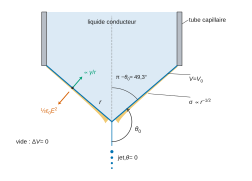
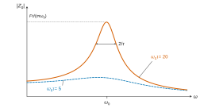
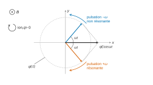
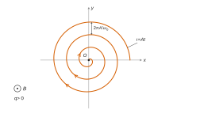
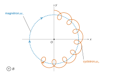
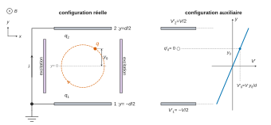

# X PC — Physique A 2026 · Corrigé brut

*Corrigé rédigé par IA, non officiel. Signalez toute erreur.*

*Techniques modernes de spectrométrie de masse de molécules complexes.* Durée 4 h, calculatrice interdite. 43 questions, deux parties indépendantes.

## I — Ionisation par électronébuliseur

### Condensateur plan

#### Question 1

Les armatures sont supposées grandes devant leur écartement. Entre elles, le champ est uniforme et normal aux plaques ; il est nul dans le métal. Le théorème de Coulomb (théorème de Gauss appliqué à un petit cylindre qui traverse l'armature chargée $+\sigma$) donne :

$$\boxed{E=\frac{\sigma}{\varepsilon_0}}$$

Le champ est dirigé de l'armature positive vers l'armature négative, perpendiculairement aux plaques.

#### Question 2

$$\boxed{u_e=\frac12\,\varepsilon_0E^2}$$

#### Question 3

Le condensateur est isolé : sa charge $Q=\sigma S$ est constante. On écarte l'armature mobile de $\mathrm dx$. Le champ $E=\sigma/\varepsilon_0$ ne change pas ; seul le volume $Sx$ occupé par le champ varie. L'énergie stockée vaut

$$U(x)=\frac12\varepsilon_0E^2\,Sx .$$

Pour un système isolé, la force s'obtient par dérivation à charge constante :

$$F_x=-\frac{\partial U}{\partial x}\Big|_Q=-\frac12\varepsilon_0E^2S<0 .$$

Elle tend à rapprocher les armatures. Par unité de surface :

$$\boxed{P=\frac12\,\varepsilon_0E^2=\frac{\sigma^2}{2\varepsilon_0}}$$

Contrôle direct : les charges d'une armature ne subissent que le champ créé par l'autre armature, de norme $\sigma/(2\varepsilon_0)$, et non le champ total $\sigma/\varepsilon_0$. La force par unité de surface vaut donc $\sigma\cdot\sigma/(2\varepsilon_0)$, ce qui redonne $P$.

**Sens : la force attire chaque armature vers l'autre.** La surface du conducteur est donc tirée vers l'extérieur du métal, du côté où règne le champ, quel que soit le signe de $\sigma$.

### Goutte chargée sphérique ; critère de stabilité de Rayleigh

#### Question 4

La distribution est à symétrie sphérique, donc $\vec E=E(r)\,\vec e_r$. Le théorème de Gauss sur la sphère de rayon $r>R$, de surface $4\pi r^2$, donne $4\pi r^2E=Q/\varepsilon_0$. À l'extérieur de la goutte :

$$\vec E=\frac{Q}{4\pi\varepsilon_0r^2}\,\vec e_r\qquad(r>R)$$

En reportant le champ à la surface, $E(R)$, dans le résultat de la question 3 :

$$\boxed{P=\frac12\varepsilon_0E(R)^2=\frac{Q^2}{32\pi^2\varepsilon_0R^4}}$$

La force est dirigée vers l'extérieur de la goutte, selon $+\vec e_r$.

#### Question 5

La force électrostatique, dirigée vers l'extérieur, l'emporte sur la cohésion, dirigée vers l'intérieur, lorsque

$$\begin{aligned}
\frac{Q^2}{32\pi^2\varepsilon_0R^4}&>\frac{\gamma}{R}\\
\iff Q^2&>32\pi^2\varepsilon_0\gamma R^3 .
\end{aligned}$$

$$\boxed{Q>Q_{\lim}=4\pi\sqrt{2\,\varepsilon_0\gamma R^3}}$$

Comme $Q_{\lim}\propto R^{3/2}$, une goutte qui s'évapore à charge constante finit par devenir instable.

### Cône de Taylor

#### Question 6

La région extérieure au cône est vide de charges. En électrostatique, l'équation de Maxwell-Gauss $\operatorname{div}\vec E=0$ jointe à $\vec E=-\overrightarrow{\operatorname{grad}}V$ donne l'équation de Laplace :

$$\boxed{\Delta V=0}$$

Le liquide est conducteur et à l'équilibre : le champ est nul **à l'intérieur** du liquide, donc le potentiel y est uniforme. **La surface du cône est une équipotentielle :** $V(r,\theta_0,\varphi)=\text{cte}$ pour tout $r$ et tout $\varphi$. Le champ, lui, n'est pas nul juste à l'extérieur de la surface : il y est normal à celle-ci.

#### Question 7

À l'équilibre, en tout point de la surface, la pression électrostatique compense la tension superficielle :

$$\frac12\varepsilon_0E^2=k\,\frac{\gamma}{r},$$

où $k$ est une constante. Donc

$$\boxed{E\propto r^{-1/2}}$$

Le champ décroît quand on s'éloigne du sommet.

#### Question 8

$V=V_0+r^\delta f(\theta)$ ne dépend pas de $\varphi$. Son gradient en coordonnées sphériques donne

$$\begin{aligned}
\vec E&=-\frac{\partial V}{\partial r}\vec e_r-\frac1r\frac{\partial V}{\partial\theta}\vec e_\theta\\
&=-r^{\delta-1}\big(\delta f\,\vec e_r+f'\,\vec e_\theta\big).
\end{aligned}$$

Le module est donc proportionnel à $r^{\delta-1}$. La question 7 impose $\delta-1=-\frac12$ :

$$\boxed{\delta=\frac12}$$

#### Question 9

Le problème est invariant par rotation autour de l'axe du jet : $V$ ne dépend pas de $\varphi$, et le laplacien ne fait intervenir que des dérivées par rapport à $r$ et à $\theta$.

Le laplacien est un opérateur différentiel du second ordre, homogène de degré $-2$ en $r$ : chacun de ses termes contient deux dérivations par rapport à des longueurs.

Appliqué à $r^{1/2}f(\theta)$, chaque terme est donc de la forme $r^{-3/2}$ multiplié par une combinaison de $f$, de $f'$ et de $f''$. Les coefficients de cette combinaison ne dépendent que de $\theta$.

Le facteur commun $r^{-3/2}$ ne s'annule pas pour $r>0$. Après simplification, l'équation de Laplace ne contient plus $r$ : **c'est une équation différentielle linéaire du second ordre en $f(\theta)$**. Le terme du second ordre provient des dérivées secondes par rapport à $\theta$.

On peut vérifier ce résultat avec l'expression du laplacien en coordonnées sphériques, qui n'est pas fournie par l'énoncé :

$$\frac{1}{\sin\theta}\big(\sin\theta\, f'\big)'+\frac34f=0 .$$

#### Question 10

Sur la surface, $V(r,\theta_0)=V_0+r^{1/2}f(\theta_0)$ doit être indépendant de $r$ (question 6), alors que $r^{1/2}$ ne l'est pas. Il faut donc

$$\boxed{f(\theta_0)=0}$$

Le cône est alors au potentiel $V_0$. La solution de l'équation du second ordre qui reste régulière sur l'axe $\theta=0$ (le jet) et qui s'annule en $\theta_0$ fixe l'angle : $\pi-\theta_0\simeq49{,}3^\circ$.

#### Question 11

Au voisinage de la surface d'un conducteur, $\sigma=\varepsilon_0E$ (question 1 appliquée localement). Avec $E\propto r^{-1/2}$ (question 7) :

$$\boxed{\sigma\propto r^{-1/2}}$$

Les charges restent en surface du liquide conducteur. Leur densité croît sans limite vers la pointe ($r\to0$). Le jet part de la région la plus chargée de la surface : il emporte une charge par unité de volume de liquide très élevée.

Les gouttelettes de très petit rayon qu'il produit portent donc une charge proche de la limite de Rayleigh, qui est grande devant leur volume ($Q_{\lim}/R^3\propto R^{-3/2}$). Elles sont ainsi fortement chargées, ce qui conduit aux ions multichargés.

## II — Spectrométrie de masse à résonance cyclotronique ionique

#### Question 12

L'ion est soumis à la force électrique et à la force magnétique, $q\vec E+q\vec v\wedge\vec B$. Le principe fondamental de la dynamique s'écrit

$$\frac{\mathrm d\vec v}{\mathrm dt}=\frac qm\big(\vec E+\vec v\wedge\vec B\big).$$

Les champs étant connus, la trajectoire ne dépend des caractéristiques de l'ion que par le scalaire $q/m$. Deux ions de même rapport $m/q$ ont des trajectoires identiques pour les mêmes conditions initiales. **On n'accède qu'à $m/q$.**

#### Question 13

La charge électrique est quantifiée : l'ion provient de la molécule par ajout (protonation en ESI) ou retrait d'un nombre entier de charges élémentaires. Donc $q=ze$ avec $z\in\mathbb N^*$.

Les pics principaux correspondent à la même protéine de masse $M$ portant $z$ protons, de masse voisine de 1 u. On a donc $(m/z)=M/z+1$. Ce sont les **écarts entre pics** qui renseignent : deux pics voisins correspondent à $z$ et $z+1$.

Pour les pics à $1999{,}30$ (charge $z$) et $1888{,}29$ (charge $z+1$), la masse $M$ est la même :

$$\begin{aligned}
z\,(1999{,}30-1)&=(z+1)(1888{,}29-1)\\
z&=\frac{1887{,}29}{111{,}01}\simeq17{,}0 .
\end{aligned}$$

On obtient donc $\boxed{z=17}$ pour le pic à $1999{,}30$.

Pour le pic à $1000{,}15$, le rapport $(1000{,}15-1)/(1999{,}30-1)$ vaut $1/2$, d'où $\boxed{z=34}$. Le voisin $971{,}54$ correspond à $z=35$ et redonne la même masse.

$$\boxed{M\simeq17\times1998{,}3\simeq3{,}40\times10^4\ \text{u}}$$

Les autres pics de la série redonnent la même valeur, par exemple $2124{,}14$ pour $z=16$ ou $1030{,}42$ pour $z=33$. Si l'on néglige la masse des protons, on trouve $m\simeq34\,000$ u, ce qui ne change pas l'ordre de grandeur.

Une protéine est faite de C, H, N, O et S, avec environ autant d'hydrogènes que d'atomes lourds : la masse moyenne par atome est d'environ 7 u. On en déduit

$$\boxed{N_{\text{atomes}}\sim\frac{3{,}4\times10^4}{7}\sim5\times10^3}$$

#### Question 14

**On utilise un solénoïde long** de $n$ spires par mètre, parcouru par un courant continu $I$. À l'intérieur, loin des extrémités, il crée $\vec B=\mu_0nI\,\vec e_z$, uniforme et constant. Pour atteindre plusieurs teslas, on utilise une bobine supraconductrice refroidie à l'hélium liquide. Des bobines de Helmholtz conviennent pour des champs plus faibles.

#### Question 15

On calcule $\vec v\wedge\vec B=(\dot y B,\,-\dot x B,\,0)$. Le PFD donne :

$$\boxed{\begin{aligned}
m\ddot x&=qB\dot y\\
m\ddot y&=-qB\dot x\\
m\ddot z&=0
\end{aligned}}$$

#### Question 16

On forme la première équation plus $i$ fois la deuxième :

$$\begin{aligned}
m(\ddot x+i\ddot y)&=qB(\dot y-i\dot x)\\
&=-iqB(\dot x+i\dot y),
\end{aligned}$$

donc

$$\ddot Z=-i\frac{qB}{m}\dot Z .$$

Avec $Z=Z_0e^{-i\omega_0t}$, on a $\dot Z=-i\omega_0Z$ et $\ddot Z=-\omega_0^2Z$. En reportant :

$$-\omega_0^2=-i\frac{qB}m(-i\omega_0)=-\frac{qB}{m}\omega_0 .$$

Puisque $\omega_0\neq0$ :

$$\boxed{\omega_0=\frac{qB}{m}}$$

L'équation du mouvement s'écrit donc

$$\ddot Z+i\omega_0\dot Z=0 .$$

*Vérification du sens.* Pour $q>0$, $Z=Z_0e^{-i\omega_0t}$ décrit un cercle parcouru dans le sens horaire, c'est-à-dire dans le sens négatif autour de $\vec B$. Sur un cercle centré en $O$, la force $q\vec v\wedge\vec B$ doit être centripète.

On le vérifie au point $(R,0)$, où $\vec v=-R\omega_0\vec e_y$ :

$$q\vec v\wedge\vec B=-qR\omega_0B\,\vec e_x ,$$

qui pointe bien vers $O$. *Vérification de l'homogénéité* : $[qB/m]=\mathrm s^{-1}$.

### Excitation

#### Question 17

L'affixe de la force vaut

$$F_x+iF_y=F(\cos\omega t-i\sin\omega t)=Fe^{-i\omega t},$$

d'où

$$\boxed{\ddot Z+i\omega_0\dot Z=\frac Fm\,e^{-i\omega t}}$$

#### Question 18

$m/\tau$ s'exprime en $\mathrm{kg\cdot s^{-1}}$ (force divisée par vitesse) : **$\tau$ est un temps.** C'est le temps d'amortissement de la vitesse, puisque $m\dot{\vec v}=-\frac m\tau\vec v$ donne $\vec v\propto e^{-t/\tau}$.

On rencontre une force analogue dans le **modèle de Drude** de la conduction électrique, où les collisions des porteurs sont modélisées par $-\frac m\tau\vec v$. On la rencontre aussi comme frottement fluide linéaire à faible vitesse (loi de Stokes).

#### Question 19

L'affixe du frottement est $-\frac m\tau\dot Z$, d'où

$$\ddot Z+\Big(i\omega_0+\frac1\tau\Big)\dot Z=\frac Fm e^{-i\omega t}.$$

On cherche $Z=Z_0e^{-i\omega t}$ :

$$Z_0\Big[-\omega^2+\omega_0\omega-\frac{i\omega}{\tau}\Big]=\frac Fm ,$$

donc

$$\boxed{Z_0=\frac{F}{m\,\omega\,\big(\omega_0-\omega-\frac i\tau\big)}}$$

Homogénéité : $F/m$ est une accélération, divisée par le carré d'une pulsation, ce qui donne bien une longueur.

#### Question 20

$$|Z_0|=\frac{F}{m\omega\sqrt{(\omega_0-\omega)^2+1/\tau^2}} .$$

Supposons le frottement faible, au sens $\omega_0\tau\gg1$. Le facteur $1/\sqrt{(\omega_0-\omega)^2+1/\tau^2}$ présente alors un pic aigu en $\omega=\omega_0$, de hauteur $\tau$ et de largeur $\sim1/\tau\ll\omega_0$. Sur cet intervalle, le facteur $1/\omega$ varie peu.

$|Z_0|$ présente donc une résonance en $\omega\simeq\omega_0$, où il atteint $F\tau/(m\omega_0)$. Cette valeur est grande devant la valeur hors résonance, $\sim F/(m\omega_0^2)$.

$|Z_0|$ vaut $|Z_0|_{\max}/\sqrt2$ pour $|\omega-\omega_0|=1/\tau$. On en déduit

$$\boxed{\Delta\omega\sim\frac1\tau}$$

La largeur à mi-hauteur de $|Z_0|^2$ vaut exactement $2/\tau$. Le facteur de qualité est $\omega_0\tau$.

#### Question 21

$\omega_0=zeB/m$ donne

$$\frac{\delta(m/z)}{m/z}=\frac{\delta\omega_0}{\omega_0}.$$

Deux espèces ne sont séparées que si leurs pulsations diffèrent d'au moins $\Delta\omega\sim1/\tau$. La plus petite différence relative de masse détectable vaut donc

$$\frac{\delta m}{m}\sim\frac{1}{\omega_0\tau}=\frac{m}{zeB\tau}.$$

Pour un $\tau$ fixé par le gaz résiduel, **elle est d'autant plus petite que la charge et le champ magnétique sont grands**. En effet, $\omega_0$ croît comme $zB$ alors que la largeur du pic reste de l'ordre de $1/\tau$. Autrement dit, le facteur de qualité $\omega_0\tau$ augmente.

#### Question 22

La force vaut $\vec F=qE\cos\omega t\,\vec e_x$, d'affixe

$$F_x+iF_y=qE\cos\omega t=\frac{qE}2e^{-i\omega t}+\frac{qE}2e^{-i(-\omega)t}.$$

La première composante, $(F_x,F_y)=\frac{qE}2(\cos\omega t,-\sin\omega t)$, est de la forme de la question 17 avec $F=qE/2$ et la pulsation $\omega$. La seconde, $\frac{qE}2(\cos\omega t,+\sin\omega t)$, est de la même forme avec la pulsation $-\omega$. Ce sont deux forces tournantes de sens opposés.

L'équation est linéaire : le régime forcé est la somme des deux réponses de la question 19, la seconde obtenue en changeant $\omega$ en $-\omega$ :

$$\boxed{Z(t)=\frac{qE}{2m\omega}\left[\frac{e^{-i\omega t}}{\omega_0-\omega-\frac i\tau}-\frac{e^{i\omega t}}{\omega_0+\omega-\frac i\tau}\right]}$$

Pour $\omega>0$, seul le premier dénominateur devient petit, de module $1/\tau$ en $\omega=\omega_0$. Le second reste de l'ordre de $2\omega_0$. **La résonance est donc due à la composante de pulsation $+\omega$**, qui tourne dans le même sens que l'ion. L'autre composante donne une contribution plus faible d'un facteur $\sim1/(\omega_0\tau)$.

#### Question 23

**On utilise deux plaques métalliques planes parallèles**, perpendiculaires à $\vec e_x$ et distantes de $\ell$, reliées à un générateur de tension sinusoïdale $u(t)=U\cos\omega t$. Loin des bords, le champ entre elles est $\vec E=\frac{U}{\ell}\cos\omega t\,\vec e_x$, donc $E=U/\ell$.

#### Question 24

On se place en $\omega=\omega_0$, sans frottement, et l'on ne garde que la composante résonante de la question 22, d'amplitude $qE/2$ :

$$\boxed{\ddot Z+i\omega_0\dot Z=\frac{qE}{2m}e^{-i\omega_0t}}$$

#### Question 25

Avec $Z=iAt\,e^{-i\omega_0t}$, on a

$$\begin{aligned}
\dot Z&=(iA+A\omega_0t)\,e^{-i\omega_0t}\\
\ddot Z&=(2A\omega_0-iA\omega_0^2t)\,e^{-i\omega_0t}
\end{aligned}$$

donc

$$\begin{aligned}
\ddot Z+i\omega_0\dot Z&=\big(2A\omega_0-iA\omega_0^2t-A\omega_0+iA\omega_0^2t\big)e^{-i\omega_0t}\\
&=A\omega_0\,e^{-i\omega_0t}.
\end{aligned}$$

L'identification donne $A\omega_0=\dfrac{qE}{2m}$, soit

$$\boxed{A=\frac{qE}{2m\omega_0}=\frac{E}{2B}}$$

Cette valeur ne dépend ni de $q$ ni de $m$. Homogénéité : $E/B$ est une vitesse (comme dans $\vec E=-\vec v\wedge\vec B$), ce qui convient puisque $|Z|=At$ est une longueur.

#### Question 26

$Z=At\,e^{i(\pi/2-\omega_0t)}$ donne en polaires $r=At$ et $\theta=\frac\pi2-\omega_0t$. En éliminant $t$ :

$$\boxed{r=\frac{A}{\omega_0}\Big(\frac\pi2-\theta\Big)=\frac{E}{2B\omega_0}\Big(\frac\pi2-\theta\Big)}$$

**La trajectoire est une spirale d'Archimède** partant de l'origine. Elle est parcourue dans le sens horaire ($\theta$ décroissant) pour $q>0$ et $B>0$. Son pas entre deux spires est constant, égal à $2\pi A/\omega_0=\pi E/(B\omega_0)$.

En $t=0^+$, l'ion part de $O$ selon $+\vec e_y$ ($Z\simeq iAt$), puis s'écarte de l'origine à la vitesse radiale constante $A$.

**Rôles des deux champs.** Le champ magnétique ne travaille pas : il courbe la trajectoire et impose la pulsation de rotation $\omega_0$. Le champ électrique (sa composante résonante) reste en phase avec la vitesse de l'ion. Il lui fournit de l'énergie à chaque tour, ce qui fait croître la vitesse $v\simeq A\omega_0t$ et donc le rayon.

#### Question 27

Le rayon $r=\frac{E}{2B}t$ doit devenir aussi grand que possible, tout en restant inférieur à la taille de la cellule. Il faut donc $r(t_E)\sim d$, ce qui donne

$$\boxed{t_E\sim\frac{Bd}{E}}$$

(à un facteur numérique près).

#### Question 28

**L'uniformité du champ magnétique est la plus importante.** La grandeur mesurée est $\omega_0=qB/m$, dont on déduit $m/z$. Si $B$ varie dans la cellule, la pulsation de l'ion dépend de sa position : le pic s'élargit, la résonance se dégrade (l'ion se désaccorde de l'excitation) et $m/z$ est mesuré avec une erreur relative $\delta B/B$.

Une non-uniformité de $E$ ne modifie que la vitesse $A=E/(2B)$ de croissance du rayon, c'est-à-dire l'amplitude atteinte, et non la fréquence mesurée.

#### Question 29

L'équipartition de l'énergie attribue $\frac12k_BT$ à chaque degré de liberté de translation, soit $\frac{p_x^2}{2m}\sim\frac12k_BT$ :

$$\boxed{p\sim\sqrt{m\,k_BT}}$$

Ici $m$ est la masse d'un ion et $k_B$ la constante de Boltzmann (et non $R$, qui se rapporte à une mole).

#### Question 30

Pour un mouvement circulaire dans le plan perpendiculaire à $\vec B$, on a $\frac{mv^2}r=qvB$, donc

$$r=\frac{p_\perp}{qB}\sim\frac{\sqrt{mk_BT}}{qB}.$$

La condition $r\ll d$ s'écrit $mk_BT\ll q^2B^2d^2$, soit

$$\boxed{m\ll m_{\max}=\frac{q^2B^2d^2}{k_BT}}$$

### Piégeage

#### Question 31

La force magnétique est orthogonale à $\vec B=B\vec e_z$, et la troisième équation de la question 15 s'écrit $m\ddot z=0$. **Rien ne retient l'ion selon $z$** : son mouvement selon cet axe est uniforme, $z=z_0+v_zt$. La vitesse thermique $v_z\neq0$ l'amène sur une paroi de la cellule.

#### Question 32

$\vec E=-\overrightarrow{\operatorname{grad}}V$ :

$$\boxed{\begin{aligned}
E_x&=\alpha x\\
E_y&=\alpha y\\
E_z&=-\alpha\beta z
\end{aligned}}$$

La cellule est vide de charges, donc $\operatorname{div}\vec E=0$, c'est-à-dire $\Delta V=0$ :

$$\operatorname{div}\vec E=\alpha(2-\beta)=0 .$$

Comme $\alpha\neq0$ :

$$\boxed{\beta=2}$$

Le champ de piégeage s'écrit donc $\vec E=\alpha\,(x,\,y,\,-2z)$.

#### Question 33

Selon $z$, $m\ddot z=qE_z=-2q\alpha z$, soit

$$\ddot z+\frac{2q\alpha}{m}z=0 .$$

Pour $q\alpha>0$, c'est l'équation d'un oscillateur harmonique : l'ion oscille autour de $z=0$ à la pulsation

$$\boxed{\omega_p=\sqrt{\frac{2q\alpha}{m}}}$$

#### Question 34

Dans le plan, la force supplémentaire a pour affixe $q(E_x+iE_y)=q\alpha Z$ : elle est radiale et dirigée vers l'extérieur. L'équation de la question 16 devient

$$m\ddot Z=-iqB\dot Z+q\alpha Z .$$

Avec $q\alpha/m=\omega_p^2/2$ :

$$\boxed{\ddot Z+i\omega_0\dot Z-\frac{\omega_p^2}{2}Z=0}$$

#### Question 35

Avec $Z=Z_0e^{-i\omega t}$ et $Z_0\neq0$ :

$$\omega^2-\omega_0\omega+\frac{\omega_p^2}{2}=0 .$$

Le discriminant $\omega_0^2-2\omega_p^2$ est positif car $\omega_p\ll\omega_0$. Il existe donc deux racines réelles :

$$\boxed{\omega_\pm=\frac{\omega_0\pm\sqrt{\omega_0^2-2\omega_p^2}}{2}}$$

Au premier ordre en $\omega_p^2/\omega_0^2$ :

$$\sqrt{\omega_0^2-2\omega_p^2}\simeq\omega_0-\frac{\omega_p^2}{\omega_0} .$$

D'où les deux pulsations, toutes deux positives :

$$\boxed{\begin{aligned}
\omega_+&\simeq\omega_0-\frac{\omega_p^2}{2\omega_0}\\
\omega_-&\simeq\frac{\omega_p^2}{2\omega_0}
\end{aligned}}$$

Contrôle : $\omega_++\omega_-=\omega_0$ et $\omega_+\omega_-=\omega_p^2/2$.

#### Question 36

La pulsation rapide $\omega_+$ est la pulsation cyclotron modifiée. Elle est abaissée de $\frac{\omega_p^2}{2\omega_0}$, ce qui représente une correction relative $\frac{\omega_p^2}{2\omega_0^2}\ll1$ : **la résonance n'est que légèrement décalée.**

La seconde solution décrit un mouvement de rotation dans le plan à la pulsation $\omega_-\ll\omega_0$, beaucoup plus lent (c'est le mouvement magnétron). Avec $\omega_p^2=2q\alpha/m$ et $\omega_0=qB/m$ :

$$\boxed{\omega_-\simeq\frac{\alpha}{B}}$$

Cette pulsation est **indépendante de $m/q$**.

### Détection

#### Question 37

$$\boxed{V_i=\frac1{4\pi\varepsilon_0}\sum_{j\neq i}\frac{q_j}{\|\vec r_i-\vec r_j\|}}$$

La somme exclut $j=i$ : une charge ponctuelle ne crée pas de potentiel fini à sa propre position.

#### Question 38

Toutes les sommes portent sur les indices de $0$ à $N-1$. On note, pour $i\neq j$,

$$G_{ij}=\frac{1}{4\pi\varepsilon_0\|\vec r_i-\vec r_j\|}=G_{ji} .$$

Alors

$$\begin{aligned}
\sum_iq_iV'_i&=\sum_i\sum_{j\neq i}G_{ij}\,q_iq'_j\\
\sum_iq'_iV_i&=\sum_i\sum_{j\neq i}G_{ij}\,q'_iq_j .
\end{aligned}$$

Dans la seconde somme, on échange les indices muets $i$ et $j$. L'ensemble des couples $(i,j)$ avec $i\neq j$ est invariant par cet échange, et $G_{ji}=G_{ij}$ : la seconde somme devient $\sum_j\sum_{i\neq j}G_{ij}q'_jq_i$, c'est-à-dire la première. D'où

$$\boxed{\sum_{i}q_iV'_i=\sum_{i}q'_iV_i}$$

#### Question 39

On suppose les plaques grandes devant leur écartement ($S\gg d^2$) et l'on néglige les effets de bord. Entre elles, sans charge, le potentiel ne dépend que de $y$ et vérifie $V''(y)=0$ : il est affine.

Les conditions aux limites sont $V'(-d/2)=-V/2$ et $V'(d/2)=V/2$. On obtient $V'(y)=Vy/d$, donc

$$\boxed{V'_0=\frac{V\,y_0}{d}}$$

Contrôle de signe : $V'_0$ passe de $-V/2$ à $+V/2$ quand $y_0$ va de l'électrode 1 à l'électrode 2.

#### Question 40

On applique le théorème de réciprocité aux trois objets : la charge en $y_0$ et les deux électrodes.

$$q_0V'_0+q_1V'_1+q_2V'_2=q'_0V_0+q'_1V_1+q'_2V_2 .$$

Le membre de droite est nul ($q'_0=0$ et $V_1=V_2=0$). À gauche, on obtient

$$q\frac{Vy_0}{d}+\frac V2(q_2-q_1)=0 ,$$

d'où

$$\boxed{\Delta q=q_2-q_1=-\frac{2q\,y_0}{d}}$$

La charge induite suit à chaque instant l'ordonnée $y_0(t)$ de l'ion. Après l'excitation, l'ion tourne à la pulsation $\omega_+\simeq\omega_0$ : $y_0(t)$, donc $\Delta q(t)$, oscille à cette pulsation.

Pour des plaques grandes devant $d$, l'influence est totale et $q_1+q_2=-q$. Le courant dans le fil qui relie les électrodes vaut alors

$$\begin{aligned}
i&=\frac{\mathrm dq_2}{\mathrm dt}=\frac12\frac{\mathrm d\Delta q}{\mathrm dt}\\
&=-\frac qd\,\dot y_0 .
\end{aligned}$$

Ce courant est sinusoïdal à la pulsation $\omega_0$. **Mesurer sa fréquence donne $\omega_0$, donc $m/z=eB/\omega_0$**, sans capter l'ion (la détection est non destructive).

#### Question 41

**Les faces de la cellule perpendiculaires à $x$ sont déjà occupées par les électrodes d'excitation**, qui créent le champ selon $x$ (question 23). On place donc les électrodes de détection sur les faces libres, perpendiculaires à $y$.

Cette disposition a un second avantage. Les électrodes de détection ne sont pas en regard des électrodes d'excitation et, par symétrie, elles reçoivent la même influence du champ d'excitation, qui s'élimine dans $q_2-q_1$. On évite ainsi que la tension d'excitation, élevée, induise directement un signal parasite qui masquerait le très faible signal dû aux ions.

#### Question 42

La fréquence associée à un ion est

$$f=\frac{\omega_0}{2\pi}=\frac{B}{2\pi}\,\frac{e}{m_u}\,\frac{1}{(m/z)_{\mathrm u}},$$

où $(m/z)_{\mathrm u}$ est la valeur lue en abscisse de la figure 2, en unités de masse atomique. La fréquence la plus élevée correspond au plus petit $m/z$ du spectre, $(m/z)_{\mathrm u}\simeq9\times10^2$ :

$$\begin{aligned}
f_{\max}&\simeq\frac{7\times10^8}{2\pi\times9\times10^2}\\
&\simeq\frac{7\times10^8}{5{,}7\times10^3}\\
&\simeq1{,}2\times10^5\ \mathrm{Hz}.
\end{aligned}$$

Le critère de Shannon-Nyquist impose une fréquence d'échantillonnage supérieure à $2f_{\max}$ :

$$\boxed{f_{e,\min}\simeq2{,}5\times10^5\ \mathrm{Hz}}$$

(environ 250 kHz). La correction $\omega_+<\omega_0$ est négligeable.

#### Question 43

D'après la question 40, la charge induite $\Delta q=-2zey_0/d$ est proportionnelle à $z$. Le rayon atteint $At_E$ ne dépend pas de $z$ (question 25).

Le courant $i=-\frac{ze}{d}\dot y_0$ est donc proportionnel à $z\,\omega_0$. Pour une molécule donnée, $\omega_0\propto z$, et le courant croît comme $z^2$.

**Un ion multichargé donne un signal de détection bien plus intense**, donc un meilleur rapport signal sur bruit et une meilleure sensibilité. Cet avantage s'ajoute au gain en résolution de la question 21.
