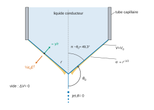
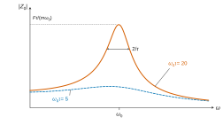
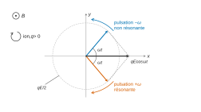
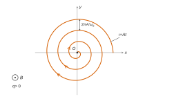
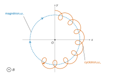
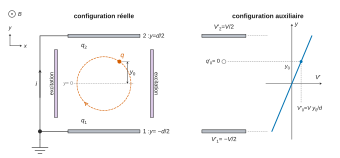

# X PC — Physique A 2026 · Corrigé guidé

*Corrigé rédigé par IA, non officiel. Signalez toute erreur.*

## Présentation du sujet

**Thème.** *Techniques modernes de spectrométrie de masse de molécules complexes.* Le sujet suit les deux étapes d'une mesure de masse moléculaire. On produit d'abord des ions multichargés par électronébulisation (ESI). On mesure ensuite leur rapport $m/z$ par résonance cyclotronique ionique à transformée de Fourier (FT-ICR). L'épreuve dure 4 heures, **sans calculatrice**, et compte **43 questions**. L'énoncé prévient que la plupart se traitent de façon concise, et c'est vrai : beaucoup tiennent en trois lignes.

- **Partie I, électronébuliseur (Q1-11).** On établit la pression électrostatique $P=\frac12\varepsilon_0E^2$ sur un conducteur, à partir du condensateur plan. On l'oppose ensuite à la tension superficielle, d'abord pour une goutte sphérique (limite de Rayleigh, en $Q\propto R^{3/2}$), puis pour le cône de Taylor. Là, l'équilibre local impose $E\propto r^{-1/2}$, donc un potentiel en $r^{1/2}f(\theta)$, et une condition aux limites qui fixe l'angle du cône.
- **Partie II, cyclotron (Q12-36).** Après une question de lecture de spectre (déterminer les états de charge et la masse d'une protéine), on étudie l'ion dans $\vec B$ uniforme avec la variable complexe $Z=x+iy$. On obtient la pulsation cyclotron, puis la résonance forcée avec frottement et sa largeur $1/\tau$. Viennent ensuite la décomposition d'un champ rectiligne en deux champs tournants, la croissance séculaire en spirale à la résonance, le confinement thermique et le piégeage quadrupolaire (mouvements cyclotron modifié et magnétron).
- **Partie II, détection (Q37-43).** Le théorème de réciprocité de Green, démontré pour des charges ponctuelles, donne la charge induite par un ion sur deux plaques. On termine par le critère de Shannon et l'intérêt des charges élevées.

**Notions mobilisées.** Théorèmes de Gauss et de Coulomb, énergie électrostatique, équation de Laplace, conducteur à l'équilibre, gradient en sphériques, PFD avec force de Lorentz, notation complexe, résonance et facteur de qualité, équipartition, oscillateur harmonique, superposition, échantillonnage.

**Difficulté et longueur.** Le niveau technique est modéré, et l'épreuve est très guidée. La difficulté tient à la **rigueur des signes** : la convention $e^{-i\omega t}$ et le sens de rotation conditionnent toute la partie II, et l'énoncé insiste sur la vérification de $\omega_0$. Elle tient aussi aux **questions qualitatives** (Q11, Q21, Q28, Q41, Q43), où il faut un argument physique précis plutôt qu'un discours.

**Ce que le rapport 2026 juge discriminant.** Le rapport ne donne pas de statistiques, mais il signale plusieurs questions mal réussies :

- la loi $E\propto r^{-1/2}$ et la valeur de $\delta$ (Q7-8), puis l'équation en $f(\theta)$ (Q9, « Question délicate ») et la condition sur le cône (Q10) ;
- la décomposition en deux champs tournants (Q22, « Question difficile »), dont dépend le facteur $qE/2$ de Q24 ;
- le potentiel créé par des charges ponctuelles (Q37, « plutôt mal traitée »), pourtant proche du cours ;
- la lecture du spectre (Q13) et les développements limités de Q35.

Le rapport relève aussi, sur tout le sujet, des égalités entre scalaires et vecteurs, des erreurs sur les équations du second degré, les développements limités et l'homogénéité. Il reproche enfin à beaucoup de candidats d'avoir intégré les équations de Q16-17 puis réutilisé ces solutions dans les questions suivantes, où de nouveaux termes apparaissaient.

**Questions à ne pas laisser passer.** Q1-6, Q12, Q14-19, Q23, Q29-33 relèvent du cours ou d'un calcul direct. La détection (Q37-40) est indépendante de tout le reste : c'est un point de reprise idéal, à condition de savoir écrire un potentiel coulombien.

**Gestion du temps.** On peut viser environ 50 min pour la partie I, 2 h 30 pour la partie II (dont 25 min pour la détection) et 15 min de relecture des signes.

## Partie I — Ionisation par électronébuliseur

On établit d'abord l'outil central, la pression électrostatique, sur le cas le plus simple. On l'applique ensuite à deux géométries. Outils : Gauss, énergie électrostatique, équation de Laplace.

### Question 1

> [!INDICATION]
> C'est un théorème de cours sur le champ au voisinage immédiat d'une surface chargée.

#### Solution

Les armatures sont grandes devant leur écartement. Le champ est uniforme et normal entre elles, et nul dans le métal. Le théorème de Coulomb donne :

$$\boxed{E=\frac{\sigma}{\varepsilon_0}}$$

Le champ est dirigé de l'armature positive vers l'armature négative.

> [!JURY]
> Le rapport 2026 note que des copies cherchent à rétablir l'expression du champ à la question 1, ce qui n'était pas demandé : l'énoncé demande un rappel, une réponse directe suffit.

### Question 2

> [!INDICATION]
> C'est une formule de cours, analogue électrique de $B^2/(2\mu_0)$.

#### Solution

$$\boxed{u_e=\frac12\varepsilon_0E^2}$$

### Question 3

> [!INDICATION]
> Faites un raisonnement énergétique : déplacez virtuellement une armature et regardez comment varie l'énergie stockée.

> [!INDICATION]
> Choisissez la situation la plus simple, un condensateur isolé (charge fixée). Que devient alors le champ quand l'écartement change ?

#### Solution

À charge $Q=\sigma S$ fixée, $E=\sigma/\varepsilon_0$ ne dépend pas de l'écartement $x$. L'énergie vaut $U=\frac12\varepsilon_0E^2\,Sx$, et pour un système isolé :

$$F_x=-\frac{\partial U}{\partial x}\Big|_Q=-\frac12\varepsilon_0E^2S .$$

$$\boxed{P=\frac12\varepsilon_0E^2=\frac{\sigma^2}{2\varepsilon_0}}$$

La force est attractive : chaque armature est tirée vers l'autre, c'est-à-dire, pour le conducteur, vers l'extérieur du métal, du côté où règne le champ. Le résultat ne dépend pas du signe de $\sigma$.

> [!PIEGE]
> Écrire $P=\sigma E$ donne un résultat deux fois trop grand. Les charges d'une armature ne subissent que le champ créé par l'autre armature, $\sigma/(2\varepsilon_0)$, et non le champ total. La méthode énergétique évite ce piège.

> [!JURY]
> Le rapport 2026 relève des erreurs de facteur 2 sur $P$ et note qu'« A la question 3, le raisonnement portant sur le champ subi par une plaque s’est souvent révélé incorrect ». Il signale aussi que le sens de la force (attraction entre les armatures) a souvent été oublié ou inversé, le mot « pression » ayant suggéré à certains une répulsion.

> [!METHODE]
> Pour une force électrostatique sur un conducteur, le travail virtuel à charge constante est la méthode la plus sûre : $F=-\partial U/\partial x|_Q$. À potentiel constant, le générateur fournit de l'énergie, et le signe s'inverse ($F=+\partial U/\partial x|_V$).

### Question 4

> [!INDICATION]
> La goutte conductrice porte sa charge en surface, avec la symétrie sphérique. Le théorème de Gauss donne le champ extérieur.

> [!INDICATION]
> Évaluez ensuite le champ juste à l'extérieur de la surface et reportez-le dans le résultat de la question 3.

#### Solution

La symétrie sphérique impose $\vec E=E(r)\vec e_r$. Le théorème de Gauss, sur une sphère de surface $4\pi r^2$, donne pour $r>R$ :

$$\vec E=\frac{Q}{4\pi\varepsilon_0r^2}\vec e_r .$$

À la surface :

$$\boxed{P=\frac{Q^2}{32\pi^2\varepsilon_0R^4}}$$

Cette force est dirigée vers l'extérieur de la goutte.

> [!JURY]
> Selon le rapport 2026, la question est bien réussie, mais l'application du théorème de Gauss « n’est néanmoins pas aussi automatique qu’on pourrait le penser (erreurs sur la surface d’une sphère) ». Il rappelle que le champ était demandé à l'extérieur de la goutte.

### Question 5

> [!INDICATION]
> Comparez les deux forces surfaciques, qui sont de sens opposés.

> [!INDICATION]
> Elles ne dépendent pas de $R$ de la même manière. Isolez $Q$ dans l'inégalité.

#### Solution

L'électrostatique l'emporte si

$$\frac{Q^2}{32\pi^2\varepsilon_0R^4}>\frac\gamma R ,$$

soit

$$\boxed{Q>Q_{\lim}=4\pi\sqrt{2\varepsilon_0\gamma R^3}}$$

Une goutte qui s'évapore à charge constante voit $Q_{\lim}\propto R^{3/2}$ diminuer : elle finit par se fragmenter, et le processus recommence sur les gouttes filles.

> [!PIEGE]
> Le rapport 2026 note des erreurs de calcul dans l'expression finale de la charge limite, alors que le raisonnement était bien posé. Vérifiez la dimension : $\varepsilon_0\gamma R^3$ doit être le carré d'une charge.

> [!METHODE]
> Origine du facteur $\sqrt2$ de la note de bas de page : pour une sphère, la surpression de Laplace due à la tension superficielle vaut $2\gamma/R$, pas $\gamma/R$. En remplaçant $\gamma/R$ par $2\gamma/R$, on retrouve exactement la limite de Rayleigh $Q_R=8\pi\sqrt{\varepsilon_0\gamma R^3}=\sqrt2\,Q_{\lim}$. L'énoncé simplifie volontairement le modèle. On répond avec ses données.

### Question 6

> [!INDICATION]
> Partez de l'équation de Maxwell-Gauss dans une région sans charge, en électrostatique.

> [!INDICATION]
> Que vaut le champ à l'intérieur d'un conducteur à l'équilibre ? Qu'en déduit-on pour le potentiel ?

#### Solution

On a $\operatorname{div}\vec E=0$ et $\vec E=-\overrightarrow{\operatorname{grad}}V$, d'où l'équation de Laplace :

$$\boxed{\Delta V=0}$$

Dans le liquide conducteur à l'équilibre, $\vec E=\vec 0$, donc $V$ y est uniforme. **La surface du cône est une équipotentielle** : $V(r,\theta_0)$ est indépendant de $r$.

> [!PIEGE]
> Le champ est nul **dans** le conducteur, pas à sa surface : juste à l'extérieur, il est normal à la surface et vaut $\sigma/\varepsilon_0$. Le rapport 2026 cite, parmi les commentaires surprenants, « pour un liquide conducteur, le champ s’annule à sa surface ».

> [!JURY]
> Le rapport 2026 regrette que beaucoup de copies donnent $\vec E=-\overrightarrow{\operatorname{grad}}V$ au lieu de l'équation de Laplace. Il note aussi que l'argument attendu, un potentiel uniforme sur le liquide traité comme un métal, apparaît bien moins souvent qu'un vague argument de continuité du potentiel.

### Question 7

> [!INDICATION]
> Écrivez l'égalité des deux forces surfaciques en un point de la surface situé à la distance $r$ du sommet.

#### Solution

$\frac12\varepsilon_0E^2=k\gamma/r$, avec $k$ une constante, donc

$$\boxed{E\propto r^{-1/2}}$$

> [!JURY]
> Le rapport 2026 compte relativement peu de réponses correctes à Q7-8. Il s'étonne que des candidats aboutissent sans réagir à un champ qui croît avec $r$. Ici, la tension superficielle croît vers la pointe : le champ doit faire de même.

### Question 8

> [!INDICATION]
> Calculez le gradient du potentiel proposé en coordonnées sphériques. Quelle puissance de $r$ apparaît dans chacune des composantes ?

#### Solution

Le gradient en coordonnées sphériques donne

$$\begin{aligned}
\vec E&=-\partial_rV\,\vec e_r-\frac1r\partial_\theta V\,\vec e_\theta\\
&=-r^{\delta-1}(\delta f\,\vec e_r+f'\,\vec e_\theta).
\end{aligned}$$

Donc $\|\vec E\|\propto r^{\delta-1}$, et la condition $\delta-1=-1/2$ donne

$$\boxed{\delta=\frac12}$$

> [!PIEGE]
> Le terme constant $V_0$ ne contribue pas au champ. Il ne faut pas en tenir compte pour déterminer $\delta$.

### Question 9

> [!INDICATION]
> Pourquoi $V$ ne dépend-il pas de $\varphi$ ? Comment chaque terme du laplacien se comporte-t-il quand on multiplie toutes les longueurs par un facteur constant ?

> [!INDICATION]
> Le laplacien contient deux dérivations par rapport à des longueurs. Appliqué à $r^{1/2}f(\theta)$, quelle puissance de $r$ chaque terme fait-il apparaître ?

#### Solution

Le problème est invariant par rotation autour de l'axe du jet, donc $V$ ne dépend pas de $\varphi$.

Le laplacien est un opérateur du second ordre, homogène de degré $-2$ en $r$.

Appliqué à $r^{1/2}f(\theta)$, il donne $r^{-3/2}$ multiplié par une expression qui ne contient que $f$, $f'$ et $f''$, avec des coefficients fonctions de $\theta$.

Après simplification par $r^{-3/2}\neq0$, l'équation de Laplace ne contient plus $r$. **C'est une équation différentielle linéaire du second ordre en $f(\theta)$** (le terme du second ordre vient des dérivées secondes angulaires).

Pour aller plus loin (hors attendu) : avec l'expression du laplacien sphérique, on trouve l'équation de Legendre d'indice $1/2$,

$$\frac{1}{\sin\theta}(\sin\theta f')'+\frac34f=0 .$$

> [!JURY]
> Le rapport 2026 qualifie la question de « délicate en l’absence d’expression fournie pour le Laplacien en coordonnées sphériques ». Une valeur fausse de $\delta$ (par exemple $\delta=0$) a mené à des raisonnements hors de propos, et les arguments de séparation des variables avancés « sans convaincre ».

> [!METHODE]
> Sans l'expression du laplacien, on raisonne par homogénéité : chaque dérivation par rapport à une longueur abaisse d'une unité la puissance de $r$. C'est cet argument précis, et non une invocation générale de la séparation des variables, qui justifie que $r$ disparaisse de l'équation.

### Question 10

> [!INDICATION]
> La condition de la question 6 doit être vérifiée pour toutes les valeurs de $r$ sur la surface $\theta=\theta_0$.

#### Solution

$V(r,\theta_0)=V_0+r^{1/2}f(\theta_0)$ doit être indépendant de $r$, donc

$$\boxed{f(\theta_0)=0}$$

Le potentiel du cône vaut alors $V_0$. L'angle est fixé par deux conditions. L'équation du second ordre a, à un facteur près, une seule solution régulière sur l'axe $\theta=0$, où se trouve le jet. La condition $f(\theta_0)=0$ sélectionne alors $\theta_0$ : le premier zéro de cette solution est $\theta_0\simeq130{,}7^\circ$, soit $\pi-\theta_0\simeq49{,}3^\circ$.

> [!JURY]
> Pour le rapport 2026, la question revenait à exprimer que le potentiel est constant sur le cône. Elle dépendait donc directement de Q6 et a posé des difficultés aux candidats qui n'y avaient pas énoncé cette condition.

### Question 11

> [!INDICATION]
> Reliez la densité surfacique de charge au champ au voisinage d'un conducteur.

> [!INDICATION]
> Regardez ensuite ce qui se passe en $r\to0$, et rappelez-vous que $Q_{\lim}$ varie moins vite que le volume quand $R$ diminue.

#### Solution

$\sigma=\varepsilon_0E$, donc, avec Q7,

$$\boxed{\sigma\propto r^{-1/2}}$$

La densité de charge augmente fortement vers la pointe. Le jet part de la zone la plus chargée : il transporte beaucoup de charge par unité de volume de liquide.

Ses gouttelettes, très petites, peuvent porter une charge élevée par rapport à leur volume ($Q_{\lim}/R^3\propto R^{-3/2}$). Les fragmentations de Rayleigh successives produisent alors des ions multichargés.

> [!PIEGE]
> Dans un conducteur à l'équilibre, la charge est **surfacique**. Le rapport 2026 signale des copies qui cherchent une densité volumique de charge dans le liquide, et des lois pour $\sigma$ incohérentes avec celle trouvée pour $E$ en Q7.

## Partie II — Spectrométrie de masse à résonance cyclotronique ionique

On lit d'abord un spectre de masse. On met ensuite en équations l'ion dans $\vec B$ avec la variable complexe $Z$, puis on ajoute successivement l'excitation, le frottement, le piégeage et la détection. Outils : PFD, notation complexe, résonance, superposition, réciprocité.

### Question 12

> [!INDICATION]
> Écrivez le PFD avec la force de Lorentz complète, puis divisez par $m$.

#### Solution

$$\frac{\mathrm d\vec v}{\mathrm dt}=\frac qm(\vec E+\vec v\wedge\vec B).$$

Les champs étant connus, $q$ et $m$ n'interviennent que par leur quotient, qui est un scalaire. Deux ions de même $q/m$ ont la même trajectoire pour les mêmes conditions initiales. **On n'accède donc qu'à $m/q$.**

> [!JURY]
> Le rapport 2026 attend l'argument pour **l'ensemble des forces**, électrique et magnétique, alors que beaucoup de copies n'en traitent qu'une. Il relève aussi « des divisions par des vecteurs dans l’expression de m/q ».

### Question 13

> [!INDICATION]
> La charge est quantifiée. Deux pics voisins de la série correspondent à des états de charge consécutifs de la même molécule.

> [!INDICATION]
> Les rapports $1999{,}30$ et $1000{,}15$ sont dans un rapport 2 : ils ne suffisent pas à fixer $z$. Utilisez un pic voisin de l'un d'eux, par exemple $1888{,}29$, et écrivez que la masse est la même.

> [!INDICATION]
> En ESI, l'ion est la molécule protonée : chaque charge apporte environ 1 u de masse. Vous pouvez en tenir compte.

#### Solution

L'ion se forme par ajout ou retrait d'un nombre entier de charges élémentaires : $q=ze$ avec $z\in\mathbb N^*$.

Pour une protéine de masse $M$ portant $z$ protons, $(m/z)=M/z+1$.

On écrit que les pics voisins $1999{,}30$ (charge $z$) et $1888{,}29$ (charge $z+1$) donnent la même masse :

$$\begin{aligned}
z\times1998{,}30&=(z+1)\times1887{,}29\\
z&=\frac{1887{,}29}{111{,}01}\simeq17{,}0 .
\end{aligned}$$

On trouve donc $z=17$ pour le pic à $1999{,}30$. Pour celui à $1000{,}15$, on a $z=34$, puisque $(1000{,}15-1)\times2=1998{,}30$.

$$\boxed{M\simeq17\times1998{,}3\simeq3{,}40\times10^4\ \mathrm u}$$

Tous les pics de la série redonnent $M\simeq33\,970$ u à 3 u près ($2265{,}52$ pour $z=15$, $1030{,}42$ pour $z=33$, etc.). La masse moyenne par atome d'une protéine (C, H, N, O, S, avec à peu près autant de H que d'atomes lourds) est d'environ 7 u :

$$\boxed{N_{\text{atomes}}\sim5\times10^3}$$

> [!JURY]
> Le rapport 2026 trouve l'interprétation du graphe difficile : « Il ne s’agissait pas de commenter l’ordonnée du graphe (variation de l’intensité détectée) mais les écarts entre pics à associer à des variations unitaires de charge des molécules. »

> [!PIEGE]
> Le pic à $897{,}77$ n'appartient pas à la série : avec $z=38$, il donnerait $34\,077$ u. Utilisez des pics voisins de la série principale, sans en sauter un.

> [!METHODE]
> Avec deux pics consécutifs $p_1>p_2$, pour les états de charge $z$ et $z+1$, on a $z\simeq\dfrac{p_2-1}{p_1-p_2}$. Contrôlez ensuite sur un troisième pic : ce test à peu de frais détecte une erreur d'indexation.

### Question 14

> [!INDICATION]
> Quel dispositif de cours crée un champ magnétique uniforme dans tout un volume ?

#### Solution

**On utilise un solénoïde long** parcouru par un courant continu $I$, avec $n$ spires par mètre : à l'intérieur, loin des bords, $\vec B=\mu_0nI\vec e_z$. Pour plusieurs teslas, la bobine est supraconductrice et refroidie à l'hélium liquide. Les bobines de Helmholtz conviennent pour des champs modérés.

> [!PIEGE]
> Le rapport 2026 accepte tout dispositif qui crée un champ uniforme, mais précise que le cas d'une spire unique n'était pas pertinent : son champ n'est uniforme dans aucun volume.

### Question 15

> [!INDICATION]
> Calculez composante par composante le produit vectoriel $\vec v\wedge B\vec e_z$.

#### Solution

$\vec v\wedge\vec B=(\dot yB,-\dot xB,0)$, d'où

$$\boxed{\begin{aligned}
m\ddot x&=qB\dot y\\
m\ddot y&=-qB\dot x\\
m\ddot z&=0
\end{aligned}}$$

### Question 16

> [!INDICATION]
> Combinez les deux premières équations pour faire apparaître $\ddot Z$ et $\dot Z$.

> [!INDICATION]
> Pour vérifier le signe, choisissez un point particulier de la trajectoire circulaire et contrôlez que la force magnétique y est bien centripète.

#### Solution

$$m(\ddot x+i\ddot y)=qB(\dot y-i\dot x)=-iqB\dot Z .$$

Avec $Z=Z_0e^{-i\omega_0t}$, on obtient $-\omega_0^2=-\frac{qB}{m}\omega_0$, donc

$$\boxed{\omega_0=\frac{qB}{m}}$$

L'équation du mouvement s'écrit

$$\ddot Z+i\omega_0\dot Z=0 .$$

Vérification : pour $q>0$, le cercle est parcouru dans le sens horaire. Au point $(R,0)$, la vitesse est $-R\omega_0\vec e_y$ et $q\vec v\wedge\vec B=-qR\omega_0B\vec e_x$, qui est bien centripète. La dimension est correcte : $[qB/m]=\mathrm{s^{-1}}$.

> [!JURY]
> Le rapport 2026 rappelle que la question demandait **une équation différentielle** et une solution particulière, pas l'intégration complète. Surtout, beaucoup de candidats ont réutilisé les solutions intégrées de Q16-17 dans les questions suivantes, « alors même que de nouveaux termes apparaissaient dans les équations différentielles étudiées ». À chaque question, repartez de l'équation du mouvement complète.

### Question 17

> [!INDICATION]
> Formez l'affixe complexe $F_x+iF_y$ de la force et reconnaissez une exponentielle.

#### Solution

$$F_x+iF_y=F(\cos\omega t-i\sin\omega t)=Fe^{-i\omega t},$$

donc

$$\boxed{\ddot Z+i\omega_0\dot Z=\frac Fme^{-i\omega t}}$$

Cette force tourne dans le sens horaire, comme l'ion positif.

### Question 18

> [!INDICATION]
> Raisonnez sur les dimensions : $m/\tau$ multiplié par une vitesse donne une force.

> [!INDICATION]
> Cherchez dans le cours un modèle où les collisions d'une particule chargée avec son environnement sont décrites par un terme proportionnel à la vitesse.

#### Solution

$[m/\tau]=\mathrm{kg\cdot s^{-1}}$, donc **$\tau$ est un temps**. C'est le temps d'amortissement de la vitesse, puisque $\vec v\propto e^{-t/\tau}$ sous l'effet de cette seule force.

On rencontre ce terme dans le **modèle de Drude** de la conduction, où il décrit les collisions des électrons ($\tau$ est alors le temps moyen entre deux collisions). On le rencontre aussi dans le frottement fluide linéaire à faible vitesse (loi de Stokes).

> [!JURY]
> Le rapport 2026 juge Q17-18 bien traitées et note que le rapprochement avec le modèle de Drude a été très fréquent. Il observe en revanche que beaucoup de copies quittent ici la notation complexe pour écrire des cosinus et des sinus : c'est inutile et source d'erreurs pour Q19.

### Question 19

> [!INDICATION]
> Ajoutez l'affixe du frottement, puis remplacez les dérivations par des multiplications par $-i\omega$.

#### Solution

L'affixe du frottement est $-\frac m\tau\dot Z$ :

$$\ddot Z+\Big(i\omega_0+\frac1\tau\Big)\dot Z=\frac Fme^{-i\omega t}.$$

Avec $Z=Z_0e^{-i\omega t}$ :

$$Z_0\Big(-\omega^2+\omega_0\omega-\frac{i\omega}\tau\Big)=\frac Fm ,$$

d'où

$$\boxed{Z_0=\frac{F}{m\omega\left(\omega_0-\omega-\frac i\tau\right)}}$$

> [!JURY]
> D'après le rapport 2026, les erreurs venaient de préfacteurs faux en Q17 ou du passage en notation complexe, et « auraient ici pu être souvent évitées par un examen de l’homogénéité de Z0(w) ». Ici, $F/m$ divisé par le carré d'une pulsation donne bien une longueur.

### Question 20

> [!INDICATION]
> Étudiez le module de $Z_0$. Quel facteur varie rapidement au voisinage de $\omega_0$ quand $\tau$ est grand ?

> [!INDICATION]
> Pour la largeur, cherchez l'écart à $\omega_0$ pour lequel les deux termes sous la racine sont du même ordre.

#### Solution

$$|Z_0|=\frac{F}{m\omega\sqrt{(\omega_0-\omega)^2+\tau^{-2}}} .$$

Si $\omega_0\tau\gg1$, le dénominateur est minimal en $\omega\simeq\omega_0$, où $|Z_0|\simeq F\tau/(m\omega_0)$. Cette valeur est grande devant la valeur hors résonance, $\sim F/(m\omega_0^2)$ : il y a résonance.

$|Z_0|$ chute d'un facteur $\sqrt2$ pour $|\omega-\omega_0|=1/\tau$, donc

$$\boxed{\Delta\omega\sim\frac1\tau}$$

Le facteur de qualité vaut $\omega_0\tau$.

> [!JURY]
> Le rapport 2026 note que la condition $\omega\simeq\omega_0$ a été facilement obtenue, mais pas la largeur en $1/\tau$. Les copies efficaces exhibent la résonance en deux lignes. Les autres s'enlisent dans de longs calculs, surtout quand l'hypothèse $\tau$ grand n'est utilisée qu'à la fin : posez $\omega_0\tau\gg1$ dès le départ.

### Question 21

> [!INDICATION]
> Reliez l'écart relatif de $m/z$ à l'écart relatif de pulsation. Quand deux pics de largeur $\Delta\omega$ sont-ils séparés ?

#### Solution

On a

$$\frac{\delta(m/z)}{m/z}=\frac{\delta\omega_0}{\omega_0}.$$

Deux espèces sont séparées si $\delta\omega_0\gtrsim\Delta\omega\sim1/\tau$. La résolution relative vaut donc

$$\frac{\delta m}{m}\sim\frac{1}{\omega_0\tau}=\frac{m}{zeB\tau}.$$

**Elle s'améliore quand $z$ et $B$ augmentent**, car $\omega_0$ croît alors que la largeur, fixée par $\tau$, ne change pas.

> [!JURY]
> Le rapport 2026 indique que la proportionnalité de $\omega_0$ à $z$ et $B$ a généralement été mise en avant. Les meilleures copies vont jusqu'à la comparaison avec la largeur de résonance, c'est-à-dire l'augmentation du facteur de qualité à $\tau$ fixé.

> [!METHODE]
> En spectroscopie, la résolution relative est l'inverse du facteur de qualité : $\delta\omega/\omega\sim1/Q$. On augmente $Q$ en augmentant la fréquence ou la durée de vie du mouvement.

### Question 22

> [!INDICATION]
> Écrivez $\cos\omega t$ comme une demi-somme d'exponentielles complexes.

> [!INDICATION]
> La seconde exponentielle s'écrit $e^{-i(-\omega)t}$. La question 19 s'applique donc à chaque terme, et la linéarité permet de sommer les réponses.

> [!INDICATION]
> Pour savoir laquelle résonne, regardez lequel des deux dénominateurs peut devenir petit pour $\omega>0$.

#### Solution

$$F_x+iF_y=qE\cos\omega t=\frac{qE}2e^{-i\omega t}+\frac{qE}2e^{-i(-\omega)t}.$$

Le premier terme correspond à $(F_x,F_y)=\frac{qE}2(\cos\omega t,-\sin\omega t)$ : c'est la forme de la question 17 avec $F=qE/2$ et la pulsation $\omega$. Le second correspond à la même forme avec la pulsation $-\omega$.

Ce sont deux forces tournant en sens opposés. Par linéarité :

$$\boxed{Z(t)=\frac{qE}{2m\omega}\left[\frac{e^{-i\omega t}}{\omega_0-\omega-\frac i\tau}-\frac{e^{i\omega t}}{\omega_0+\omega-\frac i\tau}\right]}$$

Le premier dénominateur tombe à $1/\tau$ en $\omega=\omega_0$, alors que le second reste voisin de $2\omega_0$. **La composante de pulsation $+\omega$, qui tourne dans le même sens que l'ion, est responsable de la résonance.**

> [!PIEGE]
> Pour la composante $-\omega$, le changement $\omega\to-\omega$ s'applique **partout** dans $Z_0$, y compris au facteur $1/\omega$ placé devant. C'est de là que vient le signe moins entre les deux termes.

> [!JURY]
> « Question difficile » pour le rapport 2026 : des copies écrivent $E_x(t)$ sous forme complexe mais n'en tirent pas deux champs tournants dans le plan $(x,y)$. Le facteur $1/2$ de chaque composante conditionne la réponse à Q24.

### Question 23

> [!INDICATION]
> Quel dispositif de cours crée un champ électrique uniforme ? Comment le rendre sinusoïdal ?

#### Solution

**On utilise deux plaques planes parallèles**, perpendiculaires à $\vec e_x$ et distantes de $\ell$, alimentées par un générateur de tension $U\cos\omega t$. Loin des bords, le champ entre elles vaut $\vec E=\frac U\ell\cos\omega t\,\vec e_x$.

> [!PIEGE]
> Le rapport 2026 cite des confusions : faire tourner le condensateur sur lui-même, invoquer une lumière polarisée, ou confondre champ électrique et champ magnétique. Le champ demandé est rectiligne et oscillant : un condensateur fixe sous tension alternative suffit.

### Question 24

> [!INDICATION]
> Repartez de l'équation de la question 17 en remplaçant $F$ par l'amplitude de la composante résonante.

#### Solution

$$\boxed{\ddot Z+i\omega_0\dot Z=\frac{qE}{2m}e^{-i\omega_0t}}$$

> [!JURY]
> Le rapport 2026 : « La composante utile en qE/2 issue de la question 22 a souvent été manquée. »

### Question 25

> [!INDICATION]
> Dérivez deux fois l'expression proposée (dérivée d'un produit). Les termes proportionnels à $t$ doivent se compenser.

#### Solution

On dérive :

$$\begin{aligned}
\dot Z&=(iA+A\omega_0t)e^{-i\omega_0t}\\
\ddot Z&=(2A\omega_0-iA\omega_0^2t)e^{-i\omega_0t}
\end{aligned}$$

Les termes en $t$ se compensent et $\ddot Z+i\omega_0\dot Z=A\omega_0e^{-i\omega_0t}$, d'où

$$\boxed{A=\frac{qE}{2m\omega_0}=\frac{E}{2B}}$$

Le coefficient $A$ est indépendant de $q$ et de $m$ : tous les ions en résonance s'écartent du centre à la même vitesse.

> [!JURY]
> Le rapport 2026 note que « très peu ont avancé un raisonnement dimensionnel pour obtenir E/B ». Or $E/B$ est une vitesse (pensez à $\vec E=-\vec v\wedge\vec B$), et $A$ doit en être une puisque $|Z|=At$ est une longueur : le contrôle est immédiat.

> [!METHODE]
> Un oscillateur non amorti forcé exactement à sa pulsation propre a une réponse dont l'amplitude croît linéairement avec le temps (solution « séculaire » en $t\,e^{-i\omega_0t}$). L'amortissement limite cette croissance et redonne l'amplitude finie de la question 20.

### Question 26

> [!INDICATION]
> Mettez $i$ sous forme exponentielle, puis lisez le module et l'argument de $Z(t)$.

> [!INDICATION]
> Éliminez $t$ entre $r(t)$ et $\theta(t)$. Quel type de courbe obtient-on quand le rayon est une fonction affine de l'angle ?

#### Solution

$Z=At\,e^{i(\pi/2-\omega_0t)}$ donne $r=At$ et $\theta=\pi/2-\omega_0t$, d'où

$$\boxed{r=\frac{E}{2B\omega_0}\Big(\frac\pi2-\theta\Big)}$$

C'est une **spirale d'Archimède** issue de l'origine. L'ion part selon $+\vec e_y$ puis tourne dans le sens horaire, avec des spires équidistantes dont l'écart est $2\pi A/\omega_0$.

**Rôles des champs.** Le champ magnétique ne travaille pas : il impose la rotation à $\omega_0$. Le champ électrique résonant reste en phase avec la vitesse. Il fournit continûment de l'énergie, ce qui fait croître la vitesse et donc le rayon.

> [!PIEGE]
> Le rapport 2026 signale que le sens de rotation de la spirale n'a pas toujours été le bon. Pour $q>0$ et $B>0$, $\theta$ décroît : sens horaire, comme en Q16. Indiquez-le sur le dessin.

### Question 27

> [!INDICATION]
> Le rayon croît linéairement avec le temps. Écrivez qu'il atteint, à la fin de l'excitation, une valeur de l'ordre de la taille de la cellule.

#### Solution

On écrit $r(t_E)=\frac{E}{2B}t_E\sim d$, d'où

$$\boxed{t_E\sim\frac{Bd}{E}}$$

(à un facteur numérique près).

### Question 28

> [!INDICATION]
> Demandez-vous quelle grandeur l'appareil mesure et de quel champ elle dépend.

#### Solution

**L'uniformité de $\vec B$ est la plus importante.** La grandeur mesurée est $\omega_0=qB/m$. Si $B$ varie dans la cellule, la pulsation de l'ion dépend de sa position : il se désaccorde de l'excitation, le pic s'élargit et $m/z$ est faussé d'une quantité relative $\delta B/B$.

Une non-uniformité de $E$ ne change que la vitesse de croissance $A=E/(2B)$ du rayon, c'est-à-dire l'amplitude, et non la fréquence.

> [!JURY]
> Le rapport 2026 valorise les copies qui relient $B$ à la mesure de $\omega_0$, donc de $m/z$, au-delà d'un raisonnement sur l'allure des trajectoires.

### Question 29

> [!INDICATION]
> Appliquez l'équipartition de l'énergie à un degré de liberté de translation.

#### Solution

On a $\frac{p^2}{2m}\sim\frac12k_BT$, d'où

$$\boxed{p\sim\sqrt{mk_BT}}$$

> [!PIEGE]
> Pour un ion unique, c'est la constante de Boltzmann $k_B$ qui intervient, et non la constante des gaz parfaits $R$ (qui va avec une masse molaire). Le rapport 2026 relève cette erreur en Q29-30.

### Question 30

> [!INDICATION]
> Exprimez le rayon d'un mouvement circulaire uniforme dans $\vec B$ en fonction de la quantité de mouvement.

#### Solution

On a

$$r=\frac{p_\perp}{qB}\sim\frac{\sqrt{mk_BT}}{qB}.$$

La condition $r\ll d$ s'écrit

$$\boxed{m\ll m_{\max}=\frac{q^2B^2d^2}{k_BT}}$$

Comme $m_{\max}\propto z^2$, les ions multichargés repoussent la limite des masses analysables.

### Question 31

> [!INDICATION]
> Relisez la troisième équation de la question 15.

#### Solution

$m\ddot z=0$ : la force magnétique n'a pas de composante selon $\vec B$. **Le mouvement selon $z$ est uniforme**, et toute vitesse thermique $v_z\neq0$ amène l'ion sur une paroi.

### Question 32

> [!INDICATION]
> Calculez le gradient, puis utilisez l'équation locale que vérifie le potentiel dans une région vide de charges.

#### Solution

$$\boxed{\begin{aligned}
E_x&=\alpha x\\
E_y&=\alpha y\\
E_z&=-\alpha\beta z
\end{aligned}}$$

La cellule est vide de charges, donc $\operatorname{div}\vec E=\alpha(2-\beta)=0$, et

$$\boxed{\beta=2}$$

Après simplification, $\vec E=\alpha\,(x,\,y,\,-2z)$.

> [!JURY]
> Le rapport 2026 relève des erreurs sur le signe de $\vec E=-\overrightarrow{\operatorname{grad}}V$ et regrette que la nullité de la divergence ne soit pas toujours invoquée pour trouver $\beta$. Il ajoute : « On apprécierait que les simplifications soient effectuées par les candidats. »

> [!METHODE]
> Comme $\Delta V=0$, un potentiel électrostatique ne peut pas être confinant dans les trois directions : la somme des trois « raideurs » est nulle. Le confinement selon $z$ se paie par un champ centrifuge dans le plan.

### Question 33

> [!INDICATION]
> Projetez le PFD sur $z$. Reconnaissez une équation de cours.

#### Solution

$m\ddot z=-2q\alpha z$. Pour $q\alpha>0$, c'est un oscillateur harmonique de pulsation

$$\boxed{\omega_p=\sqrt{\frac{2q\alpha}{m}}}$$

> [!PIEGE]
> Une erreur de signe sur $E_z$ donne $\ddot z-\omega_p^2z=0$, dont les solutions sont exponentielles. Le rapport 2026 note des copies qui parlent malgré tout d'oscillations : confrontez toujours la solution à la conclusion.

### Question 34

> [!INDICATION]
> Formez l'affixe de la force électrique dans le plan $(x,y)$ : elle s'exprime simplement à l'aide de $Z$.

#### Solution

L'affixe vaut $q(E_x+iE_y)=q\alpha Z$. Avec $q\alpha/m=\omega_p^2/2$ :

$$\boxed{\ddot Z+i\omega_0\dot Z-\frac{\omega_p^2}2Z=0}$$

> [!JURY]
> Selon le rapport 2026, l'équation a rarement été écrite à l'aide de $\omega_p$. Il relève beaucoup de facteurs 2 manquants (c'est $\omega_p^2/2$ qui apparaît) et l'oubli fréquent de la charge dans l'expression de la force.

### Question 35

> [!INDICATION]
> On obtient une équation du second degré en $\omega$. Regardez le signe de son discriminant.

> [!INDICATION]
> Pour la limite, développez la racine carrée au premier ordre en $\omega_p^2/\omega_0^2$.

#### Solution

On obtient

$$\omega^2-\omega_0\omega+\frac{\omega_p^2}2=0 .$$

Le discriminant $\omega_0^2-2\omega_p^2$ est positif, d'où

$$\boxed{\omega_\pm=\frac{\omega_0\pm\sqrt{\omega_0^2-2\omega_p^2}}2}$$

Au premier ordre :

$$\boxed{\begin{aligned}
\omega_+&\simeq\omega_0-\frac{\omega_p^2}{2\omega_0}\\
\omega_-&\simeq\frac{\omega_p^2}{2\omega_0}
\end{aligned}}$$

> [!PIEGE]
> Pour $\omega_-$, le développement à l'ordre zéro donne $0$, ce qui n'est pas un résultat utile : il faut aller jusqu'au premier ordre. Un contrôle rapide : la somme des racines vaut $\omega_0$ et leur produit $\omega_p^2/2$.

> [!JURY]
> Le rapport 2026 note que les candidats ne font pas toujours le développement limité pour $\omega_p\ll\omega_0$, ou s'arrêtent à l'ordre 0. Les racines et leurs développements sont « très souvent » entachés d'erreurs menant à des pulsations négatives ou complexes : ici, les deux racines sont réelles et positives.

### Question 36

> [!INDICATION]
> Comparez $\omega_+$ à $\omega_0$. Exprimez ensuite $\omega_-$ avec les définitions des deux pulsations : que deviennent la charge et la masse ?

#### Solution

Le décalage relatif de la résonance, $\frac{\omega_p^2}{2\omega_0^2}\ll1$, est faible : **la résonance n'est que légèrement déplacée.** Le second mouvement de rotation dans le plan (mouvement magnétron) a la pulsation $\omega_-\ll\omega_0$, avec

$$\boxed{\omega_-\simeq\frac{q\alpha/m}{qB/m}=\frac\alpha B}$$

Cette pulsation est **indépendante de $m/q$**.

### Détection

On montre qu'un ion en mouvement induit sur deux plaques reliées une charge qui suit sa position. Le lemme de réciprocité évite de résoudre un problème d'électrostatique avec des conducteurs. Cette sous-partie est indépendante du reste.

### Question 37

> [!INDICATION]
> Il suffit de superposer les potentiels coulombiens des autres charges.

#### Solution

$$\boxed{V_i=\frac1{4\pi\varepsilon_0}\sum_{j\neq i}\frac{q_j}{\|\vec r_i-\vec r_j\|}}$$

> [!PIEGE]
> Le rapport 2026 juge la question « plutôt mal traitée », alors qu'elle est proche du cours. Il cite un florilège d'erreurs : potentiel vectoriel, signe moins, potentiel dépendant de produits $q_iq_j$ (c'est l'énergie, pas le potentiel), distances mesurées depuis une origine fixe au lieu de $\|\vec r_i-\vec r_j\|$, dépendance autre qu'en $1/r$.

### Question 38

> [!INDICATION]
> Écrivez les deux membres comme des doubles sommes. Quelle propriété de symétrie le coefficient d'interaction entre $i$ et $j$ possède-t-il ?

> [!INDICATION]
> Dans l'une des deux sommes, renommez les indices muets.

#### Solution

Posons, pour $i\neq j$,

$$G_{ij}=\frac1{4\pi\varepsilon_0\|\vec r_i-\vec r_j\|}=G_{ji} .$$

Alors

$$\begin{aligned}
\sum_iq_iV'_i&=\sum_{i}\sum_{j\neq i}G_{ij}q_iq'_j\\
\sum_iq'_iV_i&=\sum_i\sum_{j\neq i}G_{ij}q'_iq_j .
\end{aligned}$$

L'échange des indices muets $i\leftrightarrow j$ laisse invariant l'ensemble des couples $i\neq j$. Avec $G_{ji}=G_{ij}$, il transforme la seconde somme en la première :

$$\boxed{\sum_iq_iV'_i=\sum_iq'_iV_i}$$

> [!JURY]
> Le rapport 2026 note que les erreurs de Q37 se répercutent ici. Il signale aussi des copies qui, pour exclure les termes diagonaux, les placent dans une somme séparée de termes infinis : les termes $i=j$ n'existent tout simplement pas dans la définition de $V_i$.

### Question 39

> [!INDICATION]
> Entre deux grandes plaques parallèles sans charge, de quelle variable dépend le potentiel ? Quelle équation vérifie-t-il ?

#### Solution

On suppose $S\gg d^2$ et l'on néglige les effets de bord. Le potentiel ne dépend que de $y$ et vérifie $V''=0$ : il est affine. Avec $V'(\pm d/2)=\pm V/2$ :

$$\boxed{V'_0=\frac{Vy_0}{d}}$$

> [!JURY]
> Pour le rapport 2026, il s'agissait « surtout d’une question d’homothétie au vu de la linéarité du potentiel entre les armatures du condensateur », et des erreurs de signe reviennent souvent. Contrôle : $V'_0$ doit valoir $-V/2$ en $y_0=-d/2$.

### Question 40

> [!INDICATION]
> Écrivez le théorème de réciprocité pour les trois objets (charge, électrode 1, électrode 2), en reportant les valeurs connues dans chaque configuration.

> [!INDICATION]
> L'un des deux membres est identiquement nul. Pour la fréquence, demandez-vous comment $y_0$ évolue au cours du temps après l'excitation.

#### Solution

Le théorème de réciprocité s'écrit

$$qV'_0+q_1V'_1+q_2V'_2=q'_0V_0+q'_1V_1+q'_2V_2 .$$

Le membre de droite est nul, d'où $q\frac{Vy_0}d+\frac V2(q_2-q_1)=0$ :

$$\boxed{\Delta q=-\frac{2q\,y_0}{d}}$$

$\Delta q$ suit l'ordonnée de l'ion. Celui-ci tourne à $\omega_+\simeq\omega_0$, donc $\Delta q(t)$ oscille à cette pulsation.

Avec $q_1+q_2=-q$ (influence totale), le courant dans le fil de liaison vaut $i=\frac{\mathrm dq_2}{\mathrm dt}=-\frac qd\dot y_0$. **L'analyse en fréquence de ce courant donne $\omega_0$, donc $m/z$**, sans capter l'ion.

> [!PIEGE]
> Le courant dans le fil est $\mathrm dq_2/\mathrm dt$, et non $\mathrm d(\Delta q)/\mathrm dt$. Ces deux quantités diffèrent d'un facteur 2 puisque $q_1+q_2$ est constant. Le rapport 2026 note que la question a été bien traitée « au signe près » : vérifiez que l'électrode dont l'ion positif se rapproche porte une charge négative croissante.

> [!METHODE]
> Le théorème de réciprocité (ou théorème de Green) ramène le calcul de charges induites par une charge ponctuelle à un problème sans charge, souvent trivial. C'est le principe du théorème de Shockley-Ramo, utilisé dans tous les détecteurs à électrodes.

### Question 41

> [!INDICATION]
> Quelles électrodes occupent déjà les faces perpendiculaires à $x$ ?

#### Solution

**Les faces perpendiculaires à $x$ sont déjà occupées par les électrodes d'excitation**, qui créent le champ selon $x$. On place donc les électrodes de détection sur les faces libres, perpendiculaires à $y$.

Second avantage : les électrodes de détection ne font pas face à l'excitation, soumise à une tension élevée. Par symétrie, l'influence de celle-ci est la même sur les deux plaques et s'élimine dans $q_2-q_1$, ce qui évite un signal parasite énorme devant celui des ions.

> [!JURY]
> Le rapport 2026 indique que l'argument d'encombrement spatial a été relativement fréquemment avancé : c'est la réponse directe à la question.

### Question 42

> [!INDICATION]
> Quelle fréquence est la plus élevée dans le signal ? Elle correspond à une extrémité du spectre de la figure 2.

> [!INDICATION]
> Exprimez $f$ à l'aide de $e/m_u$ et de la valeur de $m/z$ lue en abscisse. Appliquez ensuite le critère de Shannon.

#### Solution

$$f=\frac{qB}{2\pi m}=\frac{B}{2\pi}\frac{e}{m_u}\frac1{(m/z)_{\mathrm u}} .$$

La fréquence maximale correspond au plus petit $m/z$, $\simeq9\times10^2$ :

$$\begin{aligned}
f_{\max}&\simeq\frac{7\times10^8}{2\pi\times900}\\
&\simeq\frac{7\times10^8}{5{,}7\times10^3}\\
&\simeq1{,}2\times10^5\ \mathrm{Hz}.
\end{aligned}$$

Le critère de Shannon donne

$$\boxed{f_{e,\min}=2f_{\max}\simeq2{,}5\times10^5\ \mathrm{Hz}}$$

> [!PIEGE]
> Les erreurs classiques consistent à prendre le plus grand $m/z$, qui correspond à la fréquence la plus basse, à confondre $\omega$ et $f$ (facteur $2\pi$), ou à oublier le facteur 2 de Shannon.

> [!JURY]
> Le rapport 2026 : le théorème de Shannon a souvent été cité, mais l'application numérique a déçu « du fait du choix opéré pour (m/z)min, souvent trois ordres de grandeur trop faible ». La valeur se lit sur l'axe de la figure 2 : environ $900$, et non l'ordre de l'unité.

### Question 43

> [!INDICATION]
> Regardez comment $\Delta q$, puis le courant, dépendent de la charge de l'ion. Pensez aussi à la dépendance de $\omega_0$ en $z$.

#### Solution

D'après la question 40, $\Delta q=-2zey_0/d$ est proportionnelle à $z$. Le rayon atteint après excitation, $At_E$, ne dépend pas de $z$.

Le courant $i=-\frac{ze}d\dot y_0$ est donc proportionnel à $z\,\omega_0$. Pour une molécule donnée, il croît comme $z^2$. **Un ion multichargé produit un signal bien plus intense**, donc un meilleur rapport signal sur bruit : c'est un gain de sensibilité, qui s'ajoute au gain de résolution de la question 21.

> [!JURY]
> Le rapport 2026 regrette que le lien avec Q40 n'ait pas toujours été fait, même par des candidats qui l'avaient réussie : la réponse se lit dans l'expression de $\Delta q$.

## Bilan

**Méthodes à retenir.**

- Pression électrostatique $P=\frac12\varepsilon_0E^2=\sigma^2/(2\varepsilon_0)$ par travail virtuel à charge constante. Elle tire toujours la surface du conducteur vers le vide.
- Équilibre « électrostatique contre tension superficielle » : comparer les lois d'échelle ($R^{-4}$ contre $R^{-1}$, $E^2\propto1/r$).
- Recherche de solutions de l'équation de Laplace de la forme $r^\delta f(\theta)$ : l'homogénéité ramène le problème à une équation différentielle angulaire, et la condition d'équipotentielle donne $f(\theta_0)=0$.
- Mouvement dans $\vec B$ avec $Z=x+iy$ : $\ddot Z+i\omega_0\dot Z=0$ et $\omega_0=qB/m$. Il faut toujours vérifier le sens de rotation.
- Résonance : largeur $\Delta\omega\sim1/\tau$, résolution $1/(\omega_0\tau)$. Un champ rectiligne est la somme de deux champs tournants, dont un seul résonne.
- Forçage exactement à la pulsation propre sans amortissement : réponse séculaire en $t\,e^{-i\omega_0t}$, ici une spirale d'Archimède.
- Théorème de réciprocité pour les charges induites, et critère de Shannon ($f_e>2f_{\max}$).

**Questions discriminantes selon le rapport 2026.** Q7-10 (cône de Taylor), Q22 et Q24 (champs tournants et facteur $1/2$), Q37 (potentiel coulombien), Q13 (lecture des écarts entre pics), Q35 (racines et développements limités). Les points perdus viennent surtout d'erreurs élémentaires : homogénéité, signes, facteurs 2, scalaires égalés à des vecteurs, solutions d'une question réutilisées hors de leur domaine.

**Prérequis à revoir.** Théorème de Coulomb, énergie électrostatique, gradient en coordonnées sphériques, force de Lorentz, notation complexe, équipartition, équation de Laplace et ses conséquences.

**Questions transposables.** Pression électrostatique (bulles chargées, électrets, actionneurs), cyclotron et magnétron (piège de Penning), décomposition d'une polarisation rectiligne en deux circulaires (RMN, optique), charge induite et théorème de Shockley-Ramo (détecteurs), lecture d'un spectre ESI (protéomique).
